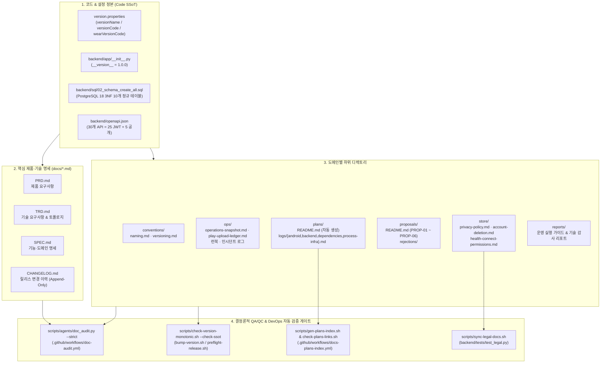

# 은둔헬스 (eundunHealth) 문서 아키텍처 및 거버넌스 맵

> **역할 기준**: 프로젝트 팀장(아키텍처·SSoT 거버넌스) · DevOps 엔지니어(CI/CD 파이프라인·운영 런북 동기화) · QA/QC 엔지니어(결정론적 드리프트 차단 게이트)  
> **최종 갱신**: 2026-11-09 (`v0.8.0` / `versionCode=45` / `wearVersionCode=10001` / `eundunhealth-api--0000070`)

이 디렉토리(`docs/`)는 **은둔헬스(eundunHealth)** 프로젝트의 모든 비코드(Non-Code) 문서를 관리합니다. 문서 간 중복과 버전 드리프트(Drift)를 원천 차단하기 위해 모든 문서는 **단일 진실 공급원(Single Source of Truth, SSoT) 계층**과 **수명주기(Lifecycle) 분류**에 따라 엄격히 관리되며, 로컬 pre-commit 훅 및 GitHub Actions CI에서 **결정론적 감사기(`scripts/agents/doc_audit.py`)**로 상시 검증됩니다.

---

## 1. 문서 계층 구조 및 토폴로지 (Documentation Architecture)



---

## 2. 디렉토리 및 파일별 역할·수명주기 매트릭스

### 2.1. 루트 핵심 명세 (`docs/*.md`)

| 문서 | 성격 | SSoT 역할 및 갱신 규칙 | 자동 검증 게이트 |
| :--- | :---: | :--- | :--- |
| [`PRD.md`](./PRD.md) | Living SSoT | 제품 비전, 타깃 사용자, 기능 요구사항, 마일스톤 및 제안서(`PROP-*`) 반영 상태 | `doc_audit.py`, `bump-version.sh` |
| [`TRD.md`](./TRD.md) | Living SSoT | 3모듈(`:app`, `:wear`, `:core:wear-contract`) + FastAPI/PG18/Azure 시스템 아키텍처 및 기술 사양 정본 (초기 v1.0 설계는 하단 `<details>` 아카이브 보존) | `doc_audit.py`, `check-version-monotonic.sh --check-ssot` |
| [`SPEC.md`](./SPEC.md) | Living SSoT | 화면·도메인·API 계약의 상세 기능 명세 | `doc_audit.py` |
| [`CHANGELOG.md`](./CHANGELOG.md) | Append-Only | 버전별 아키텍처 변화 및 릴리스 기록 단일 출처 (과거 버전 숫자 치환 절대 금지) | `doc_audit.py` |

### 2.2. 컨벤션 (`docs/conventions/`)

| 문서 | 성격 | SSoT 역할 및 갱신 규칙 | 자동 검증 게이트 |
| :--- | :---: | :--- | :--- |
| [`conventions/versioning.md`](./conventions/versioning.md) | Living SSoT | 모바일(`versionCode`), 워치(`wearVersionCode`), 백엔드(`__version__`) 독립 버전 체계 및 `bump-version.sh` 정책 | `doc_audit.py`, `check-version-monotonic.sh` |
| [`conventions/naming.md`](./conventions/naming.md) | Living SSoT | Kotlin / Python / REST / DB / Azure CAF 명명 규칙 및 문서화 컨벤션 (결정 `D1~D10`) | `/naming-audit`, `detekt`, `ruff` |

### 2.3. 운영·인프라·릴리스 (`docs/ops/`)

| 문서 | 성격 | SSoT 역할 및 갱신 규칙 | 자동 검증 게이트 |
| :--- | :---: | :--- | :--- |
| [`ops/operations-snapshot.md`](./ops/operations-snapshot.md) | **Living SSoT** | **현재 운영 상태의 단일 진실 공급원** (클라이언트 버전, Container App 활성 리비전/이미지, Key Vault 시크릿 8종, PG18 10개 테이블, Entra CIAM, AI Foundry, CI/CD, §13 변경 이력) | `doc_audit.py`, `bump-version.sh`, `check-version-monotonic.sh --check-ssot` |
| [`ops/play-upload-ledger.md`](./ops/play-upload-ledger.md) | **Living SSoT** | Google Play 프로덕션 업로드 최고 `versionCode` 원장 (`LAST_UPLOADED_VERSION_CODE=44`). `release.yml` 또는 원장 PR로만 갱신 (룰 13) | `check-version-monotonic.sh`, `update-upload-ledger.sh` |
| [`ops/incident-log.md`](./ops/incident-log.md) | Append-Only | 운영/빌드 인시던트(`INC-01` ~ `INC-34`) 근본 원인(Root Cause) 및 재발 방지 가드(`CLAUDE.md` 룰 1~17의 기원) | 수동 기록 (과거 내역 수정 금지) |
| [`ops/monitoring-and-cost.md`](./ops/monitoring-and-cost.md) | Runbook | Sentry / Azure Monitor 알림 8종, ACR 정밀 정리(`acr purge`), 월간 비용 예산 및 **§6.8 파괴적 명령 실행 직전 5문항** | `setup-azure-alerts.sh`, `setup-sentry-alerts.ps1` |
| [`ops/azure-container-apps-jobs.md`](./ops/azure-container-apps-jobs.md) | Runbook | `eundunhealth-reaper` 등 Container Apps Job(UAI + private ACR + KV + `--yaml` 배포) 프로비저닝 및 CLI 함정(`E1~E4`) 회피 런북 | `setup-reaper-job.sh` |
| [`ops/play-store-release.md`](./ops/play-store-release.md) | Runbook | 모바일(`:app`) 및 Wear OS(`:wear` `10001`) Play Console 출시 절차, 데이터 안전(Data Safety) 선언, 서명 검증 가이드 | `preflight-release.sh` |
| [`ops/dependency-deferred.md`](./ops/dependency-deferred.md) | Living Tracker | 메이저 호환성·프리릴리스 사유로 보류된 의존성 추적 (현행 남은 항목: `detekt 2.0.0` GA 대기, 룰 16 연동) | `triage-prs.sh` |
| [`ops/migration-runbook.md`](./ops/migration-runbook.md) | Historical Runbook | Ktor → FastAPI 전환 절차 및 수동 `redeploy.sh` 비상 배포 참조 | 아카이브 겸 비상 참조 |
| [`ops/predeployment-readiness.md`](./ops/predeployment-readiness.md) | Historical Baseline | `v0.3.1/36` 프로덕션 배포 하드닝(`backend-production` 승인 게이트, `verify_containerapp_deployment.py`, `backend-rollback.yml`) 도입 당시의 기준선 증적 | 상단 아카이브 배너 유지 |

### 2.4. 설계·구현 계획 및 토픽 원장 (`docs/plans/`)

> **하이브리드 수명주기 규칙 ([`plans/README.md`](./plans/README.md))**:
> 1. **작업 진행 중 (`Working`)**: `docs/plans/YYYY-MM-DD-<topic>-{design,plan}.md` 파일을 생성하여 작업합니다 (`status: proposed | approved | in-progress`).
> 2. **PR 병합 및 배포 완료 직후 (`Completed`)**: 해당 내용을 아래 4대 토픽 원장(`docs/plans/logs/*.md`)의 `## Recent (last 90 days)` 최상단에 흡수 기록하고, 루트의 완료된 페어/플랜 파일은 반드시 **`git rm`으로 제거**하여 `docs/plans/` 루트에 죽은 레거시 문서가 쌓이지 않게 합니다 (`active: 0` 유지).

| 문서 | 역할 | 자동 검증 게이트 |
| :--- | :--- | :--- |
| [`plans/README.md`](./plans/README.md) | 진행 중(Active) 계획 및 토픽 원장 인덱스 (**수동 편집 금지** — 스크립트 자동 생성) | `bash scripts/gen-plans-index.sh --check` |
| [`plans/logs/android.md`](./plans/logs/android.md) | Android(`:app`), Wear OS(`:wear`), 공유 계약(`:core:wear-contract`) 완료 설계·구현 원장 | `bash scripts/check-plans-links.sh` |
| [`plans/logs/backend.md`](./plans/logs/backend.md) | FastAPI 백엔드, PostgreSQL 18 스키마, Azure AI Foundry 완료 설계·구현 원장 | `bash scripts/check-plans-links.sh` |
| [`plans/logs/process-infra.md`](./plans/logs/process-infra.md) | CI/CD, Azure 인프라, 보안 하드닝, Android CLI, 문서 감사기 완료 원장 | `bash scripts/check-plans-links.sh` |
| [`plans/logs/dependencies.md`](./plans/logs/dependencies.md) | Gradle / Python / GitHub Actions 공급망 업데이트 배치 이력 원장 | `bash scripts/check-plans-links.sh` |
| [`plans/_templates/`](./plans/_templates/) | 신규 `design.md` / `plan.md` 작성용 표준 템플릿 (`gen-plans-index.sh` 스캔 제외) | - |

### 2.5. 제품 제안 백로그 (`docs/proposals/`)

| 문서 | 역할 | 비고 |
| :--- | :--- | :--- |
| [`proposals/README.md`](./proposals/README.md) | 차기 기능 아이디어(`PROP-01` ~ `PROP-06`) 인큐베이팅 매트릭스 및 상태 전이(`Idea → Exploring → Accepted → Promoted to Plan → Shipped / Deferred`) 관리 | 구현 완료 시 `plans/logs/*.md`로 연결 |
| [`proposals/rejections/`](./proposals/rejections/) | 아키텍처·제품 복잡도 대비 효용 검토 후 기각/보류(`Deferred/Rejected`)된 제안의 의사결정 근거(ADR) 보존 (`PROP-04` 등) | 재논의 시 시행착오 방지 |

### 2.6. 스토어 법무·정책 고지 정본 (`docs/store/`)

| 문서 | 성격 | SSoT 역할 및 동기화 파이프라인 | 자동 검증 게이트 |
| :--- | :---: | :--- | :--- |
| [`store/privacy-policy.md`](./store/privacy-policy.md) | **Legal SSoT** | 개인정보 처리방침 정본. 수정 후 `bash scripts/sync-legal-docs.sh` 실행 시 `backend/app/legal/privacy-policy.md`로 복사되어 공개 라우트 `GET /privacy`에서 HTML로 서빙됨 | `pytest backend/tests/test_legal.py` |
| [`store/account-deletion.md`](./store/account-deletion.md) | **Legal SSoT** | 계정 및 데이터 삭제(스마일 트레이닝·워치 생체 요약 단독 삭제 포함) 안내 정본. `GET /account-deletion` 공개 라우트로 서빙됨 | `pytest backend/tests/test_legal.py` |
| [`store/health-connect-permissions.md`](./store/health-connect-permissions.md) | **Policy SSoT** | Google Play Console 건강 앱 선언 및 `:app`(Health Connect `READ_EXERCISE` 단독) vs `:wear`(Wear OS 6 Health Services 온디바이스 센서) 권한 분리 명세 | `ManifestHealthConnectRationaleTest`, `WearEnvironmentSpecTest` |

### 2.7. 운영 실행 가이드 및 감사 리포트 (`docs/reports/`)

| 문서 | 역할 | 수명주기 규칙 |
| :--- | :--- | :--- |
| [`reports/2026-11-09-wear-os-user-action-items-guide.md`](./reports/2026-11-09-wear-os-user-action-items-guide.md) | Wear OS 6 상시 생체·마음 상태 런타임 배포에 따른 GitHub Actions 승인, Google Play Console 건강 앱·데이터 안전·Wear OS 전용 트랙 제출 문구(Copy-Paste 정본), Xiaomi Watch 5(`M2501W1`) 실기기 설정 런북 | 운영 기준 문서로 보존. 일회성 임시 초안(Draft)은 본 코드/원장 반영 즉시 삭제하여 레거시 적체를 방지한다. |

---

## 3. 문서 최신화 및 QA/QC 검증 표준 워크플로

코드·버전·인프라·API가 변경될 때 프로젝트 팀장 / DevOps / QA 엔지니어 관점에서 다음 4단계를 실행하여 문서 무결성을 100% 보장합니다:

```bash
# 1) 법적 고지(docs/store/*.md) 수정 시 백엔드 번들 동기화
bash scripts/sync-legal-docs.sh

# 2) docs/plans/ 페어 추가·이관(git rm) 시 인덱스 재생성 및 끊긴 링크 검사
bash scripts/gen-plans-index.sh
bash scripts/check-plans-links.sh

# 3) 앱 버전/최소 지원 버전 SSoT 5대 지점 일치 검사
bash scripts/check-version-monotonic.sh --check-ssot

# 4) 결정론적 문서 감사 린터 실행 (드리프트 0건 = exit 0 보장) 및 단위 테스트
python scripts/agents/doc_audit.py --strict
backend/.venv/Scripts/python.exe -m pytest scripts/agents/test_doc_audit.py -v
```
