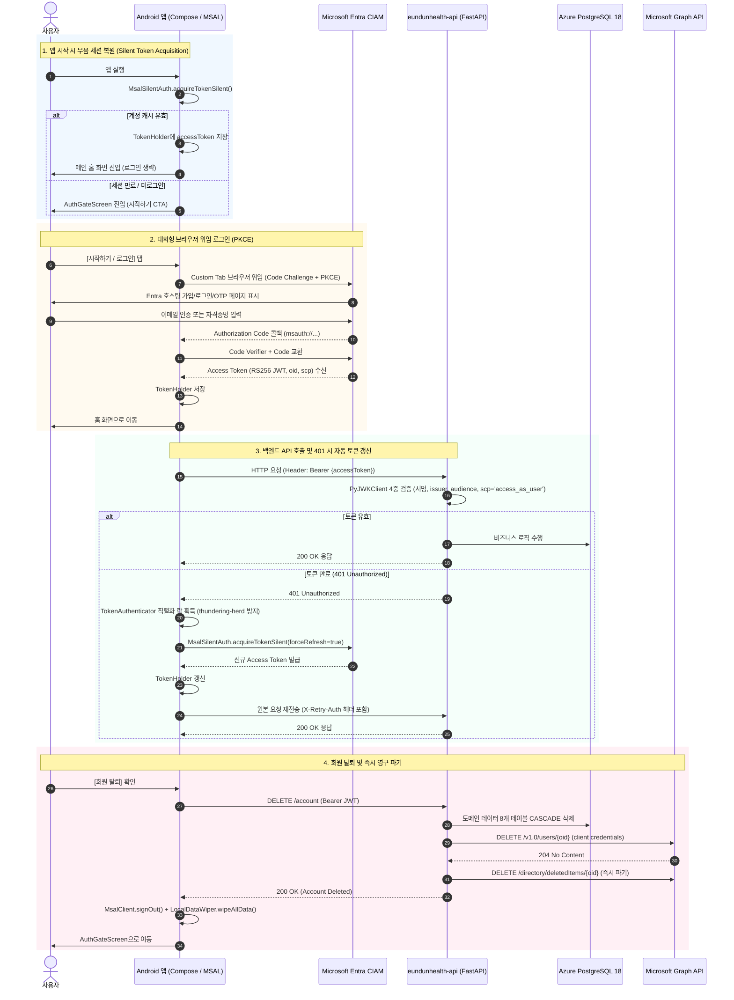
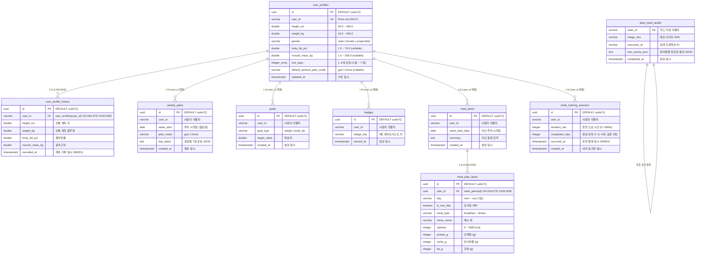

# 은둔헬스(eundunHealth) - 기술 요구사항 문서 (TRD)

> **문서 버전:** v2.1 (현행 아키텍처 정본, 2026-10-29 최신화)  
> **현재 상태:** Google Play 프로덕션 및 저장소 최신 릴리스 **v0.7.2/43 (`completed` 100%, 원장 PR #223)**, 백엔드 활성 리비전 **`eundunhealth-api--0000068` (`db8b4f8`)**  
> **패키지 명:** `com.gunnys.eundunhealth`  
> **관련 문서:** [PRD.md](./PRD.md) | [SPEC.md](./SPEC.md) | [CHANGELOG.md](./CHANGELOG.md) | [ops/operations-snapshot.md](./ops/operations-snapshot.md)

> [!IMPORTANT]
> 본 TRD는 v0.1.0 초기 설계(Ktor, Supabase Auth, Exposed, Alembic) 이후 전면 현대화된 현행 프로덕션 아키텍처(**FastAPI 0.161.0 / Python 3.14**, **Microsoft Entra External ID CIAM**, **Azure PostgreSQL 18.4 Flexible Server**, **온디바이스 스마일 트레이닝 v2**, **Azure AI Foundry gpt-5.4-mini (GlobalStandard)**, **Sentry 풀스택 분산 추적**)를 기준으로 작성된 **기술 사양 단일 진실 공급원(SSoT)**입니다.  
> 과거 v1.0 초기 설계 기록은 각 섹션 하단의 `<details>` 아카이브 블록에 안전하게 보존되어 있습니다.

---

## 0. 아키텍처 전환 및 릴리스 히스토리

### 0.1. 핵심 아키텍처 전환 요약

| 영역 | 초기 설계 (TRD v1.0) | 현행 아키텍처 (v0.7.2 & 스마일 트레이닝 v2) | 전환 사유 및 기술 이점 |
| :--- | :--- | :--- | :--- |
| **Backend 런타임** | Ktor 3.4.3 + Netty (Kotlin) | **FastAPI 0.161.0 (Python 3.14)** + uvicorn 0.54.0 | 비동기 고성능 처리, Pydantic v2 선언적 검증, AI SDK 통합 용이성 |
| **Backend API 버전** | (미정) | **`1.0.0`** (앱 버전과 분리된 독립 SSoT) | 모바일 클라이언트와 백엔드 배포 라이프사이클 디커플링 |
| **데이터베이스 엔진** | PostgreSQL 16 (추정) | **PostgreSQL 18.4 Flexible Server (`healthapp`)** | `DEFAULT uuidv7()` 네이티브 PK, `wal_compression=zstd`, B1ms 특화 튜닝 |
| **ORM & DB 드라이버** | Exposed 0.61.0 + HikariCP | **SQLAlchemy 2.0 Async + asyncpg 0.32.0** | 순수 비동기 I/O, 연결 풀 3+2 안정화, 엄격한 3NF 정규화 9개 테이블 |
| **스키마 라이프사이클** | 점진적 Alembic 마이그레이션 | **Drop & Recreate 전용 하드 리셋 파이프라인** | 레거시 마이그레이션 부채 0(Zero-Legacy), 멱등 부트스트랩(`schema_bootstrap`) |
| **인증 시스템** | Supabase Auth (ES256) | **Microsoft Entra External ID (CIAM)** | 엔터프라이즈 OIDC/PKCE 브라우저 위임, RS256 JWKS 서명 검증, `oid` SSoT |
| **회원 탈퇴 파이프라인** | Supabase Admin API | **Microsoft Graph API `DELETE /users/{oid}`** | 204 No Content 처리 및 `deletedItems` 즉시 파기 (30일 보관 완전 우회) |
| **AI 식단 생성** | 미포함 | **Azure AI Foundry `gpt-5.4-mini` (100K TPM)** | AsyncOpenAI + Strict JSON Schema(`json_schema`), 명시적 동의 헤더 및 킬 스위치 보장 |
| **온디바이스 비전 AI** | 미포함 | **CameraX 1.6.2 + ML Kit Face Detection 17.1.0** | 온디바이스 스마일 트레이닝 v2 (단일 규격 2s×3회, 영상 무저장/무전송) |
| **클라이언트 UI/디자인** | Material 3 기본 테마 | **Modern Forest & Mint (36슬롯) + Pretendard** | 13 시맨틱 토큰(`EundunExtendedColors`), UDF 12 ViewModel, DayNight 깜빡임 제거 |
| **운동 카탈로그** | RapidAPI ExerciseDB (영문) | **OSS ExerciseDB + 추천 46종 한국어 + 홈트 18종** | 한국어 번들 지문 대조, 무장비 내장 홈트 알고리즘(`HomeWeeklyPlanGenerator`) |
| **주간 계획 계약** | `/weekly-plan` (v1 단순 덮어쓰기) | **`/v2/weekly-plan` (Gym/Home 모드, RestDays)** | 계획 불변성(중복 시 409), 손상 계획 복구(DELETE 204), 다중 휴식 요일 지원 |
| **모니터링 & 트레이싱** | Sentry 단일 프로젝트 | **Sentry 프로젝트 분리 (Android ↔ Backend)** | R8 난독화 매핑 자동화, OkHttp 최외곽 분산 추적, 엔드투엔드 상관관계 ID |
| **CI/CD & 배포** | 수동 배포 스크립트 | **GitHub Actions (Entra OIDC 무암호 CD)** | Play Console 프로덕션 100% CD, Azure Key Vault 8종 시크릿 완전 연동 |

### 0.2. 주요 마일스톤 릴리스 로그

- **v0.1.0 ~ v0.1.18 (2026-05 ~ 2026-06)**: Ktor/Supabase 기반 프로토타입 개발 및 점진적 하드닝. Google Play 최초 승인 및 2026-06-29 정식 프로덕션 출시(v0.1.18/32).
- **v0.2.0 (2026-09-02)**: **인증 시스템 전면 전환**. Supabase Auth를 완전 영구 폐기하고 Microsoft Entra External ID(CIAM, MSAL 브라우저 위임, RS256 JWKS, Microsoft Graph 계정 삭제)로 전환.
- **v0.3.0 ~ v0.3.1 (2026-09 ~ 2026-10)**: **AI 맞춤 식단 및 운동 한국어 현지화**. Azure AI Foundry 연동(초기 `DeepSeek-V3.2` → v0.7.2 `gpt-5.4-mini`), 추천 운동 46종 한국어 번들(`korean_exercises.json` v2) 도입.
- **v0.4.0 (2026-10-17)**: **적응형 메뉴트리 & Health Connect 투명성**. 4대 최상위 탭(`오늘·식단·진행·프로필`, `MainAppShell`), Health Connect 1.1.0 권한 재조회 연동.
- **v0.5.0 (2026-10-26)**: **온디바이스 스마일 트레이닝 도입**. 전면 카메라 + ML Kit 미소 코칭, Room `SmileTrainingDatabase` v2 및 WorkManager 백그라운드 동기화.
- **v0.6.0 (2026-10-27)**: **적응형 주간 운동 계획 v2 & 다중 휴식 요일**. Gym/Home 모드 분기, 다중 휴식 요일(`rest_days` 1~6일), 내장 홈트 18종 무장비 카탈로그 엔진 도입.
- **v0.6.1 (2026-10-28)**: **UI/UX 전면 개선 (`PROP-05`)**. Modern Forest & Mint 36슬롯 + Pretendard Variable 가변 폰트, `TodayHeroCard`, 단계별 운동 가이드, 하이브리드 바디 피커 적용.
- **v0.7.0 / v0.7.1 (2026-10-29)**: **PostgreSQL 18 하드 리셋 & 스마일 트레이닝 v2 Zero-Legacy 컷오버 · 콜드 스타트 크래시 핫픽스**. Azure PostgreSQL 18.4 엔진 및 3NF 9개 테이블 확립, 스마일 트레이닝 단일 규격(2초×3회, 1초 자동 시작) 완전 통합, 5계층 심층 방어(룰 14)·AGP 거버넌스(룰 15) 확립.
- **v0.7.2 (2026-10-29)**: **진행·프로필 허브 비주얼 대시보드 개편 & AI 식단 `gpt-5.4-mini` (100K TPM) 전환**. `ProgressHubScreen`/`ProfileHubScreen` 시각화 대시보드 및 중복 메뉴 제거, 체성분 직접 입력 `0.1` 정밀도 보존, `ep-eundunhealth-meal-ai` (`gpt-5.4-mini`, Strict JSON Schema) 배포(`eundunhealth-api--0000068`).

---

## 1. 시스템 아키텍처

### 1.1. 전체 시스템 구성도

> **최신 아키텍처 기준 (v0.7.0 ~ v0.7.2, 2026-10-29 반영)**:
> 초기 v1.0 설계에서 **FastAPI (Python 3.14), Microsoft Entra External ID(CIAM), Azure PostgreSQL 18.4 Flexible Server, 온디바이스 스마일 트레이닝 v2(CameraX + ML Kit), Azure AI Foundry(gpt-5.4-mini GlobalStandard), Sentry 풀스택 분산 추적**으로 전면 현대화된 엔드투엔드 토폴로지입니다.

#### [Mermaid 시스템 아키텍처 다이어그램]

```mermaid
graph TB
    subgraph Client["Client Layer (Android 네이티브 앱)"]
        direction TB
        UI["Jetpack Compose UI<br/>(Material 3 / Forest & Mint / Pretendard Variable)"]
        Domain["Domain & ViewModel<br/>(Clean Architecture / UDF / SideEffect Channel)"]
        Vision["On-Device AI Engine<br/>(CameraX 1.6.2 + ML Kit Face Detection 17.1.0)<br/>스마일 트레이닝 v2 (단일 규격 2s×3회, 1.0s 자동 시작)"]
        LocalDB["Local Storage (오프라인 우선)<br/>• Room DB v3 (eundunhealth.db: 계획/프로필/목표/배지)<br/>• Room DB v2 (smile_training.db: 세션 이력)<br/>• DataStore Preferences (설정/테마/리셋 플래그)"]
        Worker["WorkManager (SmileSyncWorker)<br/>오프라인 세션 멱등 백그라운드 동기화"]
        HC["Health Connect Client (1.1.0 stable)<br/>운동 완료 자동 연동 (READ_EXERCISE 단독)"]
        MSAL["MSAL Android SDK (8.4.2 / 8.6.0)<br/>브라우저 위임 인증 (PKCE)"]
        SentryApp["Sentry Android SDK (8.61.1)<br/>크래시 / ANR / R8 역난독화 매핑 / 성능 트레이싱"]
        Catalogs["Bundled Catalogs<br/>• 추천 운동 46종 한국어 번들 (korean_exercises.json v2)<br/>• 내장 무장비 홈트 18종 (HomeWeeklyPlanGenerator v2.0)"]
    end

    subgraph External["External & Identity Services"]
        Entra["Microsoft Entra External ID (CIAM)<br/>테넌트: eundunhealthciam<br/>OIDC / RS256 JWKS 서명 검증"]
        Graph["Microsoft Graph API (v1.0)<br/>DELETE /users/{oid} (회원 탈퇴 204 No Content)<br/>+ deletedItems 즉시 영구 파기"]
        Foundry["Azure AI Foundry (MaaS Serverless)<br/>gpt-5.4-mini (Korea Central, GlobalStandard)<br/>AI 맞춤 주간 식단 자동 생성"]
        ExerciseDB["OSS ExerciseDB<br/>(oss.exercisedb.dev/api/v1/)<br/>오픈소스 운동 데이터 카탈로그"]
        SentrySaaS["Sentry Cloud Platform (gunnys 조직)<br/>Android (eundunhealth) ↔ Backend (eundunhealth-backend)<br/>엔드투엔드 분산 트레이싱 & 실시간 모니터링"]
    end

    subgraph AzureCloud["Azure Cloud Infrastructure (rg-eundunhealth-prod-krc, Korea Central)"]
        subgraph ACA["Azure Container Apps (eundunhealth-env)"]
            API["eundunhealth-api (Container App)<br/>FastAPI 0.161.0 / Python 3.14 + uvicorn<br/>• /v2/weekly-plan, /v2/smile-training, /meals<br/>• 멱등 스키마 부트스트랩 (python -m app.schema_bootstrap)<br/>• Warm Baseline: minReplicas 1 / maxReplicas 3<br/>• System Managed Identity (AcrPull, KV Secrets User)"]
            Reaper["eundunhealth-reaper (Container Apps Job)<br/>주간 cron (0 18 * * 0 UTC = 매주 월 03:00 KST)<br/>고아 계정 데이터 안전망 청소 (reap_orphaned_accounts.py)<br/>• User-assigned Managed Identity (id-eundunhealth-reaper)"]
        end

        KV["Azure Key Vault (kv-eundunhealth)<br/>시크릿 8종 중앙 집중 관리 (Azure RBAC)<br/>(database-url, entra-*, deepseek-*, sentry-dsn-backend)"]
        ACR["Azure Container Registry (eundunhealthacr)<br/>Basic SKU / 컨테이너 이미지 저장소"]
        LogAnalytics["Log Analytics Workspace (workspace-appsDOlM)<br/>Key Vault 감사(kv-audit) & ACA 콘솔/시스템 로그"]

        subgraph Database["Database Layer (Azure Flexible Server)"]
            PG["Azure Database for PostgreSQL Flexible Server (healthapp)<br/>• Engine: PostgreSQL 18.4 (B1ms, 32GB, Korea Central)<br/>• 파라미터: io_method=worker, wal_compression=zstd, pg_stat_statements<br/>• Schema: 3NF 정규화 9개 도메인 테이블 (PostgreSQL 18 uuidv7 PK)<br/>• Pipeline: Drop & Recreate 전용 하드 리셋 (Zero-Legacy)"]
        end
    end

    subgraph DevOps["CI / CD & Release Automation (GitHub Actions)"]
        GHA["GitHub Actions Workflows (Full SHA Pinned)<br/>• android.yml / release.yml (Google Play Production CD)<br/>• backend.yml (Entra OIDC 무암호 배포 & 런타임 스모크)"]
        PlayStore["Google Play Console<br/>(Production Track 100% 출시)"]
    end

    %% Client Connections
    UI --> Domain
    Domain --> Vision
    Domain --> LocalDB
    Domain --> Worker
    Domain --> HC
    Domain --> Catalogs
    Domain --> MSAL

    MSAL -->|1. 브라우저 위임 로그인 / PKCE| Entra
    Domain -->|2. HTTP REST / Bearer JWT| API
    Worker -->|3. 오프라인 세션 백그라운드 업로드| API
    Domain -.->|운동 DB 보충 조회| ExerciseDB
    SentryApp -.->|클라이언트 크래시/트레이스 전송| SentrySaaS

    %% Backend Connections
    API -->|4. 토큰 유효성 검증 (JWKS)| Entra
    API -->|5. 회원 탈퇴 시 계정 영구 삭제| Graph
    API -->|6. AI 식단 생성 프롬프트 호출| Foundry
    API -->|7. 비동기 쿼리 (SQLAlchemy 2.0 + asyncpg)| PG
    Reaper -->|고아 계정 존재 조회| Graph
    Reaper -->|잔존 고아 DB 데이터 삭제| PG
    API -.->|백엔드 에러/트레이스 전송| SentrySaaS

    %% Infra Connections
    API -->|KeyVault Secret 참조| KV
    Reaper -->|KeyVault Secret 참조| KV
    KV -.->|진단 감사 로그| LogAnalytics
    ACA -.->|콘솔/시스템 로그| LogAnalytics
    ACR -->|이미지 Pull (Managed Identity)| ACA

    %% DevOps Connections
    GHA -->|OIDC 연합 인증 & 컨테이너 무암호 배포| ACA
    GHA -->|서명 AAB 업로드 & 원장 PR 생성| PlayStore
```

#### [ASCII 시스템 아키텍처 다이어그램]

```text
┌────────────────────────────────────────────────────────────────────────────────────────┐
│                                Client Layer (Android App)                              │
│  ┌──────────────────────────────────────────────────────────────────────────────────┐  │
│  │  UI: Jetpack Compose + Material 3 (Modern Forest & Mint / Pretendard Variable)   │  │
│  │  Architecture: Hilt + Clean Architecture (UDF / SideEffect Channel)              │  │
│  │  Vision AI: CameraX 1.6.2 + ML Kit Face Detection (스마일 트레이닝 v2, 2s×3회)     │  │
│  │  Storage: Room DB v3 (eundunhealth.db) + Room DB v2 (smile_training.db)          │  │
│  │  Catalogs: 번들 ExerciseDB 46종 (korean_exercises.json v2) + 내장 홈트 18종 (v2.0)  │  │
│  └───────┬────────────┬────────────┬─────────────┬─────────────┬──────────────┬─────┘  │
└──────────┼────────────┼────────────┼─────────────┼─────────────┼──────────────┼────────┘
           │            │            │             │             │              │
    ┌──────▼──────┐     │     ┌──────▼──────┐      │      ┌──────▼──────┐       │
    │  Microsoft  │     │     │ Health      │      │      │ OSS         │       │
    │  Entra ID   │     │     │ Connect     │      │      │ ExerciseDB  │       │
    │  (CIAM)     │     │     │ (운동 연동) │      │      │ (운동 API)  │       │
    └──────┬──────┘     │     └─────────────┘      │      └─────────────┘       │
           │ (JWKS)     │                          │                            │
           │            │ (HTTP REST / Bearer JWT) │                            │
           │ ┌──────────▼──────────────────────────┴──────────────────────────┐ │
           │ │     Azure Container Apps (rg-eundunhealth-prod-krc, Korea Central)│ │
           │ │  ┌──────────────────────────────────────────────────────────┐  │ │
           │ │  │ Backend API: eundunhealth-api (FastAPI 0.161.0 / Py 3.14)│  │ │
           │ │  │ • SQLAlchemy 2.0 Async + asyncpg 0.32.0 (Pool 3+2)       │  │ │
           │ │  │ • Schema Bootstrap (python -m app.schema_bootstrap)      │  │ │
           │ │  │ • Scaling: Warm Baseline min 1 / max 3 replicas          │  │ │
           │ │  └──────┬───────────────────────┬───────────────────────────┘  │ │
           │ │         │                       │                              │ │
           │ │  ┌──────▼───────────────────────┴───────────────────────────┐  │ │
           │ │  │ Background Job: eundunhealth-reaper (주간 월 03:00 KST)  │  │ │
           │ │  │ • 계정 삭제 후 잔존 고아 데이터 자동 정리 (User MI)      │  │ │
           │ │  └──────┬───────────────────────────────────────────────────┘  │ │
           │ └─────────┼───────────────────────┬──────────────────────────────┘ │
           │           │                       │                                │
           │ ┌─────────▼────────┐     ┌────────▼────────┐                       │
           │ │ Azure Key Vault  │     │ Microsoft Graph │                       │
           │ │ (kv-eundunhealth)│     │ API (계정 탈퇴  │                       │
           │ │ 시크릿 8종 관리  │     │  204 No Content)│                       │
           │ └──────────────────┘     └─────────────────┘                       │
           │           │                                                        │
           │ ┌─────────▼────────┐     ┌─────────────────┐             ┌─────────▼────────┐
           │ │ Azure AI Foundry │     │ Log Analytics   │             │ Sentry SaaS      │
           │ │ (gpt-5.4-mini)   │     │ (workspace-     │             │ (gunnys 조직)    │
           │ │ AI 주간 식단 생성│     │  appsDOlM)      │             │ Android / 백엔드 │
           │ └──────────────────┘     └─────────────────┘             │ 풀스택 분산 추적 │
           │                                                          └──────────────────┘
           │ ┌────────────────────────────────────────────────────────┐
           └─► Azure Database for PostgreSQL Flexible Server (healthapp)│
             │ Engine: PostgreSQL 18.4 / B1ms (32GB)                  │
             │ Schema: 3NF 정규화 9개 테이블 (PostgreSQL 18 uuidv7 PK)│
             │ Pipeline: Drop & Recreate 하드 리셋 전용 (Zero-Legacy) │
             └────────────────────────────────────────────────────────┘
```

### 1.2. 데이터베이스 서버 (Azure Database for PostgreSQL 18.4)

| 항목 | 프로덕션 실측 사양 | 아키텍처 상세 및 튜닝 사유 |
| :--- | :--- | :--- |
| **서비스 / 인스턴스** | Azure Database for PostgreSQL - Flexible Server | 인스턴스명: `healthapp` |
| **엔진 버전** | **PostgreSQL 18.4** | 네이티브 `DEFAULT uuidv7()` PK, 고성능 시간순 정렬 인덱스 지원 |
| **컴퓨팅 티어** | Burstable (버스트 가능) **B1ms** (1 vCore / 2 GiB RAM / 32 GB 스토리지) | 1인 은둔 청년 사용자 특화 경제적 구성 (월 비용 최적화) |
| **리전** | **Korea Central (한국 중부)** | 클라이언트 및 컨테이너 앱과의 네트워크 레이턴시 최소화 (<10ms) |
| **드라이버 & 비동기 엔진** | **asyncpg 0.32.0** + **SQLAlchemy 2.0 Async** | 이벤트 루프 친화적 비동기 커넥션 풀링 (`postgresql+asyncpg://`) |
| **커넥션 풀 구성** | `pool_size=3`, `max_overflow=2`, `pool_timeout=10.0` | B1ms 메모리 보호 (최대 커넥션 5개 제한으로 OOM 원천 방지) |
| **풀 유효성 검증** | `pool_pre_ping=True`, `pool_recycle=1800` | 방화벽 유휴 끊김 방지, 워밍된 인스턴스의 첫 요청 500 에러 차단 |
| **명령 타임아웃** | `command_timeout=30.0` (asyncpg) | 장기 락 발생 시 요청 조기 반환으로 풀 고갈 방지 |
| **핵심 DB 파라미터** | `io_method=worker`, `wal_compression=zstd` | I/O 스레드 분리 및 WAL 로그 압축으로 B1ms 디스크 I/O 병목 완화 |
| **진단 라이브러리** | `shared_preload_libraries = pg_stat_statements` | 슬로우 쿼리 및 통계 실시간 프로파일링 |
| **스키마 설계** | **3NF 정규화 9개 도메인 테이블** | 비정규화 제거, 11개 도메인 CHECK 제약 및 `ON DELETE CASCADE` 외래키 강제 |
| **스키마 관리 파이프라인** | **Drop & Recreate 전용 하드 리셋 파이프라인** | 점진적 Alembic 폐기, 기동 시 `schema_bootstrap` 멱등 테이블 검증/생성 |

<details>
<summary>📜 [아카이브] TRD v1.0 초기 DB 설계 기록 (Exposed & HikariCP — 2026-06 전면 폐기)</summary>

| 항목 | 상세 (v1.0 초기 설계) |
| :--- | :--- |
| PostgreSQL 드라이버 | org.postgresql:postgresql 42.7.7 (JDBC) |
| 커넥션 풀 | HikariCP 6.2.1 (풀 사이즈 3) |
| 격리 수준 | TRANSACTION_REPEATABLE_READ |
| ORM | Exposed 0.61.0 (Kotlin SQL 프레임워크) |
| 마이그레이션 | SchemaUtils.createMissingTablesAndColumns() |

</details>

### 1.3. 컨테이너 및 서버리스 인프라

#### 1) 메인 API 컨테이너 앱 (`eundunhealth-api`)

| 항목 | 프로덕션 실측 사양 | 비고 |
| :--- | :--- | :--- |
| **호스팅 환경** | **Azure Container Apps** (`eundunhealth-env`) | 리소스 그룹: `rg-eundunhealth-prod-krc` (Korea Central) |
| **컨테이너 레지스트리** | **Azure Container Registry** (`eundunhealthacr.azurecr.io`) | Basic SKU / 관리 ID(System Managed Identity)로 무암호 Pull |
| **런타임 베이스 이미지** | `python:3.14-slim` (멀티스테이지 경량 빌드) | 비루트 유저 실행 (`appuser:appgroup`), 취약점 최소화 |
| **할당 리소스** | **CPU 0.25 cores / Memory 0.5 GiB** | 저전력/고효율 비동기 컨테이너 |
| **오토스케일링 규칙** | **Warm Baseline: Min 1 / Max 3 replicas** | **Cold Start 완전 제거** (최소 1개 레플리카 상시 유지), 트래픽 급증 시 3개 확장 |
| **노출 포트 및 프로토콜** | 포트 `8080` (HTTP/1.1 REST) | Ingress: External, HTTPS 종료는 ACA 인그레스가 전담 |
| **HTTP 프로브 (3종)** | • **Liveness:** `GET /health` (30s 간격, 3회 실패 시 재시작)<br/>• **Startup:** `GET /health/startup` (5s 간격, 기동 완료 확인)<br/>• **Readiness:** `GET /health/ready` (10s 간격, DB 통신 확인) | 장애 발생 레플리카의 즉시 격리 및 트래픽 유입 방지 |
| **보안 자격증명 관리** | **Azure Key Vault (`kv-eundunhealth`) 참조 연동** | 컨테이너 환경변수에 평문 저장 금지, Key Vault Secrets User 역할 기반 자동 주입 |

#### 2) 백그라운드 관리 잡 (`eundunhealth-reaper`)

| 항목 | 사양 및 운영 규칙 |
| :--- | :--- |
| **잡 유형** | **Azure Container Apps Job** (Cron Trigger) |
| **실행 스케줄** | **매주 일요일 18:00 UTC (한국 시각 매주 월요일 03:00 KST)** (`0 18 * * 0`) |
| **실행 스크립트** | `backend/scripts/reap_orphaned_accounts.py` |
| **역할 및 책임** | 회원 탈퇴 시 네트워크 일시 오류 등으로 DB에 잔존할 수 있는 고아 사용자 데이터를 Graph API 대조 후 영구 삭제 |
| **인증 자격증명** | **User-assigned Managed Identity** (`id-eundunhealth-reaper`) |

## 2. 기술 스택 상세

### 2.1. 개발 환경

| 항목 | 프로덕션 실측 사양 | 비고 및 활용 가이드 |
| :--- | :--- | :--- |
| **개발 호스트 OS** | **Windows 11 Pro + WSL2 Ubuntu 하이브리드** | Windows(`pwsh`) 네이티브 빌드 + WSL2 Ubuntu(`wsl -d Ubuntu`) CI/CD 패리티 검증 |
| **모바일 IDE** | **Android Studio** | Kotlin 2.4.21, Jetpack Compose 최적화 |
| **백엔드 IDE / 툴체인** | **Python 3.14 (venv) + uv / pip-compile** | 해시 락(`requirements.txt`, `--require-hashes`) 엄격 검증 |
| **테스트 디바이스** | **Samsung Galaxy Phone (Android 14 / One UI 6.1)** | Health Connect 및 실제 카메라 센서 실기기 검증 |
| **빌드 자동화 도구** | **Gradle 9.8.2** (Android) / **pip-compile** (Backend) | Gradle Hash Verification (`gradle/verification-metadata.xml`) |
| **Android 빌드 플러그인** | **AGP 9.4.1** | Kotlin 내장 툴체인, `detekt-cli` + `androidComponents` 통합 |
| **코드 정적 분석 & 포맷터** | **Detekt 1.23.8 + Spotless 8.10.4 + ktlint 1.5.0** | 빌드 파이프라인 무결성 게이트 강제 |
| **모니터링 / 에러 추적** | **Sentry** (Android `8.61.1` / Backend `2.73.0`) | R8 ProGuard 매핑 자동 업로드 및 풀스택 분산 추적 |
| **형상 관리 & CI/CD** | **Git + GitHub Actions** | Entra OIDC 무암호 Azure 배포 및 Google Play 내부/프로덕션 트랙 자동 릴리스 |

### 2.2. 클라이언트 개발 언어 및 프레임워크

| 구분 | 프레임워크 / 라이브러리 | 버전 | 기술 상세 및 채택 사유 |
| :--- | :--- | :--- | :--- |
| **프로그래밍 언어** | **Kotlin** | **2.4.21** | 최신 컴파일러 최적화, 엄격한 널 안정성 및 코루틴 1.10.2 지원 |
| **Java 호환 바이트코드** | **JVM Target** | **17 (Temurin 17)** | Android 8.0(Min SDK 26) ~ Android 17(Target SDK 37) 지원 |
| **UI 툴킷** | **Jetpack Compose (BOM)** | **2026.09.00** | 선언적 UI 프레임워크, 불변 상태 기반 고성능 리컴포지션 |
| **디자인 시스템** | **Material 3 (M3)** | **Compose BOM 내장** | **Modern Forest & Mint** 테마 (36개 정규 컬러 슬롯) |
| **시맨틱 토큰 확장** | **`EundunExtendedColors`** | **독자 확장 (13토큰)** | 심박/칼로리/미소코칭 등 도메인 특화 색상 토큰 체계 |
| **가변 폰트 시스템** | **Pretendard Variable** | **15개 폰트 슬롯** | 시스템 가변 두께(100~900) 지원 가변 서체 적용 |
| **콜드 스타트 가드** | **DayNight Theme** | **Android 내장** | 스플래시 및 콜드 스타트 시 흰색 화면 번쩍임(White Flash) 완전 제거 |
| **비전 AI & 카메라** | **CameraX + ML Kit** | **1.6.2 / 17.1.0** | 온디바이스 스마일 트레이닝 v2 (단일 규격 2s×3회, 1s 자동 시작) |
| **로컬 데이터베이스** | **Room Database** | **2.8.5** | `eundunhealth.db` (v3) + `smile_training.db` (v2), KSP 2.3.12 컴파일 |
| **비동기 백그라운드 잡** | **WorkManager** | **2.12.0** | `SmileSyncWorker` (오프라인 완료 세션 지수 백오프 멱등 동기화) |
| **설정 저장소** | **DataStore Preferences** | **1.3.0** | 테마 설정(SYSTEM/DARK/LIGHT), v2 리셋 감사 플래그 보관 |
| **네트워크 통신** | **OkHttp + Retrofit** | **5.5.0 / 3.0.0** | 최외곽 Sentry 인터셉터, 지수 백오프 재시도, TokenAuthenticator 갱신 |
| **인증 클라이언트** | **MSAL Android** | **8.6.0** | Entra External ID OIDC/PKCE 위임, Custom Tabs 브라우저 팝업 지원 |
| **건강 데이터 연동** | **Health Connect Client** | **1.1.0 stable** | `READ_EXERCISE` 단독 권한, 운동 세션 감지 및 완료 자동 마킹 |
| **차트 & 시각화** | **Vico** | **3.3.1 (compose-m3)** | 체중/골격근량/체지방 추세 라인 차트 및 주간 달성 바 차트 |
| **이미지/애니메이션** | **Coil** | **3.4.0** | 메모리/디스크 2단계 캐싱, 운동 상세 가이드 GIF 디코더 내장 |

### 2.3. 인증 시스템 (현행: Microsoft Entra External ID CIAM)

> **정본 출처**: `CLAUDE.md` · [`docs/ops/operations-snapshot.md`](./ops/operations-snapshot.md) §5-A · [`docs/plans/logs/process-infra.md`](./plans/logs/process-infra.md) 2026-09-02 entry.  
> 2026-09부로 초기 Supabase Auth에서 **Microsoft Entra External ID(CIAM)**로 전면 전환되었습니다. 브라우저 위임(PKCE) 방식을 채택하여 계정 가입, 이메일 인증, 비밀번호 재설정 등 인증의 전 과정을 Entra 보안 호스팅 페이지로 일원화하고 앱에는 단일 진입 CTA 화면(`AuthGateScreen`)만 유지합니다.

#### 1) 인증 시스템 사양 (Current Specification)

| 항목 | 상세 사양 |
| :--- | :--- |
| **인증 서비스** | **Microsoft Entra External ID (CIAM)** 외부 테넌트 `eundunhealthciam` |
| **테넌트 위치** | `Asia Pacific` / `KR` (테넌트 ID: `c7ebcc7f-fc6b-4674-a3d5-8fbc419561a8`) |
| **인증 방식** | **브라우저 위임 (Browser Delegated)** — OAuth 2.0 Authorization Code Flow + PKCE (RFC 7636) |
| **클라이언트 SDK** | **MSAL Android 8.4.2** (`com.microsoft.identity.client:msal`) |
| **클라이언트 설정** | `app/src/{debug,release}/res/raw/auth_config_ciam.json` (Custom Tabs 브라우저 위임) |
| **리다이렉트 URI** | `msauth://com.gunnys.eundunhealth/<SHA-1-base64>` (debug / release upload / Play App Signing 등록) |
| **JWT 서명 알고리즘** | **RS256 (비대칭 공개키 서명)** |
| **OIDC Discovery** | `https://eundunhealthciam.ciamlogin.com/eundunhealthciam.onmicrosoft.com/v2.0/.well-known/openid-configuration` |
| **Issuer (발급자)** | `https://c7ebcc7f-fc6b-4674-a3d5-8fbc419561a8.ciamlogin.com/c7ebcc7f-fc6b-4674-a3d5-8fbc419561a8/v2.0` (tenantId 서브도메인) |
| **JWKS 엔드포인트** | `https://eundunhealthciam.ciamlogin.com/c7ebcc7f-fc6b-4674-a3d5-8fbc419561a8/discovery/v2.0/keys` (Discovery 로드 필수) |
| **백엔드 검증기** | Python `PyJWT 2.15.1` + `PyJWKClient` (`cache_keys=True`, 24시간 TTL, 5초 타임아웃, `asyncio.to_thread` 오프로드) |
| **필수 검증 클레임** | 서명 유효성 + `exp` + `issuer` + `audience`(`entra_backend_client_id`) + **`scp`(`access_as_user`)** |
| **사용자 식별자 SSoT** | **`oid` (Object ID)** claim (`sub`는 앱별 pairwise 해시라 Graph 탈퇴 시 불일치하므로 배제) |
| **세션 보관 / 갱신** | 메모리 `TokenHolder` (`AtomicReference<String?>`) + MSAL 계정 캐시 + `MsalSilentAuth` + `TokenAuthenticator` |
| **회원 탈퇴 (삭제)** | 앱 `DELETE /account` → 백엔드 DB 사용자 데이터 영구 삭제 → **Microsoft Graph API `DELETE /v1.0/users/{oid}` (204)** + `deletedItems` 즉시 영구 파기 |
| **고아 계정 청소** | Azure Container Apps Job `eundunhealth-reaper` (주간 cron `0 18 * * 0`, User Managed Identity) |

#### 2) 엔드투엔드 인증 플로우 다이어그램 (Mermaid)



#### 3) 텍스트 인증 상태머신 다이어그램 (ASCII)

```text
[앱 기동]
    │
    ▼
[MsalSilentAuth.acquireTokenSilent]
    │
    ├─► [성공] ──► TokenHolder.set(accessToken) ──► [홈 화면 즉시 진입]
    │
    └─► [실패] ──► [AuthGateScreen (단일 진입점)]
                       │
                       ▼ 사용자 "시작하기" 탭
                   [MSAL Browser Delegated Login (PKCE)]
                       │
                       ▼ Entra 호스팅 보안 웹페이지 (가입 / 로그인 / 비밀번호 재설정)
                   [토큰 수신: RS256 JWT (oid, scp=access_as_user)]
                       │
                       ▼
                   [TokenHolder 저장] ──► [홈 화면 진입]
                       │
                       ▼ Backend API 호출 (Bearer {token})
                   [FastAPI 4중 검증: 서명(JWKS) + issuer + audience + scp]
                       │
                       ├─► [200 OK] 정상 처리
                       │
                       └─► [401 Unauthorized]
                             │
                             ▼ OkHttp TokenAuthenticator (직렬화 락)
                           [MsalSilentAuth.acquireTokenSilent(forceRefresh=true)]
                             │
                             ├─► [성공] ──► TokenHolder 갱신 ──► [새 토큰으로 재시도]
                             │
                             └─► [세션 소멸] ──► TokenHolder.set(null) ──► [AuthGateScreen 안내]
```

#### 4) 백엔드 4단계 토큰 검증 파이프라인 (`app/dependencies.py`)

1. **OIDC Discovery & JWKS 캐싱**:
   - `subdomain`(`eundunhealthciam`)을 통해 OIDC discovery 문서를 최초 1회 로드하여 `issuer`와 `jwks_uri`를 메모리에 안전하게 캐시합니다.
   - `PyJWKClient`는 24시간 TTL로 공개키를 로컬 캐싱하며, 비동기 이벤트 루프 블로킹을 방지하기 위해 `asyncio.to_thread`로 워커 스레드에서 서명키를 파싱합니다.
2. **서명 및 만료 검증**:
   - 비대칭 암호화 공개키(`RS256`)로 토큰 서명과 유효기간(`exp`)을 엄격히 검증합니다.
3. **발급자(`issuer`) 및 대상(`audience`) 검증**:
   - `issuer == https://<tenantId>.ciamlogin.com/<tenantId>/v2.0` 및 `audience == entra_backend_client_id` 불변식을 단언합니다.
4. **위임 권한 스코프(`scp`) 및 식별자(`oid`) 추출**:
   - `payload.get("scp")` 내에 `access_as_user`가 반드시 포함되어 있는지 검증하여 서버 간 App-Only 토큰의 비인가 접근을 원천 차단합니다.
   - 사용자 식별자는 앱마다 달라지는 pairwise 값인 `sub`를 배제하고, Microsoft Graph 사용자 관리와 1:1로 일치하는 **`oid` (Object ID)**를 단일 진실 공급원(SSoT)으로 추출하여 도메인 비즈니스 로직에 주입합니다.

<details>
<summary>📜 [아카이브] TRD v1.0 초기 설계 기록 (Supabase Auth — 2026-09 완전 폐기됨)</summary>

> 본 섹션은 문서 제정 시점(2026-05)의 초기 설계 기록 보존용입니다. 실제 운영 환경에서는 Supabase 프로젝트 및 관련 코드가 2026-09-02에 전량 영구 삭제되었습니다.

| 항목 | 상세 (v1.0 초기 설계) |
|------|------|
| 인증 서비스 | Supabase Authentication (SDK 3.6.0 `auth-kt`) |
| 인증 방식 | 앱 내 네이티브 이메일/비밀번호 입력 폼 |
| JWT 알고리즘 | ES256 (ECDSA) |
| 토큰 검증 | Supabase JWKS 엔드포인트 대조 (Java-JWT 4.5.0) |
| 세션 복원 | Supabase Storage SDK 내장 복원 |
| 계정 삭제 | Supabase Admin API (200 OK) |

</details>

### 2.4. 건강 데이터 API

#### Health Connect (현재 사용)

| 항목 | 상세 |
|------|------|
| 라이브러리 | `androidx.health.connect:connect-client` |
| 버전 | 1.1.0 |
| 권한 | `READ_EXERCISE` (읽기 전용) |
| 데이터 유형 | `ExerciseSessionRecord` |
| 기능 | 운동 세션 자동 감지 → 해당 날짜 완료 처리 |
| 시간대 | 시스템 기본 타임존 (KST) |
| SDK 가용성 체크 | `HealthConnectClient.getSdkStatus()` |
| DI | `@Inject` + `@ApplicationContext` |

**Health Connect 통합 흐름:**

```
HealthConnectDataSource
    │
    ├─ isAvailable() → SDK 설치 여부 확인
    ├─ hasPermissions() → READ_EXERCISE 권한 확인
    └─ getExerciseDatesThisWeek(weekStart)
         │
         ▼
       ExerciseSessionRecord 쿼리 (7일 범위)
         │
         ▼
       운동 날짜 목록 반환 → SyncHealthDataUseCase
         │
         ▼
       PATCH /v2/weekly-plan/complete (서버 동기화)
```

#### Samsung Health Data SDK (도입하지 않음 — Health Connect 경로 유지)

Samsung Health Data SDK는 **도입하지 않는다**. 갤럭시 워치/삼성헬스 데이터는 `워치/폰 → 삼성헬스 앱 → Health Connect` 경로로 이미 수신되며(앱이 `ExerciseSessionRecord` 등을 HC에서 read), Health Connect가 벤더 중립 표준 브릿지 역할을 한다. SDK 직접 연동은 **프로덕션 배포 시 Samsung 파트너 승인 필수 + Samsung 기기 한정 + 벤더 종속**이라 비용·리드타임 대비 이득이 낮다.

| 항목 | 상세 |
|------|------|
| 도입 여부 | 도입 안 함 (decided against) |
| 데이터 경로 | 삼성헬스 → Health Connect 동기화 → 앱이 HC에서 read |
| 미수신 데이터 | 골격근량(HC에 레코드 타입 없음) → 수동 입력 유지. 실시간 심박/상세 센서가 추후 필수가 되면 그때 한해 재검토 |

### 2.5. 외부 API

| API | 용도 | 프로토콜 | 인증 |
|-----|------|---------|------|
| OSS ExerciseDB | 추천 운동 데이터 조회 (카탈로그 46종 한국어 번들 + API 조회) | HTTPS REST | 인증 불필요 (`oss.exercisedb.dev/api/v1/`) |
| Microsoft Entra External ID | 브라우저 위임 회원가입, 로그인, 토큰 발급/갱신 (OIDC/PKCE) | HTTPS REST (브라우저 위임) | OAuth 2.0 PKCE / RS256 JWKS |
| Microsoft Graph API | 계정 영구 삭제 (`DELETE /v1.0/users/{oid}`) 및 영구 파기 | HTTPS REST | Client Credentials (백엔드 시크릿) |
| Azure AI Foundry | AI 맞춤 주간 식단 자동 생성 (`gpt-5.4-mini` `GlobalStandard` 100K TPM) | HTTPS REST (OpenAI SDK) | Key Vault 관리 API Key (`deepseek-*`) |
| eundunHealth Backend | 프로필, 주간 계획 v2, 스마일 트레이닝 v2, 배지, 식단 CRUD | HTTPS REST | Bearer JWT (RS256 `oid`, `access_as_user`) |

### 2.6. 네트워크 계층

| 구분 | 기술 / 라이브러리 | 버전 | 설정 및 비고 |
| :--- | :--- | :--- | :--- |
| **HTTP 클라이언트 (앱)** | **OkHttp** | **5.5.1** | 최외곽 Sentry 트레이싱, 지수 백오프, 직렬화 토큰 갱신 |
| **REST 클라이언트 (앱)** | **Retrofit** | **3.0.0** | 비동기 코루틴 Suspended 인터페이스 |
| **JSON 직렬화 (앱)** | **Gson (Retrofit Converter)** | **2.11.0** | R8 난독화 방지 DTO `@SerializedName` 및 keep 룰 적용 |
| **HTTP 서버 (백엔드)** | **FastAPI + uvicorn** | **0.161.0 / 0.54.0** | 비동기 ASGI 서버, Python 3.14 런타임 |
| **인증 클라이언트 (앱)** | **MSAL Android** | **8.6.0** | Entra CIAM 브라우저 위임 (PKCE) |

#### [OkHttp 인터셉터 체인 (Client Layer)]

```text
클라이언트 요청
   │
   ▼
[SentryOkHttpInterceptor (최외곽)] ──► 네트워크 트랜잭션 성능 및 에러 브레드크럼 계측
   │
   ▼
[RetryInterceptor] ──────────────────► GET/HEAD 멱등 요청 대상 지수 백오프 (최대 3회: 500ms → 1s → 2s)
   │
   ▼
[Authorization Interceptor] ─────────► TokenHolder에서 Bearer {accessToken} 자동 삽입
   │
   ▼
[TokenAuthenticator (401 감지 시)] ──► 직렬화 락 획득 후 MsalSilentAuth.acquireTokenSilent 세션 갱신
   │
   ▼
[HttpLoggingInterceptor] ────────────► Debug: BODY 레벨 / Release: NONE (민감 건강 정보 보호)
   │
   ▼
네트워크 전송 (HTTPS REST)
```

| 인터셉터 | 상세 설정 및 동작 정책 |
| :--- | :--- |
| **SentryOkHttpInterceptor** | API 호출 성능 트레이싱 (체인 최외곽 배치, `captureFailedRequests=false`로 재시도 중복 오탐 방지) |
| **RetryInterceptor** | 최대 3회 재시도, exponential backoff (500ms → 1s → 2s, 멱등한 `GET`/`HEAD` 요청 한정) |
| **Authorization** | `TokenHolder`를 통해 `Bearer {accessToken}` 자동 첨부 (미로그인 상태 요청 시 헤더 생략) |
| **TokenAuthenticator** | 401 Unauthorized 수신 시 직렬화 락(`thundering-herd` 방지) 기반 `acquireTokenSilent` 수행 후 갱신 토큰으로 재전송 |
| **HttpLoggingInterceptor** | Debug: BODY 레벨 로깅 / Release: 완전 비활성화 (로그캣 개인정보 노출 방지) |
| **타임아웃 정책** | 일반 API: 연결 15초 / 읽기 15초 / 쓰기 15초<br/>식단 생성 전용 API (`/meals/generate`): 읽기 130초 (AI LLM 추론 지연 버퍼) |

---

## 3. 앱 아키텍처

### 3.1. Clean Architecture & UDF 구조

```text
┌────────────────────────────────────────────────────────────────────────┐
│                               UI Layer                                 │
│  • Jetpack Compose Screens (Material 3 Modern Forest & Mint)           │
│  • 12 ViewModel (UDF: 단일 _uiState, @Immutable State, SideEffect Ch)  │
│  • Navigation (MainAppShell 4대 허브: 오늘·식단·진행·프로필)           │
├────────────────────────────────────────────────────────────────────────┤
│                             Domain Layer                               │
│  • Domain Models (WeeklyPlan, DayPlan, Exercise, Badge, UserProfile)   │
│  • Repository Interfaces (순수 코틀린 계약)                            │
│  • Use Cases (LoadCurrentWeekPlan, CreateWeeklyPlan, SyncHealth 등)    │
│  • Business Engines:                                                   │
│    - HomeWeeklyPlanGenerator (내장 무장비 18종 대근육 큐 라운드로빈)   │
│    - SmileSignalEvaluator (온디바이스 미소 유지 판단 규칙)             │
├────────────────────────────────────────────────────────────────────────┤
│                              Data Layer                                │
│  • Repository Implementations (Workout, Meal, Smile, User 등)          │
│  • Remote Data Sources: Retrofit APIs, MSAL Auth Client                │
│  • Local Storage:                                                      │
│    - Room Database v3 (eundunhealth.db: 계획/프로필/목표/배지)         │
│    - Room Database v2 (smile_training.db: 스마일 트레이닝 세션 이력)   │
│    - DataStore Preferences (theme_preferences.pb: 테마 및 플래그)      │
│  • Hardware & Sensors: Health Connect Client, CameraX Vision Engine    │
│  • Background Sync: WorkManager (SmileSyncWorker 멱등 동기화)          │
├────────────────────────────────────────────────────────────────────────┤
│                               DI Layer                                 │
│  • Hilt Modules (NetworkModule, DatabaseModule, RepositoryModule 등)   │
└────────────────────────────────────────────────────────────────────────┘
```

### 3.2. 의존성 주입 컴포넌트 (Hilt)

| Hilt 모듈 | 제공 컴포넌트 및 바인딩 |
| :--- | :--- |
| **`NetworkModule`** | OkHttpClient, Retrofit, `EundunApi`, `MealApi`, `ExerciseDbApi`, `TokenHolder` |
| **`DatabaseModule`** | `EundunDatabase` (v3), `SmileTrainingDatabase` (v2), DAO 5종 (`WeeklyPlanDao`, `ProfileDao` 등) |
| **`RepositoryModule`** | `AuthRepository`, `WorkoutRepository`, `MealPlanRepository`, `SmileTrainingRepository`, `UserRepository` |
| **`CoroutineModule`** | `@IoDispatcher`, `@DefaultDispatcher`, `@MainDispatcher` CoroutineContext 주입 |

### 3.3. 단방향 데이터 흐름 (UDF) & 동기화 패턴

1. **단일 상태 공급원 (SSoT)**:
   - 각 ViewModel은 `@Immutable`로 선언된 단일 `UiState` 데이터 클래스를 `StateFlow`로 노출하며, UI는 `collectAsStateWithLifecycle()`을 통해 수명주기에 안전하게 상태를 구독합니다.
2. **일회성 부수효과 (Side Effect)**:
   - 화면 전환, 에러 배너 표시, 스낵바 등 1회성 이벤트는 `Channel<SideEffect>(Channel.BUFFERED)`와 Flow를 통해 전달되어 화면 회전 시 중복 실행을 방지합니다.
3. **낙관적 업데이트 (Optimistic Update)**:
   - 운동 완료 체크박스 탭 시 UI 및 로컬 Room DB에 즉시 반영한 후 서버 `PATCH /v2/weekly-plan/complete`를 호출합니다. 네트워크 실패 시 이전 상태로 자동 롤백합니다.
4. **오프라인 우선 (Offline-First)**:
   - 모든 사용자 데이터는 Room DB에 1차 캐싱되며, 네트워크가 단절된 상태에서도 기존 주간 계획 및 스마일 트레이닝 기능을 정상 이용할 수 있습니다.

### 3.4. 로컬 데이터 저장 체계

| 저장소 | 구현 기술 | 저장 데이터 및 생명주기 관리 |
| :--- | :--- | :--- |
| **Room Database v3** | Room 2.8.5 (`eundunhealth.db`) | 주간 운동 계획(`weekly_plans`), 신체 계측 이력(`user_profile_history`), 목표치(`goals`), 획득 배지(`badges`) |
| **Room Database v2** | Room 2.8.5 (`smile_training.db`) | 온디바이스 스마일 트레이닝 세션 이력 (v2 단일 규격 2s×3회 요약 데이터) |
| **DataStore** | DataStore Preferences 1.3.0 | 앱 테마 설정(`SYSTEM`, `LIGHT`, `DARK`), 스마일 트레이닝 v2 리셋 감사 플래그, 숏컷 닫힘 상태 |
| **MSAL Secure Cache** | MSAL Android 암호화 스토리지 | OAuth 2.0 PKCE Access Token, Refresh Token 및 테넌트 계정 캐시 |

### 3.5. 이미지 로딩 파이프라인 (Coil 3.4.0)

- **비동기 이미지 로딩**: `SubcomposeAsyncImage` 기반으로 로딩 중 Shimmer 스켈레톤, 로드 실패 시 직관적 에러 UI 표시.
- **GIF 애니메이션 가이드 지원**: `coil-gif` 디코더를 통합하여 추천 운동 상세 화면(`WorkoutDetailScreen`)에서 운동 동작 GIF를 메모리 누수 없이 렌더링.
- **다단계 캐시 정책**: 고해상도 운동 썸네일 및 GIF를 메모리 캐시 및 디스크 캐시(최대 50MB)로 계층화하여 오프라인 재생 지원.

### 3.6. 온디바이스 비전 AI 엔진 (스마일 트레이닝 v2)

> **핵심 원칙: 온디바이스 무저장 · 무전송 프라이버시 절대 보장**

```text
전면 카메라 (CameraX 1.6.2)
   │ [이미지 프레임 스트림 (메모리에서 즉시 분석 후 파기)]
   ▼
ML Kit Face Detection (17.1.0)
   │ 랜드마크 분석: smilingProbability (미소 확률: 0.0 ~ 1.0)
   ▼
SmileSignalEvaluator (Domain)
   │ 미소 감지 기준: smilingProbability >= 0.70 (연속 프레임 판정)
   ▼
스마일 트레이닝 상태머신 (단일 표준 규격 SmileTrainingSpec)
   ├─ 1. READY (준비): 얼굴 정렬 가이드 내 1.0초 안정 유지 시 자동 시작
   ├─ 2. HOLDING (미소 유지): 2.0초 동안 미소 유지 카운트다운
   ├─ 3. REST (휴식): 랩 간 1.5초 휴식
   └─ 4. REPEAT: 총 3회(Reps) 반복 완료 시 자동 세션 종료
   │
   ▼
Room Database v2 (smile_training.db)에 세션 요약 데이터(소요시간, 완료 횟수) 저장
   │
   ▼
WorkManager (SmileSyncWorker) 백그라운드 멱등 동기화 (POST /v2/smile-training/sessions)
```

- **표준화된 단일 스펙**: 초급/중급/고급의 파편화된 난이도를 폐기하고, 뇌신경 자극 및 심리적 안정에 가장 효과적인 **2.0초 미소 유지 × 3회 반복**의 단일 표준 규격으로 일원화.
- **자동 시작 UX**: 사용자가 화면을 터치할 필요 없이 전면 카메라 얼굴 인식 영역에 얼굴이 1.0초간 감지되면 자동으로 세션이 시작됩니다.
- **세션 종료 후 심리 설문 제거**: 훈련 완료 직후 피로감을 유발하던 번거로운 감정 설문을 전면 제거하고 세션 통계로 즉시 이동합니다.

---

## 4. 백엔드 아키텍처

### 4.1. 서버 구성 및 런타임 환경

| 항목 | 프로덕션 사양 | 기술적 특징 및 장점 |
| :--- | :--- | :--- |
| **웹 프레임워크** | **FastAPI 0.161.0** (ASGI) | 비동기 논블로킹 I/O, OpenAPI (Swagger) 자동 생성, 높은 처리량 |
| **ASGI 서버** | **uvicorn 0.54.0** | 표준 uvloop 및 httptools 기반 고성능 웹 서버 |
| **언어 및 런타임** | **Python 3.14** | GIL 최적화 및 최신 비동기 구문 지원 |
| **데이터 검증** | **Pydantic v2 (CamelSchema)** | Rust 코어 기반 고속 데이터 검증, 모바일 camelCase ↔ 백엔드 snake_case 자동 양방향 매핑 |
| **ORM / DB 계층** | **SQLAlchemy 2.0 Async + asyncpg 0.32.0** | 순수 비동기 SQL 세션, 커넥션 풀 3+2 제한으로 B1ms 메모리 완벽 보호 |
| **테스트 프레임워크** | **pytest 9.1.1 + pytest-asyncio** | 143+ 테스트 통과, 코드 커버리지 94%+ (PEP 669 sysmon 코어 고정) |
| **코드 품질 도구** | **Ruff 0.9.x + mypy (strict)** | 초고속 린트 및 엄격한 정적 타입 검증 |

### 4.2. 서버 라이프사이클 및 기동 시퀀스 (`app/main.py`)

FastAPI의 현대적인 `@asynccontextmanager def lifespan(app: FastAPI)` 라이프사이클 훅을 통해 리소스를 결정론적으로 초기화하고 정리합니다.

```text
FastAPI Lifespan Startup
   │
   ├─ 1. 비동기 DB 엔진 생성 (create_async_engine)
   │     • build_engine_kwargs(): pool_size=3, max_overflow=2, pool_recycle=1800s
   │     • pool_pre_ping=True (Azure 유휴 커넥션 단절 방지)
   │     • async_sessionmaker를 app.state.session_factory에 등록
   │
   ├─ 2. Sentry 모니터링 SDK 초기화
   │     • DSN 존재 시: traces_sample_rate (prod 0.2 / dev 1.0)
   │
   ├─ 3. 멱등 스키마 부트스트랩 (python -m app.schema_bootstrap)
   │     • 9개 핵심 도메인 테이블의 실재 여부 검증
   │     • 누락된 테이블/인덱스 발견 시 02_schema_create_all.sql DDL 자동 실행
   │
   └─ 4. Microsoft Entra External ID OIDC Discovery 사전 워밍
         • OpenID Discovery 문서 로드 및 RS256 JWKS 서명키 비동기 캐싱
   │
   ▼ [서버 정상 기동 완료: HTTP 요청 처리]
   │
FastAPI Lifespan Shutdown
   │
   └─ 5. await engine.dispose() (데이터베이스 연결 풀 안전 반환 및 리소스 해제)
```

### 4.3. 현행 API 엔드포인트 명세 (10개 도메인 27개 라우트)

> **API 버전:** `1.0.0` (SSoT: `backend/app/__init__.py:__version__`)  
> 모든 비공개 API는 `Authorization: Bearer {accessToken}` (RS256 JWT, 필수 claim: `oid`, `scp="access_as_user"`) 인증을 필수로 요구합니다.

| 도메인 | Method | Path | 인증 | 설명 및 검증 규칙 |
| :--- | :--- | :--- | :---: | :--- |
| **Health** | `GET` | `/health` | X | 컨테이너 Liveness 프로브 (기본 생존 확인) |
| | `GET` | `/health/startup` | X | 컨테이너 Startup 프로브 (부트스트랩 완료 확인) |
| | `GET` | `/health/ready` | X | 컨테이너 Readiness 프로브 (`SELECT 1` DB 연결 확인, 실패 시 503) |
| **Compatibility** | `GET` | `/app-compatibility` | X | 클라이언트 버전 호환성 검증 (`minVersionCode=39`) |
| **Profile** | `GET` | `/profile` | **O** | 사용자 신체 프로필 조회 |
| | `PUT` | `/profile` | **O** | 프로필 생성/수정 (키: 50~300cm, 몸무게: 10~500kg, 체지방: 1~70%, 근육량: 1~200kg) |
| | `GET` | `/profile/history` | **O** | 신체 계측 변경 이력 페이지네이션 조회 (`user_profile_history`) |
| | `PUT` | `/v2/profile/default-workout-plan-mode` | **O** | 기본 운동 환경(`gym`/`home`) 설정 (신체 계측 히스토리 미생성) |
| **Weekly Plan v2** | `GET` | `/v2/weekly-plan` | **O** | 특정 주차 운동 계획 조회 (`weekStart` 쿼리 파라미터) |
| | `POST` | `/v2/weekly-plan` | **O** | 주간 운동 계획 생성 (동일 주 중복 생성 시 `409 Conflict: weekly_plan_exists`) |
| | `DELETE` | `/v2/weekly-plan` | **O** | 손상된 계획 명시적 삭제 (`204 No Content`, 복구 지원) |
| | `PATCH` | `/v2/weekly-plan/complete` | **O** | 일별 운동 완료 토글 (`date`, `completed`, `manual`) |
| | `GET` | `/v2/weekly-plan/history` | **O** | 이전 주차 운동 계획 히스토리 페이지네이션 조회 |
| **AI Meals** | `POST` | `/meals/generate` | **O** | Azure AI Foundry `gpt-5.4-mini` 맞춤 주간 식단 생성 (`X-AI-Data-Processing-Consent: true` 필수) |
| | `GET` | `/meals/current` | **O** | 현재 적용 중인 주간 식단 35개 슬롯 상세 조회 |
| **Smile Training** | `POST` | `/v2/smile-training/sessions` | **O** | 완료된 온디바이스 세션 업로드 (2s×3회, 지속시간, 수행횟수) |
| | `GET` | `/v2/smile-training/sessions` | **O** | 세션 이력 조회 |
| | `GET` | `/v2/smile-training/statistics` | **O** | 주간/월간 스마일 트레이닝 통계 (누적 세션 수, 연속 수행일) |
| | `GET` | `/v2/smile-training/restore` | **O** | 기기 변경/재설치 시 원격 이력 복원 |
| **Badges** | `GET` | `/badges` | **O** | 사용자가 획득한 배지 목록 조회 |
| | `POST` | `/badges/{key}` | **O** | 배지 수여 (9종 정규 배지 키 화이트리스트 검증, 중복 수여 방지) |
| **Goals** | `GET` | `/goals` | **O** | 목표 체중 및 체지방률 조회 |
| | `PUT` | `/goals` | **O** | 목표 체중/체지방률 생성 및 갱신 |
| **Account** | `DELETE` | `/account` | **O** | **회원 탈퇴**: DB 도메인 데이터 즉시 CASCADE 영구 삭제 + Graph API 계정 영구 파기 (`204 No Content`) |
| **Legal** | `GET` | `/privacy` | X | 개인정보 처리방침 공개 페이지 (Markdown → HTML 렌더링) |
| | `GET` | `/account-deletion` | X | 구글 플레이 요구 계정 삭제 안내 페이지 |

### 4.4. 미들웨어 파이프라인

1. **CORS 미들웨어 (`CORSMiddleware`)**:
   - 모바일 네이티브 앱 전용 API이므로 웹 브라우저로부터의 무분별한 요청을 방어하기 위해 `cors_origins=[]`로 설정하여 와일드카드 및 비인가 도메인 요청을 원천 차단합니다.
   - Starlette 제약에 따라 `app/main.py` 모듈 최상위 레벨에서 등록됩니다.
2. **요청 상관관계 ID 미들웨어 (`request_id_middleware`)**:
   - 모든 HTTP 요청에 대해 `X-Request-ID` 헤더를 검증(`^[A-Za-z0-9_-]{1,64}$`)하고 유효한 경우 채택, 없거나 비정상일 경우 12자리 난수 ID를 생성하여 `ContextVar`에 주입합니다.
   - uvicorn 및 백엔드 로깅 포맷 `[%(request_id)s]`에 자동으로 바인딩되어 다중 레플리카 환경에서 분산 로그를 완벽하게 추적합니다.
3. **클라이언트 버전 가드 (`app_compatibility`)**:
   - 모바일 앱이 전송하는 `Eundun-Client-Version-Code` 헤더를 검사하여 지원 중단된 구버전 앱의 주요 API 접근을 통제합니다.

### 4.5. 에러 처리 및 관측성

| 예외 유형 | 처리 방식 | HTTP 상태 | 로깅 및 Sentry 전송 정책 |
| :--- | :--- | :---: | :--- |
| **`AppException` (도메인 에러)** | 커스텀 예외 핸들러 | 4xx / 5xx | 4xx는 INFO 로깅 / 5xx인 경우 `logger.exception` 및 Sentry 자동 전송 |
| **`RequestValidationError`** | Pydantic v2 유효성 검증 | **422** | **개인정보 보호 Redacted 로깅**: 키·몸무게·체지방 등 신체 정보 본문은 로그에서 완전 제외하고 `loc`, `type`, `msg`만 기록 |
| **`503 Service Unavailable`** | `/health/ready` 전용 | **503** | DB 장애 시 헬스체크 프로브가 Sentry 이슈를 도배하지 않도록 의도적으로 Sentry 전송 제외 |
| **`Exception` (미처리 예외)** | 전역 에러 핸들러 | **500** | 에러 상세 원문 은폐(`code: "INTERNAL_ERROR"`), Sentry 에러 캡처 및 알림 발생 |

<details>
<summary>📜 [아카이브] TRD v1.0 초기 Ktor 백엔드 설계 기록 (2026-06 완전 폐기)</summary>

| 항목 | 상세 (v1.0 초기 설계) |
| :--- | :--- |
| 프레임워크 | Ktor 3.4.3 + Netty (Kotlin 2.3.0) |
| 빌드 도구 | Shadow Plugin 9.0.0-beta12 (Fat JAR) |
| 라우트 구성 | Ktor routing { route("/profile") { ... } } |
| 에러 처리 | StatusPages 플러그인 |
| 인증 방식 | Ktor Authentication JWT verifier |

</details>

---

## 5. 데이터베이스 스키마 (PostgreSQL 18 3NF 정규화)

> **엔진:** Azure Database for PostgreSQL 18.4 Flexible Server (`healthapp`)  
> **스키마 정책:** **3NF 완전 정규화 9개 도메인 테이블** · **PostgreSQL 18 네이티브 `DEFAULT uuidv7()` PK** · **엄격한 `ON DELETE CASCADE` 외래키** · **도메인 CHECK 제약 조건 11종** 강제 · **Zero-Legacy Drop & Recreate 파이프라인**

### 5.1. 도메인 관계 다이어그램 (Mermaid ERD)



### 5.2. 9대 핵심 도메인 테이블 상세 명세

#### 1) `user_profiles` (루트 사용자 프로필)

| 컬럼명 | PostgreSQL 타입 | NULL | 기본값 / 제약 조건 | 설명 |
| :--- | :--- | :---: | :--- | :--- |
| `id` | `UUID` | N | `DEFAULT uuidv7()` (PK) | PostgreSQL 18 네이티브 시간순 정렬 UUID |
| `user_id` | `VARCHAR(128)` | N | `UNIQUE`, `length(trim(user_id)) >= 1` | Microsoft Entra `oid` (Object ID, SSoT) |
| `height_cm` | `DOUBLE PRECISION` | N | `CHECK (height_cm BETWEEN 50.0 AND 300.0)` | 사용자 신장 (cm) |
| `weight_kg` | `DOUBLE PRECISION` | N | `CHECK (weight_kg BETWEEN 10.0 AND 500.0)` | 사용자 체중 (kg) |
| `gender` | `VARCHAR(20)` | N | `'unspecified'`, `CHECK IN ('male', 'female', 'unspecified')` | 성별 (AI 식단 영양소 산출용) |
| `body_fat_pct` | `DOUBLE PRECISION` | Y | `CHECK (body_fat_pct BETWEEN 1.0 AND 70.0)` | 체지방률 (%) |
| `muscle_mass_kg` | `DOUBLE PRECISION` | Y | `CHECK (muscle_mass_kg BETWEEN 1.0 AND 200.0)` | 골격근량 (kg) |
| `rest_days` | `INTEGER[]` | N | `'{7}'::integer[]`, `CHECK (cardinality 1..6)` | 다중 휴식 요일 (1=월 ~ 7=일, 1~6일 선택 가능) |
| `default_workout_plan_mode` | `VARCHAR(4)` | Y | `CHECK IN ('gym', 'home')` | 기본 생성 운동 환경 (`gym` 또는 `home`) |
| `updated_at` | `TIMESTAMPTZ` | N | `DEFAULT now()` | 프로필 최종 수정 일시 |

#### 2) `user_profile_history` (신체 계측 시계열 이력)

| 컬럼명 | PostgreSQL 타입 | NULL | 제약 조건 / 인덱스 | 설명 |
| :--- | :--- | :---: | :--- | :--- |
| `id` | `UUID` | N | `DEFAULT uuidv7()` (PK) | 고유 식별자 |
| `user_id` | `VARCHAR(128)` | N | `FK -> user_profiles(user_id) ON DELETE CASCADE` | 회원 탈퇴 시 자동 연쇄 삭제 |
| `height_cm` | `DOUBLE PRECISION` | N | `CHECK (height_cm BETWEEN 50.0 AND 300.0)` | 측정 시점 신장 |
| `weight_kg` | `DOUBLE PRECISION` | N | `CHECK (weight_kg BETWEEN 10.0 AND 500.0)` | 측정 시점 체중 |
| `body_fat_pct` | `DOUBLE PRECISION` | Y | `CHECK (body_fat_pct BETWEEN 1.0 AND 70.0)` | 측정 시점 체지방률 |
| `muscle_mass_kg` | `DOUBLE PRECISION` | Y | `CHECK (muscle_mass_kg BETWEEN 1.0 AND 200.0)` | 측정 시점 골격근량 |
| `recorded_at` | `TIMESTAMPTZ` | N | `DEFAULT now()`, **인덱스 `(user_id, recorded_at)`** | 이력 조회 최적화 복합 인덱스 |

#### 3) `weekly_plans` (주간 운동 루틴 계획)

| 컬럼명 | PostgreSQL 타입 | NULL | 제약 조건 / 인덱스 | 설명 |
| :--- | :--- | :---: | :--- | :--- |
| `id` | `UUID` | N | `DEFAULT uuidv7()` (PK) | 고유 식별자 |
| `user_id` | `VARCHAR(128)` | N | `length(trim(user_id)) >= 1` | 소유 사용자 식별자 |
| `week_start` | `DATE` | N | **유니크 인덱스 `UNIQUE (user_id, week_start)`** | 주차 시작 월요일 (동일 주 중복 생성 차단) |
| `plan_mode` | `VARCHAR(4)` | N | `'gym'`, `CHECK IN ('gym', 'home')` | 헬스장(`gym`) vs 홈트레이닝(`home`) 모드 |
| `day_plans` | `TEXT` | N | `CHECK (length(trim(day_plans)) >= 2)` | 7일치 요일별 운동 및 완료 여부 JSON 문자열 |
| `created_at` | `TIMESTAMPTZ` | N | `DEFAULT now()` | 계획 생성 일시 |

#### 4) `goals` (체중 및 체지방 목표치)

| 컬럼명 | PostgreSQL 타입 | NULL | 제약 조건 / 인덱스 | 설명 |
| :--- | :--- | :---: | :--- | :--- |
| `id` | `UUID` | N | `DEFAULT uuidv7()` (PK) | 고유 식별자 |
| `user_id` | `VARCHAR(128)` | N | `length(trim(user_id)) >= 1` | 소유 사용자 식별자 |
| `goal_type` | `VARCHAR(20)` | N | `CHECK IN ('weight', 'body_fat')`, **`UNIQUE(user_id, goal_type)`** | 목표 유형 (사용자당 목표 유형별 1건만 허용) |
| `target_value` | `DOUBLE PRECISION` | N | `CHECK (weight 0~500, body_fat 0~100)` | 목표 수치 (체중 kg 또는 체지방 %) |
| `created_at` | `TIMESTAMPTZ` | N | `DEFAULT now()` | 목표 설정/갱신 일시 |

#### 5) `badges` (마일스톤 배지 수여 내역)

| 컬럼명 | PostgreSQL 타입 | NULL | 제약 조건 / 인덱스 | 설명 |
| :--- | :--- | :---: | :--- | :--- |
| `id` | `UUID` | N | `DEFAULT uuidv7()` (PK) | 고유 식별자 |
| `user_id` | `VARCHAR(128)` | N | `length(trim(user_id)) >= 1` | 소유 사용자 식별자 |
| `badge_key` | `VARCHAR(64)` | N | **화이트리스트 9종 CHECK**, **`UNIQUE (user_id, badge_key)`** | 중복 수여 방지 유니크 제약 |
| `earned_at` | `TIMESTAMPTZ` | N | `DEFAULT now()` | 배지 획득 일시 |

> **9종 정규 배지 키 화이트리스트:**  
> `first_workout`, `week_1_complete`, `week_2_complete`, `streak_3weeks`, `streak_8weeks`, `workouts_10`, `workouts_50`, `goal_weight_achieved`, `goal_body_fat_achieved`

#### 6) `meal_plans` (AI 주간 식단 헤더)

| 컬럼명 | PostgreSQL 타입 | NULL | 제약 조건 / 인덱스 | 설명 |
| :--- | :--- | :---: | :--- | :--- |
| `id` | `UUID` | N | `DEFAULT uuidv7()` (PK) | 고유 식별자 |
| `user_id` | `VARCHAR(128)` | N | `length(trim(user_id)) >= 1` | 소유 사용자 식별자 |
| `week_start_date` | `DATE` | N | **유니크 인덱스 `UNIQUE (user_id, week_start_date)`** | 주차 시작일 (주간 1개 식단 보장) |
| `summary` | `TEXT` | N | `CHECK (length 1..1000)` | AI가 작성한 주간 식단 요약 코멘트 |
| `created_at` | `TIMESTAMPTZ` | N | `DEFAULT now()` | 식단 생성 일시 |

#### 7) `meal_plan_items` (일별/끼니별 정규화 식단 아이템)

| 컬럼명 | PostgreSQL 타입 | NULL | 제약 조건 / 인덱스 | 설명 |
| :--- | :--- | :---: | :--- | :--- |
| `id` | `UUID` | N | `DEFAULT uuidv7()` (PK) | 고유 식별자 |
| `plan_id` | `UUID` | N | `FK -> meal_plans(id) ON DELETE CASCADE` | 상위 식단 헤더 삭제 시 연쇄 삭제 |
| `day` | `VARCHAR(20)` | N | `CHECK (length 1..20)` | 요일 (`mon`, `tue`, `wed`, `thu`, `fri`, `sat`, `sun`) |
| `is_rest_day` | `BOOLEAN` | N | `DEFAULT false` | 해당 요일의 휴식일 여부 |
| `meal_type` | `VARCHAR(50)` | N | `CHECK (length 1..50)`, **`UNIQUE(plan_id, day, meal_type)`** | 끼니 유형 (`breakfast`, `lunch`, `dinner` 등 35슬롯) |
| `menu_name` | `VARCHAR(200)` | N | `CHECK (length 1..200)` | 권장 메뉴명 (예: 닭가슴살 샐러드와 현미밥) |
| `calories` | `INTEGER` | N | `CHECK (calories BETWEEN 0 AND 5000)` | 예상 열량 (kcal) |
| `protein_g` | `INTEGER` | N | `CHECK (protein_g BETWEEN 0 AND 1000)` | 단백질 함량 (g) |
| `carbs_g` | `INTEGER` | N | `CHECK (carbs_g BETWEEN 0 AND 1000)` | 탄수화물 함량 (g) |
| `fat_g` | `INTEGER` | N | `CHECK (fat_g BETWEEN 0 AND 1000)` | 지방 함량 (g) |

#### 8) `smile_training_sessions` (온디바이스 스마일 트레이닝 세션)

| 컬럼명 | PostgreSQL 타입 | NULL | 제약 조건 / 인덱스 | 설명 |
| :--- | :--- | :---: | :--- | :--- |
| `id` | `UUID` | N | `DEFAULT uuidv7()` (PK) | 고유 식별자 |
| `user_id` | `VARCHAR(128)` | N | `length(trim(user_id)) >= 1` | 소유 사용자 식별자 |
| `duration_sec` | `INTEGER` | N | `CHECK (duration_sec BETWEEN 0 AND 1800)` | 실제 훈련 지속 시간 (초 단위) |
| `completed_reps` | `INTEGER` | N | `CHECK (completed_reps BETWEEN 1 AND 5)` | 완료 횟수 (표준 스펙: 3회) |
| `occurred_at` | `TIMESTAMPTZ` | N | **인덱스 `(user_id, occurred_at DESC)`** | 클라이언트에서 훈련이 완료된 시각 |
| `created_at` | `TIMESTAMPTZ` | N | `DEFAULT now()` | 서버 DB 저장 시각 |

#### 9) `data_reset_audits` (하드 리셋 감사 원장)

| 컬럼명 | PostgreSQL 타입 | NULL | 제약 조건 | 설명 |
| :--- | :--- | :---: | :--- | :--- |
| `reset_id` | `VARCHAR(128)` | N | `PRIMARY KEY` | 하드 리셋 고유 식별자 |
| `image_sha` | `VARCHAR(64)` | N | `length >= 1` | 리셋 당시 백엔드 컨테이너 이미지 SHA |
| `execution_id` | `VARCHAR(128)` | N | `length >= 1` | 실행 파이프라인 / GitHub Actions Run ID |
| `row_counts_json` | `TEXT` | N | `length >= 2` | 리셋 및 시딩 완료 직후 테이블별 행 수 JSON 기록 |
| `completed_at` | `TIMESTAMPTZ` | N | `DEFAULT now()` | 감사 기록 완료 일시 |

### 5.3. 스키마 관리 파이프라인 (Zero-Legacy & Drop & Recreate)

1. **점진적 Alembic 마이그레이션 전면 폐기**:
   - 운영 초기의 복잡한 10단계 Alembic 스크립트(`a3869f575d6a`, `718783053fcd` 등)는 스키마 드리프트 및 테스트 환경 간 불일치를 초래하여 2026-10-29 하드 리셋을 통해 전면 폐기되었습니다.
2. **클린 DDL 기반 Drop & Recreate**:
   - `backend/sql/01_cleanup_drop_all.sql`: 기존 모든 뷰/테이블/타입/인덱스를 안전하게 역순 삭제.
   - `backend/sql/02_schema_create_all.sql`: 9개 3NF 정규화 테이블을 단일 트랜잭션으로 원자적 생성.
3. **기동 시 멱등 부트스트랩 (`python -m app.schema_bootstrap`)**:
   - 컨테이너 시작 시 필수 테이블 9종의 존재를 사전 점검하고 누락 시 자동 생성하여 CI/CD 및 로컬 개발 환경에서의 부트스트랩 실패를 원천 방지합니다.
4. **결정론적 100건 엣지케이스 검증기 (`backend/scripts/seed_edge_cases.py`)**:
   - 11개 도메인 CHECK 제약 및 외래키 연쇄 삭제(CASCADE), 유니크 제약 조건을 100건의 경계값 테스트 데이터로 엄격히 검증합니다.

---

## 6. 보안 아키텍처

### 6.1. 클라이언트 보안

| 항목 | 프로덕션 설정 | 상세 보안 규칙 및 대응 기법 |
| :--- | :--- | :--- |
| **네트워크 트래픽** | **HTTPS 전면 강제** | `network_security_config.xml`: `cleartextTrafficPermitted="false"`, 평문 HTTP 전면 차단 |
| **개발 로컬 예외** | `localhost`, `127.0.0.1`, `10.0.2.2` | Debug 빌드 환경에서만 에뮬레이터 로컬 백엔드 통신 허용 |
| **코드 난독화 및 최적화** | **R8 / ProGuard (Release)** | 클래스/메서드 난독화 및 미사용 코드/리소스 축소 (`minifyEnabled = true`, `shrinkResources = true`) |
| **난독화 예외 룰 (keep)** | DTO, MSAL, Room, Vico, Sentry | Retrofit 직렬화 DTO 패키지 전체 보존으로 릴리스 빌드 런타임 역직렬화 오류 원천 방지 |
| **16KB 페이지 크기 호환** | `jniLibs.useLegacyPackaging = false` | Android 15+ 16KB 페이지 메모리 정렬 호환 표준 준수 |
| **앱 서명 키 보안** | Google Play App Signing + 업로드 키 | 업로드 키(`.key/eundunhealth_upload_key`) 로컬/CI 보관 및 단조성 가드 |

### 6.2. 인증 및 식별자 보안 (Entra CIAM)

1. **브라우저 위임 (PKCE) 인증**:
   - 앱 내에서 사용자 비밀번호를 직접 다루지 않고 시스템 Custom Tabs 브라우저를 통해 Microsoft 호스팅 페이지로 인증을 위임합니다.
   - Authorization Code Flow with PKCE (RFC 7636)를 강제하여 인가 코드 가로채기 공격을 원천 차단합니다.
2. **비대칭 공개키 서명 검증 (`RS256`)**:
   - 백엔드는 공유 시크릿 없이 Entra JWKS 엔드포인트에서 획득한 공개키로만 토큰 서명을 검증합니다.
   - `PyJWKClient`는 24시간 TTL로 키를 캐싱하며 비동기 이벤트 루프 블로킹 방지를 위해 `asyncio.to_thread`로 오프로드됩니다.
3. **단일 식별자 SSoT (`oid`) 및 권한 스코프 (`scp`) 단언**:
   - `sub` 클레임은 앱마다 달라질 수 있는 pairwise 해시이므로 사용자 관리 단일 공급원인 **`oid` (Object ID)**를 필수 식별자로 사용합니다.
   - 백엔드에 인입되는 토큰의 `scp` 클레임에 `access_as_user`가 포함되어 있는지 반드시 검증하여 App-Only 토큰의 비인가 접근을 차단합니다.

### 6.3. 백엔드 및 클라우드 보안

| 항목 | 프로덕션 설정 | 상세 보안 정책 |
| :--- | :--- | :--- |
| **시크릿 중앙 관리** | **Azure Key Vault (`kv-eundunhealth`)** | 컨테이너 환경변수에 평문 저장 금지, Key Vault Secrets User 역할 기반 보안 주입 |
| **컨테이너 실행 권한** | **Non-root 유저 실행** | `appuser:appgroup` (UID 10001) 비권한 유저로 실행하여 컨테이너 이스케이프 방어 |
| **CORS 방어 정책** | **와일드카드 차단 (`cors_origins=[]`)** | 모바일 네이티브 앱 전용이므로 외부 웹 브라우저의 교차 출처 요청 전면 거부 |
| **SQL 인젝션 방어** | **SQLAlchemy 파라미터화 쿼리** | Prepared Statements 자동 바인딩으로 SQL 주입 공격 원천 방어 |
| **입력 데이터 검증** | **Pydantic v2 선언적 범위 제한** | 신체 수치, 배지 키 화이트리스트 9종, 페이지네이션 크기(1~50) 엄격 제한 |

### 6.4. 개인정보 보호 & 계정 완전 삭제 파이프라인

> **법적 준수 기준:** 구글 플레이 데이터 보안 가이드라인 및 개인정보 보호법 준수

```text
사용자 회원 탈퇴 확인 (앱: DELETE /account)
   │
   ▼ 1. 백엔드 DB 도메인 데이터 영구 삭제
[Azure PostgreSQL 18]
   • user_profiles 레코드 삭제 (ON DELETE CASCADE로 8개 도메인 테이블 연쇄 영구 삭제)
   │
   ▼ 2. Entra 테넌트 사용자 영구 파기
[Microsoft Graph API v1.0]
   • DELETE /users/{oid} (204 No Content 수신)
   • DELETE /directory/deletedItems/{oid} 호출 (30일 소프트 보관함 우회 즉시 완전 영구 파기)
   │
   ▼ 3. 클라이언트 로컬 캐시 와이프
[LocalDataWiper (Android)]
   • Room DB v3 (eundunhealth.db) 완전 초기화
   • Room DB v2 (smile_training.db) 완전 초기화
   • DataStore Preferences 설정 초기화
   • MSAL 캐시 signOut() 완전 로그아웃
   │
   ▼ 4. 주간 고아 계정 자동 청소 안전망
[eundunhealth-reaper (ACA Job)]
   • 주간 월 03:00 KST 정기 실행
   • 네트워크 단절로 Graph 탈퇴 후 DB에 잔존한 고아 레코드 감지 및 자동 영구 삭제
```

---

## 7. 모니터링 및 관측성 (Observability)

### 7.1. Sentry 풀스택 분산 추적

Android 앱과 FastAPI 백엔드의 성능 트랜잭션과 에러를 독립된 두 개의 전용 Sentry 프로젝트로 분리하여 모니터링합니다.

| 구분 | Android 프로젝트 | Backend 프로젝트 |
| :--- | :--- | :--- |
| **프로젝트 식별자** | `gunnys / eundunhealth` | `gunnys / eundunhealth-backend` |
| **SDK 버전** | **Sentry Android 8.61.1** (Gradle 플러그인 6.24.0) | **sentry-sdk (Python) 2.73.0** |
| **초기화 방식** | `SentryAndroid.init` (Manifest 메타데이터 기반) | FastAPI 기동 시 `sentry_sdk.init` |
| **트레이스 샘플링** | Development: 100% / Production: 20% | Development: 100% / Production: 20% |
| **크래시 / ANR 감지** | NDK 크래시, Java/Kotlin 미처리 예외, ANR 감시 | ASGI 미들웨어 미처리 5xx 예외 자동 수집 |
| **난독화 역매핑** | **R8 매핑 파일 자동 업로드** (CI/CD 빌드 시) | 해당 없음 (Python 소스 라인 트레이스) |
| **네트워크 트레이싱** | `SentryOkHttpInterceptor` (엔드포인트 지연 측정) | SQLAlchemy 쿼리 프로파일링 및 HTTP 트랜잭션 추적 |
| **노이즈 억제 정책** | 네트워크 재시도 오류 중복 수집 차단 | `/health/ready` 503 프로브 실패 수집 제외 (알림 도배 방지) |

### 7.2. Azure Log Analytics & 감사 로그

- **작업 영역**: `workspace-appsDOlM` (rg-eundunhealth-prod-krc, Korea Central).
- **상관관계 추적 ID (`X-Request-ID`)**:
  - 클라이언트가 요청 헤더로 전송하거나 백엔드 미들웨어가 자동 생성한 상관관계 ID가 백엔드 표준 로그 포맷 `[%(request_id)s]`에 자동으로 삽입됩니다.
  - Container Apps의 다중 레플리카(min 1 / max 3) 환경에서도 단일 HTTP 요청의 전 라이프사이클 로그를 Log Analytics 쿼리로 즉시 조회할 수 있습니다.
- **Key Vault 감사 진단 (`kv-audit`)**:
  - 시크릿 접근 및 수정 이력이 Log Analytics로 실시간 스트리밍되어 비인가 자격증명 접근을 상시 감시합니다.

---

## 8. 빌드, 테스트 및 배포 파이프라인 (CI/CD)

### 8.1. Android 모바일 클라이언트

#### [빌드 사양]
- **Compile / Target SDK:** 37 (Android 17) / **Min SDK:** 26 (Android 8.0 Oreo)
- **빌드 도구:** Gradle 9.8.2 + AGP 9.4.1 (Kotlin 2.4.21 내장)
- **자바 런타임:** Eclipse Temurin 17 (Java 17 바이트코드)
- **버전 관리 SSoT:** 루트 `version.properties` (`VERSION_NAME=0.7.2`, `VERSION_CODE=43`)

#### [주요 CLI 명령어]
```bash
# 1. 단위 테스트 실행
./gradlew :app:testDebugUnitTest

# 2. 코드 스타일 및 정적 분석 검증
./gradlew detekt spotlessCheck

# 3. 디버그 APK 빌드
./gradlew assembleDebug

# 4. 배포용 서명 AAB 번들 생성 (ProGuard 활성화)
./gradlew bundleRelease
```

#### [배포 파이프라인 (`.github/workflows/release.yml`)]
- `v*` 태그 푸시 시 트리거.
- 사전 게이트(preflight, 단위 테스트, detekt, spotless, R8 릴리스 빌드) 전체 통과 필수.
- GitHub Actions 비밀키로 AAB 서명 후 **Google Play Console 프로덕션 트랙 100% 직접 배포**.
- 배포 성공 시 업로드 원장(`docs/ops/play-upload-ledger.md`) 자동 갱신 PR 생성.

### 8.2. FastAPI 백엔드 API

#### [런타임 및 테스트]
- **런타임:** Python 3.14 (venv)
- **의존성 락:** `pip-compile --generate-hashes` 기반 `requirements.txt` / `requirements-dev.txt`
- **테스트:** `pytest tests -q --cov=app` (143+ 테스트, PEP 669 sysmon 코어 커버리지 94%+)

#### [주요 CLI 명령어]
```bash
# 1. 로컬 개발 서버 실행
uvicorn app.main:app --host 0.0.0.0 --port 8080 --reload

# 2. 단위/통합 테스트 및 커버리지 측정
pytest tests -q --cov=app --cov-report=term-missing

# 3. 데이터베이스 멱등 스키마 부트스트랩
python -m app.schema_bootstrap

# 4. 데이터베이스 하드 리셋 및 엣지케이스 검증 (테스트 DB 전용)
python backend/scripts/hard_reset_db.py
python backend/scripts/seed_edge_cases.py
```

#### [배포 파이프라인 (`.github/workflows/backend.yml`)]
- `main` 브랜치에 백엔드 코드 푸시 시 트리거.
- **Entra ID OIDC 연합 인증 (무암호 배포)**: 고정 자격증명(`AZURE_CREDENTIALS`) 없이 GitHub Actions 러너가 임시 OIDC 토큰으로 Azure 인증.
- Azure Container Registry(`eundunhealthacr`)에 `python:3.14-slim` 기반 멀티스테이지 컨테이너 이미지 빌드 및 푸시.
- Azure Container Apps(`eundunhealth-api`) 신규 리비전 배포 및 Liveness/Readiness 런타임 스모크 테스트 수행.

### 8.3. 테스트 프레임워크 매트릭스

| 영역 | 프레임워크 | 검증 대상 및 특성 |
| :--- | :--- | :--- |
| **Android 단위 테스트** | **JUnit 4.13.2 + MockK 1.13.16** | Use Case, Repository, 12 ViewModel 비즈니스 로직 검증 |
| **Android 비동기 테스트** | **kotlinx-coroutines-test 1.10.2** | `StandardTestDispatcher`, Flow 상태 방출 및 SideEffect 채널 검증 |
| **Android Compose 테스트** | **Compose UI Test (JUnit4)** | 스마일 트레이닝, 다중 휴식 요일 선택기 UI 인터랙션 검증 |
| **Backend 비동기 테스트** | **pytest 9.1.1 + pytest-asyncio** | 10개 도메인 라우터, SQLAlchemy 비동기 세션, 422 개인정보 마스킹 검증 |
| **Backend 통합 테스트** | **httpx (ASGITransport)** | 실제 인메모리 ASGI 통신을 통한 엔드투엔드 HTTP 요청/응답 검증 |

---

## 9. 프로젝트 구조 및 환경 변수

### 9.1. 전체 프로젝트 디렉토리 구조

```text
eundunHealth/                          # 루트 저장소 (Gradle & Python 하이브리드)
├── app/                               # Android 네이티브 앱 (:app 모듈)
│   ├── build.gradle.kts               # AGP 9.4.1 + Kotlin 2.4.21 + R8 + Sentry 6.24.0
│   └── src/
│       ├── main/
│       │   ├── java/com/gunnys/eundunhealth/
│       │   │   ├── EundunHealthApplication.kt
│       │   │   ├── MainActivity.kt
│       │   │   ├── data/
│       │   │   │   ├── auth/          # MSAL 브라우저 위임 및 토큰 홀더 (AuthRepositoryImpl)
│       │   │   │   ├── healthconnect/ # Health Connect DataSource (READ_EXERCISE)
│       │   │   │   ├── local/         # Room DB v3 (EundunDatabase) & v2 (SmileTrainingDatabase)
│       │   │   │   ├── preferences/   # DataStore (테마, 리셋 감사 플래그)
│       │   │   │   ├── remote/        # Retrofit APIs, DTOs, OkHttp 인터셉터 5종
│       │   │   │   └── repository/    # 도메인 Repository 구현체
│       │   │   ├── di/                # Hilt Modules (Network, Database, Repository, Coroutine)
│       │   │   ├── domain/
│       │   │   │   ├── model/         # WeeklyPlan, MealPlan, SmileTraining, UserProfile
│       │   │   │   ├── repository/    # 순수 도메인 인터페이스
│       │   │   │   ├── usecase/       # 운동 계획, AI 식단, 건강 동기화 Use Cases
│       │   │   │   └── generator/     # HomeWeeklyPlanGenerator (내장 무장비 18종 카탈로그)
│       │   │   ├── ui/
│       │   │   │   ├── auth/          # AuthGateScreen (Entra 브라우저 위임 단일 진입점)
│       │   │   │   ├── components/    # TodayHeroCard, HybridBodyMetricPicker, ErrorBanner
│       │   │   │   ├── history/       # 운동 및 신체 계측 이력 화면
│       │   │   │   ├── home/          # HomeScreen (오늘의 운동, 빠른 체크)
│       │   │   │   ├── meal/          # MealPlanScreen (AI 주간 맞춤 식단 35슬롯)
│       │   │   │   ├── navigation/    # MainAppShell (4대 탭 허브), AppNavigation
│       │   │   │   ├── onboarding/    # 2단계 온보딩 화면
│       │   │   │   ├── profile/       # ProfileHubScreen, 신체 수치 수정, 휴식 요일 선택기
│       │   │   │   ├── smile/         # SmileTrainingScreen (CameraX + ML Kit 스마일 코칭 v2)
│       │   │   │   ├── theme/         # Modern Forest & Mint (36슬롯), EundunExtendedColors
│       │   │   │   └── workout/       # WorkoutDetailScreen, WorkoutGuideScreen
│       │   │   └── worker/            # SmileSyncWorker (WorkManager 오프라인 세션 멱등 동기화)
│       │   └── res/raw/
│       │       └── auth_config_ciam.json # MSAL Custom Tabs 브라우저 위임 설정
│       └── test/                      # JUnit 4, MockK 단위 테스트 (UseCases, 12 ViewModels)
├── backend/                           # FastAPI 독립 백엔드 서비스
│   ├── app/
│   │   ├── __init__.py                # __version__ = "1.0.0" (독립 API 버전 SSoT)
│   │   ├── main.py                    # FastAPI 인스턴스, lifespan, CORS, request_id 미들웨어
│   │   ├── config.py                  # Pydantic Settings (Key Vault 환경변수 매핑)
│   │   ├── database.py                # SQLAlchemy 2.0 비동기 엔진 & asyncpg 커넥션 풀
│   │   ├── dependencies.py            # Entra OIDC/JWKS 4단계 RS256 JWT 인증 검증기
│   │   ├── exceptions.py              # 도메인 예외 계층 구조 (AppException)
│   │   ├── schema_bootstrap.py        # 9개 테이블 멱등 부트스트랩 엔진
│   │   ├── models/                    # SQLAlchemy ORM 테이블 (user_profiles, weekly_plans 등)
│   │   ├── schemas/                   # Pydantic v2 CamelSchema (in/out DTO)
│   │   └── routers/                   # 10개 도메인 라우터 모듈 (27개 엔드포인트)
│   ├── sql/
│   │   ├── 01_cleanup_drop_all.sql    # 하드 리셋 Step 1: 클린 정리
│   │   └── 02_schema_create_all.sql   # 하드 리셋 Step 2: 3NF 정규화 9개 테이블 DDL
│   ├── scripts/
│   │   ├── hard_reset_db.py           # DB 하드 리셋 CLI
│   │   ├── seed_edge_cases.py         # 100건 엣지케이스 검증 시더
│   │   └── reap_orphaned_accounts.py  # 주간 고아 계정 자동 청소 잡 스크립트
│   ├── tests/                         # pytest 9.1.1 + pytest-asyncio (143+ 테스트)
│   ├── Dockerfile                     # python:3.14-slim 멀티스테이지 컨테이너 빌드
│   ├── requirements.txt               # pip-compile 해시 락 프로덕션 의존성
│   └── requirements-dev.txt           # 개발/테스트 의존성
├── gradle/
│   ├── libs.versions.toml             # Android 의존성 버전 카탈로그
│   └── verification-metadata.xml      # Gradle 공급망 체크섬 락 (SHA-256)
├── docs/                              # 프로젝트 정본 문서군
│   ├── PRD.md                         # 제품 요구사항 문서
│   ├── TRD.md                         # 기술 요구사항 문서 (본 문서)
│   ├── SPEC.md                        # 상세 기능 명세서
│   ├── CHANGELOG.md                   # 릴리스 변경 이력
│   └── ops/                           # 운영 스냅샷 및 배포 원장
└── version.properties                 # 앱 버전 단일 진실 공급원 (SSoT)
```

### 9.2. 환경 변수 및 시크릿 매트릭스

#### 1) Android 클라이언트 (`local.properties`)

| 변수 키 | 필수 여부 | 설명 및 설정 가이드 |
| :--- | :---: | :--- |
| `BACKEND_BASE_URL` | 필수 | 백엔드 API 호스트 URL (`https://api.eundunhealth.com/` 또는 `http://10.0.2.2:8080/`) |
| `eundunhealth-app_SENTRY_DSN` | 필수 | Sentry Android DSN (공식 Sentry Gradle 플러그인 6.24.0용) |
| `ENTRA_API_SCOPE` | 선택 | Entra 백엔드 접근 권한 스코프 (`api://<backend_client_id>/access_as_user`) |
| `KEYSTORE_PASSWORD` | 릴리스 필수 | 릴리스 서명 키스토어 비밀번호 (CI GitHub Secrets 주입) |
| `KEY_ALIAS` | 릴리스 필수 | 서명 키 별칭 (`upload`) |
| `KEY_PASSWORD` | 릴리스 필수 | 서명 키 비밀번호 |

> **MSAL Android 설정:**  
> `app/src/{debug,release}/res/raw/auth_config_ciam.json` 파일에 테넌트 ID, 클라이언트 ID, 리다이렉트 URI(`msauth://...`)가 정적으로 번들링됩니다.

#### 2) Azure Key Vault 시크릿 (`kv-eundunhealth` — 백엔드 컨테이너 자동 주입)

| 시크릿 이름 | 환경변수 매핑 | 용도 및 연동 서비스 |
| :--- | :--- | :--- |
| `database-url` | `DATABASE_URL` | Azure PostgreSQL 18.4 접속 비동기 DSN (`postgresql+asyncpg://...`) |
| `entra-tenant-id` | `ENTRA_TENANT_ID` | Microsoft Entra CIAM 테넌트 ID (`c7ebcc7f-fc6b-4674-a3d5-8fbc419561a8`) |
| `entra-subdomain` | `ENTRA_SUBDOMAIN` | Entra 테넌트 서브도메인 (`eundunhealthciam`) |
| `entra-backend-client-id` | `ENTRA_BACKEND_CLIENT_ID` | 백엔드 API 애플리케이션 ID (`audience` 검증용) |
| `entra-backend-client-secret` | `ENTRA_BACKEND_CLIENT_SECRET` | Microsoft Graph API 호출용 Client Credentials 시크릿 |
| `deepseek-endpoint` | `DEEPSEEK_ENDPOINT` | Azure AI Foundry (`hub-eundunhealth-prod`) OpenAI 호환 엔드포인트 URL |
| `deepseek-key` | `DEEPSEEK_KEY` | Azure AI Foundry API Key |
| `sentry-dsn-backend` | `SENTRY_DSN` | Sentry 백엔드 프로젝트 DSN (`gunnys/eundunhealth-backend`) |

#### 3) 백엔드 일반 구성 변수 (`containerapp.yaml` / `.env`)

| 변수명 | 기본값 | 설명 |
| :--- | :--- | :--- |
| `ENVIRONMENT` | `production` | 실행 환경 구분 (`production` / `development`) |
| `MEAL_AI_MODEL` | `ep-eundunhealth-meal-ai` | Azure AI Foundry 식단 생성 모델 배포명 (`gpt-5.4-mini`, `GlobalStandard` 100K TPM) |
| `MEAL_AI_ENABLED` | `true` | AI 식단 생성 긴급 차단 킬 스위치 (`false` 설정 시 503 반환) |
| `MINIMUM_SUPPORTED_ANDROID_VERSION_CODE` | `44` | 지원 최소 Android 클라이언트 `versionCode` |
| `CORS_ORIGINS` | `[]` | CORS 허용 오리진 (네이티브 앱 전용이므로 빈 배열로 와일드카드 전면 차단) |

<details>
<summary>📜 [아카이브] TRD v1.0 초기 환경 변수 기록 (Supabase & JDBC — 2026-06 완전 폐기)</summary>

| 키 | 대상 | 용도 (v1.0 초기 설계) |
| :--- | :--- | :--- |
| `SUPABASE_URL` | Android / Backend | Supabase 프로젝트 URL |
| `SUPABASE_ANON_KEY` | Android | Supabase 익명 키 |
| `AZURE_DB_URL` | Backend | PostgreSQL JDBC 연결 URL |
| `SUPABASE_JWT_SECRET` | Backend | 레거시 대칭키 서명 시크릿 |

</details>

---

## 10. PRD 기능 요구사항 대비 기술 매핑 매트릭스

> [PRD.md](./PRD.md) 섹션 3 "기능 요구사항"의 각 도메인 항목이 현행 아키텍처에서 구현되는 기술적 매핑 명세입니다.

| PRD ID | 기능 요구사항 | 현행 기술 구현 상세 |
| :--- | :--- | :--- |
| **AUTH-01** | 회원가입 및 이메일 인증 | Microsoft Entra External ID (CIAM) 브라우저 위임 호스팅 가입 페이지 |
| **AUTH-02** | 사용자 로그인 | MSAL Android (8.6.0) PKCE 브라우저 위임 로그인 (`AuthGateScreen`) |
| **AUTH-03** | 세션 무음 복원 (Silent Auth) | 앱 기동 시 `MsalSilentAuth.acquireTokenSilent()` 호출 → `TokenHolder` 주입 |
| **AUTH-04** | 토큰 만료 시 자동 갱신 | OkHttp `TokenAuthenticator` (401 감지 시 직렬화 락 기반 무음 갱신 후 재전송) |
| **AUTH-05** | 로그아웃 | MSAL Android `signOut()` + `TokenHolder.set(null)` + 로컬 세션 소멸 |
| **AUTH-06** | 회원 탈퇴 및 영구 파기 | `DELETE /account` (DB 도메인 데이터 즉시 CASCADE) + **Microsoft Graph API `DELETE /users/{oid}` (204 No Content)** + `deletedItems` 즉시 파기 + Android `LocalDataWiper` |
| **PROF-01** | 신체 정보 최초 입력 | `OnboardingScreen` 2단계 바디 피커 → `PUT /profile` |
| **PROF-02** | 신체 정보 수정 | `ProfileScreen` 슬라이더/피커 → `PUT /profile` (시계열 `user_profile_history` 자동 기록) |
| **PROF-03** | 신체 지표 입력값 범위 검증 | Pydantic v2 `ProfileRequest` (키: 50~300cm, 몸무게: 10~500kg, 체지방: 1~70%, 근육: 1~200kg) |
| **PROF-05** | 기본 운동 환경 설정 | `ProfileHubScreen` → `PUT /v2/profile/default-workout-plan-mode` (신체 이력 미생성) |
| **PLAN-01** | 적응형 주간 운동 계획 생성 | `CreateWeeklyPlanUseCase` → `POST /v2/weekly-plan` (Gym/Home 모드 필수 분기) |
| **PLAN-02** | 요일별 운동 카드 렌더링 | `HomeScreen` `DayPlanCard` Composable (Modern Forest & Mint 디자인) |
| **PLAN-03** | 오늘 운동 하이라이트 | `TodayHeroCard` (오늘 운동 종목, 권장 세트/반복수, 집중 하이라이트) |
| **PLAN-04** | 운동 상세 및 가이드 모드 | `WorkoutDetailScreen` (Coil 3.6.3 GIF) + `WorkoutGuideScreen` (단계별 타이머 가이드) |
| **PLAN-05** | 듀얼 운동 카탈로그 엔진 | 헬스장: OSS ExerciseDB 46종 한국어 번들 / 홈트: 내장 무장비 18종(`HomeWeeklyPlanGenerator`) |
| **PLAN-06** | 로컬 오프라인 캐시 | Room Database v3 (`eundunhealth.db`) `WeeklyPlanDao` |
| **PLAN-07** | 계획 불변성 및 손상 복구 | 동일 주 중복 생성 시 `409 weekly_plan_exists` 차단 + 손상 시 `DELETE /v2/weekly-plan` (204) |
| **PLAN-08** | 다중 휴식 요일 자유 지정 | `RestDaysSelector` M3 선택기 (1~6일 선택 가능, `user_profiles.rest_days`) |
| **MEAL-01** | AI 맞춤 주간 식단 생성 | Azure AI Foundry `gpt-5.4-mini` (`POST /meals/generate`, Strict JSON Schema) |
| **MEAL-02** | 35슬롯 정규화 식단 조회 | `GET /meals/current` → `meal_plans` & `meal_plan_items` 1:N 조인 응답 |
| **MEAL-03** | AI 식단 생성 명시적 동의 | 클라이언트 `X-AI-Data-Processing-Consent: true` 요청 헤더 전송 강제 |
| **MEAL-04** | 식단 생성 안전 킬 스위치 | 백엔드 `MEAL_AI_ENABLED` 환경변수로 긴급 차단 (503 응답) |
| **SMILE-01** | 온디바이스 얼굴 미소 인식 | CameraX 1.6.2 전면 카메라 스트림 + ML Kit Face Detection 17.1.0 (`smilingProbability`) |
| **SMILE-02** | 단일 표준 규격 미소 코칭 | `SmileTrainingSpec`: 2.0초 미소 유지 × 3회 반복, 1.0초 얼굴 정렬 시 자동 시작 |
| **SMILE-03** | 프라이버시 절대 보장 | 이미지 프레임 메모리 즉시 파기 (영상 무저장, 네트워크 전송 0건) |
| **SMILE-04** | 오프라인 우선 동기화 | Room Database v2 (`smile_training.db`) 로컬 저장 + WorkManager (`SmileSyncWorker`) |
| **TRACK-01** | 수동 운동 완료 토글 | `DayPlanCard` 탭 → `PATCH /v2/weekly-plan/complete` |
| **TRACK-02** | 낙관적 업데이트 (UI 즉시 반영) | ViewModel 즉시 UI 반영 → 백그라운드 서버 통신 → 실패 시 자동 롤백 |
| **TRACK-03** | Health Connect 운동 감지 | `SyncHealthDataUseCase` + `ExerciseSessionRecord` (`READ_EXERCISE` 단독) |
| **TRACK-04** | 주간 목표 달성 시각화 | Vico 3.3.1 주간 달성 바 차트 및 LinearProgressIndicator |
| **TRACK-05** | 운동 및 신체 시계열 히스토리 | `HistoryScreen` (LazyColumn 무한 스크롤 + Vico 체중/체지방/골격근 추세 차트) |
| **BADGE-01** | 배지 자동 수여 판정 | `CheckBadgesUseCase` → `POST /badges/{key}` (9종 정규 배지 키 검증) |
| **BADGE-02** | 배지 컬렉션 조회 | `BadgeScreen` → `GET /badges` (달성 배지 활성화 및 미달성 흑백 처리) |
| **ETC-01** | 다크/라이트 테마 제어 | `ThemePreferences` (DataStore) 3단계 순환 (시스템/라이트/다크) + DayNight 점멸 제거 |
| **ETC-02** | 데이터 로딩 스켈레톤 UI | `SkeletonUi.kt` (ShimmerBox 애니메이션 효과) |
| **ETC-03** | 풀스택 에러 모니터링 | Sentry Android 8.61.1 (R8 난독화 매핑) + Sentry Backend 2.73.0 (분산 추적) |
