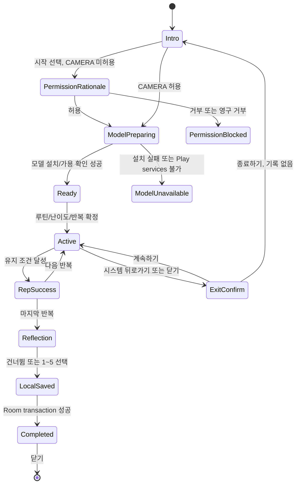

# 스마일 트레이닝 구현 설계 — 재검토 요청

- **개정일**: 2026-10-26, r10
- **상태**: `proposed` — 구현 착수 전 재검토 요청. 이 문서는 구현 계획(`*-plan.md`)이 아니라 구현을 승인할 수 있는 설계 기준이다.
- **대상 버전**: v0.5.0 이후. 현재 저장소의 SSoT는 `version.properties`의 v0.4.0 / versionCode 37이다.
- **검증 기준 시점**: 2026-10-26. 코드 대조와 공식 문서 대조를 수행했으며, 실기기·계정·배포 콘솔 검증은 아직 수행하지 않았다.

## 1. 결론, 승인 범위, 재검토 요청

전면 카메라와 온디바이스 ML Kit Face Detection을 이용해 사용자가 자신의 표정을 보며 짧은 미소 연습을 하는 기능을 제안한다. 영상 프레임·얼굴 좌표·확률값은 기기에만 일시적으로 존재하고 저장·전송하지 않는다. 서버에는 세션 요약만 저장한다.

**이번 개정의 결론은 조건부 구현 가능**이다. CameraX, ML Kit, WorkManager, 로컬 DB, API/마이그레이션 모두 신규 추가가 필요하며 현 코드에 구현되어 있지 않다. 아래의 차단 조건을 해소하기 전에는 구현 PR을 만들지 않는다.

| 구분 | 결정 | 이유 및 완료 조건 |
| --- | --- | --- |
| 신호의 의미 | ML Kit 확률은 **연습 피드백 신호**일 뿐 표정의 자연스러움·정서·의료 상태를 평가하지 않는다. | ML Kit의 smile/eye-open은 확신도이며 정면 얼굴에서만 작동한다. UI·분석·지표 어디에도 점수/등급/치료 효능을 넣지 않는다. |
| 모델 배포 | Google Play services 기반 unbundled Face Detection을 채택한다. | APK/AAB 증가량은 약 800 KB이나 최초 모델 다운로드 대기가 생긴다. 모델 준비 전에는 세션을 시작하지 않는다. 실제 크기는 구현 PR에서 bundletool로 재측정한다. |
| 동기화 | Room이 사용자에게 보이는 기록의 SSOT, 서버는 멱등 업로드 대상이다. | 저장 직후 UI를 갱신하고 `WorkManager`의 고유 작업으로 업로드한다. 단순 앱 재실행 코루틴에 의존하지 않는다. |
| 네비게이션 | `AppNavigation` 루트에 독립 route를 추가하고 `MainAppShell` 밖에서 카메라를 표시한다. | 현 `MainAppShell`은 `NavigationSuiteScaffold` 내부 NavHost다. 내부 화면으로 넣으면 하단/레일 내비게이션이 남는다. |
| 딥링크 | v0.5.0에서 제외한다. | 현 매니페스트와 `Screen`에 딥링크/URI 계약이 없다. 인증 복귀·백스택·외부 공개 URI는 별도 설계와 제품 승인이 필요하다. |
| 기능 플래그 | v0.5.0 MVP에는 새 BuildConfig 플래그를 만들지 않는다. | 현 `SMILE_TRAINING_ENABLED`는 존재하지 않는다. 서버 API가 먼저 배포되고 Android가 호환된 뒤 앱 릴리스한다. 긴급 중단은 hotfix로 카드를 숨기되, 이미 기록된 로컬 데이터는 유지한다. |

### 사용자 결정 또는 사용자 실행이 반드시 필요한 항목

다음은 내가 임의로 우회하거나 대체할 수 없는 작업이다. 구현 전 또는 해당 검증 단계에서 **사용자에게 직접 요청**한다.

1. 카메라 권한 사전 안내 문구, "영상/원시 표정값을 저장·전송하지 않음"이라는 사용자 노출 문구, 의료 효능 비주장 문구의 최종 승인.
2. 실기기 2대 이상에서의 권한, 최초 모델 다운로드, 전면 카메라 미러, 발열/배터리, TalkBack 및 Switch Access 검증. 기기 연결·권한 부여가 필요한 경우 사용자에게 요청한다.
3. 배포 권한이 필요한 Azure/Google Play/Entra/운영 Sentry 작업. 인증이나 콘솔 작업을 다른 방식으로 우회하지 않는다.
4. KST 연속일 정책(여행 시에도 KST 고정) 및 사용자가 자신의 세션을 개별 삭제할 수 있어야 하는지의 제품 승인. 본 설계는 KST 고정과 전체 삭제 API를 기본안으로 둔다.

## 2. 현재 코드와의 대조 결과

| 확인 대상 | 확인된 현황 | 설계 영향 |
| --- | --- | --- |
| Android SDK | minSdk 26, target/compileSdk 37 | ML Kit 문서의 API 23 이상 조건을 충족한다. |
| UI/내비게이션 | `AppNavigation.kt` 루트는 Splash/Auth/Onboarding/Main만 보유. `MainAppShell.kt`는 `NavigationSuiteScaffold`와 별도 내부 NavHost를 보유. | 루트 `Screen.SmileTraining`와 콜백을 새로 추가해야 한다. |
| 진입 화면 | `ProgressHubScreen.kt`에는 통계/기록/목표/배지만 있다. | "마음 연습" 섹션 및 `onSmileTrainingClick`을 추가한다. 홈 넛지는 MVP에서 제외한다. |
| 카메라/ML 의존성 | `libs.versions.toml`, `app/build.gradle.kts`에 CameraX, Camera Compose, ML Kit가 없다. | 버전 카탈로그와 의존성, 매니페스트, Proguard 검증을 새로 추가한다. |
| 오프라인 작업 | WorkManager 의존성·Worker가 없다. | `work-runtime-ktx`와 `SmileSyncWorker`를 새로 추가한다. |
| Room | 기존 `EundunDatabase`는 캐시 성격이며 destructive migration을 사용한다. | 세션 기록은 독립 `SmileTrainingDatabase`로 분리하고 schema export와 migration test를 의무화한다. |
| 계정 삭제 | 백엔드 purge 회귀 가드는 `user_id` 모델을 동적으로 전수 검사한다. Android `AuthRepositoryImpl.deleteAccount()`는 현재 sign-out만 한다. | 백엔드 seed fixture·purge에 새 모델을 포함하고, Android는 주입형 `LocalDataWiper`로 DB/DataStore를 지운다. |
| OpenAPI | `scripts/sync-openapi.sh`와 생성 Kotlin Retrofit 클라이언트가 이미 있다. | 새 router/DTO 후 같은 PR에서 `backend/openapi.json`을 동기화하고, 생성 타입을 NetworkModule에 제공한다. |
| 마이그레이션 도구 | 루트 `docker-compose.test.yml`은 없다. `scripts/alembic-autogen.sh`가 `backend/docker-compose.yml`의 PostgreSQL을 준비한다. | 기존 문서의 `docker compose -f docker-compose.test.yml` 명령은 금지한다. 기존 스크립트와 runtime-smoke를 사용한다. |

## 3. 제품 범위와 비범위

### In scope

- 전면 카메라 미리보기, 한 사람만 대상으로 하는 실시간 안내, 3개 루틴과 1~5회 반복.
- 권한/모델 준비/카메라 없음/얼굴 미검출/중단 확인을 포함한 완결된 상태 흐름.
- 세션 요약의 로컬 저장, 네트워크 조건부 재시도 업로드, 이력/통계 API, 계정 삭제 및 수동 전체 삭제.
- JVM·Android·Pytest·실기기 검증과 운영 관측성.

### Out of scope

- 영상, 스틸 이미지, 얼굴 bounding box/landmark, 얼굴 확률 시계열의 저장·업로드·분석 로그.
- 얼굴 인식, 사람 식별, 외모 평가, 랭킹, 진단/치료 주장, 타 사용자 비교.
- 외부 딥링크/알림 진입, 자동 시작, 백그라운드 카메라, 저사양 기기별 품질 분기.
- 프라이버시·권한 **구현 자체**는 제외하지 않는다. 단, 정책/스토어 고지의 변경은 사용자 승인 후 별도 작업으로 한다.

## 4. 사용자 흐름과 상태 계약



| 상태 | UI와 허용 동작 | 실패/이탈 처리 |
| --- | --- | --- |
| `Intro` | 기능 목적, 저장 범위, 루틴/난이도/반복 선택, 시작 버튼 | 카메라를 아직 bind하지 않는다. |
| `PermissionRationale` | 권한이 필요한 이유와 시스템 요청 버튼 | 거부 시 강제 반복 요청하지 않는다. `shouldShow...`가 false면 앱 설정 이동만 제시한다. |
| `ModelPreparing` | 설치 중 스피너와 취소 | model이 준비되기 전 analyzer/세션 카운터를 시작하지 않는다. |
| `Ready` | 미러 프리뷰, 얼굴 가이드, "준비됨" | 단일 얼굴/거리/정면을 안내하지만 아직 반복은 증가시키지 않는다. |
| `Active` | 게이지, 일시정지/중단, 중립적 환경 안내 | `ON_STOP`, 권한 철회, camera error면 analyzer와 preview를 즉시 release하고 재개 전 `Ready`로 돌아간다. |
| `Reflection` | 선택형 1~5 회고 또는 건너뛰기 | 회고 응답은 모델 판정과 결합하지 않는다. |
| `Completed` | 저장 완료, 동기화 대기 여부, 연속일 표시 | 저장은 완료된 반복이 1개 이상일 때만 수행한다. |

카메라 권한은 기능 진입 직전에만 요청하고 매 진입 시 현재 grant를 다시 확인한다. Android 11+에는 one-time camera grant가 있으므로 세션 재개 시에도 grant를 가정하지 않는다. 영구 거부는 설정 이동으로만 해결하며, 카메라 없는 기기는 `FEATURE_CAMERA_FRONT` 검사 후 시작 버튼을 비활성화한다.

## 5. UX, 접근성, 내비게이션

### 5.1 화면 구조

1. `ProgressHubScreen`의 "마음 연습" heading 아래에 한 개의 `Card`를 추가한다. 제목은 "스마일 트레이닝", 설명은 "카메라로 내 표정을 보며 짧게 연습해요"로 한다. 카드 전체가 하나의 접근 가능한 버튼이다.
2. 카드 선택은 `MainAppShell`에서 루트 콜백 `onNavigateToSmileTraining`을 호출한다. 내부 NavHost route로 직접 navigate하지 않는다.
3. `AppNavigation`에 `Screen.SmileTraining`을 root composable로 추가한다. `Main` 화면 위에 표시하고 종료 시 `popBackStack()`한다. 화면 전환은 `slideInVertically`/`slideOutVertically`와 짧은 fade만 사용한다.
4. 카메라 화면은 `Scaffold`에 bottom navigation을 두지 않는다. 상단 닫기 버튼, 진행 안내, 하단 큰 일시정지/중단 컨트롤을 안전 영역 안에 둔다.

### 5.2 접근성과 피드백

- 얼굴 타원, 게이지, 파티클은 장식이며 `contentDescription = null`이다. 상태 변화는 하나의 live region 텍스트로 1회만 읽힌다. 프레임마다 TalkBack을 갱신하지 않는다.
- 최소 터치 영역은 48dp, 텍스트 대비와 focus 순서는 Compose 접근성 검사 및 실제 TalkBack/Switch Access로 확인한다.
- 햅틱은 성공 시 1회만, 시스템 햅틱 설정을 존중하고 소리 없이도 완료를 알 수 있게 한다. 진동을 끌 수 있는 앱 내 선택지는 구현 단계에서 제품 승인 후 추가한다.
- "더 밝은 곳에서", "얼굴을 가이드 중앙에"처럼 환경을 설명한다. "표정이 틀렸어요" 같은 평가 문구를 금지한다.

### 5.3 카메라 렌더링 원칙

- preview만 전면 카메라에 맞춰 거울처럼 렌더링한다. 분석 프레임과 ML Kit Euler 값은 원본 좌표계로 유지한다.
- 오버레이 가이드는 얼굴 점수에 따라 사용자 외모를 판단하지 않으며, bounding box를 화면 좌표로 변환할 때 CameraX transform API와 실제 crop/rotation을 같은 use case 설정에서 공유한다.
- `CompositingStrategy.Offscreen + BlendMode.Clear` 효과는 별도 composable 레이어에 한정한다. 저수준 blend가 읽기 어려운 UI나 TalkBack 의미를 만들지 않도록 대체 텍스트 상태를 분리한다.

## 6. 신호 판정 엔진

### 6.1 확정된 제약과 보정 대상

ML Kit 분류는 `CLASSIFICATION_MODE_ALL`이 켜진 경우에만 나오며, smile/eyes-open은 정면에 가까운 얼굴(Euler Y 약 -18°~18°)에서만 작동한다. 따라서 "눈맞춤"은 렌즈 응시 판정이 아니라 **카메라를 향한 정면 얼굴의 근사 신호**라고 UX에 명시한다. `null` 확률은 0점이 아니라 `Unmeasurable`이다.

| 신호 | MVP 기준 | 상태 | 근거/처리 |
| --- | --- | --- | --- |
| 얼굴 수 | 정확히 1 | 확정 | 0은 `NO_FACE`, 2 이상은 `MULTIPLE_FACES`; 다른 사람의 얼굴을 선택하지 않는다. |
| 입력 크기 | analysis 640x480 목표, 실제 negotiated resolution 기록 | 확정 | ML Kit 권고 입력 최소 480x360, 얼굴 약 100x100 px. 해상도는 요청값과 달라질 수 있다. |
| 최소 얼굴 크기 | `setMinFaceSize(0.25f)` + 실제 box 폭 비율도 확인 | 보정 대상 | minFaceSize는 hard limit가 아니다. UI 안내 기준은 실기기에서 확인한다. |
| yaw | `abs(Y) <= 15°` | 확정 시작값 | 분류가 가능한 정면 범위 안에서 여유를 둔다. |
| roll | `abs(Z) <= 12°` | 보정 대상 | 사용자 편안함/기기 자세를 실기기로 검증한다. |
| smile enter/exit | 루틴별 0.60/0.50, 0.75/0.65 | 보정 대상 | enter/exit 히스테리시스. 0.70 단일값과 모순되던 기존 설계를 제거했다. |
| eye open | 양쪽 0.60 이상 | 보정 대상 | `null`이면 완료 불가가 아니라 정면 안내 상태다. |
| hold | 1,000ms window에서 측정가능 frame 75% 충족 후 연속 목표 시간 | 확정 알고리즘, 임계치 보정 | frame count가 아니라 `elapsedRealtime` timestamp로 계산한다. |

루틴은 Gentle(1.5 s), Sustained(3.0 s), Smile & Front-facing(2.0 s)으로 시작한다. 편안은 smile threshold -0.10 및 hold 20% 단축, 도전은 hold 1.5배와 yaw 10°로 한다. 이 수치는 의료/생체학적 정답이 아니므로 구현 PR의 파일럿·실기기 결과로만 바꾼다.

### 6.2 순수 도메인 계약

```kotlin
data class FrameSignal(
    val timestampElapsedMs: Long,
    val faceCount: Int,
    val faceWidthRatio: Float?,
    val yawDeg: Float?,
    val rollDeg: Float?,
    val smileProbability: Float?,
    val leftEyeOpenProbability: Float?,
    val rightEyeOpenProbability: Float?,
)

sealed interface FrameVerdict {
    data object Satisfied : FrameVerdict
    data object BelowThreshold : FrameVerdict
    data class Unmeasurable(val reason: Reason) : FrameVerdict
}
```

`SmileRoutineRule`은 frame 하나의 판정만 하고, `SmileSignalEvaluator`가 time window·hysteresis·반복 완료를 소유한다. CameraX/ML Kit/Compose 객체는 ViewModel과 domain에 넣지 않는다. `trackingId`는 세션 내부에서 프레임 연속성 확인에만 쓰며 저장하지 않는다.

## 7. Android 구현 설계

### 7.1 새 의존성과 매니페스트

구현 PR에서 버전 카탈로그에 CameraX core/camera2/lifecycle/compose, Google Play services ML Kit Face Detection, WorkManager KTX와 테스트 의존성을 추가한다. 정확한 CameraX/WorkManager 버전은 PR 시작 시 AndroidX release note와 dependency insight로 호환성을 확인해 고정한다. 문서에 미확인 버전을 가정해 적지 않는다.

```xml
<uses-permission android:name="android.permission.CAMERA" />
<uses-feature android:name="android.hardware.camera" android:required="false" />
<uses-feature android:name="android.hardware.camera.front" android:required="false" />

<!-- application 내부: Play Store 설치 후 model prefetch 요청 -->
<meta-data android:name="com.google.mlkit.vision.DEPENDENCIES" android:value="face" />
```

`CAMERA` permission만으로 기기 필터링이 생기지 않도록 `uses-feature required=false`를 함께 선언한다. unbundled 모델은 manifest prefetch와 `ModuleInstallClient` 명시 확인을 둘 다 사용한다. 모델 미다운로드 상태에서 detector 요청이 결과 없이 끝날 수 있으므로 `ModelPreparing`에서 가용성 확인/설치 성공까지 시작을 막는다.

### 7.2 CameraX 및 ML Kit adapter

1. `SmileCameraController`가 `ProcessCameraProvider`를 얻고, `Preview`와 `ImageAnalysis`를 `DEFAULT_FRONT_CAMERA`로 같은 lifecycle owner에 bind한다.
2. `ImageAnalysis`는 `STRATEGY_KEEP_ONLY_LATEST`와 단일 executor를 사용한다. 프리뷰를 멈추게 하는 producer-blocking을 사용하지 않는다.
3. `FaceDetectorOptions`는 FAST, `CLASSIFICATION_MODE_ALL`, landmark/contour NONE, minFaceSize 0.25, tracking enable로 시작한다. 모든 analysis frame에서 `ImageProxy.close()`를 completion 경로에서 정확히 한 번 호출한다.
4. `MlKitSmileSignalAnalyzer`가 `Face` 목록을 `FrameSignal`로 바꾼다. detector failure/UNAVAILABLE는 분류 실패로 숨기지 않고 UI가 재시도 가능한 `ModelUnavailable` 또는 inline error로 보여 준다.
5. `DisposableEffect(lifecycleOwner)`와 lifecycle observer가 `ON_STOP`에서 analysis를 clear/unbind하고 executor/detector를 close한다. ViewModel은 카메라 resource를 소유하지 않는다.

`ResolutionSelector`는 640x480을 선호하되 하드웨어 협상 결과가 다를 수 있음을 전제로 한다. 프로파일링 결과가 p95 50 ms를 넘거나 preview jank가 보이면 우선 analysis resolution/호출 빈도를 조정하고, UX 기준을 낮추는 결정을 임의로 하지 않는다.

### 7.3 UDF와 오류 경계

`SmileTrainingViewModel`은 불변 `SmileTrainingUiState`와 `Channel<SmileSideEffect>`를 쓴다. `SurfaceRequest`, `ImageProxy`, `FaceDetector`, `Context`는 state에 넣지 않는다. side effect는 permission request, settings launch, success haptic, popBackStack으로 한정한다.

오류는 다음처럼 분류한다.

| 오류 | 사용자 상태 | 재발 방지 |
| --- | --- | --- |
| 권한 거부/철회 | 설정 이동 안내, 세션 미시작 | 매 진입/재개시 permission 재확인 |
| 전면 카메라 없음/bind 실패 | 시작 불가 inline 화면 | feature check + bind exception test |
| 모델 미설치/Play services 오류 | 설치 재시도와 취소 | module availability를 detector 결과와 분리 |
| 일시적 네트워크 | 완료는 성공, "동기화 대기" | Worker retry, 로컬 기록 보존 |
| 4xx validation/409 payload 충돌 | 기록은 보존, 명시적 "동기화 확인 필요" | 무한 retry 금지, 개발 진단 event만 기록 |

### 7.4 Room과 동기화 상태

`SmileTrainingDatabase` v1을 별도 파일 `smile_training.db`로 만든다. `exportSchema = true`, KSP `room.schemaLocation`, schema JSON의 Git 추적, Android migration test asset 등록이 모두 완료 조건이다. version 1에도 schema export를 커밋해 이후 migration의 기준점으로 삼는다.

```text
SmileSessionEntity
- id: UUID string, primary key (클라이언트가 생성)
- userId: Entra oid
- routine, difficulty
- durationSec, completedReps, reflectionEmoji?
- occurredAtUtc: Instant epoch millis (사용자 완료 시각)
- syncStatus: PENDING | SYNCED | BLOCKED
- syncedAtUtc?, lastSyncErrorCode?
```

- `(userId, occurredAtUtc DESC)`와 `(userId, syncStatus)` index를 둔다.
- 완료 저장은 Room transaction으로 entity insert와 sync work enqueue 의도 표시를 함께 처리한다. 중복 `id` insert는 기존 entity를 보존한다.
- `SmileSyncWorker`는 `NetworkType.CONNECTED`, unique work name `smile-sync`, `ExistingWorkPolicy.KEEP`, exponential backoff를 쓴다. 한 실행에 오래된 PENDING 최대 10건을 시간순 처리한다.
- 성공 또는 서버의 동등한 idempotent 응답만 `SYNCED`로 바꾼다. 5xx/IO는 `Result.retry()`와 PENDING 유지, 계약 위반 4xx는 `BLOCKED`로 전환해 무한 재시도를 막는다. 401은 silent token refresh가 성공한 경우 한 번만 재시도하고, 실패하면 로그인 후 새 unique work를 enqueue한다.
- 계정 전환/삭제 시 userId로 쿼리를 항상 제한하고, 삭제 성공 후 `LocalDataWiper`가 Eundun DB, smile DB, DataStore, 관련 unique work를 한 transaction boundary 정책으로 정리한다. 서버 삭제 실패 시 로컬 자료를 지우지 않는다.

## 8. 백엔드, API, 데이터 계약

### 8.1 데이터 모델 및 Alembic

`smile_training_sessions`에 아래를 둔다. `id`는 UUID PK, `user_id`는 인증 subject, `occurred_at`은 클라이언트 완료 시각, `created_at`은 서버 `now()`다. 혼동을 막기 위해 `created_at`을 클라이언트에서 받지 않는다.

```text
id UUID PK
user_id VARCHAR NOT NULL
routine VARCHAR(50) NOT NULL
difficulty VARCHAR(20) NOT NULL
duration_sec INTEGER NOT NULL CHECK (duration_sec >= 0)
completed_reps INTEGER NOT NULL CHECK (completed_reps >= 1)
reflection_emoji SMALLINT NULL CHECK (reflection_emoji BETWEEN 1 AND 5)
occurred_at TIMESTAMPTZ NOT NULL
created_at TIMESTAMPTZ NOT NULL DEFAULT now()
UNIQUE (id)
INDEX (user_id, occurred_at DESC)
```

Alembic autogenerate는 저장소의 `bash scripts/alembic-autogen.sh "create smile training sessions"`를 사용한다. 생성 파일의 upgrade/downgrade, `backend/app/models/__init__.py` import, `alembic upgrade head`, `cd backend && docker compose up -d --build` runtime smoke를 같은 PR에서 검증한다. SQLite test DB로 PostgreSQL migration을 생성하지 않는다.

### 8.2 API

| Endpoint | 계약 |
| --- | --- |
| `POST /smile-training/sessions` | 인증 필수. `id`는 **필수 UUID**. 동일 `(user_id, id)` + 동일 payload면 200/201의 동등 response; 같은 id가 다른 user 또는 payload면 409. DB unique violation을 500으로 노출하지 않는다. |
| `GET /smile-training/sessions?cursor=&limit=` | 인증 user만, `occurred_at DESC, id DESC` cursor pagination. page/offset은 신규 append 데이터에서 중복/누락 가능성이 있어 쓰지 않는다. |
| `GET /smile-training/statistics` | 현재 KST 날짜와 `occurred_at`의 KST date로 distinct day를 계산한다. UTC/KST 경계를 포함한 테스트를 둔다. |
| `DELETE /smile-training/sessions` | 인증 user의 세션만 모두 삭제. 성공 후 Android는 해당 user 로컬 session도 delete하고 history/statistics를 invalidate한다. |

DTO는 enum을 사용한다(`routine`, `difficulty`). Pydantic validator는 최대 duration/rep와 `occurred_at`의 과거/미래 허용 범위를 정한다. 정확한 상한은 제품 결정 후 테스트 상수로 고정하며, 서버가 받는 raw 얼굴 신호 필드는 만들지 않는다.

`AccountService._purge_app_data()`에는 `SmileTrainingRepository.delete_all_by_user()`를 추가한다. 현재 `test_delete_account_purges_all_user_data`는 모든 `user_id` 모델을 자동 수집하므로, fixture가 smile row를 실제로 seed하도록 같이 변경해야 false failure가 나지 않는다. profile만 candidate source인 reaper도 새 session-only user를 놓치지 않는지 확인한다. 기본안은 `list_all_user_ids()`를 모든 per-user 테이블의 union으로 확장하거나, smile row가 profile보다 먼저 생기지 않도록 API가 profile 존재를 보장하는지 테스트로 확정하는 것이다.

## 9. 구현 순서와 완료 기준

| Phase | 변경 단위 | 선행/완료 조건 |
| --- | --- | --- |
| 0 | 사용자 승인 | §1의 문구·KST·삭제 정책 및 실기기 협력 승인. 승인 전 구현 시작 금지. |
| 1 | Backend contract | model/repository/service/router/Alembic/OpenAPI/pytest. idempotency·account purge·KST cases와 docker smoke 통과. |
| 2 | Android persistence | catalog의 Room test/WorkManager, DB/schema, DAO, repository, worker, LocalDataWiper. offline/retry/blocked/account deletion test 통과. |
| 3 | Camera domain | CameraX/ML Kit dependency, module readiness, analyzer, pure evaluator/rules. proxy close와 lifecycle release instrumentation test 통과. |
| 4 | UI/navigation | root route, Progress card, permission flow, Compose UI/a11y. camera resource가 MainShell과 격리됨을 test로 검증. |
| 5 | 사용자 실기기 검증 | §10 physical checklist 전부 통과 후에만 release 후보 생성. |

작업은 한 phase마다 작은 PR/커밋으로 나누며 API 계약 변경과 `backend/openapi.json`은 분리하지 않는다. 각 phase 실패 시 다음 phase로 넘어가지 않고 원인을 고친다. 현 문서는 실행 기록의 대체물이 아니며, 실제 명령/결과/기기 정보는 구현 plan 및 PR에 남긴다.

## 10. 테스트, 측정, 운영 점검

### 자동 테스트

| 계층 | 필수 사례 |
| --- | --- |
| JVM domain | 0/다중 얼굴, null probability, enter/exit hysteresis, timestamp window, 세 루틴·난이도·반복 완료. |
| Android DB/worker | schema export/migration, user isolation, duplicate UUID, PENDING→SYNCED, IO/5xx retry, 4xx→BLOCKED, unique worker 중복 enqueue. |
| Camera instrumentation | front camera 없음, permission revoked, model unavailable, `ImageProxy.close()` 정확히 한 번, lifecycle stop에서 unbind/close. |
| Compose/navigation | card semantics, permission rationale, back exit confirmation, root route에서 NavigationSuite가 노출되지 않음, live region spam 없음. |
| Backend Pytest | UUID idempotency(동일/충돌/다른 user), cursor 안정성, validation, KST boundary/streak, delete isolation, account purge/reaper candidate. |
| CI/runtime | OpenAPI drift, Android unit/instrumented suite, backend alembic upgrade/downgrade와 Docker smoke. |

### 사용자 실기기 점검 — 사용자 협력 필요

| 시나리오 | 합격 기준 |
| --- | --- |
| 최초 설치/오프라인 | 모델 준비 상태가 명확하고 준비 전 세션이 시작되지 않음. |
| 권한 | 허용, 이번만 허용 후 재진입, 1회/영구 거부, 설정 복귀가 각각 올바르게 동작. |
| 카메라 | 전면 미러 preview, 회전/분할 화면, background/foreground, 통화/카메라 점유 후 복귀에서 black preview/자원 누수 없음. |
| 신호 | 밝음/어두움, 안경/마스크, 얼굴 2명, 너무 가까움/멀음에서 비난 문구 없이 안정적으로 안내. |
| 접근성 | TalkBack과 Switch Access로 시작·일시정지·중단·회고·닫기 가능; 프레임 단위 음성 반복 없음. |
| 성능 | 대표 기기 5분 연속 사용의 p95 analysis latency, dropped-frame, 온도/배터리를 기록. 목표값은 측정 전 성공 기준으로 가장하지 않는다. |
| 동기화 | 오프라인 완료→앱 종료→온라인 복귀, 5xx, auth refresh, 중복 worker에서 서버 중복이 없음. |

### 관측성과 롤백

- Sentry에는 `smile_phase`, 오류 코드, model readiness, analyzer latency bucket, sync outcome만 남긴다. user id, 이미지, 얼굴 확률, raw exception payload는 보내지 않는다.
- backend metric은 API status/latency/idempotency conflict 수만 집계한다. 세션 완주율은 세션 요약만으로 계산하며 표정 품질 지표로 해석하지 않는다.
- Android 문제: hotfix에서 진입 카드/route를 숨기고 이미 저장된 로컬 기록은 보존한다. DB를 destructive migration으로 지우지 않는다.
- backend 문제: API를 먼저 호환 상태로 고치고, 이미 클라이언트가 쓴 데이터가 있는 migration은 무검토 downgrade하지 않는다. rollback 전 migration의 reversible 여부와 데이터 보존 영향을 확인한다.

## 11. 위험, 근본 원인, 재발 방지

| 위험/과거형 결함 | 근본 원인 | 방지 설계 |
| --- | --- | --- |
| 모델 미다운로드인데 빈 결과를 미소 실패로 취급 | unbundled model readiness와 detector 결과를 혼동 | 명시 설치/availability state, `ModelPreparing` 차단, 실기기 최초 설치 테스트 |
| preview가 멈추거나 메모리가 증가 | `ImageProxy.close`, detector/executor close, lifecycle unbind 누락 | completion `finally`, DisposableEffect, camera instrumentation |
| 중복 세션 | 앱 재시작/Worker 중복/HTTP timeout 후 재전송 | client UUID 필수, server idempotency 검증, unique work |
| 무한 sync와 배터리 소모 | 4xx를 transient error로 재시도 | PENDING/SYNCED/BLOCKED 구분, 사용자 재시도 경로 |
| 계정 탈퇴 뒤 기록 잔류 | 새 `user_id` 테이블이 purge/fixture/reaper 후보에서 빠짐 | 동적 purge test seed 확장 및 candidate source 검증 |
| back/tab 오터치로 세션 유실 | camera 화면을 MainShell 내부 route로 구현 | root route 격리, exit confirm, UI test |
| 임계값이 사용자에게 불리하게 작동 | 확률을 객관적/의료적 판정으로 오해 | 보정 라벨, neutral copy, 측정 후에만 변경, 비교/등급 금지 |

## 12. 공식·외부 기술 근거

- [ML Kit Face Detection Android](https://developers.google.com/ml-kit/vision/face-detection/android): bundled/unbundled 의존성, install-time metadata, ModuleInstallClient, 입력 해상도·실시간 성능 가이드.
- [ML Kit Face Detection Concepts](https://developers.google.com/ml-kit/vision/face-detection/face-detection-concepts): Euler 축, 분류가 정면 얼굴에 한정되는 조건, min face size의 성격.
- [CameraX Image analysis](https://developer.android.com/media/camera/camerax/analyze): lifecycle bind, output resolution 협상, `STRATEGY_KEEP_ONLY_LATEST` backpressure와 analyzer 종료 원칙.
- [Android runtime permissions](https://developer.android.com/training/permissions/requesting): rationale, permanent denial, one-time camera grant를 전제로 한 재검사 원칙.
- [WorkManager unique work](https://developer.android.com/develop/background-work/background-tasks/persistent/how-to/manage-work) 및 [retry/backoff](https://developer.android.com/develop/background-work/background-tasks/persistent/getting-started/define-work): 중복 작업 방지, network constraint, retry/backoff의 한계.
- [Room migration and schema export](https://developer.android.com/training/data-storage/room/migrating-db-versions): schema history의 버전 관리와 migration test 필요성.

## 13. 재검토 요청

아래 네 항목이 승인되면 다음 산출물인 `2026-10-26-smile-training-plan.md`를 작성하고 Phase 1부터 구현한다.

1. 카메라 기반의 세션 요약 저장과, 원시 영상/얼굴 신호 비저장 원칙.
2. unbundled ML Kit의 첫 실행 모델 다운로드 대기를 허용하는 UX.
3. KST 고정 streak 및 전체 세션 삭제 API.
4. §1과 §10의 사용자 협력 필요 검증을 실제 구현/출시 게이트로 유지하는 것.

승인 전에는 코드, 콘솔, 정책 문구를 변경하지 않는다.
