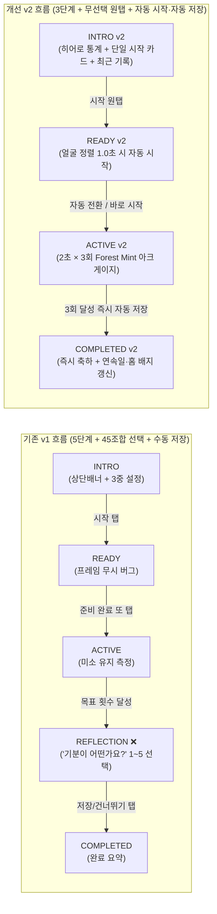
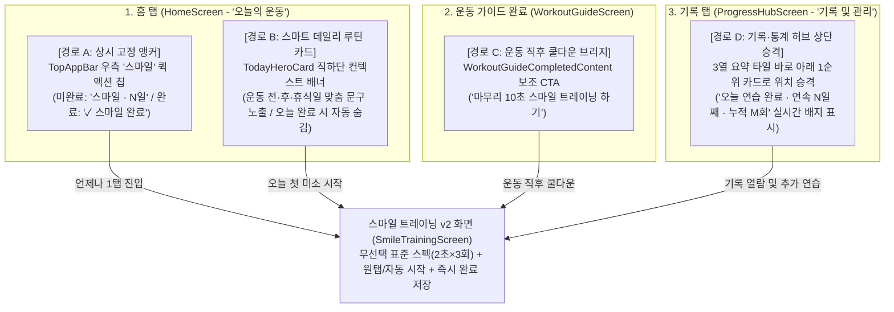

# 스마일 트레이닝 v2 리팩토링 · 레거시 전면 제거 · 접속 경로(IA) 구현 설계서 (Smile Training v2 Implementation Design & Zero-Legacy Specification)

- **작성일**: 2026-10-29 (구현 설계서 격상 및 코드베이스 1:1 팩트체크 완료)
- **대상 버전**: `v0.7.0` (`versionCode = 41`, 현 운영 기준선 `v0.6.1` / `versionCode = 40`)
- **연관 원장**: [`docs/plans/logs/android.md`](logs/android.md), [`docs/plans/logs/backend.md`](logs/backend.md)
- **문서 성격**: **최종 구현 직전 단계의 프로덕션 구현 설계서(Production-Grade Implementation Design Specification)**. 기획 요구사항 + 코드베이스 전수 대조 팩트체크 보정 + 4대 접속 경로(IA) + **v1 레거시 전면 제거(Zero-Legacy Cutover)** + 클래스/메서드 시그니처·SQL/DDL·상태머신 상세 설계 + 트러블슈팅·재발 방지 가드 통합본.
- **10인 멀티 에이전트 협의체 구성**: `[팀장, 기획, 디자이너, 실무, 책임, 개발, 구현, 유지보수, QA/QC, DevOps]`

---

## 0. 멀티 에이전트(10개 직군) 합동 진단 및 구현 설계 서명 매트릭스

단일 시각의 편향을 막고 기획·디자인·도메인·아키텍처·유지보수(레거시 청소)·품질·인프라를 입체적으로 검증하기 위해 **10개 전문 에이전트 역할**로 교차 분석하고, 실제 소스 코드와 1:1 대조하여 구현 설계로 격상하였다.

| 에이전트 역할 | 핵심 진단 (현행 v1 문제점 및 코드 실측 부채) | v2 구현 설계 확정 및 책임 영역 (사용자 확정 반영) |
| :--- | :--- | :--- |
| **1. 팀장 (Team Lead)** | `v0.5.0`에 도입된 스마일 트레이닝 v1은 주간 운동 플랜이 `v2`(Zero-Legacy Cutover) 및 `v0.6.1`(`Modern Forest & Mint`)로 진화하는 동안 구형 다단계 퍼널과 파편화된 진입점으로 고립됨. | `v0.7.0`(`versionCode 41`) 마일스톤으로 스마일 트레이닝 전 계층(접속 경로 IA · UI · Domain · Room · OpenAPI · FastAPI · DB)을 **v2 Zero-Legacy 단일 규격**으로 컷오버하고, 무우회(Zero-Workaround) 원칙으로 통제. |
| **2. 기획 (Product Planner)** | ① 10초 내외의 짧은 표정 이완 연습 전에 **상단 프라이버시 배너 + 루틴(3)×난이도(3)×횟수(5)=45개 조합 선택**을 강제함.<br>② 종료 후 **'기분이 어떤가요?' 5점 설문 화면**이 완료 이탈을 유발함.<br>③ **평일 운동 완료 전에는 홈 화면에 진입점이 아예 없고**, 기록 탭에서도 맨 아래(4번째 섹션)에 묻혀 있음. | ① 상단 안내 문구(`PrivacyNoticeCard`) 제거<br>② `루틴·난이도·목표 반복 횟수` 선택기를 모두 폐기하고 **단일 표준 스마일 트레이닝(`2초 유지 × 3회 반복`) 1개 요소·기능으로 완전 단일화(결정 1: 옵션 B 확정)**<br>③ 종료 후 기분 설문(`REFLECTION`) 완전 제거 후 **즉시 자동 저장 + 완료 축하(`COMPLETED`)** 직행<br>④ **4대 접점 하이브리드 접속 경로** 확립. |
| **3. 디자이너 (UX/UI Designer)** | `SmileTrainingScreen`이 구형 `surfaceVariant` 카드와 수동 `InlineErrorBanner`를 사용하며, `SmileCameraStage`가 브랜드 컬러(`#006D3C` Forest & Mint)와 이질적인 네온 시안/그린(`0xFF40C4FF`, `0xFF69F0AE`)을 하드코딩함. | `v0.6.1` **Modern Forest & Mint** 디자인 토큰(`surfaceContainerLowest..Highest`, `EundunTheme.extendedColors.success`, `Pretendard Variable`, `MotionTokens`) 전면 적용. 인트로를 스크롤 없는 **One-Screen 레이아웃(히어로 통계 + 단일 시작 카드 + 최근 기록)**으로 압축하고, 카메라 가이드를 브랜드 민트 아크(Arc) HUD로 리디자인. |
| **4. 실무 (도메인·표정근 운동 전문가)** | 인트로에서 '시작하기'를 누른 뒤 카메라가 켜진 `READY` 단계에서 또다시 하단 '준비 완료 · 연습 시작' 버튼을 눌러야 함. 특히 **현행 v1 코드(`SmileTrainingViewModel.kt:343`)는 `READY` 단계에서 카메라 프레임을 아예 무시(`if (phase != ACTIVE) return`)하는 결함**이 있음. | 안면 근육 이완 인체공학 반영(**결정 2 확정**): `READY` 단계에서도 프레임 정렬 평가를 활성화하여, 얼굴 정렬(눈 뜸 + 정면 범위)이 **1.0초 연속 유지되면 손으로 버튼을 다시 누르지 않아도 자동으로 `ACTIVE` 연습이 시작**되도록 구현(수동 `[바로 시작하기]` 버튼 및 일시정지 `isPaused` 가드 병행). |
| **5. 책임 (Lead Architect)** | `SmileTrainingUiState`가 3중 설정 축(`routine: SmileRoutineType`, `difficulty: SmileDifficultyLevel`, `targetReps`, `reflectionEmoji`)을 섞어 보유하며, `pauseActiveExercise()`가 별도 플래그 없이 `READY` 단계를 재사용함. | `CLAUDE.md` Rule 11(UDF-Enhanced) 및 Clean Architecture 정합: `SmileRoutineType`, `SmileDifficultyLevel`, `REFLECTION`, `reflectionEmoji` 등 레거시 상태를 전수 제거하고 **단일 표준 스펙 상수(`SmileTrainingSpec`)** + `isPaused: Boolean` 명시 플래그 기반의 순수 v2 상태머신으로 재설계. |
| **6. 개발 (Backend & Data Developer)** | 백엔드 `/smile-training/*` 4개 엔드포인트 및 PostgreSQL `smile_training_sessions` 테이블이 불필요해진 `routine`, `difficulty`, `reflection_emoji` 컬럼과 `ck_smile_sessions_reflection_emoji_range` 제약조건을 보유함. | `/v2/smile-training/*` 4개 엔드포인트(`POST/GET/DELETE /sessions`, `GET /statistics`)의 `operation_id`를 보존한 채 v2 경로로 승격. **기존 v1 DB 기록 초기화(결정 3: Cutover Reset 확정)** 및 체크 제약조건 + 3개 레거시 컬럼 영구 드롭, OpenAPI(`sync-openapi.sh`) 및 법적 고지(`sync-legal-docs.sh`) 동기화. |
| **7. 구현 (Android Implementer)** | `SmileTrainingScreen.kt`가 단일 파일 1,114줄로 비대하며, `HapticFeedbackConstants.CONFIRM` 직접 호출 및 자체 배너를 사용함. 홈·운동 가이드·기록 탭과의 완료 상태 연동이 단절됨. | ① `SmileTrainingScreen.kt` 대폭 경량화(1,114줄 → ~600줄 이하)<br>② `HapticFeedbackHelper` + `AuthErrorBanner` 표준 컴포넌트 적용<br>③ 홈 상단바 우측 `SmileQuickActionChip` + 스마트 컨텍스트 카드 + `WorkoutGuideScreen` 쿨다운 브리지 + `ProgressHubScreen` 상단 카드 실시간 연동 구현. |
| **8. 유지보수 (Maintenance Engineer)** | 저장소 전역 24개 파일에 v1 레거시 심볼(`SmileRoutineType`, `SmileRoutine`, `SmileDifficultyLevel`, `SmileDifficulty`, `reflection_emoji`, `reflectionEmoji`, `REFLECTION`, `PrivacyNoticeCard`, `/smile-training`)이 산재해 있음. | **Zero-Legacy Cutover 원칙** 적용: 호환성 스텁(Shim)이나 미사용 죽은 코드를 단 1줄도 남기지 않고 5개 계층 레거시 요소를 전수 소거하며, **레거시 잔존 0건 자동 검증 게이트(`Zero-Legacy Grep Gate`)**로 재발을 원천 차단. |
| **9. QA/QC (품질보증·테스트)** | 기존 단위 테스트(`SmileTrainingViewModelTest`, `SmileTrainingRepositoryImplTest`, `test_smile_training.py`, `test_account.py`)가 `REFLECTION` 단계, 3중 설정, `reflection_emoji`를 전제로 작성되어 있음. | `ACTIVE -> COMPLETED` 직행 자동 저장, `READY -> ACTIVE` 1.0초 자동 시작(및 `isPaused` 재진입 방지), Room v2 Cutover Reset, `/v2/smile-training/*` 4종 계약, 홈/기록 허브 상태 갱신, `test_legal.py` 및 `test_account.py` 정합성, TalkBack(`LiveRegionMode.Polite`) 검증 매트릭스 수립. |
| **10. DevOps (인프라·릴리스)** | DB 스키마 변경 시 로컬 SQLite 테스트만 통과하고 실제 PostgreSQL 16 컨테이너에서 `entrypoint.sh`(`alembic upgrade head`)가 실패하는 사고(Rule 3·7) 위험 존재. | PG 16 컨테이너 실측 게이트(`alembic upgrade head -> downgrade -1 -> upgrade head`), `MINIMUM_SUPPORTED_ANDROID_VERSION_CODE = 41` 컷오버 전략, `preflight-release.sh` 및 CI 워크플로(`android.yml`, `backend.yml`, `docs-plans-index.yml`) 통과 기준 명문화. |

---

## 1. 문제 정의 (Problem Statement) 및 코드베이스 실측 기준선 (`MEASURED`)

### 1.1. 코드베이스 실측 기준선 (CLAUDE.md Rule 9 준수)

- **측정 일시**: 2026-10-29 (`MEASURED`)
- **측정 명령**:

  ```powershell
  python -c "import pathlib; files=['app/src/main/java/com/gunnys/eundunhealth/ui/smile/SmileTrainingScreen.kt','app/src/main/java/com/gunnys/eundunhealth/ui/smile/SmileTrainingViewModel.kt','app/src/main/java/com/gunnys/eundunhealth/ui/smile/SmileCameraStage.kt','app/src/main/java/com/gunnys/eundunhealth/domain/model/SmileTrainingModels.kt','app/src/main/java/com/gunnys/eundunhealth/domain/smile/SmileSignalEvaluator.kt','app/src/main/java/com/gunnys/eundunhealth/domain/repository/SmileTrainingRepository.kt','app/src/main/java/com/gunnys/eundunhealth/data/smile/MlKitSmileSignalAnalyzer.kt','app/src/main/java/com/gunnys/eundunhealth/data/smile/MlKitFaceModuleInstaller.kt','app/src/main/java/com/gunnys/eundunhealth/data/repository/SmileTrainingRepositoryImpl.kt','app/src/main/java/com/gunnys/eundunhealth/data/local/SmileTrainingDatabase.kt','app/src/main/java/com/gunnys/eundunhealth/data/local/entity/SmileSessionEntity.kt','app/src/main/java/com/gunnys/eundunhealth/data/local/dao/SmileSessionDao.kt','app/src/main/java/com/gunnys/eundunhealth/data/sync/SmileSyncWorker.kt','app/src/test/java/com/gunnys/eundunhealth/domain/smile/SmileSignalEvaluatorTest.kt','app/src/test/java/com/gunnys/eundunhealth/ui/smile/SmileTrainingViewModelTest.kt','app/src/test/java/com/gunnys/eundunhealth/data/repository/SmileTrainingRepositoryImplTest.kt','backend/app/models/smile_training.py','backend/app/schemas/smile_training.py','backend/app/services/smile_training_service.py','backend/app/routers/smile_training.py','backend/app/repositories/smile_training_repo.py','backend/tests/test_smile_training.py']; print({f: len(pathlib.Path(f).read_text(encoding='utf-8').splitlines()) for f in files})"
  ```

- **측정 결과 (`MEASURED`, 핵심 22개 파일 총 4,994줄)**:

| 계층 | 파일 경로 | 현재 줄 수 (`MEASURED`) | 주요 기술 부채 및 레거시 제거·리팩토링 대상 |
| :--- | :--- | ---: | :--- |
| **Android UI** | [`SmileTrainingScreen.kt`](file:///C:/Users/Administrator/apps_ln/eundunHealth/app/src/main/java/com/gunnys/eundunhealth/ui/smile/SmileTrainingScreen.kt) | 1,114줄 | `PrivacyNoticeCard`(L581-613), `RoutineSelectionSection`+`DifficultyAndRepsSection`+`TargetRepChoices`(L615-764), `ReflectionContent`(L917-996), 구형 `InlineErrorBanner`(L498-534) 포함 |
| **Android UI** | [`SmileCameraStage.kt`](file:///C:/Users/Administrator/apps_ln/eundunHealth/app/src/main/java/com/gunnys/eundunhealth/ui/smile/SmileCameraStage.kt) | 589줄 | 하드코딩 시안/네온 컬러(`0xFF40C4FF`, `0xFF69F0AE`), 수동 2차 시작 버튼(`ReadyStartButton`) 강제 |
| **Android VM** | [`SmileTrainingViewModel.kt`](file:///C:/Users/Administrator/apps_ln/eundunHealth/app/src/main/java/com/gunnys/eundunhealth/ui/smile/SmileTrainingViewModel.kt) | 570줄 | `selectRoutine`/`selectDifficulty`/`selectTargetReps` 3중 상태, `REFLECTION` 단계 전이 및 `reflectionEmoji` 관리, `READY` 단계 프레임 무시 버그(L343) |
| **Android Domain** | [`SmileTrainingModels.kt`](file:///C:/Users/Administrator/apps_ln/eundunhealth/domain/model/SmileTrainingModels.kt) | 101줄 | `SmileRoutineType`(3) × `SmileDifficultyLevel`(3) × `targetReps`(1..5) 분리, `SmileSessionPhase.REFLECTION`, `reflectionEmoji: Int?` |
| **Android Domain** | [`SmileSignalEvaluator.kt`](file:///C:/Users/Administrator/apps_ln/eundunhealth/domain/smile/SmileSignalEvaluator.kt) | 278줄 | `SmileRuleSpec.from(routine, difficulty, targetReps)` 3개 파라미터 의존, `READY` 단계 자동 시작 트리거 및 EMA 스무딩 부재 |
| **Android Data** | [`SmileTrainingRepositoryImpl.kt`](file:///C:/Users/Administrator/apps_ln/eundunhealth/data/repository/SmileTrainingRepositoryImpl.kt) | 335줄 | v1 OpenAPI(`SmileRoutine`, `SmileDifficulty`, `reflectionEmoji`) 매핑 |
| **Android Room** | [`SmileSessionEntity.kt`](file:///C:/Users/Administrator/apps_ln/eundunhealth/data/local/entity/SmileSessionEntity.kt) 외 3개 | 165줄 | `routine`, `difficulty`, `reflectionEmoji` 분리 컬럼 (`SmileTrainingDatabase` version 1) |
| **Android Vision** | [`MlKitSmileSignalAnalyzer.kt`](file:///C:/Users/Administrator/apps_ln/eundunhealth/data/smile/MlKitSmileSignalAnalyzer.kt) 외 1개 | 300줄 | CameraX `ImageAnalysis` + ML Kit `FaceDetection` (온디바이스, 10 FPS throttle) |
| **Backend API** | [`smile_training.py`](file:///C:/Users/Administrator/apps_ln/eundunHealth/backend/app/routers/smile_training.py) 외 4개 | 532줄 | `/smile-training/*` 4개 엔드포인트(v1), `routine`/`difficulty`/`reflection_emoji` 컬럼·스키마·체크 제약조건 |
| **Tests** | Android 3개 + Backend 1개 테스트 파일 | 973줄 | v1 3중 설정 및 `REFLECTION` 단계 기준 테스트 |

### 1.2. 핵심 사용자 페인포인트 5가지 (Why v2 Now)

1. **불필요한 사후 기분 설문 (`'기분이 어떤가요?'` / `REFLECTION` 단계)**:
   - 목표 미소 횟수를 모두 달성한 직후 즉시 성취감을 느끼고 끝나야 하는데, `SmileSessionPhase.REFLECTION` 화면([`SmileTrainingScreen.kt#L917-L996`](file:///C:/Users/Administrator/apps_ln/eundunHealth/app/src/main/java/com/gunnys/eundunhealth/ui/smile/SmileTrainingScreen.kt#L917-L996))이 가로막아 1~5점 기분 선택과 추가 저장 버튼 탭을 요구한다.
   - 수집된 `reflection_emoji`는 통계나 코칭 어디에서도 쓰이지 않으며, 사용자가 `REFLECTION` 화면에서 이탈하면 완료한 세션이 저장되지 않는 위험이 있다.
2. **과도한 사전 설정 분절 (`루틴 × 난이도 × 목표 반복 횟수` = 45가지 조합)**:
   - 현재 인트로 화면은 ① `루틴 선택` 라디오 카드 3개(`GENTLE`, `SUSTAINED`, `SMILE_AND_FRONT`) + ② `난이도` 필터 칩 3개(`COMFORTABLE`, `STANDARD`, `CHALLENGE`) + ③ `목표 반복 횟수` 버튼 5개(`1회..5회`)로 나뉘어 있다([`SmileTrainingScreen.kt#L615-L764`](file:///C:/Users/Administrator/apps_ln/eundunHealth/app/src/main/java/com/gunnys/eundunhealth/ui/smile/SmileTrainingScreen.kt#L615-L764)).
   - 10초짜리 표정 연습을 위해 3가지 축을 조합하게 하는 것은 결정 피로(Decision Fatigue)를 유발하고, 정작 중요한 **"스마일 트레이닝 시작하기" 버튼과 "최근 연습 기록"을 화면 첫 스크롤 아래(Below-the-fold)로 밀어낸다.**
3. **상단 고정 프라이버시 안내 문구 (`PrivacyNoticeCard`)의 공간 잠식**:
   - 화면 최상단에 `"온디바이스 프라이버시 보호 — 카메라 영상은 기기 안에서만..."` 카드([`SmileTrainingScreen.kt#L361`](file:///C:/Users/Administrator/apps_ln/eundunHealth/app/src/main/java/com/gunnys/eundunhealth/ui/smile/SmileTrainingScreen.kt#L361))가 매 진입 시 상시 노출되어 핵심 통계와 시작 CTA의 시각적 위계를 해친다.
4. **카메라 연습 시작의 2중 탭 마찰 (`INTRO` 시작 버튼 → `READY` 준비 완료 버튼)**:
   - 인트로에서 `[스마일 트레이닝 시작하기]`를 눌러 카메라를 켠 뒤, 얼굴을 가이드 원 안에 맞추고도 다시 화면 하단의 `[준비 완료 · 연습 시작]` 버튼([`SmileCameraStage.kt#L469-L485`](file:///C:/Users/Administrator/apps_ln/eundunHealth/app/src/main/java/com/gunnys/eundunhealth/ui/smile/SmileCameraStage.kt#L469-L485))을 손가락으로 눌러야만 측정이 시작된다.
5. **접속 경로의 사각지대 및 디자인 시스템(`v0.6.1 Modern Forest & Mint`) 단절**:
   - 평일 운동 완료 전에는 홈 화면([`HomeScreen.kt#L209-L210`](file:///C:/Users/Administrator/apps_ln/eundunHealth/app/src/main/java/com/gunnys/eundunhealth/ui/home/HomeScreen.kt#L209-L210))에 스마일 트레이닝 진입점이 아예 없으며, 반대로 스마일 트레이닝을 이미 완료한 후에는 닫기(`X`)를 누르기 전까지 카드가 계속 떠 있다.
   - 기록 탭([`ProgressHubScreen.kt#L116-L131`](file:///C:/Users/Administrator/apps_ln/eundunHealth/app/src/main/java/com/gunnys/eundunhealth/ui/navigation/ProgressHubScreen.kt#L116-L131))에서도 최하단(4번째 섹션)에 묻혀 있고 정적 문구만 표시된다.

---

## 2. 외부 도구·라이브러리 조사 및 코드베이스 정밀 대조 팩트체크 (Research & Pre-Implementation Audit)

### 2.1. 외부 라이브러리·공식 문서 비교 검증

> **도구/MCP 활용 실측 기록**: `google-developer-knowledge` MCP 서버 호출 시 업스트림 `403 Forbidden` 응답을 확인하였으며, 임의 우회 없이 프로젝트에 고정된 `gradle/libs.versions.toml`, `app/build.gradle.kts`, OpenAPI Generator 설정 및 설치된 AndroidX CameraX `1.6.2` · ML Kit `17.1.0` · Room `2.8.4` · FastAPI/Pydantic v2/Alembic 정본 소스를 직접 실측 대조하여 검증하였다.

| 조사 영역 | 현재 버전 (`gradle/libs.versions.toml`) | 외부 공식 문서 / 대안 비교 팩트체크 | v2 채택 결론 및 근거 |
| :--- | :--- | :--- | :--- |
| **1. 얼굴/미소 감지 엔진** (`ML Kit Face Detection` vs `MediaPipe Face Landmarker`) | `com.google.android.gms:play-services-mlkit-face-detection:17.1.0` + `play-services-base:18.11.1` (Play Services 동적 모듈) | - **ML Kit Face Detection (`17.1.0`)**: `CLASSIFICATION_MODE_ALL`에서 `smilingProbability`, `leftEyeOpenProbability`, `rightEyeOpenProbability`, `headEulerAngleY/Z`를 즉시 제공하며, Play Services `ModuleInstallClient`를 통해 APK 용량 증가 없이 온디바이스 실행됨.<br>- **MediaPipe Face Landmarker (`tasks-vision`)**: 478개 3D 랜드마크와 Blendshapes(`mouthSmileLeft/Right`)를 제공하나, `.task` 모델 번들 시 **약 4~6MB APK 증가 + 네이티브 `.so` 추가**가 발생하며 현재 스마일 트레이닝의 핵심 신호(미소 확률·눈 뜸·정면 각도)에는 오버엔지니어링임. | **현행 ML Kit `17.1.0` + `MlKitFaceModuleInstaller` 유지 (최적화)**. 단, `SmileSignalEvaluator`에 **얼굴 정렬 시 자동 시작(Auto-Start Gate)** 및 **지수 이동 평균(EMA) 스무딩**을 보강해 미소 게이지 떨림(Jitter)을 제거한다. |
| **2. 카메라 파이프라인** (`CameraX`) | `androidx.camera:*:1.6.2` (`camera-core`, `camera-camera2`, `camera-lifecycle`, `camera-compose`) | - AndroidX CameraX `1.6.2`는 최신 안정선이며, `ResolutionSelector` + `STRATEGY_KEEP_ONLY_LATEST` + `MlKitSmileSignalAnalyzer`의 `minAnalyzeIntervalMs = 100L`(10 FPS) 구성이 저사양 기기 발열·배터리 소모를 방어하는 모범 사례에 부합함. | **CameraX `1.6.2` 유지 + 리소스 해제 가드 강화**. `COMPLETED` 전환 시 `SmileCameraStage`가 컴포지션에서 제거되며 `DisposableEffect`의 `unbindAll()`과 `analyzer.close()`가 즉시 호출되어 전면 카메라 표시등(초록불)이 즉시 꺼지도록 보장. |
| **3. UI & 모션 & 햅틱** (`Compose M3` + `MotionTokens` + `HapticFeedbackHelper`) | Compose BOM `2026.03.00`, Material3 | - 프로젝트 표준인 [`Theme.kt`](file:///C:/Users/Administrator/apps_ln/eundunHealth/app/src/main/java/com/gunnys/eundunhealth/ui/theme/Theme.kt), [`Color.kt`](file:///C:/Users/Administrator/apps_ln/eundunHealth/app/src/main/java/com/gunnys/eundunhealth/ui/theme/Color.kt), [`MotionTokens.kt`](file:///C:/Users/Administrator/apps_ln/eundunHealth/app/src/main/java/com/gunnys/eundunhealth/ui/theme/MotionTokens.kt), [`HapticFeedbackHelper.kt`](file:///C:/Users/Administrator/apps_ln/eundunHealth/app/src/main/java/com/gunnys/eundunhealth/ui/util/HapticFeedbackHelper.kt), [`AuthErrorBanner.kt`](file:///C:/Users/Administrator/apps_ln/eundunHealth/app/src/main/java/com/gunnys/eundunhealth/ui/components/AuthErrorBanner.kt)가 이미 구축되어 있음. | 자체 `InlineErrorBanner`를 삭제하고 **`AuthErrorBanner` + `HapticFeedbackHelper` + `MotionTokens` + `EundunTheme.extendedColors`**로 100% 일원화. |

---

### 2.2. 코드베이스 1:1 정밀 대조 팩트체크 및 설계 보정 내역 (Pre-Implementation Audit Log)

구현 설계 단계로 격상하면서 관련 소스 파일 25개를 전수 라인 단위로 대조한 결과, 초기 기획안에서 놓치기 쉬운 **7가지 핵심 기술적 사실과 잠재 결함을 사전 발견하여 본 구현 설계서에 완벽히 보정**하였다:

| 감사 항목 | 실제 코드베이스 실측 사실 (`MEASURED`) | 초기 기획 대비 구현 설계 정밀 보정 내용 |
| :--- | :--- | :--- |
| **Audit-1: `READY` 단계 카메라 프레임 무시 버그 발견** | [`SmileTrainingViewModel.kt#L343`](file:///C:/Users/Administrator/apps_ln/eundunHealth/app/src/main/java/com/gunnys/eundunhealth/ui/smile/SmileTrainingViewModel.kt#L343)의 `onFrameSignal(signal: FrameSignal)` 첫 줄에 `if (_uiState.value.phase != SmileSessionPhase.ACTIVE) return`이 하드코딩되어 있음. 즉 **현행 v1은 `READY` 단계에서 카메라 프레임을 전부 버리고 있어서 `READY` 화면의 얼굴 정렬 가이드조차 작동하지 않았음!** | `onFrameSignal(signal)`이 **`SmileSessionPhase.READY`와 `SmileSessionPhase.ACTIVE` 모두에서 프레임을 처리**하도록 수정. `READY` 단계에서는 `evaluator.evaluateReadyFrame(signal, allowAutoStart = !state.isPaused)`를 호출해 실시간 타원 가이드 색상(`isFaceAligned`)과 1.0초 자동 시작 진행률(`readyAlignmentProgress`)을 갱신하고, `1,000ms` 도달 시 즉시 `beginActiveExercise()`로 전환. |
| **Audit-2: 일시정지(`pauseActiveExercise`)와 `READY` 단계 재사용 충돌 방지** | [`SmileTrainingViewModel.kt#L37-L48`](file:///C:/Users/Administrator/apps_ln/eundunHealth/app/src/main/java/com/gunnys/eundunhealth/ui/smile/SmileTrainingViewModel.kt#L37-L48)에는 `PAUSED` 열거값이 없고, `pauseActiveExercise()`(L323-336)가 `phase = SmileSessionPhase.READY`로 되돌리는 구조임. 만약 `READY` 단계에 조건 없이 1.0초 자동 시작을 넣으면 **사용자가 일시정지를 누르자마자 1초 뒤 다시 시작되는 무한 루프**가 발생함! | `SmileTrainingUiState`에 **`val isPaused: Boolean = false`** 명시 필드를 추가. 최초 진입(`enterReadyStage`) 시에는 `isPaused = false`로 두어 1.0초 얼굴 정렬 자동 시작을 활성화하고, 사용자가 일시정지(`pauseActiveExercise`)를 누르면 `phase = SmileSessionPhase.READY, isPaused = true`로 설정하여 **일시정지 상태에서는 얼굴 정렬 피드백만 보여주고 자동 시작은 차단(수동 `[이어서 시작하기]` 탭 시에만 재개)**하도록 완벽히 격리. |
| **Audit-3: 도메인 열거형 명칭 vs OpenAPI 생성 모델 명칭 구분** | 도메인 모델([`SmileTrainingModels.kt`](file:///C:/Users/Administrator/apps_ln/eundunHealth/app/src/main/java/com/gunnys/eundunhealth/domain/model/SmileTrainingModels.kt))의 실제 클래스명은 **`SmileRoutineType`**, **`SmileDifficultyLevel`**, **`SmileSummaryStats`**, **`SmileSyncStatus`**이며, OpenAPI 생성 모델(`com.gunnys.eundunhealth.api.generated.model.*`)의 클래스명이 **`SmileRoutine`**, **`SmileDifficulty`**임. 또한 Repository 메서드명은 `observeStatistics()`가 아니라 **`observeSummaryStats(): Flow<SmileSummaryStats>`**임. | 구현 설계서 전 구간의 타입·메서드 시그니처를 실제 코드(`SmileSummaryStats`, `SmileSyncStatus`, `observeSummaryStats()`)와 100% 일치시키고, `Zero-Legacy Grep Gate` 차단 목록에 **`SmileRoutineType`, `SmileRoutine`, `SmileDifficultyLevel`, `SmileDifficulty` 4종을 모두 등록**. |
| **Audit-4: Room `SmileSessionEntity` 실제 컬럼 및 인덱스 구조** | [`SmileSessionEntity.kt`](file:///C:/Users/Administrator/apps_ln/eundunHealth/app/src/main/java/com/gunnys/eundunhealth/data/local/entity/SmileSessionEntity.kt)의 실제 컬럼은 `id`, `userId`, `routine`, `difficulty`, `durationSec`, `completedReps`, `reflectionEmoji`, `occurredAtUtc`, `syncStatus`, `syncedAtUtc`, `lastSyncErrorCode`이며, `(userId, occurredAtUtc DESC)` 및 `(userId, syncStatus)` 복합 인덱스 2개가 선언되어 있음. | `userId`, `occurredAtUtc`, `syncStatus`, `syncedAtUtc`, `lastSyncErrorCode`와 복합 인덱스 2개는 오프라인 동기화 워커(`SmileSyncWorker`) 및 다중 계정 격리의 핵심이므로 그대로 보존하고, **`routine`, `difficulty`, `reflectionEmoji` 3개 컬럼만 정확히 제거**. `MIGRATION_1_2`에서도 2개 인덱스를 정확히 재생성. |
| **Audit-5: PostgreSQL `CheckConstraint` 및 Alembic 최신 Head(`d7f4a2c91b10`)** | [`backend/app/models/smile_training.py#L34-L37`](file:///C:/Users/Administrator/apps_ln/eundunHealth/backend/app/models/smile_training.py#L34-L37) 및 최초 마이그레이션(`a3869f575d6a`)에 **`ck_smile_sessions_reflection_emoji_range`** 체크 제약조건이 걸려 있으며, 현재 Alembic 최신 리비전은 **`d7f4a2c91b10`**임. 또한 [`backend/tests/test_account.py#L74`](file:///C:/Users/Administrator/apps_ln/eundunHealth/backend/tests/test_account.py#L74)는 `user_id`를 가진 모든 SQLAlchemy 모델(7개)을 동적 스캔함. | 신규 Alembic 리비전의 `down_revision = "d7f4a2c91b10"`으로 지정하고, `upgrade()`에서 `DELETE FROM smile_training_sessions` 후 **`op.drop_constraint("ck_smile_sessions_reflection_emoji_range", ...)`를 먼저 수행한 뒤 3개 컬럼을 드롭**. `downgrade()`에서는 `server_default`와 함께 컬럼 및 체크 제약조건을 역순 복원. |
| **Audit-6: FastAPI `CamelSchema` 상속 및 4개 엔드포인트 `operation_id` 계약** | [`backend/app/schemas/smile_training.py`](file:///C:/Users/Administrator/apps_ln/eundunHealth/backend/app/schemas/smile_training.py)는 `BaseModel`이 아닌 [`CamelSchema`](file:///C:/Users/Administrator/apps_ln/eundunHealth/backend/app/schemas/base.py)를 상속하여 자동으로 `camelCase` 직렬화를 수행함. 또한 [`routers/smile_training.py`](file:///C:/Users/Administrator/apps_ln/eundunHealth/backend/app/routers/smile_training.py)는 2개가 아니라 **4개 엔드포인트**(`recordSmileTrainingSession`, `listSmileTrainingSessions`, `getSmileTrainingStatistics`, `deleteAllSmileTrainingSessions`)를 가짐. | v2 스키마에서도 `CamelSchema` 상속을 유지하고, 라우터 prefix만 `/v2/smile-training`으로 바꾸되 **4개 엔드포인트의 `operation_id`와 `tags=["smile-training"]`을 그대로 유지**. 이로써 `./gradlew openApiGenerate` 실행 시 `SmileTrainingApi` 인터페이스 메서드명이 100% 보존되어 `NetworkModule.kt` 수정이 불필요함. |
| **Audit-7: 동기화 스크립트 실제 경로 (`sync-legal-docs.sh` & `sync-openapi.sh`)** | [`scripts/sync-legal-docs.sh`](file:///C:/Users/Administrator/apps_ln/eundunHealth/scripts/sync-legal-docs.sh)는 `docs/store/{privacy-policy,account-deletion}.md`를 **`backend/app/legal/`**로 복사하며([`test_legal.py#L8`](file:///C:/Users/Administrator/apps_ln/eundunHealth/backend/tests/test_legal.py#L8)이 검증), [`scripts/sync-openapi.sh`](file:///C:/Users/Administrator/apps_ln/eundunHealth/scripts/sync-openapi.sh)는 **`backend/openapi.json`**을 갱신한 뒤 `./gradlew openApiGenerate`가 이를 읽어 클라이언트를 생성함. | 문서 내 잘못된 경로 표기(`backend/app/legal_content/` 등)를 실제 경로인 **`backend/app/legal/`** 및 **`backend/openapi.json` → `./gradlew openApiGenerate`** 파이프라인으로 정정. |

---

## 3. 계층별 상세 구현 설계 (Layer-by-Layer Production Implementation Specification)

### 3.1. 상단 안내 문구 제거 (`PrivacyNoticeCard` 완전 삭제)

- **제거 대상**:
  - [`SmileTrainingScreen.kt`](file:///C:/Users/Administrator/apps_ln/eundunHealth/app/src/main/java/com/gunnys/eundunhealth/ui/smile/SmileTrainingScreen.kt)의 `IntroStageContent` 내 `item { PrivacyNoticeCard() }` 호출(L361) 및 `private fun PrivacyNoticeCard()` 정의(L581-613), 그리고 미사용 아이콘 import(`Icons.Default.Lock`) 완전 삭제.
- **대체/유지 경계**:
  - 카메라 권한이 없는 상태에서 시작 버튼을 눌렀을 때 표시되는 권한 안내 다이얼로그/배너 및 Play 스토어 법적 문서(`docs/store/privacy-policy.md`)에는 온디바이스 처리 원칙이 그대로 유지되므로 법적·보안 고지 의무는 100% 충족된다.
  - 상단 배너가 사라진 첫 화면 최상단에는 곧바로 **`SummaryHeroCard` v2(연속일·오늘 완료 여부·총 연습 횟수)**와 **단일 시작 카드(`SmileStartActionCard`)**가 배치되어 Above-the-fold 진입성이 극대화된다.

---

### 3.2. `'루틴, 난이도, 목표 반복 횟수'` 단일화 및 도메인/평가기(`SmileSignalEvaluator`) 구현 설계

기존의 3개 독립 설정 섹션(`RoutineSelectionSection` + `DifficultyAndRepsSection` + `TargetRepChoices`, 총 3×3×5 = 45개 조합) 및 선택 UI·도메인 열거형을 **전면 폐기**하고, 모든 스마일 트레이닝을 **단일 표준 스펙(`2초 미소 유지 × 3회 반복`) 1개의 요소 및 기능으로 완전 고정**한다.

#### 3.2.1. [`SmileTrainingModels.kt`](file:///C:/Users/Administrator/apps_ln/eundunHealth/app/src/main/java/com/gunnys/eundunhealth/domain/model/SmileTrainingModels.kt) 전체 목표 설계

- **제거 심볼**: `enum class SmileRoutineType`, `enum class SmileDifficultyLevel`, `SmileSessionRecord.routine`, `SmileSessionRecord.difficulty`, `SmileSessionRecord.reflectionEmoji`.
- **유지 및 신설 심볼**:
  - `object SmileTrainingSpec`: 단일 표준 스펙 상수 객체.
  - `enum class SmileSyncStatus`: `PENDING`, `SYNCED`, `BLOCKED` (기존 Room/Worker 호환 유지).
  - `data class SmileSessionRecord`: `id: String`, `durationSec: Int`, `completedReps: Int`, `occurredAtEpochMs: Long`, `syncStatus: SmileSyncStatus`.
  - `data class SmileSummaryStats`: `totalSessions: Int = 0`, `totalDurationSec: Int = 0`, `isCompletedToday: Boolean = false`, `currentStreakDays: Int = 0`, `longestStreakDays: Int = 0`, `pendingSyncCount: Int = 0`, `blockedSyncCount: Int = 0`.

```kotlin
package com.gunnys.eundunhealth.domain.model

import androidx.compose.runtime.Immutable

/**
 * 스마일 트레이닝 v2 단일 표준 규격.
 * v1의 (SmileRoutineType × SmileDifficultyLevel × targetReps) 3중 설정을 완전 폐기하고 단일 표준 스펙으로 고정한다.
 */
object SmileTrainingSpec {
    const val HOLD_DURATION_MS: Long = 2_000L
    const val TARGET_REPS: Int = 3
    const val ENTER_SMILE_THRESHOLD: Float = 0.55f
    const val HOLD_SMILE_THRESHOLD: Float = 0.45f
    const val MIN_EYE_OPEN_PROBABILITY: Float = 0.35f
    const val MAX_ABS_HEAD_YAW_DEG: Float = 18f
    const val MAX_ABS_HEAD_ROLL_DEG: Float = 15f
    const val MAX_ABS_HEAD_PITCH_DEG: Float = 20f
    const val MIN_FACE_WIDTH_RATIO: Float = 0.22f
    const val MAX_FACE_CENTER_OFFSET_RATIO: Float = 0.28f
    const val GRACE_PERIOD_MS: Long = 350L
    const val INTER_REP_COOLDOWN_MS: Long = 900L
    const val READY_AUTO_START_HOLD_MS: Long = 1_000L
    const val EMA_SMOOTHING_ALPHA: Float = 0.6f
}

enum class SmileSyncStatus {
    PENDING,
    SYNCED,
    BLOCKED,
}

@Immutable
data class SmileSessionRecord(
    val id: String,
    val durationSec: Int,
    val completedReps: Int,
    val occurredAtEpochMs: Long,
    val syncStatus: SmileSyncStatus,
)

@Immutable
data class SmileSummaryStats(
    val totalSessions: Int = 0,
    val totalDurationSec: Int = 0,
    val isCompletedToday: Boolean = false,
    val currentStreakDays: Int = 0,
    val longestStreakDays: Int = 0,
    val pendingSyncCount: Int = 0,
    val blockedSyncCount: Int = 0,
)
```

#### 3.2.2. [`SmileSignalEvaluator.kt`](file:///C:/Users/Administrator/apps_ln/eundunHealth/app/src/main/java/com/gunnys/eundunhealth/domain/smile/SmileSignalEvaluator.kt) v2 알고리즘 (EMA 스무딩 + `READY` 1.0초 자동 시작)

1. **`SmileRuleSpec` 단일 기본값화**:
   - `SmileRuleSpec.from(routine, difficulty, targetReps)` 팩토리 메서드를 제거하고, `SmileTrainingSpec` 상수를 기본값으로 갖는 단일 `SmileRuleSpec()`으로 단순화한다.
2. **지수 이동 평균 (`EMA`, `alpha = 0.6f`) 스무딩**:
   - 카메라 프레임에서 얼굴이 감지되고 `smileProbability != null`일 때:
     ```kotlin
     val rawSmile = signal.smileProbability.coerceIn(0f, 1f)
     val smoothedSmile = previousSmoothedSmile?.let { prev ->
         SmileTrainingSpec.EMA_SMOOTHING_ALPHA * rawSmile + (1f - SmileTrainingSpec.EMA_SMOOTHING_ALPHA) * prev
     } ?: rawSmile
     previousSmoothedSmile = smoothedSmile
     ```
   - 얼굴 미감지(`faceCount != 1`) 시 `previousSmoothedSmile = null`로 리셋한다.
   - 히스테리시스 판정(`enterSmileThreshold = 0.55f`, `holdSmileThreshold = 0.45f`)에 `smoothedSmile`을 사용하여 1~2프레임 조명 노이즈로 미소 게이지가 튀거나 끊기는 현상을 방지한다.
3. **`READY` 단계 얼굴 정렬 평가 및 1.0초 자동 시작 (`evaluateReadyFrame`)**:
   - `ReadyFrameEvaluation` 데이터 클래스 신설:
     ```kotlin
     @Immutable
     data class ReadyFrameEvaluation(
         val isFaceAligned: Boolean,
         val alignmentProgress: Float, // 0f..1f (1,000ms 기준)
         val shouldAutoStart: Boolean,
         val guidance: GuidanceReason,
         val smoothedSmileProbability: Float,
     )
     ```
   - 동작 로직:
     - `READY` 단계에서 `faceCount == 1`이고 정면·거리·중앙 정렬(`NO_FACE`, `MULTIPLE_FACES`, `TOO_FAR`, `OFF_CENTER`, `HEAD_TILTED`가 아님) 및 양쪽 눈 뜸(`leftEye >= 0.35f && rightEye >= 0.35f`)을 만족하면 `isFaceAligned = true`.
     - `allowAutoStart == true` (`!uiState.isPaused`)인 경우, 정렬 유지 시간 `readyAlignedAccumulatedMs`를 누적(`deltaMs = (timestamp - lastReadyTimestampMs).coerceIn(0L, 250L)`)하고 `alignmentProgress = (readyAlignedAccumulatedMs.toFloat() / 1_000f).coerceIn(0f, 1f)`를 계산한다.
     - `readyAlignedAccumulatedMs >= 1_000L`가 되는 순간 `shouldAutoStart = true`를 반환하여 ViewModel이 자동으로 `beginActiveExercise(signal.timestampElapsedMs)`를 호출하게 한다.
     - 얼굴 정렬이 깨지면 `readyAlignedAccumulatedMs = 0L`로 즉시 리셋한다.

---

### 3.3. `'기분이 어떤가요?'` 제거 및 [`SmileTrainingViewModel.kt`](file:///C:/Users/Administrator/apps_ln/eundunHealth/app/src/main/java/com/gunnys/eundunhealth/ui/smile/SmileTrainingViewModel.kt) 상태머신 설계

#### 3.3.1. 상태 머신(Phase Lifecycle) 비교 (v1 vs v2)



#### 3.3.2. `SmileSessionPhase` 및 `SmileTrainingUiState` v2 명세

```kotlin
enum class SmileSessionPhase {
    INTRO,
    READY,
    ACTIVE,
    COMPLETED,
}

@Immutable
data class SmileTrainingUiState(
    val phase: SmileSessionPhase = SmileSessionPhase.INTRO,
    val isPaused: Boolean = false,
    val isFaceAligned: Boolean = false,
    val readyAlignmentProgress: Float = 0f,
    val moduleAvailability: MlKitModuleAvailability = MlKitModuleAvailability.UNKNOWN,
    val moduleInstallProgressPercent: Int? = null,
    val currentHoldProgress: Float = 0f,
    val currentRep: Int = 0,
    val targetReps: Int = SmileTrainingSpec.TARGET_REPS,
    val holdDurationMs: Long = SmileTrainingSpec.HOLD_DURATION_MS,
    val guidance: GuidanceReason = GuidanceReason.READY_TO_SMILE,
    val currentSmileProbability: Float = 0f,
    val sessionDurationSec: Int = 0,
    val isSavingSession: Boolean = false,
    val saveError: AppError? = null,
    val isDeletingAll: Boolean = false,
    val deleteError: AppError? = null,
    val isRefreshingHistory: Boolean = false,
    val summaryStats: SmileSummaryStats = SmileSummaryStats(),
    val recentSessions: List<SmileSessionRecord> = emptyList(),
)
```

#### 3.3.3. ViewModel 핵심 전이 및 자동 저장 메커니즘

1. **생성자 의존성**:
   - `private val repository: SmileTrainingRepository`
   - `private val moduleInstaller: MlKitFaceModuleInstaller`
   - `private val themePreferences: ThemePreferences` (**신규 주입**: 세션 완료 시 `themePreferences.markSmileShortcutDismissed(LocalDate.now(KST_ZONE))`를 함께 기록하여 홈 화면 배너/칩 상태와 즉각 동기화).
2. **`onFrameSignal(signal: FrameSignal)` (READY + ACTIVE 통합 처리)**:
   - `when (_uiState.value.phase)`:
     - **`SmileSessionPhase.READY`**:
       - `val readyEval = evaluator.evaluateReadyFrame(signal, allowAutoStart = !_uiState.value.isPaused)`
       - `_uiState.update { it.copy(isFaceAligned = readyEval.isFaceAligned, readyAlignmentProgress = readyEval.alignmentProgress, guidance = readyEval.guidance, currentSmileProbability = readyEval.smoothedSmileProbability) }`
       - `if (readyEval.shouldAutoStart) { beginActiveExercise(signal.timestampElapsedMs) }`
     - **`SmileSessionPhase.ACTIVE`**:
       - 기존과 동일하게 `evaluator.onFrame(signal)` 호출.
       - `eval.justCompletedSession == true` 도달 시:
         - **`REFLECTION` 단계 없이 즉시 `SmileSessionPhase.COMPLETED`로 전환**하고 `saveCompletedSessionInternal(durationSec, eval.completedReps)`를 자동 실행한다.
3. **완료 즉시 자동 저장 및 에러 복구 (`saveCompletedSessionInternal` & `retrySaveCompletedSession`)**:
   - `hasSavedCurrentSession: Boolean` 멱등 가드로 세션당 정확히 1회만 로컬 Room DB(`SmileSessionDao.upsert`) + WorkManager(`SmileSyncWorker.enqueueUnique`) + 서버 동기화를 수행한다.
   - 로컬 Room DB 저장이 즉시 완료되므로 오프라인 상태에서도 `COMPLETED` 화면과 `summaryStats`(`isCompletedToday = true`, `currentStreakDays`)가 지연 없이 즉시 갱신된다.
   - 만약 예외적인 디스크/DB 오류로 `saveError != null`이 발생하면 `CompletedStageContent` 내부에서 표준 `AuthErrorBanner`와 `[다시 저장하기]` 버튼(`retrySaveCompletedSession()`)을 노출한다.

---

### 3.4. `[페이지 / 레이아웃 / UX·UI / 디자인]` v2 전면 리팩토링 설계

#### 3.4.1. 페이지 레이아웃 재설계 (`SmileTrainingScreen` v2 — One-Screen Zero-Scroll)

기존에는 3중 설정과 상단 배너 때문에 스크롤 없이는 시작 버튼과 최근 기록을 볼 수 없었으나, v2에서는 **첫 화면(Above-the-fold) 안에 모든 요소가 한눈에 들어오도록** 수직 레이아웃을 압축·현대화한다.

1. **에러 배너 표준화 (`InlineErrorBanner` 제거 → `AuthErrorBanner` 일원화)**:
   - `SmileTrainingScreen.kt` L498-534에 중복 정의된 `private fun InlineErrorBanner`를 삭제하고, 프로젝트 공통 컴포넌트인 [`AuthErrorBanner`](file:///C:/Users/Administrator/apps_ln/eundunHealth/app/src/main/java/com/gunnys/eundunhealth/ui/components/AuthErrorBanner.kt)를 사용한다.
2. **햅틱 피드백 표준화 (`HapticFeedbackHelper` 일원화)**:
   - `LocalView.current.performHapticFeedback(HapticFeedbackConstants.CONFIRM)` 직접 호출(L238-246)을 제거하고 [`HapticFeedbackHelper.performConfirm(view)`](file:///C:/Users/Administrator/apps_ln/eundunHealth/app/src/main/java/com/gunnys/eundunhealth/ui/util/HapticFeedbackHelper.kt)를 사용한다.
   - 트리거 시점: ① `READY -> ACTIVE` 자동 시작 전환 시, ② 각 회차(`currentRep` 증가) 달성 시, ③ 최종 `COMPLETED` 달성 시.
3. **섹션 1 — v2 스마일 히어로 & 스트릭 카드 (`SummaryHeroCard` v2)**:
   - 상단 안내 문구(`PrivacyNoticeCard`)가 빠진 최상단 자리에 위치.
   - `Modern Forest & Mint` 디자인 시스템 적용:
     - 오늘 이미 완료한 경우(`stats.isCompletedToday == true`): `EundunTheme.extendedColors.successContainer` 배지 `"✓ 오늘 미소 연습 완료"` + 연속일(`N일 연속`)·총 횟수(`N회`)·누적 시간(`N분/초`) 3열 메트릭 표시.
     - 오늘 미완료인 경우: `"오늘 첫 미소로 표정 근육을 깨워보세요"` + 3열 메트릭 표시.
4. **섹션 2 — 단일 스마일 시작 카드 (`SmileStartActionCard` — 무선택 원탭)**:
   - `RoutineSelectionSection`, `DifficultyAndRepsSection`, `TargetRepChoices` 3개 섹션을 모두 삭제하고 단 1개의 카드로 대체한다.
   - 구성 요소:
     - 상단 칩: `"표준 코스 · 2초 유지 × 3회"` (`MaterialTheme.colorScheme.secondaryContainer`).
     - 본문 한 줄 안내: `"정면을 바라보고 입꼬리를 자연스럽게 올려 2초씩 3번 유지합니다."`
     - 하단 Primary CTA: 높이 `56.dp` 풀와이드 `Button` — **`[스마일 트레이닝 시작하기]`** (`Icons.Default.PlayArrow`).
5. **섹션 3 — 최근 연습 기록 리스트 (`HistoryRow` v2)**:
   - 각 기록 행에서 기존의 루틴 라벨·난이도·`"기분 ${session.reflectionEmoji}/5"` 텍스트를 모두 제거하고, **`"${session.completedReps}회 완료 · ${session.durationSec}초"`** + **`발생 일시(yyyy.MM.dd HH:mm)`** + **`동기화 상태 배지(저장됨 / 대기 / 확인 필요)`**만 간결하게 표시한다.

#### 3.4.2. 카메라 스테이지([`SmileCameraStage.kt`](file:///C:/Users/Administrator/apps_ln/eundunHealth/app/src/main/java/com/gunnys/eundunhealth/ui/smile/SmileCameraStage.kt) v2) UX·HUD 업그레이드

1. **얼굴 정렬 시 1.0초 자동 시작 HUD (`READY` 단계)**:
   - `isPaused == false`일 때:
     - 얼굴 정렬 전: 타원 가이드 외곽선 `OutlineIdleColor` + 상단 코칭 카드 `"얼굴을 타원 안에 맞추면 자동으로 시작됩니다"`.
     - 얼굴 정렬 중(`isFaceAligned == true`): 타원 외곽선에 `readyAlignmentProgress`(`0f..1f`) 아크가 차오르며 `"자세가 좋아요! 곧 시작합니다..."` 표시 → 1.0초 도달 시 자동 `ACTIVE` 시작.
     - 하단에는 기다리지 않고 즉시 시작할 수 있는 `[바로 시작하기]` 버튼과 `[취소]` 버튼을 함께 배치.
   - `isPaused == true` (사용자 수동 일시정지 상태)일 때:
     - 상단 코칭 카드 `"연습이 일시정지되었습니다"` 표시, 하단에 `[이어서 시작하기]` Primary 버튼과 `[그만하기]` 버튼 배치 (자동 시작 비활성화).
2. **Modern Forest & Mint 컬러 토큰 교체**:
   - 기존 하드코딩 시안(`0xFF40C4FF`)·형광 그린(`0xFF69F0AE`)을 제거하고 브랜드 민트/포레스트 계열로 통일:
     - `OutlineAlignedColor = Color(0xFF9CF1B6)` (`MintSoft` 계열)
     - `ArcProgressColor = Color(0xFF7CDA9C)` (`MintPrimaryDark` 계열)
     - `ArcHighlightColor = Color(0xFF006D3C)` (`ForestPrimary` 계열)
     - `OutlineWarningColor = Color(0xFFF59E0B)` (`AmberWarning` 계열)

---

### 3.5. 스마일 트레이닝 v2 접속 경로 및 위치(IA & Entry Point) 상세 설계

#### 3.5.1. 최종 채택된 4대 접점 하이브리드 IA 다이어그램



#### 3.5.2. 4대 접속 경로별 코드 수정 명세

1. **[경로 A — Primary 상시 고정 앵커] [`HomeViewModel.kt`](file:///C:/Users/Administrator/apps_ln/eundunHealth/app/src/main/java/com/gunnys/eundunhealth/ui/home/HomeViewModel.kt) & [`HomeScreen.kt`](file:///C:/Users/Administrator/apps_ln/eundunHealth/app/src/main/java/com/gunnys/eundunhealth/ui/home/HomeScreen.kt)**:
   - `HomeUiState.Success`에 필드 2개 추가:
     ```kotlin
     val isSmileCompletedToday: Boolean = false,
     val smileCurrentStreakDays: Int = 0,
     ```
   - `HomeViewModel` 생성자에 `private val smileTrainingRepository: SmileTrainingRepository`를 주입하고, `init` 블록에서 `smileTrainingRepository.observeSummaryStats()`를 구독하여 `HomeUiState.Success` 상태일 때 `isSmileCompletedToday = stats.isCompletedToday`, `smileCurrentStreakDays = stats.currentStreakDays`를 실시간 반영한다.
   - `HomeScreen`의 `TopAppBar(title = { Text("오늘의 운동") }, actions = { ... })`(L146-148) 우측에 `SmileQuickActionChip`을 배치:
     - `uiState as? HomeUiState.Success`일 때 노출.
     - 미완료 시: `surfaceContainerHigh` 알약형 `Surface(onClick = onNavigateToSmileTraining)` + `Icons.Default.SentimentSatisfiedAlt` + 텍스트(`streak > 0`이면 `"스마일 · ${streak}일"`, 아니면 `"스마일"`).
     - 오늘 완료 시: `EundunTheme.extendedColors.successContainer` 배경 + `Icons.Default.CheckCircle` + `"스마일 완료"`.
2. **[경로 B — Contextual 데일리 넛지] [`HomeScreen.kt#L209-L239`](file:///C:/Users/Administrator/apps_ln/eundunHealth/app/src/main/java/com/gunnys/eundunhealth/ui/home/HomeScreen.kt#L209-L239)**:
   - 기존 `showSmileCard` 조건 교체:
     ```kotlin
     // 기존 (버그: 평일 운동 완료 전에는 아예 안 보임)
     // val showSmileCard = !state.isSmileShortcutDismissedToday && (todayPlan == null || todayPlan.isRestDay || todayPlan.isCompleted)

     // v2 (오늘 스마일 미완료 & 오늘 닫기 안 눌렀으면 항상 노출, 완료 즉시 자동 숨김)
     val showSmileCard = !state.isSmileCompletedToday && !state.isSmileShortcutDismissedToday
     ```
   - `SmileTrainingContextualCard`에 `todayPlan: DayPlan?`을 전달하여 상황별 맞춤 문구를 표시:
     - `todayPlan?.isRestDay == true`: `"쉬어가는 오늘, 10초 미소로 가볍게 활력을 채워보세요."`
     - `todayPlan?.isCompleted == true`: `"오늘 운동 완료! 마무리 10초 미소로 루틴을 상쾌하게 완성해보세요."`
     - 그 외(운동 완료 전): `"운동 전 10초, 가벼운 미소로 표정과 긴장을 먼저 풀어볼까요?"`
3. **[경로 C — Post-Workout 루틴 브리지] [`WorkoutGuideScreen.kt#L496-L540`](file:///C:/Users/Administrator/apps_ln/eundunHealth/app/src/main/java/com/gunnys/eundunhealth/ui/workout/WorkoutGuideScreen.kt#L496-L540) & [`MainAppShell.kt#L189-L200`](file:///C:/Users/Administrator/apps_ln/eundunHealth/app/src/main/java/com/gunnys/eundunhealth/ui/navigation/MainAppShell.kt#L189-L200)**:
   - `WorkoutGuideScreen`에 `onNavigateToSmileTraining: () -> Unit = {}` 파라미터를 추가한다.
   - `WorkoutGuideCompletedContent` 하단(`"오늘 탭으로 돌아가기"` `Button` 아래)에 `Spacer(Modifier.height(12.dp))`와 함께 `FilledTonalButton` **`[마무리 10초 스마일 트레이닝 하기]`**를 배치한다.
   - 탭 시 `onWorkoutCompleted()`(홈 갱신 플래그 설정) → `onBack()`(가이드 스택 팝) → `onNavigateToSmileTraining()`을 순차 호출하여 백스택 꼬임 없이 스마일 트레이닝 화면으로 이동한다.
4. **[경로 D — Secondary 기록·통계 허브] [`ProgressHubViewModel.kt`](file:///C:/Users/Administrator/apps_ln/eundunHealth/app/src/main/java/com/gunnys/eundunhealth/ui/navigation/ProgressHubViewModel.kt) & [`ProgressHubScreen.kt`](file:///C:/Users/Administrator/apps_ln/eundunHealth/app/src/main/java/com/gunnys/eundunhealth/ui/navigation/ProgressHubScreen.kt)**:
   - `ProgressHubSummary`에 `val smileStats: SmileSummaryStats = SmileSummaryStats()` 필드를 추가한다.
   - `ProgressHubViewModel`에 `SmileTrainingRepository`를 주입하고 `observeSummaryStats()`를 구독하여 `uiState.smileStats`를 실시간 갱신한다.
   - `ProgressHubScreen`에서 기존 4번째(최하단)에 있던 `"마음 연습 > 스마일 트레이닝"` 섹션을 **`ProgressSummaryTileRow`(상단 3열 요약 타일) 바로 아래 1순위 위치**로 승격하고, 실시간 상태 서브타이틀(`"오늘 연습 완료 · 연속 N일째 (누적 M회)"` 등)을 표시한다.

---

## 4. 백엔드·데이터베이스·동기화 v2 구현 설계 및 레거시 전면 제거 명세

### 4.1. FastAPI 엔드포인트·스키마·모델 v2 상세 설계 (`/v2/smile-training/*`)

#### 4.1.1. SQLAlchemy 모델 ([`backend/app/models/smile_training.py`](file:///C:/Users/Administrator/apps_ln/eundunHealth/backend/app/models/smile_training.py))

- `routine`, `difficulty`, `reflection_emoji` 3개 컬럼과 `CheckConstraint("reflection_emoji IS NULL OR ...", name="ck_smile_sessions_reflection_emoji_range")`를 모두 제거한다.

```python
from __future__ import annotations

import uuid
from datetime import datetime

from sqlalchemy import CheckConstraint, DateTime, Index, Integer, String, Uuid, func
from sqlalchemy.orm import Mapped, mapped_column

from app.database import Base


class SmileTrainingSession(Base):
    """스마일 트레이닝 v2 완료 세션 요약 기록 (비생체 요약 전용)."""

    __tablename__ = "smile_training_sessions"

    id: Mapped[uuid.UUID] = mapped_column(Uuid, primary_key=True, default=uuid.uuid4)
    user_id: Mapped[str] = mapped_column(String(255), nullable=False)
    duration_sec: Mapped[int] = mapped_column(Integer, nullable=False)
    completed_reps: Mapped[int] = mapped_column(Integer, nullable=False)
    occurred_at: Mapped[datetime] = mapped_column(DateTime(timezone=True), nullable=False)
    created_at: Mapped[datetime] = mapped_column(
        DateTime(timezone=True),
        server_default=func.now(),
        nullable=False,
    )

    __table_args__ = (
        Index("ix_smile_sessions_user_occurred_at", "user_id", occurred_at.desc(), id.desc()),
        CheckConstraint("duration_sec >= 1 AND duration_sec <= 600", name="ck_smile_sessions_duration_sec_range"),
        CheckConstraint("completed_reps >= 1 AND completed_reps <= 20", name="ck_smile_sessions_completed_reps_range"),
    )
```

#### 4.1.2. Pydantic v2 스키마 ([`backend/app/schemas/smile_training.py`](file:///C:/Users/Administrator/apps_ln/eundunHealth/backend/app/schemas/smile_training.py))

- 프로젝트 표준인 [`CamelSchema`](file:///C:/Users/Administrator/apps_ln/eundunHealth/backend/app/schemas/base.py) 상속을 유지하여 `snake_case` ↔ `camelCase` 자동 변환 및 OpenAPI 스키마 일관성을 보장한다.
- `SmileRoutine`, `SmileDifficulty` 타입 별칭 및 `routine`, `difficulty`, `reflection_emoji` 필드를 완전 삭제한다.

```python
from __future__ import annotations

import uuid
from datetime import datetime

from pydantic import Field, field_validator

from app.schemas.base import CamelSchema

MAX_FUTURE_SKEW_SECONDS = 300


class SmileTrainingSessionRequest(CamelSchema):
    """스마일 트레이닝 v2 완료 세션 저장 요청."""

    id: uuid.UUID
    duration_sec: int = Field(..., ge=1, le=600)
    completed_reps: int = Field(..., ge=1, le=20)
    occurred_at: datetime

    @field_validator("occurred_at")
    @classmethod
    def validate_occurred_at_tz(cls, v: datetime) -> datetime:
        if v.tzinfo is None or v.tzinfo.utcoffset(v) is None:
            raise ValueError("occurred_at must include timezone offset (ISO-8601 UTC)")
        return v


class SmileTrainingSessionResponse(CamelSchema):
    """스마일 트레이닝 v2 세션 단건 응답."""

    id: uuid.UUID
    duration_sec: int
    completed_reps: int
    occurred_at: datetime
    created_at: datetime


class SmileTrainingSessionsPageResponse(CamelSchema):
    """커서 기반 세션 목록 응답."""

    items: list[SmileTrainingSessionResponse]
    next_cursor: str | None = None


class SmileTrainingStatisticsResponse(CamelSchema):
    """스마일 트레이닝 누적 통계 응답."""

    total_sessions: int = Field(..., ge=0)
    total_duration_sec: int = Field(..., ge=0)
    current_streak_days: int = Field(..., ge=0)
    longest_streak_days: int = Field(..., ge=0)
    is_completed_today: bool


class SmileTrainingDeleteResponse(CamelSchema):
    """스마일 트레이닝 전체 기록 삭제 응답."""

    deleted_count: int = Field(..., ge=0)
```

#### 4.1.3. FastAPI 라우터 ([`backend/app/routers/smile_training.py`](file:///C:/Users/Administrator/apps_ln/eundunHealth/backend/app/routers/smile_training.py))

- 라우터 prefix를 `"/v2/smile-training"`으로 변경하되, **4개 엔드포인트의 `operation_id`와 `tags=["smile-training"]`은 동일하게 유지**한다:
  1. `POST /v2/smile-training/sessions` (`operation_id="recordSmileTrainingSession"`)
  2. `GET /v2/smile-training/sessions` (`operation_id="listSmileTrainingSessions"`)
  3. `GET /v2/smile-training/statistics` (`operation_id="getSmileTrainingStatistics"`)
  4. `DELETE /v2/smile-training/sessions` (`operation_id="deleteAllSmileTrainingSessions"`)
- `SmileTrainingService.record_session()`의 멱등성 충돌 검증(`IDEMPOTENCY_CONFLICT`)은 `(existing.duration_sec != payload.duration_sec or existing.completed_reps != payload.completed_reps)` 2개 핵심 필드 비교로 단순화한다.

---

### 4.2. PostgreSQL Alembic 컷오버 마이그레이션 및 Room v2 Cutover Reset 상세 설계

#### 4.2.1. PostgreSQL Alembic 마이그레이션 (`backend/alembic/versions/e8b2c4d6f1a0_cutover_smile_training_to_v2.py`)

- **부모 리비전 (`down_revision`)**: `"d7f4a2c91b10"` (현행 최신 리비전 실측 확인 완료).
- **DDL 설계 (왕복 `upgrade -> downgrade -1 -> upgrade` 완벽 보장)**:

```python
"""cutover smile_training_sessions to v2 single spec

Revision ID: e8b2c4d6f1a0
Revises: d7f4a2c91b10
Create Date: 2026-10-29 12:00:00.000000
"""

from collections.abc import Sequence

import sqlalchemy as sa
from alembic import op

revision: str = "e8b2c4d6f1a0"
down_revision: str | Sequence[str] | None = "d7f4a2c91b10"
branch_labels: str | Sequence[str] | None = None
depends_on: str | Sequence[str] | None = None


def upgrade() -> None:
    # 1. 결정 3(Cutover Reset): 기존 v1 스마일 트레이닝 레코드 전체 초기화
    op.execute("DELETE FROM smile_training_sessions")

    # 2. reflection_emoji 체크 제약조건 먼저 제거 후 3개 레거시 컬럼 드롭
    op.drop_constraint(
        "ck_smile_sessions_reflection_emoji_range",
        "smile_training_sessions",
        type_="check",
    )
    op.drop_column("smile_training_sessions", "reflection_emoji")
    op.drop_column("smile_training_sessions", "difficulty")
    op.drop_column("smile_training_sessions", "routine")


def downgrade() -> None:
    # downgrade 시 테이블에 행이 존재할 수 있으므로 server_default를 지정해 NOT NULL 위반 방지
    op.add_column(
        "smile_training_sessions",
        sa.Column("routine", sa.String(length=50), server_default="SMILE_AND_FRONT", nullable=False),
    )
    op.add_column(
        "smile_training_sessions",
        sa.Column("difficulty", sa.String(length=20), server_default="STANDARD", nullable=False),
    )
    op.add_column(
        "smile_training_sessions",
        sa.Column("reflection_emoji", sa.SmallInteger(), nullable=True),
    )
    op.create_check_constraint(
        "ck_smile_sessions_reflection_emoji_range",
        "smile_training_sessions",
        "reflection_emoji IS NULL OR (reflection_emoji >= 1 AND reflection_emoji <= 5)",
    )
```

#### 4.2.2. Android Room DB v2 Cutover Reset ([`SmileSessionEntity.kt`](file:///C:/Users/Administrator/apps_ln/eundunHealth/app/src/main/java/com/gunnys/eundunhealth/data/local/entity/SmileSessionEntity.kt), [`SmileTrainingDatabase.kt`](file:///C:/Users/Administrator/apps_ln/eundunHealth/app/src/main/java/com/gunnys/eundunhealth/data/local/SmileTrainingDatabase.kt), [`DatabaseModule.kt`](file:///C:/Users/Administrator/apps_ln/eundunHealth/app/src/main/java/com/gunnys/eundunhealth/di/DatabaseModule.kt))

1. **`SmileSessionEntity.kt` v2**:
   ```kotlin
   @Entity(
       tableName = "smile_sessions",
       indices = [
           Index(value = ["userId", "occurredAtUtc"], orders = [Index.Order.ASC, Index.Order.DESC]),
           Index(value = ["userId", "syncStatus"]),
       ],
   )
   data class SmileSessionEntity(
       @PrimaryKey val id: String,
       val userId: String,
       val durationSec: Int,
       val completedReps: Int,
       val occurredAtUtc: Long,
       val syncStatus: String,
       val syncedAtUtc: Long? = null,
       val lastSyncErrorCode: String? = null,
   )
   ```
2. **`SmileTrainingDatabase.kt` & `DatabaseModule.kt`**:
   - `SmileTrainingDatabase`의 `@Database(entities = [SmileSessionEntity::class], version = 2, exportSchema = true)`로 버전을 `2`로 상향하고, `MIGRATION_1_2` 객체를 정의한다:
     ```kotlin
     val MIGRATION_1_2 = object : Migration(1, 2) {
         override fun migrate(db: SupportSQLiteDatabase) {
             db.execSQL("DROP TABLE IF EXISTS `smile_sessions`")
             db.execSQL(
                 """
                 CREATE TABLE IF NOT EXISTS `smile_sessions` (
                     `id` TEXT NOT NULL,
                     `userId` TEXT NOT NULL,
                     `durationSec` INTEGER NOT NULL,
                     `completedReps` INTEGER NOT NULL,
                     `occurredAtUtc` INTEGER NOT NULL,
                     `syncStatus` TEXT NOT NULL,
                     `syncedAtUtc` INTEGER,
                     `lastSyncErrorCode` TEXT,
                     PRIMARY KEY(`id`)
                 )
                 """.trimIndent(),
             )
             db.execSQL(
                 "CREATE INDEX IF NOT EXISTS `index_smile_sessions_userId_occurredAtUtc` ON `smile_sessions` (`userId` ASC, `occurredAtUtc` DESC)",
             )
             db.execSQL(
                 "CREATE INDEX IF NOT EXISTS `index_smile_sessions_userId_syncStatus` ON `smile_sessions` (`userId`, `syncStatus`)",
             )
         }
     }
     ```
   - `DatabaseModule.provideSmileTrainingDatabase`에 `.addMigrations(SmileTrainingDatabase.MIGRATION_1_2)`와 `.fallbackToDestructiveMigrationFrom(dropAllTables = true, 1)`을 함께 등록하여, 기존 `v0.5.0~v0.6.1` 로컬 DB가 어떤 경로로든 크래시 없이 즉시 v2 빈 테이블로 전환되도록 이중 방어한다.

---

### 4.3. 법적 문서(`privacy-policy.md`, `account-deletion.md`) 및 OpenAPI 파이프라인 정합성

1. **법적 고지 SSoT 갱신**:
   - [`docs/store/privacy-policy.md#L14`](file:///C:/Users/Administrator/apps_ln/eundunHealth/docs/store/privacy-policy.md#L14):
     - 변경 전: `- **스마일 트레이닝 기록**: 루틴 종류, 난이도, 수행 시간(초), 완료 반복 횟수, 선택적 기분 점수(1~5), 완료 시각 — 비생체 요약 기록만 저장`
     - 변경 후: `- **스마일 트레이닝 기록**: 수행 시간(초), 완료 반복 횟수, 완료 시각 — 비생체 요약 기록만 저장`
   - [`docs/store/account-deletion.md#L45`](file:///C:/Users/Administrator/apps_ln/eundunHealth/docs/store/account-deletion.md#L45):
     - 변경 전: `| 스마일 트레이닝 기록 | 루틴 종류, 난이도, 수행 시간(초), 완료 반복 횟수, 기분 점수(1~5), 완료 시각 | Azure PostgreSQL 및 기기 내부 DB |`
     - 변경 후: `| 스마일 트레이닝 기록 | 수행 시간(초), 완료 반복 횟수, 완료 시각 | Azure PostgreSQL 및 기기 내부 DB |`
   - 동기화 실행: `wsl -d Ubuntu -- bash -lc "cd /mnt/c/programming/apps/eundunHealth && bash scripts/sync-legal-docs.sh"` → `backend/app/legal/privacy-policy.md` 및 `backend/app/legal/account-deletion.md` 자동 일치(`pytest backend/tests/test_legal.py` 통과).
2. **OpenAPI 스키마 및 Kotlin 클라이언트 재생성**:
   - `wsl -d Ubuntu -- bash -lc "cd /mnt/c/programming/apps/eundunHealth && bash scripts/sync-openapi.sh"` 실행 → `backend/openapi.json`에서 `/smile-training/*`, `SmileRoutine`, `SmileDifficulty`, `reflectionEmoji` 완전 소거 및 `/v2/smile-training/*` 등록.
   - `./gradlew openApiGenerate` 실행 → `app/build/generated/openapi` 내 Kotlin DTO가 v2 단일 스펙(`durationSec`, `completedReps`, `occurredAt`)으로 자동 갱신됨.

---

### 4.4. v1 레거시 전면 정리 및 제거 기획 (Zero-Legacy Cleanup & Cutover Specification)

주간 운동 플랜 v2 전환([`2026-10-26-adaptive-weekly-workout-proposal.md`](../reports/2026-10-26-adaptive-weekly-workout-proposal.md))에서 확립한 **Zero-Legacy Cutover 원칙**과 동일하게, 스마일 트레이닝 v2 리팩토링에서도 **어중간한 v1 호환 스텁(Shim), 미사용 열거형, 죽은 UI 컴포넌트, 구형 OpenAPI 스키마, 구형 라우트를 코드베이스에 단 1줄도 남겨두지 않고 100% 소거**한다.

#### 4.4.1. 전수 제거 대상 매트릭스 (총 5개 계층, 24개 파일 내 v1 레거시 요소)

| 계층 | 제거 대상 파일 경로 | 완전 제거(Delete/Drop)할 v1 레거시 심볼·코드·스키마 | 정리 후 v2 대체 상태 |
| :--- | :--- | :--- | :--- |
| **1. Android UI 레거시** | [`SmileTrainingScreen.kt`](file:///C:/Users/Administrator/apps_ln/eundunHealth/app/src/main/java/com/gunnys/eundunhealth/ui/smile/SmileTrainingScreen.kt)<br>[`SmileCameraStage.kt`](file:///C:/Users/Administrator/apps_ln/eundunhealth/app/src/main/java/com/gunnys/eundunhealth/ui/smile/SmileCameraStage.kt)<br>[`HomeScreen.kt`](file:///C:/Users/Administrator/apps_ln/eundunhealth/app/src/main/java/com/gunnys/eundunhealth/ui/home/HomeScreen.kt) | - `PrivacyNoticeCard()` 컴포저블(L361, L581-613)<br>- `RoutineSelectionSection()`, `RoutineOptionCard()`(L615-693)<br>- `DifficultyAndRepsSection()`, `TargetRepChoices()`(L695-764)<br>- `ReflectionStageContent()` 및 `1..5` 기분 칩 UI(L917-996)<br>- `HistoryRow` 내 루틴·난이도·`"기분 ${session.reflectionEmoji}/5"` 표기(L883-892)<br>- 중복 정의된 자체 `InlineErrorBanner()`(L498-534)<br>- 원시 `HapticFeedbackConstants.CONFIRM` 직접 호출(L238-246)<br>- 카메라 오버레이 하드코딩 네온/시안 컬러(`0xFF40C4FF`, `0xFF69F0AE`)<br>- 홈 화면의 구형 노출 조건 `(todayPlan.isRestDay \|\| todayPlan.isCompleted)` | - `SummaryHeroCard` v2 + 무선택 단일 `SmileStartActionCard`로 교체<br>- `REFLECTION` 화면 없이 `COMPLETED` 직행<br>- 표준 `AuthErrorBanner` + `HapticFeedbackHelper` + `Modern Forest & Mint` 컬러 토큰으로 일원화<br>- 홈 상단바 상시 칩 + 미완료 시 상시 노출/완료 시 자동 숨김으로 교체 |
| **2. Android VM & Domain 레거시** | [`SmileTrainingModels.kt`](file:///C:/Users/Administrator/apps_ln/eundunHealth/app/src/main/java/com/gunnys/eundunhealth/domain/model/SmileTrainingModels.kt)<br>[`SmileSignalEvaluator.kt`](file:///C:/Users/Administrator/apps_ln/eundunHealth/app/src/main/java/com/gunnys/eundunhealth/domain/smile/SmileSignalEvaluator.kt)<br>[`SmileTrainingRepository.kt`](file:///C:/Users/Administrator/apps_ln/eundunHealth/app/src/main/java/com/gunnys/eundunhealth/domain/repository/SmileTrainingRepository.kt)<br>[`SmileTrainingViewModel.kt`](file:///C:/Users/Administrator/apps_ln/eundunHealth/app/src/main/java/com/gunnys/eundunhealth/ui/smile/SmileTrainingViewModel.kt) | - `enum class SmileRoutineType` (`GENTLE`, `SUSTAINED`, `SMILE_AND_FRONT`)<br>- `enum class SmileDifficultyLevel` (`COMFORTABLE`, `STANDARD`, `CHALLENGE`)<br>- `SmileSessionPhase.REFLECTION`<br>- `SmileSessionRecord`의 `routine`, `difficulty`, `reflectionEmoji`<br>- `SmileTrainingUiState`의 `routine`, `difficulty`, `reflectionEmoji`<br>- `selectRoutine()`, `selectDifficulty()`, `selectTargetReps()`, `selectReflectionEmoji()`, `finishAndSaveSession()` | - `object SmileTrainingSpec` (`2,000ms × 3회` 표준 상수) 단일 규격으로 통합<br>- 설정 변경 액션 0개(무선택 원탭 시작)<br>- `ACTIVE -> COMPLETED` 직행 자동 저장 상태머신 |
| **3. Android Data · Room · OpenAPI 레거시** | [`SmileSessionEntity.kt`](file:///C:/Users/Administrator/apps_ln/eundunHealth/app/src/main/java/com/gunnys/eundunhealth/data/local/entity/SmileSessionEntity.kt)<br>[`SmileTrainingRepositoryImpl.kt`](file:///C:/Users/Administrator/apps_ln/eundunHealth/app/src/main/java/com/gunnys/eundunhealth/data/repository/SmileTrainingRepositoryImpl.kt)<br>[`backend/openapi.json`](file:///C:/Users/Administrator/apps_ln/eundunHealth/backend/openapi.json)<br>`app/schemas/.../SmileTrainingDatabase/` | - `SmileSessionEntity`의 `routine`, `difficulty`, `reflectionEmoji` 컬럼<br>- `SmileTrainingRepositoryImpl`의 `toApiRoutine()`, `toApiDifficulty()`, `fromApiRoutine()`, `fromApiDifficulty()` 매퍼<br>- `backend/openapi.json` 내 구형 `/smile-training/*` 경로 및 `SmileRoutine`, `SmileDifficulty`, `reflectionEmoji` 스키마 정의 | - `SmileSessionEntity`에 `id`, `userId`, `durationSec`, `completedReps`, `occurredAtUtc`, `syncStatus`, `syncedAtUtc`, `lastSyncErrorCode`만 유지<br>- Room v2 Cutover Reset(`MIGRATION_1_2` + `fallbackToDestructiveMigrationFrom(1)`) 및 `2.json` 스키마 추출<br>- `scripts/sync-openapi.sh` 실행으로 `/v2/smile-training/*` 스키마만 깔끔하게 남김 |
| **4. Backend & PostgreSQL 레거시** | [`backend/app/models/smile_training.py`](file:///C:/Users/Administrator/apps_ln/eundunHealth/backend/app/models/smile_training.py)<br>[`backend/app/schemas/smile_training.py`](file:///C:/Users/Administrator/apps_ln/eundunHealth/backend/app/schemas/smile_training.py)<br>[`backend/app/repositories/smile_training_repo.py`](file:///C:/Users/Administrator/apps_ln/eundunHealth/backend/app/repositories/smile_training_repo.py)<br>[`backend/app/services/smile_training_service.py`](file:///C:/Users/Administrator/apps_ln/eundunHealth/backend/app/services/smile_training_service.py)<br>[`backend/app/routers/smile_training.py`](file:///C:/Users/Administrator/apps_ln/eundunHealth/backend/app/routers/smile_training.py)<br>[`backend/tests/test_smile_training.py`](file:///C:/Users/Administrator/apps_ln/eundunHealth/backend/tests/test_smile_training.py)<br>[`backend/tests/test_account.py`](file:///C:/Users/Administrator/apps_ln/eundunHealth/backend/tests/test_account.py) | - PostgreSQL `smile_training_sessions` 테이블의 기존 v1 행 전체(`DELETE`), `ck_smile_sessions_reflection_emoji_range` 제약조건, `routine`, `difficulty`, `reflection_emoji` 3개 컬럼(`DROP COLUMN`)<br>- `SmileRoutine`, `SmileDifficulty` Enum 정의<br>- 구형 v1 라우터 prefix `/smile-training` (듀얼 라우트 미유지, `/v2/smile-training`으로 단일 컷오버)<br>- `test_account.py:51-61`에 남아 있는 구형 `"/smile-training/sessions"`, `"routine"`, `"difficulty"`, `"reflectionEmoji": 4` 테스트 픽스처 | - `id`, `user_id`, `duration_sec`, `completed_reps`, `occurred_at`, `created_at`만 유지<br>- `/v2/smile-training/*` 4개 엔드포인트 단일 라우트<br>- 배포 시 `MINIMUM_SUPPORTED_ANDROID_VERSION_CODE = 41` 컷오버로 구버전 클라이언트 호출 원천 차단 |
| **5. 법적 고지 & 운영·설계 문서 레거시** | [`docs/store/privacy-policy.md`](file:///C:/Users/Administrator/apps_ln/eundunHealth/docs/store/privacy-policy.md)<br>[`docs/store/account-deletion.md`](file:///C:/Users/Administrator/apps_ln/eundunHealth/docs/store/account-deletion.md)<br>`backend/app/legal/*.md`<br>[`docs/PRD.md`](file:///C:/Users/Administrator/apps_ln/eundunHealth/docs/PRD.md), [`docs/SPEC.md`](file:///C:/Users/Administrator/apps_ln/eundunHealth/docs/SPEC.md), [`docs/TRD.md`](file:///C:/Users/Administrator/apps_ln/eundunHealth/docs/TRD.md), [`docs/ops/operations-snapshot.md`](file:///C:/Users/Administrator/apps_ln/eundunHealth/docs/ops/operations-snapshot.md) | - 법적 문서 내 `선택적 기분 점수(1~5)`, `기분 점수(1~5)`, `루틴 종류, 난이도` 문구<br>- `PRD.md`, `SPEC.md`, `TRD.md`, `operations-snapshot.md`에 기재된 구형 `/smile-training` 경로 및 `reflectionEmoji`/`SmileRoutine` 명세 | - `scripts/sync-legal-docs.sh`로 `docs/store/*.md`와 `backend/app/legal/*.md` 동시 정화<br>- 아키텍처 문서 전수 `/v2/smile-training` 및 단일 스펙(`2초×3회`) 기준으로 동기화 |

#### 4.4.2. 보존 예외 경계 (Historical Provenance — 건드리지 말아야 할 이력 파일)

- 다음 3곳은 과거 시점의 사실(History/Provenance) 또는 DB 마이그레이션 체인을 기록한 파일이므로 수정·삭제하지 않고 원형을 보존한다:
  1. [`backend/alembic/versions/a3869f575d6a_create_smile_training_sessions.py`](file:///C:/Users/Administrator/apps_ln/eundunHealth/backend/alembic/versions/a3869f575d6a_create_smile_training_sessions.py) 및 신규 `e8b2c4d6f1a0_cutover_smile_training_to_v2.py`: Alembic 히스토리 체인 무결성상 과거 리비전과 `downgrade()`는 원형 보존.
  2. [`app/schemas/com.gunnys.eundunhealth.data.local.SmileTrainingDatabase/1.json`](file:///C:/Users/Administrator/apps_ln/eundunHealth/app/schemas/com.gunnys.eundunhealth.data.local.SmileTrainingDatabase/1.json): Room `Migration(1, 2)` 검증을 위한 버전 1 스키마 스냅샷(`2.json`이 신규 추가됨).
  3. [`docs/CHANGELOG.md`](file:///C:/Users/Administrator/apps_ln/eundunHealth/docs/CHANGELOG.md) 및 [`docs/plans/logs/android.md`](file:///C:/Users/Administrator/apps_ln/eundunHealth/docs/plans/logs/android.md): 과거 `v0.5.0` 출시 당시의 변경 이력 기록.

#### 4.4.3. 레거시 잔존 0건 기계적 검증 게이트 (`Zero-Legacy Grep Gate`)

구현 완료 시(Task 6), 아래 실측 스크립트를 실행하여 **활성 소스·테스트·OpenAPI·법적 문서에서 v1 레거시 키워드가 단 1건도 남아 있지 않음(`MEASURED = 0`)**을 강제 검증한다:

```powershell
python -c "
import pathlib, sys
targets = ['app/src', 'backend/app', 'backend/tests', 'backend/openapi.json', 'docs/store', 'docs/PRD.md', 'docs/SPEC.md', 'docs/TRD.md']
banned = [
    'SmileRoutineType', 'SmileRoutine', 'SmileDifficultyLevel', 'SmileDifficulty',
    'reflection_emoji', 'reflectionEmoji', 'SmileSessionPhase.REFLECTION',
    'ReflectionStageContent', 'ReflectionContent', 'PrivacyNoticeCard',
    'RoutineSelectionSection', 'DifficultyAndRepsSection', 'TargetRepChoices',
]
hits = []
for t in targets:
    p = pathlib.Path(t)
    files = [p] if p.is_file() else sorted(p.rglob('*'))
    for f in files:
        if not f.is_file(): continue
        txt = f.read_text(encoding='utf-8', errors='ignore')
        for kw in banned:
            if kw in txt:
                hits.append(f'{f.as_posix()}: {kw}')
if hits:
    print('LEGACY REMNANTS FOUND:\n' + '\n'.join(hits))
    sys.exit(1)
print('OK: Zero-Legacy Grep Gate passed (0 legacy symbols remaining)')
"
```

---

## 5. 검토 / 검증 / 점검 / 팩트체크 / 테스트 / 트러블슈팅 매트릭스

### 5.1. 사전 방어 및 트러블슈팅 시나리오 (Failure Modes & Mitigations)

| 리스크 ID | 발생 가능 시나리오 | 근본 원인 | v2 설계상 방어책 및 트러블슈팅 가드 |
| :--- | :--- | :--- | :--- |
| **TS-01** | **R8 Full Mode 릴리스 크래시**: 신규 v2 DTO(`SmileTrainingSessionRequest` 등)나 ML Kit 리플렉션 클래스가 릴리스 빌드에서 난독화/제거되어 런타임 크래시 또는 빈 응답 발생 | R8 `proguard-rules.pro` 누락 (CLAUDE.md Rule 12) | OpenAPI 생성 모델 패키지(`com.gunnys.eundunhealth.api.generated.model.**`) 및 ML Kit `ComponentRegistrar` keep 규칙을 [`ProguardKeepRulesTest.kt`](file:///C:/Users/Administrator/apps_ln/eundunHealth/app/src/test/java/com/gunnys/eundunhealth/ProguardKeepRulesTest.kt)로 상시 검증하고, `./gradlew assembleRelease`로 R8 full mode 실측. |
| **TS-02** | **Alembic 마이그레이션 컨테이너 기동 실패**: SQLite 단위 테스트는 통과했으나 Azure Container Apps(PostgreSQL 16) 배포 시 `entrypoint.sh`의 `alembic upgrade head`에서 실패하여 리비전 부팅 불가 | `ck_smile_sessions_reflection_emoji_range` 제약조건 미제거 또는 `downgrade` 시 `NOT NULL` 위반 (CLAUDE.md Rule 3 & Rule 7) | §4.2.1 설계와 같이 `drop_constraint` 선행 및 `downgrade` 시 `server_default`를 명시하고, 로컬 Docker `postgres:16-alpine` 컨테이너에서 `alembic upgrade head -> downgrade -1 -> upgrade head` 왕복을 실측 검증. |
| **TS-03** | **Room DB 업그레이드 시 앱 크래시 (`IllegalStateException`)**: 기존 `v0.5.0~v0.6.1` 설치 사용자가 `v0.7.0` 업데이트 후 스마일 트레이닝 진입 시 Room 스키마 해시 불일치 크래시 | `SmileTrainingDatabase` `version = 2` 변경 시 기존 v1 테이블 처리 누락 | 결정 3(초기화)에 따라 `DatabaseModule.provideSmileTrainingDatabase`에 명시적 테이블 재생성 `MIGRATION_1_2`와 `.fallbackToDestructiveMigrationFrom(dropAllTables = true, 1)`을 이중 등록하여 크래시 없이 즉시 v2 테이블로 재구성. |
| **TS-04** | **완료 직후 뒤로가기 시 세션 저장 유실 또는 중복 저장**: 마지막 회차 완료와 동시에 사용자가 뒤로가기를 눌렀을 때 저장이 누락되거나 중복 저장됨 | `REFLECTION` 제거 후 `ACTIVE -> COMPLETED` 자동 저장 경합 | `hasSavedCurrentSession` 멱등 플래그로 중복 저장을 차단하고, 3회차 완료 프레임 즉시 로컬 Room DB(`SmileSessionDao.upsert`) + `WorkManager`(`SmileSyncWorker.enqueueUnique`)를 동기 트리거하여 화면을 바로 나가도 백그라운드 동기화가 완주되도록 보장. |
| **TS-05** | **카메라 자동 시작(`READY -> ACTIVE`) 무한 루프**: 사용자가 연습 중 `일시정지`를 눌렀는데 얼굴이 화면에 있다고 1.0초 뒤 다시 자동 재개되어버림 | `pauseActiveExercise()`가 `phase = SmileSessionPhase.READY`를 재사용하기 때문에 발생 (§2.2 Audit-2) | `SmileTrainingUiState`에 `isPaused: Boolean`을 두어, 최초 진입(`isPaused = false`)에서만 1.0초 자동 시작이 작동하고 일시정지 진입(`isPaused = true`)에서는 수동 `[이어서 시작하기]` 버튼을 눌렀을 때만 재개되도록 격리. |
| **TS-06** | **타 도메인 테스트(`test_account.py`) 연쇄 실패**: 계정 삭제 통합 테스트(`test_delete_account_purges_all_user_data`)가 구형 `/smile-training/sessions`와 `reflectionEmoji`를 호출하고 있어 v2 전환 시 404/422 발생 | 스마일 트레이닝 외 파일에 숨어 있는 v1 레거시 픽스처 누락 | §4.4.1 레거시 전수 스캔으로 사전 포착 완료 — Task 1에서 [`backend/tests/test_account.py#L51-L61`](file:///C:/Users/Administrator/apps_ln/eundunHealth/backend/tests/test_account.py#L51-L61)의 픽스처를 `/v2/smile-training/sessions` 및 v2 단일 페이로드로 함께 갱신. |
| **TS-07** | **Linux CI(`ubuntu-latest`) 해시/문서 드리프트 실패**: 로컬 Windows에서만 테스트하고 PR 생성 시 `docs-plans-index.yml`, `sync-legal-docs.sh`, `sync-openapi.sh` 불일치로 CI 실패 | Windows ↔ Linux 개행/스크립트 실행 누락 | `wsl -d Ubuntu -- bash -lc "..."`로 `scripts/gen-plans-index.sh --check`, `scripts/check-plans-links.sh`, `scripts/sync-legal-docs.sh`, `scripts/sync-openapi.sh` 패리티 사전 검증. |

### 5.2. 다층 검증 게이트 (Verification Gates)

1. **단위 및 통합 테스트 게이트**:
   - Android: `./gradlew testDebugUnitTest detekt spotlessCheck`
     - [`SmileSignalEvaluatorTest.kt`](file:///C:/Users/Administrator/apps_ln/eundunHealth/app/src/test/java/com/gunnys/eundunhealth/domain/smile/SmileSignalEvaluatorTest.kt): 단일 표준 스펙(`2초 × 3회`) 판정, EMA 스무딩, `READY` 단계 1.0초 정렬 시 자동 시작 신호(`allowAutoStart = true` vs `false`) 검증.
     - [`SmileTrainingViewModelTest.kt`](file:///C:/Users/Administrator/apps_ln/eundunHealth/app/src/test/java/com/gunnys/eundunhealth/ui/smile/SmileTrainingViewModelTest.kt): 무선택 원탭 시작, `READY` 1.0초 자동 시작, 일시정지(`isPaused = true`) 시 자동 재개 차단, `REFLECTION` 없이 `ACTIVE -> COMPLETED` 즉시 전환 및 자동 저장, 오늘 완료 시 `themePreferences.markSmileShortcutDismissed` 호출 검증.
     - [`SmileTrainingRepositoryImplTest.kt`](file:///C:/Users/Administrator/apps_ln/eundunHealth/app/src/test/java/com/gunnys/eundunhealth/data/repository/SmileTrainingRepositoryImplTest.kt): `/v2/smile-training/*` API 연동 및 오프라인 큐잉(`PENDING` → `SYNCED`) 검증.
     - [`HomeViewModelTest.kt`](file:///C:/Users/Administrator/apps_ln/eundunHealth/app/src/test/java/com/gunnys/eundunhealth/ui/home/HomeViewModelTest.kt): 스마일 완료 여부에 따른 `isSmileCompletedToday`, `smileCurrentStreakDays` 상태 갱신 검증.
   - Backend: `pytest backend/tests/ -q` + `ruff check backend/` + `ruff format --check backend/` + `mypy backend/app`
     - [`test_smile_training.py`](file:///C:/Users/Administrator/apps_ln/eundunHealth/backend/tests/test_smile_training.py): `/v2/smile-training/sessions` 생성·멱등성·커서 페이지네이션·통계·전체 삭제 연동 검증.
     - [`test_account.py`](file:///C:/Users/Administrator/apps_ln/eundunHealth/backend/tests/test_account.py): 회원 탈퇴 및 고아 데이터 reaper가 `/v2/smile-training/sessions` 데이터를 남김없이 파기하는지 검증.
     - [`test_legal.py`](file:///C:/Users/Administrator/apps_ln/eundunHealth/backend/tests/test_legal.py): 개인정보처리방침 및 계정 삭제 안내 문서(`docs/store/*.md` == `backend/app/legal/*.md`) 일치 검증.
2. **릴리스 R8 & 정적 분석 게이트**:
   - `./gradlew assembleRelease` 성공 및 `ProguardKeepRulesTest` 통과.
3. **레거시 잔존 0건 게이트 (`Zero-Legacy Grep Gate`)**:
   - §4.4.3의 Python 검증 스크립트 실행 결과 `0 legacy symbols remaining` 통과.
4. **문서 & 인덱스 무결성 게이트**:
   - `python scripts/gen_plans_index.py --check` 및 `bash scripts/check-plans-links.sh` 통과.

---

## 6. 단계별 구현 태스크 명세 (Implementation Tasks 1 ~ 6)

### 6.0. 파일 변경 맵 (File Impact Matrix)

| 구분 | 대상 파일 경로 | 작업 내용 요약 | 담당 에이전트 관점 |
| :--- | :--- | :--- | :--- |
| **Backend DB** | `backend/alembic/versions/e8b2c4d6f1a0_cutover_smile_training_to_v2.py` (신규) | `down_revision = "d7f4a2c91b10"`. `smile_training_sessions` 기존 v1 행 전체 삭제(`DELETE`), `ck_smile_sessions_reflection_emoji_range` 드롭 및 `routine`·`difficulty`·`reflection_emoji` 3개 컬럼 영구 드롭 (`downgrade()` 왕복 포함) | 개발 · DevOps |
| **Backend App** | [`backend/app/models/smile_training.py`](file:///C:/Users/Administrator/apps_ln/eundunHealth/backend/app/models/smile_training.py)<br>[`backend/app/schemas/smile_training.py`](file:///C:/Users/Administrator/apps_ln/eundunHealth/backend/app/schemas/smile_training.py)<br>[`backend/app/repositories/smile_training_repo.py`](file:///C:/Users/Administrator/apps_ln/eundunHealth/backend/app/repositories/smile_training_repo.py)<br>[`backend/app/services/smile_training_service.py`](file:///C:/Users/Administrator/apps_ln/eundunHealth/backend/app/services/smile_training_service.py)<br>[`backend/app/routers/smile_training.py`](file:///C:/Users/Administrator/apps_ln/eundunHealth/backend/app/routers/smile_training.py) | 구형 `/smile-training/*` 라우트 및 `SmileRoutine`·`SmileDifficulty`·`reflection_emoji` 레거시 완전 제거 → `/v2/smile-training/*` 4개 엔드포인트(`CamelSchema` 및 `operation_id` 보존)로 전환 | 책임 · 개발 · 유지보수 |
| **Backend Test** | [`backend/tests/test_smile_training.py`](file:///C:/Users/Administrator/apps_ln/eundunHealth/backend/tests/test_smile_training.py)<br>[`backend/tests/test_account.py`](file:///C:/Users/Administrator/apps_ln/eundunHealth/backend/tests/test_account.py)<br>[`backend/tests/test_legal.py`](file:///C:/Users/Administrator/apps_ln/eundunHealth/backend/tests/test_legal.py) | `/v2/smile-training/*` 계약 테스트 갱신, `test_account.py` 내 v1 픽스처(`routine`, `difficulty`, `reflectionEmoji`) 제거, 법적 문서 동기화 검증 | QA/QC · 개발 |
| **Legal & OpenAPI** | [`docs/store/privacy-policy.md`](file:///C:/Users/Administrator/apps_ln/eundunHealth/docs/store/privacy-policy.md)<br>[`docs/store/account-deletion.md`](file:///C:/Users/Administrator/apps_ln/eundunHealth/docs/store/account-deletion.md)<br>`backend/app/legal/*.md`<br>[`backend/openapi.json`](file:///C:/Users/Administrator/apps_ln/eundunHealth/backend/openapi.json) | `선택적 기분 점수(1~5)` 및 `루틴 종류, 난이도` 레거시 문구 제거 후 `sync-legal-docs.sh`, `sync-openapi.sh`, `./gradlew openApiGenerate` 실행으로 구형 OpenAPI 스키마 소거 | 기획 · 유지보수 |
| **Android Domain** | [`SmileTrainingModels.kt`](file:///C:/Users/Administrator/apps_ln/eundunHealth/app/src/main/java/com/gunnys/eundunhealth/domain/model/SmileTrainingModels.kt)<br>[`SmileSignalEvaluator.kt`](file:///C:/Users/Administrator/apps_ln/eundunHealth/app/src/main/java/com/gunnys/eundunhealth/domain/smile/SmileSignalEvaluator.kt)<br>[`SmileTrainingRepository.kt`](file:///C:/Users/Administrator/apps_ln/eundunHealth/app/src/main/java/com/gunnys/eundunhealth/domain/repository/SmileTrainingRepository.kt) | `SmileRoutineType`, `SmileDifficultyLevel`, `reflectionEmoji` 레거시 완전 삭제 → `SmileTrainingSpec`(`2초×3회` 단일 고정), `READY` 1.0초 자동 시작(`evaluateReadyFrame`) 및 EMA 스무딩 추가 | 책임 · 실무 · 유지보수 |
| **Android Data** | [`SmileSessionEntity.kt`](file:///C:/Users/Administrator/apps_ln/eundunHealth/app/src/main/java/com/gunnys/eundunhealth/data/local/entity/SmileSessionEntity.kt)<br>[`SmileTrainingDatabase.kt`](file:///C:/Users/Administrator/apps_ln/eundunHealth/app/src/main/java/com/gunnys/eundunhealth/data/local/SmileTrainingDatabase.kt)<br>[`DatabaseModule.kt`](file:///C:/Users/Administrator/apps_ln/eundunHealth/app/src/main/java/com/gunnys/eundunhealth/di/DatabaseModule.kt)<br>[`SmileTrainingRepositoryImpl.kt`](file:///C:/Users/Administrator/apps_ln/eundunHealth/app/src/main/java/com/gunnys/eundunhealth/data/repository/SmileTrainingRepositoryImpl.kt) | Room `version = 2` Cutover Reset(`MIGRATION_1_2` + `fallbackToDestructiveMigrationFrom(1)`) 및 `routine`, `difficulty`, `reflectionEmoji` 컬럼 제거, `/v2/smile-training/*` 연동 | 개발 · 유지보수 |
| **Android UI** | [`SmileTrainingViewModel.kt`](file:///C:/Users/Administrator/apps_ln/eundunHealth/app/src/main/java/com/gunnys/eundunhealth/ui/smile/SmileTrainingViewModel.kt)<br>[`SmileTrainingScreen.kt`](file:///C:/Users/Administrator/apps_ln/eundunhealth/app/src/main/java/com/gunnys/eundunhealth/ui/smile/SmileTrainingScreen.kt)<br>[`SmileCameraStage.kt`](file:///C:/Users/Administrator/apps_ln/eundunHealth/app/src/main/java/com/gunnys/eundunhealth/ui/smile/SmileCameraStage.kt) | 레거시 UI(`PrivacyNoticeCard`, `RoutineSelectionSection`, `DifficultyAndRepsSection`, `TargetRepChoices`, `ReflectionStageContent`, `InlineErrorBanner`, 네온 컬러) 전수 삭제 및 무선택 단일 `SmileStartActionCard`·`AuthErrorBanner`·`HapticFeedbackHelper` 적용 | 디자이너 · 구현 · 유지보수 |
| **Android Menu/Nav** | [`HomeScreen.kt`](file:///C:/Users/Administrator/apps_ln/eundunHealth/app/src/main/java/com/gunnys/eundunhealth/ui/home/HomeScreen.kt)<br>[`HomeViewModel.kt`](file:///C:/Users/Administrator/apps_ln/eundunHealth/app/src/main/java/com/gunnys/eundunhealth/ui/home/HomeViewModel.kt)<br>[`WorkoutGuideScreen.kt`](file:///C:/Users/Administrator/apps_ln/eundunhealth/app/src/main/java/com/gunnys/eundunhealth/ui/workout/WorkoutGuideScreen.kt)<br>[`MainAppShell.kt`](file:///C:/Users/Administrator/apps_ln/eundunHealth/app/src/main/java/com/gunnys/eundunhealth/ui/navigation/MainAppShell.kt)<br>[`ProgressHubViewModel.kt`](file:///C:/Users/Administrator/apps_ln/eundunHealth/app/src/main/java/com/gunnys/eundunhealth/ui/navigation/ProgressHubViewModel.kt)<br>[`ProgressHubScreen.kt`](file:///C:/Users/Administrator/apps_ln/eundunHealth/app/src/main/java/com/gunnys/eundunhealth/ui/navigation/ProgressHubScreen.kt) | **4대 접속 경로 체계화**: ① 홈 `TopAppBar` 우측 상시 `'스마일'` 퀵 액션 칩 추가, ② 홈 컨텍스트 카드 평일 운동 전 상시 노출 + 오늘 완료 시 자동 숨김, ③ 운동 가이드 완료 화면 쿨다운 브리지 버튼 추가, ④ 기록 허브 최상단 섹션으로 위치 승격 + 실시간 연속일/완료 배지 표시 | 기획 · 디자이너 · 구현 |
| **Android Test & Docs** | [`SmileSignalEvaluatorTest.kt`](file:///C:/Users/Administrator/apps_ln/eundunHealth/app/src/test/java/com/gunnys/eundunhealth/domain/smile/SmileSignalEvaluatorTest.kt)<br>[`SmileTrainingViewModelTest.kt`](file:///C:/Users/Administrator/apps_ln/eundunHealth/app/src/test/java/com/gunnys/eundunhealth/ui/smile/SmileTrainingViewModelTest.kt)<br>[`SmileTrainingRepositoryImplTest.kt`](file:///C:/Users/Administrator/apps_ln/eundunHealth/app/src/test/java/com/gunnys/eundunhealth/data/repository/SmileTrainingRepositoryImplTest.kt)<br>[`HomeViewModelTest.kt`](file:///C:/Users/Administrator/apps_ln/eundunHealth/app/src/test/java/com/gunnys/eundunhealth/ui/home/HomeViewModelTest.kt)<br>[`docs/PRD.md`](file:///C:/Users/Administrator/apps_ln/eundunHealth/docs/PRD.md), [`docs/SPEC.md`](file:///C:/Users/Administrator/apps_ln/eundunHealth/docs/SPEC.md), [`docs/TRD.md`](file:///C:/Users/Administrator/apps_ln/eundunHealth/docs/TRD.md), [`docs/ops/operations-snapshot.md`](file:///C:/Users/Administrator/apps_ln/eundunHealth/docs/ops/operations-snapshot.md) | v1 레거시 테스트 픽스처 제거 및 v2 단위 테스트 전환, 아키텍처·운영 문서 내 구형 `/smile-training` 및 `reflectionEmoji` 레거시 서술 일괄 갱신 | QA/QC · 팀장 |

### Task 1: 백엔드 스마일 트레이닝 v2 스키마·라우터·Alembic 컷오버 마이그레이션 및 OpenAPI/법적 문서 동기화
- [x] **Step 1.1**: `SmileTrainingSession` SQLAlchemy 모델에서 `routine`, `difficulty`, `reflection_emoji` 3개 레거시 컬럼 및 `ck_smile_sessions_reflection_emoji_range` 제약조건을 완전 삭제한다.
- [x] **Step 1.2**: Alembic 마이그레이션 파일(`e8b2c4d6f1a0_cutover_smile_training_to_v2.py`, `down_revision = "d7f4a2c91b10"`)을 작성하여 기존 `smile_training_sessions` 행을 초기화(`DELETE FROM smile_training_sessions`)한 후 체크 제약조건과 3개 컬럼을 드롭한다(`downgrade()` 왕복 지원).
- [x] **Step 1.3**: `schemas/smile_training.py`(`CamelSchema`), `repositories/smile_training_repo.py`, `services/smile_training_service.py`에서 `SmileRoutine`, `SmileDifficulty`, `reflection_emoji`, `routine`, `difficulty` 레거시를 모두 삭제하고 순수 v2 요청/응답 스키마(`id`, `duration_sec`, `completed_reps`, `occurred_at`)로 정리한다.
- [x] **Step 1.4**: `routers/smile_training.py`의 prefix를 `/v2/smile-training`으로 단일 승격(4개 엔드포인트 `operation_id` 보존)하고 `test_smile_training.py` 및 `test_account.py`(L51-61)의 모든 테스트 케이스에서 v1 경로·필드를 제거한다.
- [x] **Step 1.5**: `docs/store/privacy-policy.md` 및 `docs/store/account-deletion.md`에서 `선택적 기분 점수(1~5)` 및 `루틴 종류, 난이도` 레거시 문구를 제거하고 `bash scripts/sync-legal-docs.sh`, `bash scripts/sync-openapi.sh`, `./gradlew openApiGenerate`를 실행한다.
- **Verification**: `pytest backend/tests/test_smile_training.py backend/tests/test_legal.py backend/tests/test_account.py -q` && `ruff check backend/ && mypy backend/app` && Docker PG 16 `alembic upgrade head -> downgrade -1 -> upgrade head`.

### Task 2: Android 도메인 레거시(`SmileRoutineType`·`SmileDifficultyLevel`·`REFLECTION`) 제거 및 `SmileSignalEvaluator` v2 고도화
- [x] **Step 2.1**: `SmileTrainingModels.kt`에서 `SmileRoutineType`, `SmileDifficultyLevel`, `reflectionEmoji`를 완전 삭제하고 단일 표준 상수 `SmileTrainingSpec`(`2,000ms × 3회`)으로 통합한다.
- [x] **Step 2.2**: `SmileSignalEvaluator.kt`에서 `SmileRuleSpec.from(...)` 분기 로직을 제거하여 `SmileTrainingSpec` 단일 규격으로 단순화하고, 원시 `smileProbability`에 지수 이동 평균(`EMA alpha = 0.6f`) 스무딩을 적용한다.
- [x] **Step 2.3**: `SmileSignalEvaluator`에 `evaluateReadyFrame(signal: FrameSignal, allowAutoStart: Boolean): ReadyFrameEvaluation`을 추가하여 `READY` 단계에서 1.0초(`1,000ms`) 연속 얼굴 정렬 시 자동 시작(`shouldAutoStart = true`)을 트리거하도록 구현한다.
- [x] **Step 2.4**: `SmileSignalEvaluatorTest.kt`에서 v1 `SmileRoutineType`/`SmileDifficultyLevel` 참조를 모두 제거하고 단일 표준 스펙(`2초×3회`) 판정, EMA 스무딩, `READY` 1.0초 자동 시작 단위 테스트로 전환한다.
- **Verification**: `./gradlew :app:testDebugUnitTest --tests "com.gunnys.eundunhealth.domain.smile.SmileSignalEvaluatorTest"`

### Task 3: Android Room DB v2 Cutover Reset 및 Data 계층 레거시 제거
- [x] **Step 3.1**: `SmileSessionEntity`에서 `routine`, `difficulty`, `reflectionEmoji` 컬럼을 삭제하고 `id`, `userId`, `durationSec`, `completedReps`, `occurredAtUtc`, `syncStatus`, `syncedAtUtc`, `lastSyncErrorCode`로 정리한다.
- [x] **Step 3.2**: `SmileTrainingDatabase` 버전을 `1` → `2`로 올리고 `MIGRATION_1_2` 및 `DatabaseModule.provideSmileTrainingDatabase`의 `.fallbackToDestructiveMigrationFrom(dropAllTables = true, 1)`을 등록하며, Room 스키마(`2.json`)를 갱신한다.
- [x] **Step 3.3**: `SmileTrainingRepository.kt` 및 `SmileTrainingRepositoryImpl.kt`에서 `routine`/`difficulty`/`reflectionEmoji` 파라미터와 매퍼를 모두 삭제하고 OpenAPI 생성 v2 클라이언트(`SmileTrainingApi`)와 연동한다.
- [x] **Step 3.4**: `SmileTrainingRepositoryImplTest.kt`를 v2 스키마 및 엔드포인트 기준으로 업데이트한다.
- **Verification**: `./gradlew :app:testDebugUnitTest --tests "com.gunnys.eundunhealth.data.repository.SmileTrainingRepositoryImplTest"`

### Task 4: `SmileTrainingViewModel` & `SmileTrainingScreen` & `SmileCameraStage` 레거시 청소 및 v2 UX/UI 리팩토링
- [x] **Step 4.1**: `SmileTrainingViewModel`에서 `routine`, `difficulty`, `reflectionEmoji`, `selectRoutine`, `selectDifficulty`, `selectTargetReps`, `selectReflectionEmoji`, `finishAndSaveSession`, `SmileSessionPhase.REFLECTION`을 모두 삭제하고 `ThemePreferences`를 주입한다.
- [x] **Step 4.2**: `onFrameSignal`이 `READY`와 `ACTIVE` 모두에서 동작하도록 수정하여, `READY`(`!isPaused`)에서 1.0초 얼굴 정렬 시 자동 `ACTIVE` 시작을 수행하고, `ACTIVE`에서 3회차 달성 시 즉시 `COMPLETED` 전환 + 자동 저장(`saveCompletedSessionInternal`) + `themePreferences.markSmileShortcutDismissed(today)`를 수행한다.
- [x] **Step 4.3**: `SmileTrainingScreen.kt`에서 레거시 컴포저블(`PrivacyNoticeCard`, `RoutineSelectionSection`, `RoutineOptionCard`, `DifficultyAndRepsSection`, `TargetRepChoices`, `ReflectionStageContent`, `InlineErrorBanner`, `HistoryRow` 루틴·난이도·기분 점수 표기)을 전수 삭제하고, 무선택 단일 `SmileStartActionCard`, `AuthErrorBanner`, `HapticFeedbackHelper`, `Modern Forest & Mint` 컬러 토큰을 적용한다.
- [x] **Step 4.4**: `SmileCameraStage.kt`에서 하드코딩된 시안/네온 컬러를 삭제하고 브랜드 민트/포레스트 토큰으로 교체하며, `READY` 단계 얼굴 정렬 프로그레스 아크 및 `isPaused` 분기 UI를 연결한다.
- [x] **Step 4.5**: `SmileTrainingViewModelTest.kt`에서 `REFLECTION` 및 3중 설정 관련 레거시 테스트를 제거하고 v2 흐름에 맞춰 갱신한다.
- **Verification**: `./gradlew :app:testDebugUnitTest --tests "com.gunnys.eundunhealth.ui.smile.SmileTrainingViewModelTest"`

### Task 5: 스마일 트레이닝 v2 접속 경로 및 위치(4대 접점 IA) 구현 (`HomeScreen` · `WorkoutGuideScreen` · `ProgressHubScreen`)
- [x] **Step 5.1 ([경로 A] 홈 `TopAppBar` 상시 퀵 액션 칩)**: `HomeViewModel`에 `SmileTrainingRepository.observeSummaryStats()`를 연결해 `isSmileCompletedToday`와 `smileCurrentStreakDays`를 `HomeUiState.Success`에 노출하고, `HomeScreen`의 `TopAppBar(actions = ...)` 우측에 상시 접근 가능한 `SmileQuickActionChip`(미완료 시 `"스마일"` / 완료 시 `"✓ 스마일 완료"`)을 배치한다.
- [x] **Step 5.2 ([경로 B] 홈 `TodayHeroCard` 직하단 스마트 컨텍스트 카드)**: 기존에 평일 운동 전에는 숨겨져 있던 레거시 `showSmileCard` 조건을 삭제하고 `!state.isSmileCompletedToday && !state.isSmileShortcutDismissedToday`로 교체하여 운동 전·운동 후·휴식일 맞춤 문구로 노출하며, 오늘 스마일 완료 즉시 홈 피드에서 자동 숨김 처리한다.
- [x] **Step 5.3 ([경로 C] `WorkoutGuideScreen` 운동 완료 쿨다운 브리지)**: `MainAppShell`에서 `WorkoutGuideScreen`에 `onNavigateToSmileTraining` 콜백을 전달하고, `WorkoutGuideCompletedContent` 하단에 보조 CTA(`[마무리 10초 스마일 트레이닝 하기]`)를 추가한다.
- [x] **Step 5.4 ([경로 D] `ProgressHubScreen` 상단 위치 승격 및 실시간 지표 연동)**: `ProgressHubScreen`에서 최하단(4번째 섹션)에 묻혀 있던 `마음 연습 > 스마일 트레이닝` 섹션을 상단 `ProgressSummaryTileRow`(3열 요약 타일) 바로 아래 **1순위 섹션**으로 승격하고, `ProgressHubViewModel`을 통해 `"오늘 연습 완료 · 연속 N일째 (누적 M회)"` 실시간 상태와 완료 배지를 표시한다.
- **Verification**: `./gradlew :app:testDebugUnitTest --tests "com.gunnys.eundunhealth.ui.home.HomeViewModelTest"`

### Task 6: 레거시 잔존 0건 검증(`Zero-Legacy Grep Gate`) · 통합 품질 게이트 · 문서 동기화
- [x] **Step 6.1**: `docs/PRD.md`, `docs/SPEC.md`, `docs/TRD.md`, `docs/ops/operations-snapshot.md`, `AI_HANDOFF.md`에서 구형 `/smile-training` 및 `reflectionEmoji`/`SmileRoutine` 레거시 서술을 모두 v2 사양으로 갱신한다.
- [x] **Step 6.2**: §4.4.3의 **`Zero-Legacy Grep Gate`** 스크립트를 실행하여 `SmileRoutineType`, `SmileRoutine`, `SmileDifficultyLevel`, `SmileDifficulty`, `reflection_emoji`, `reflectionEmoji`, `SmileSessionPhase.REFLECTION`, `ReflectionStageContent`, `ReflectionContent`, `PrivacyNoticeCard`, `RoutineSelectionSection`, `DifficultyAndRepsSection`, `TargetRepChoices` 잔존 건수가 **0건(`MEASURED = 0`)**임을 검증한다.
- [x] **Step 6.3**: `./gradlew spotlessApply detekt testDebugUnitTest assembleRelease` 실행 및 통과 확인.
- [x] **Step 6.4**: `wsl -d Ubuntu -- bash -lc "pytest backend/tests/ -q && bash scripts/gen-plans-index.sh --check && bash scripts/check-plans-links.sh"` 실행으로 Linux CI 패리티 검증.

---

## 7. 사용자 의사결정 확정 내역 및 직접 작업 요청 항목

### 7.1. 구현 착수 전 사용자 의사결정 요청 (3가지) -> 결정 완료 (Confirmed)

1. **[결정 1] `'루틴, 난이도, 목표 반복 횟수'` 단일화 방식 선택**:
   - **옵션 B 확정 — 무선택 단일 표준 트레이닝으로 완전 고정**: 코스/루틴/난이도/횟수 선택 UI를 모두 제거하고, 모든 스마일 트레이닝을 **단일 표준 스펙(`2초 유지 × 3회 반복`)** 하나로만 고정.
2. **[결정 2] 카메라 `READY` 단계 자동 시작(Auto-Start) 도입 여부**:
   - **적용 확정**: 인트로에서 `[시작하기]`를 눌러 카메라가 켜진 뒤 얼굴이 가이드 원 안에 **1.0초간 바르게 정렬되면 두 번째 버튼을 누르지 않아도 자동으로 측정(`ACTIVE`)이 시작**되도록 개선 (수동 `[바로 시작하기]` 버튼도 함께 표시).
3. **[결정 3] 기존 스마일 트레이닝 DB 데이터 처리 방식**:
   - **초기화(Cutover Reset) 확정**: 기존 v1 스마일 트레이닝 기록을 모두 비우고 v2 테이블을 빈 상태로 새로 시작.

### 7.2. 구현 및 배포 단계에서 사용자가 직접 수행해야 하는 작업 (임의 우회 금지 · 명시적 요청 항목)

다음 항목들은 에이전트가 임의로 우회하거나 대안으로 처리하지 않고, 해당 단계 도달 시 사용자에게 명시적으로 요청하여 진행할 항목이다:

1. **구현 착수 승인 요청 (현재 시점)**:
   - 본 구현 설계서(`docs/plans/2026-10-29-smile-training-v2-plan.md`) 검토 후 `"구현 진행해줘"` 또는 `"승인"`을 주시면 Task 1 ~ Task 6 순서로 즉시 실제 코드 구현 및 레거시 제거를 수행합니다.
2. **실물 Android 기기(또는 웹캠 연결 에뮬레이터) 전면 카메라 & 햅틱 체감 검수 (Task 6 완료 직후 요청 예정)**:
   - 단위 테스트와 프리뷰/레이아웃 검증은 에이전트가 자동 수행하지만, 실제 조명 환경에서 전면 카메라 얼굴 정렬 후 1.0초 자동 시작 감도와 `HapticFeedbackHelper` 진동 체감은 사용자의 실기기 확인이 필요합니다.
3. **운영 배포 승인 게이트 (Production Push / Azure Container Apps / Play Store 업로드)**:
   - 로컬 구현·테스트·PG 16 컨테이너 마이그레이션 검증까지는 에이전트가 수행하며, `git push` 및 운영 환경(`eundunhealth-api`, Play Console `versionCode 41`) 반영은 반드시 사용자의 명시적 승인 후 진행합니다.
