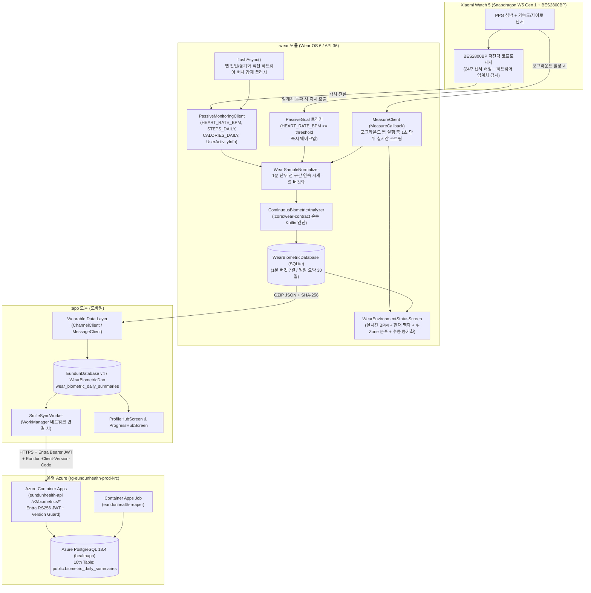

# Wear OS 상시(전 구간) 생체 신호·마음 상태 측정·분석 런타임, 운영 Azure 배포 런북 및 CLAUDE.md 거버넌스 통합 기획·설계서

> **문서 성격**: `2026-11-06-wear-os-foundation-env-setup-plan.md`(→ [`docs/plans/logs/android.md`](logs/android.md) 2026-11-06 entry, Foundation `AC-01 ~ AC-10` 완료)의 후속 **본 기능(Runtime Phase 1 ~ 4) + 운영 Azure 배포 런북 리팩토링 + `CLAUDE.md` 규칙 개정 통합 기획·설계서**이다.
>
> **핵심 설계 전환 (2026-11-09 심층 연구·코드베이스 전수 조사 반영)**:
> 1. **'비활동(휴식)' 한정의 한계 극복 → 워치 착용 전 구간 상시 측정 및 5차원 상태 맥락 분석 (`ContinuousBiometricAnalyzer`)**:
>    - `USER_ACTIVITY_PASSIVE`(휴식) 구간만 분석하면 외출·보행·일상 이동(`UNKNOWN`/경미한 활동) 중 발생하는 급격한 심박 급상승(스트레스·공황 전조), 만성 긴장 시간 분포(Time-in-Zone), 활동 직후 자율신경 회복 지연(HRR), 수면 중 야간 각성을 놓치게 된다.
>    - 이를 해결하기 위해 **워치 착용 전 시간(`PASSIVE` + `EXERCISE` + `ASLEEP` + `UNKNOWN`) 연속 1분 버킷 정규화 + 5차원 분석 엔진**과 **백그라운드 24/7(`PassiveMonitoringClient` + `PassiveGoal`) + 포그라운드 실시간(`MeasureClient` + `flushAsync()`) 이중 측정 파이프라인**을 구축한다.
> 2. **운영 Azure (`rg-eundunhealth-prod-krc`) 실측 기반 아키텍처·런북 리팩토링**:
>    - 실제 백엔드 코드베이스([`backend/app/dependencies.py`](../../backend/app/dependencies.py), [`backend/sql/02_schema_create_all.sql`](../../backend/sql/02_schema_create_all.sql), [`backend/tests/test_v2_reset.py`](../../backend/tests/test_v2_reset.py), [`scripts/verify_containerapp_deployment.py`](../../scripts/verify_containerapp_deployment.py), [`.github/workflows/backend.yml`](../../.github/workflows/backend.yml))를 전수 실측하여, **Microsoft Entra External ID (`RS256` JWKS) + `Eundun-Client-Version-Code` 버전 가드 + OpenAPI 스펙 동기화(`scripts/sync-openapi.sh` → `:app:openApiGenerate`) + PostgreSQL 18 10개 정규 테이블 1:1 계약(`test_v2_reset.py` & `seed_edge_cases.py`) + 배포 검증기(`verify_containerapp_deployment.py`) 고도화**까지 빈틈없이 맞물리도록 재설계했다.
> 3. **`CLAUDE.md` 운영 안전 규칙(룰 2, 3, 7, 12, 13, 14 개정 + 신규 룰 17 신설) 리팩토링**:
>    - 단일 `:app` 및 9개 DB 테이블 기준이던 기존 `CLAUDE.md` 규칙과 운영 런북을 **3모듈(`:app` + `:wear` + `:core:wear-contract`) + 10개 정규 테이블 + 운영 Azure 배포 검증 체계**에 맞게 전면 리팩토링한다.

- **작성/개정일**: 2026-11-09 (Asia/Seoul)
- **상태**: `in-progress` — 구현 및 로컬·에뮬레이터·단위 테스트 검증 완료
- **대상 릴리스**: 모바일 `:app` `v0.8.0` (`versionCode = 45` 예정, 현행 `44`) / 워치 `:wear` `wearVersionCode = 10001` ([`version.properties`](../../version.properties) SSoT)
- **타깃 실기기**: **Xiaomi Watch 5 (`M2501W1`, `OS3.0.3.70.WO61WMIXM`, Wear OS 6.0 / Android 16 API 36)**
- **상위 문서 및 이력**:
  - [`docs/proposals/README.md`](../proposals/README.md) (`PROP-06` / `PROP-06-A` 승격)
  - [`docs/plans/logs/android.md`](logs/android.md) (`2026-11-06` Foundation & `2026-11-09` Runtime)
  - [`docs/reports/2026-11-09-wear-os-user-action-items-guide.md`](../reports/2026-11-09-wear-os-user-action-items-guide.md) (사용자 필수 실행 가이드)

---

## 1. 타깃 실기기(Xiaomi Watch 5) 팩트체크 및 하드웨어 센서 아키텍처

사용자가 보유한 워치 실기기 정보를 공식 문서 및 글로벌 펌웨어 명명 규칙으로 대조·검증한 결과는 다음과 같다.

| 항목 | 실측/확인 값 | 기술적 의미 및 아키텍처 시사점 |
| :--- | :--- | :--- |
| **제품명 / 모델명** | **Xiaomi Watch 5 (`M2501W1`)** | 1.54인치 원형 AMOLED (`480 × 480`), 다채널 광학 심박(PPG)·SpO2·ECG·가속도·자이로 센서 탑재 |
| **듀얼 칩셋 구조** | **Snapdragon W5 Gen 1 + BES2800BP** | 고성능 AP(W5 Gen 1)와 초저전력 보조 프로세서(Airoha BES2800BP) 결합. **24시간 상시 심박·활동·수면 수집 시 보조 프로세서가 센서 배칭(Batching)과 임계치 트리거(`PassiveGoal`)를 전담하여 배터리 소모를 최소화**함 |
| **펌웨어 버전** | **`OS3.0.3.70.WO61WMIXM`** | `OS3.0.3.70` = Xiaomi HyperOS 3.0 웨어러블 레이어 / **`W` = Android 16 (API 36, Wear OS 6.0)** / `O61W` = Xiaomi Watch 5 기기 코드 / **`MIXM` = Global 정식 ROM** |
| **Google 서비스 지원** | **GMS + Play Store + Health Services 내장** | 글로벌(`MIXM`) Wear OS 6 정식 펌웨어이므로 Google Play 스토어, Google Play Services Wearable Data Layer(`ChannelClient` / `MessageClient`), AndroidX Health Services(`1.1.0`) 모두 100% 네이티브 동작 |
| **`:wear` 모듈 호환성** | **`minSdk = 36`, `targetSdk = 37`** | 현재 [`:wear/build.gradle.kts`](../../wear/build.gradle.kts)의 `minSdk = 36` 설정과 **정확히 일치** |
| **외부(비동일 Wi-Fi) 검증** | **운영 배포 경로로 즉시 검증 가능** | 개발자가 외부에 있어 PC와 워치가 같은 Wi-Fi(`ADB over Wi-Fi`)에 있지 않아도, **Play Console 내부/비공개/프로덕션 트랙에 `:wear` AAB를 배포**하고 운영 **Azure Container Apps (`eundunhealth-api`)** 를 배포하면 워치 단독 LTE/Wi-Fi 또는 스마트폰 블루투스 테더링으로 즉시 설치·실측 가능 |

---

## 2. 워치 착용 전 구간 상시 측정 및 다차원 분석 연구 (`ContinuousBiometricAnalyzer`)

### 2.1 왜 '비활동(휴식)' 한정 측정만으로는 부족한가?

초기 설계안에서는 `UserActivityState == USER_ACTIVITY_PASSIVE`(휴식/정지) 상태일 때만 심박 상승을 감지하도록 제한했으나, 실제 워치 착용 환경과 은둔고립청년의 일상 패턴을 분석하면 다음 **4가지 치명적 사각지대**가 발생한다.

1. **일상 이동·외출 중 사회적 긴장/공황 전조 누락**:
   - 은둔고립청년이 외출을 시도하거나 대중교통·편의점 등을 이용할 때는 약간의 보행이나 자세 변화가 동반되어 AndroidX Health Services가 상태를 `USER_ACTIVITY_UNKNOWN` 또는 경미한 활동으로 분류할 수 있다. 휴식(`PASSIVE`)만 필터링하면 **가장 중요한 외출 중 급격한 심박 급상승(Rapid Delta Spike)** 을 버리게 된다.
2. **하루 전체 자율신경 부하 분포(Continuous Zone Time-in-Range) 파악 불가**:
   - 특정 급상승 이벤트 건수만 세면, 하루 종일 심박이 경계선 부근(`restingBpm + 15 ~ 25 BPM`)에 머무르는 **만성적 긴장 상태(Chronic Elevated Tension)** 와 이완 상태를 구별할 수 없다.
3. **활동/운동 후 심박 회복력(HRR, Heart Rate Recovery) 미측정**:
   - 신체 활동(`USER_ACTIVITY_EXERCISE`) 자체는 정상적인 심박 상승을 유발하지만, 활동 중 과도한 심박 과부하가 걸리거나 **활동 종료 직후(`EXERCISE → PASSIVE` 전환 후 1~3분) 심박이 빠르게 떨어지지 않는 현상(HRR 지연)** 은 자율신경계 피로 및 스트레스 누적의 핵심 생리학적 지표다.
4. **수면(`USER_ACTIVITY_ASLEEP`) 중 야간 각성 및 일일 회복 점수 부재**:
   - 수면 중 심박 안정성과 야간 급상승(악몽·불안·수면 분절)을 분석해야 아침 기상 시 오늘의 신체·마음 회복도(`recoveryScore`)를 산출할 수 있다.

### 2.2 Wear OS 6 이중 측정 파이프라인 (24/7 백그라운드 + 포그라운드 실시간)

워치를 착용하고 사용하는 전 시간 동안 끊김 없이 측정하기 위해 AndroidX Health Services(`androidx.health:health-services-client:1.1.0`)의 **이중 경로(Dual-Path) 아키텍처**를 채택한다.



1. **백그라운드 24/7 상시 경로 (`PassiveMonitoringClient` + `PassiveListenerService`)**:
   - `PassiveListenerConfig`에 `DataType.HEART_RATE_BPM`, `DataType.STEPS_DAILY`, `DataType.CALORIES_DAILY` 및 `shouldUserActivityInfoBeRequested = true`를 설정한다.
   - **하드웨어 보조 프로세서 즉시 알림 (`PassiveGoal`)**:
     - `DataTypeCondition(DataType.HEART_RATE_BPM, threshold = 100.0, ComparisonType.GREATER_THAN_OR_EQUAL)`을 `dailyGoals`로 등록한다.
     - 평소에는 BES2800BP 코프로세서가 저전력으로 샘플을 배칭하다가, 착용자의 심박이 임계치를 돌파하면 배칭 주기를 기다리지 않고 즉시 `EundunPassiveListenerService.onGoalCompleted()`를 깨워 해당 시점의 심박·활동 맥락을 분석·기록한다.
2. **포그라운드 실시간 경로 (`MeasureClient` + `flushAsync()`)**:
   - 사용자가 워치 화면을 켜고 은둔헬스 워치 앱을 열면(`Lifecycle.Event.ON_START`):
     1. 즉시 `PassiveMonitoringClient.flushAsync()`를 호출하여 코프로세서 버퍼에 대기 중인 백그라운드 샘플을 즉시 플러시한다.
     2. 동시에 `MeasureClient.registerMeasureCallback(DataType.HEART_RATE_BPM, callback)`을 연결하여 화면을 보고 있는 동안 **1초 단위의 라이브 심박수(`liveBpm`)와 센서 접촉 품질(`Availability`)** 을 실시간으로 표시하고 시계열 버킷에 병합한다.
     3. 화면이 백그라운드로 내려가면(`Lifecycle.Event.ON_STOP`) `unregisterMeasureCallbackAsync`로 즉시 해제하여 배터리를 보호한다.

### 2.3 전 구간 5차원 연속 상태 분석 알고리즘 (`ContinuousBiometricAnalyzer`)

`:core:wear-contract`에 위치하는 `ContinuousBiometricAnalyzer`는 하루의 모든 측정 시점을 **1분 단위 연속 버킷(`MinuteBiometricBucket`)** 으로 정규화한 뒤, 특정 상태만 남기고 버리는 것이 아니라 **착용 전 구간(`totalMonitoredMinutes`)을 아래 5가지 차원으로 동시 분석**한다.

| 분석 차원 | 대상 착용 상태 | 산출 지표 (Contract 필드) | 알고리즘 및 생리학적 근거 |
| :--- | :--- | :--- | :--- |
| **① 개인 기저 심박선 (Adaptive Baseline)** | `ASLEEP` + `PASSIVE` | `restingBpm`, `avgBpm`, `minBpm`, `maxBpm`, `hrvRmssdMs` | 당일 착용 구간 중 `ASLEEP` 및 안정된 `PASSIVE` 버킷의 **하위 20백분위수(P20, 최소 5분 이상 확보 시)** 를 개인 `restingBpm`으로 산출 (미확보 시 전체 버킷 P15 또는 기본값 `70 BPM` 폴백). 개인별 기초 심박 차이를 보정함 |
| **② 전 구간 4-Zone 연속 시간 분포** | **전 상태 (`PASSIVE` + `EXERCISE` + `ASLEEP` + `UNKNOWN`)** | `totalMonitoredMinutes`, `relaxedZoneMinutes`, `normalZoneMinutes`, `elevatedTensionMinutes`, `highLoadMinutes` | 워치 착용 시간 전체를 4개 심박 존으로 100% 분류 (`4개 존의 합 == totalMonitoredMinutes` 불변식 보장):<br>• **이완/안정(`relaxedZoneMinutes`)**: 비운동 상태에서 `bpm < restingBpm + 10`<br>• **일상 활성(`normalZoneMinutes`)**: 비운동 상태에서 `restingBpm + 10 <= bpm < max(restingBpm + 20, 95)`<br>• **긴장/각성 주의(`elevatedTensionMinutes`)**: 비운동 상태에서 `restingBpm + 20 (최소 95) <= bpm < max(restingBpm + 45, 130)`<br>• **고부하/운동(`highLoadMinutes`)**: `EXERCISE` 상태이거나 `bpm >= max(restingBpm + 45, 130)` |
| **③ 상태 무관 급격한 심박 급상승 (Rapid Delta Spike)** | **전 상태 (보행·이동·미분류 `UNKNOWN` 포함)** | `rapidDeltaSpikeCount`, `maxDeltaBpmPerMin` | 활동 상태 분류(`PASSIVE` 여부)와 무관하게, **직전 3분 이동평균 대비 1~2분 내 `+18 BPM` 이상 급등**하고 동시에 `bpm >= max(restingBpm + 22, 100)`인 급성 자율신경 각성(외출 중 긴장, 공황 전조, 깜짝 놀람 등)을 포착 |
| **④ 휴식/일상 중 지속 긴장 에피소드 (Sustained Mind-Tension)** | `PASSIVE` + 비운동 `UNKNOWN` (`stepsDelta <= 15/min`) | `tensionEpisodeCount`, `tensionMinutes`, `peakTensionBpm` | 신체 이동이 거의 없는 상태에서 `bpm >= max(restingBpm + 20, 95)` 상태가 **연속 2분 이상** 지속될 때 1개의 지속 긴장 에피소드로 집계 (버킷 간 최대 2분 갭 병합) |
| **⑤ 활동 과부하 & 활동 후 심박 회복(HRR) + 수면 각성/회복 점수** | `EXERCISE`, `EXERCISE → PASSIVE` 전환 구간, `ASLEEP` | `activityOverloadCount`, `avgRecoveryDropBpm`, `sleepAwakeningCount`, `recoveryScore` (`0..100`) | • **활동 과부하(`activityOverloadCount`)**: `EXERCISE` 중 `bpm >= max(restingBpm + 55, 150)`이 연속 3분 이상 지속된 횟수<br>• **활동 후 회복(`avgRecoveryDropBpm`)**: `EXERCISE` 종료 후 비운동(`PASSIVE`/`UNKNOWN`) 전환 시점 피크 심박에서 2분 뒤 심박 감소량 평균 (`>= 20 BPM` 정상 회복, `< 12 BPM` 피로 누적)<br>• **수면 각성(`sleepAwakeningCount`)**: `ASLEEP` 중 수면 기저선 대비 `+15 BPM` 이상 치솟은 횟수<br>• **종합 회복 점수(`recoveryScore`, `0..100`)**: 이완 비율(+), 긴장 시간(-), 급상승 횟수(-), 수면 각성(-), HRR 회복력(+)을 가중 합산하여 산출 |

> [!IMPORTANT]
> **비의료 웰니스 고지 (Play 스토어 및 의료기기법 경계 준수)**:
> 위 5차원 분석 지표는 의학적 진단(부정맥·공황장애 진단 등)을 수행하지 않으며, 모든 UI/문서/API에서 **"착용 중 심박 변화·긴장도·회복 추세 참고 지표(웰니스 목적)"** 로 명확히 표기합니다.

---

## 3. 모듈별 상세 구현 설계 (`Phase 1 ~ Phase 3`)

### 3.1 Phase 1: `:core:wear-contract` — 상시 분석 계약 및 순수 Kotlin 엔진

- **파일 목록**:
  1. [`:core:wear-contract/src/main/kotlin/com/gunnys/eundunhealth/core/wearcontract/WearContractVersion.kt`](../../core/wear-contract/src/main/kotlin/com/gunnys/eundunhealth/core/wearcontract/WearContractVersion.kt) (` 수정 `)
  2. `:core:wear-contract/src/main/kotlin/com/gunnys/eundunhealth/core/wearcontract/BiometricSummaryContract.kt` (` 신규 `)
  3. `:core:wear-contract/src/main/kotlin/com/gunnys/eundunhealth/core/wearcontract/ContinuousBiometricAnalyzer.kt` (` 신규 `)
  4. `:core:wear-contract/src/main/kotlin/com/gunnys/eundunhealth/core/wearcontract/BiometricPayloadCodec.kt` (` 신규 `)
- **상세 설계**:
  - `WearContractVersion`:
    - `BIOMETRIC_DAILY_SUMMARY_PATH = "/eundunhealth/v1/biometric/daily_summary"`
    - `BIOMETRIC_SYNC_REQUEST_PATH = "/eundunhealth/v1/biometric/sync_request"`
    - `BIOMETRIC_SYNC_ACK_PATH = "/eundunhealth/v1/biometric/sync_ack"`
  - `BiometricSummaryContract.kt`:
    - `WearActivityContext`: `PASSIVE`, `EXERCISE`, `ASLEEP`, `UNKNOWN`
    - `MinuteBiometricBucket`: `epochMinute: Long`, `avgBpm: Int`, `maxBpm: Int`, `minBpm: Int`, `stepsDelta: Int`, `activityContext: WearActivityContext`
    - `HourlyBiometricBucket`: `hour: Int` (`0..23`), `avgBpm: Int`, `maxBpm: Int`, `dominantContext: WearActivityContext`, `monitoredMinutes: Int`
    - `BiometricDailySummaryRecord`:
      - 기본 식별/시간: `recordDate: String` (`YYYY-MM-DD`), `capturedAtEpochMs: Long`, `zoneId: String`, `sourceDevices: List<String>`
      - 활동/에너지: `totalSteps: Int`, `activeCaloriesKcal: Double`
      - 심박 기저선: `restingBpm: Int?`, `avgBpm: Int?`, `minBpm: Int?`, `maxBpm: Int?`, `hrvRmssdMs: Double?`
      - **전 구간 착용·4-Zone 분포**: `totalMonitoredMinutes: Int`, `relaxedZoneMinutes: Int`, `normalZoneMinutes: Int`, `elevatedTensionMinutes: Int`, `highLoadMinutes: Int`
      - **5차원 상태 분석 지표**: `tensionEpisodeCount: Int`, `tensionMinutes: Int`, `peakTensionBpm: Int?`, `rapidDeltaSpikeCount: Int`, `maxDeltaBpmPerMin: Int?`, `activityOverloadCount: Int`, `avgRecoveryDropBpm: Int?`, `sleepAwakeningCount: Int`, `recoveryScore: Int?`
      - 시간대 분포: `hourlyBuckets: List<HourlyBiometricBucket>`
    - `BiometricSyncBatchEnvelope`: `schemaVersion`, `sentAtEpochMs`, `sourceNodeId`, `deviceModel`, `summaries: List<BiometricDailySummaryRecord>`, `payloadSha256: String`
  - `BiometricPayloadCodec.kt`:
    - 외부 직렬화 라이브러리 의존성 없이 순수 JDK(`GZIPOutputStream`/`GZIPInputStream` + `MessageDigest("SHA-256")` + 결정론적 JSON 직렬화/파서)로 직렬화·압축·무결성 해시 검증을 수행.

### 3.2 Phase 2: `:wear` — Xiaomi Watch 5 상시 수집·실시간 측정·M3 대시보드

- **파일 목록**:
  1. [`:wear/src/main/AndroidManifest.xml`](../../wear/src/main/AndroidManifest.xml) (` 수정 `)
  2. [`:wear/proguard-rules.pro`](../../wear/proguard-rules.pro) (` 수정 `: `:core:wear-contract` 데이터 클래스 R8 fullMode 보호)
  3. `:wear/src/main/java/com/gunnys/eundunhealth/wear/data/WearBiometricDatabase.kt` (` 신규 `)
  4. `:wear/src/main/java/com/gunnys/eundunhealth/wear/sensor/WearHealthSensorGateway.kt` (` 신규 `)
  5. `:wear/src/main/java/com/gunnys/eundunhealth/wear/sensor/EundunPassiveListenerService.kt` (` 신규 `)
  6. `:wear/src/main/java/com/gunnys/eundunhealth/wear/sensor/PassiveMonitoringBootReceiver.kt` (` 신규 `)
  7. `:wear/src/main/java/com/gunnys/eundunhealth/wear/sync/WearDataLayerSender.kt` (` 신규 `)
  8. `:wear/src/main/java/com/gunnys/eundunhealth/wear/sync/PhoneSyncCommandListenerService.kt` (` 신규 `)
  9. [`:wear/src/main/java/com/gunnys/eundunhealth/wear/presentation/WearEnvironmentStatusScreen.kt`](../../wear/src/main/java/com/gunnys/eundunhealth/wear/presentation/WearEnvironmentStatusScreen.kt) 및 [`:wear/src/main/java/com/gunnys/eundunhealth/wear/presentation/WearMainActivity.kt`](../../wear/src/main/java/com/gunnys/eundunhealth/wear/presentation/WearMainActivity.kt) (` 수정 `)
- **상세 설계**:
  - **권한 선언 (`wear/src/main/AndroidManifest.xml`)**:
    - `android.permission.BODY_SENSORS` (API 36 심박 센서)
    - `android.permission.ACTIVITY_RECOGNITION` (걸음 수 및 `UserActivityInfo` 상태 전환 감지)
    - `android.permission.RECEIVE_BOOT_COMPLETED` (재부팅 시 `PassiveMonitoringClient` 자동 재등록)
    - `EundunPassiveListenerService` (`com.google.android.wearable.healthservices.permission.PASSIVE_DATA_BINDING`)
    - `PhoneSyncCommandListenerService` (`com.google.android.gms.wearable.MESSAGE_RECEIVED`, `/eundunhealth/v1/biometric/sync_request`)
  - **워치 로컬 SQLite 저장소 (`WearBiometricDatabase`)**:
    - `minute_biometric_buckets` (`epoch_minute PK`, `record_date`, `avg_bpm`, `max_bpm`, `min_bpm`, `steps_delta`, `activity_context`): 최근 7일치 1분 버킷 보관(7일 경과분 자동 DELETE). 새 샘플이 들어올 때마다 해당 일자의 버킷 전체를 `ContinuousBiometricAnalyzer.analyzeDay()`에 통과시켜 일일 요약을 실시간 갱신.
    - `daily_biometric_summaries` (`record_date PK`, `summary_json`, `synced_at_epoch_ms`): 최근 30일치 일일 요약 보관 및 폰 전송 ACK 추적.
  - **워치 UI/UX (`WearEnvironmentStatusScreen.kt` 확장)**:
    - 원형 화면(`480×480`, `ScreenScaffold` + `TransformingLazyColumn`)에 최적화된 4개 핵심 카드 제공:
      1. **실시간 심박 & 착용 맥락 헤더**: 포그라운드 `MeasureClient`가 측정 중인 라이브 BPM + 현재 상태 배지(`휴식 중` / `이동·활동 중` / `수면` + 오늘 회복 점수 `recoveryScore`점)
      2. **전 구간 4-Zone 심박 분포 바**: 오늘 착용 시간(`totalMonitoredMinutes`분) 중 `이완` · `일상` · `긴장 주의` · `고부하` 시간 비율 시각화
      3. **마음·자율신경 주요 감지 요약**: 급격한 심박 상승(`rapidDeltaSpikeCount`회), 지속 긴장(`tensionEpisodeCount`회 / `tensionMinutes`분), 활동 후 회복(`avgRecoveryDropBpm`)
      4. **권한 요청 & 즉시 동기화 액션**: 권한 미허용 시 원탭 권한 요청, 허용 시 `지금 폰으로 동기화` (`flushAsync()` 후 즉시 Data Layer 전송) + 하단 진단 정보

### 3.3 Phase 3: `:app` — Data Layer 수신, Room DB 확장, OpenAPI 연동 및 모바일 UI

- **모바일 `:app` 권한 정책**:
  - `:app/src/main/AndroidManifest.xml`에는 **어떠한 신규 `android.permission.health.*` 권한도 추가하지 않는다** (기존 `READ_EXERCISE`만 유지). 모든 워치 연속 측정 데이터는 Google Play Services Wearable Data Layer를 통해 수신하므로 Play Console 건강 앱 선언 위반 리스크가 `0`이다.
- **Room 데이터베이스 전략 (룰 14 준수)**:
  - 현재 `:app`은 `EundunDatabase` (`version = 3`)와 `SmileTrainingDatabase` (`version = 2`)를 운영 중이다.
  - 워치 생체 요약 테이블(`wear_biometric_daily_summaries`)은 `SmileTrainingDatabase`와 동일하게 오프라인-우선 동기화 도메인이므로, `EundunDatabase`를 **`version = 4` (`MIGRATION_3_4`, `CREATE TABLE IF NOT EXISTS wear_biometric_daily_summaries ...`)** 로 무중단 마이그레이션하고 `app/schemas/com.gunnys.eundunhealth.data.local.EundunDatabase/4.json` 스키마 파일을 커밋한다 (`DatabaseModuleTest`가 `validateMigrationsNotRequired()` 및 스키마 JSON 존재를 자동 검증).
- **파일 목록**:
  1. [`:app/build.gradle.kts`](../../app/build.gradle.kts) (` 수정 `: `libs.play.services.wearable` 추가)
  2. `:app/src/main/java/com/gunnys/eundunhealth/data/local/entity/WearBiometricSummaryEntity.kt` (` 신규 `)
  3. `:app/src/main/java/com/gunnys/eundunhealth/data/local/dao/WearBiometricDao.kt` (` 신규 `)
  4. `:app/src/main/java/com/gunnys/eundunhealth/data/local/EundunDatabase.kt` & [`:app/src/main/java/com/gunnys/eundunhealth/di/DatabaseModule.kt`](../../app/src/main/java/com/gunnys/eundunhealth/di/DatabaseModule.kt) (` 수정 `: `version = 4` + `MIGRATION_3_4`)
  5. `:app/src/main/java/com/gunnys/eundunhealth/data/local/DefaultLocalDataWiper.kt` (` 수정 `: `dagger.Lazy<WearBiometricDao>` 주입 및 계정 탈퇴/초기화 시 `wearBiometricDao.get().deleteAll()` 호출 — 룰 14 Layer 2 준수)
  6. `:app/src/main/java/com/gunnys/eundunhealth/data/wear/PhoneWearDataListenerService.kt` & `WearBiometricRepositoryImpl.kt` (` 신규 `)
  7. `:app/src/main/java/com/gunnys/eundunhealth/data/sync/SmileSyncWorker.kt` (` 수정 `: 미동기화 워치 일일 요약 레코드도 백엔드 `/v2/biometrics/sync`로 함께 배치 업로드)
  8. [`:app/src/main/java/com/gunnys/eundunhealth/ui/profile/ProfileHubScreen.kt`](../../app/src/main/java/com/gunnys/eundunhealth/ui/profile/ProfileHubScreen.kt), [`ProfileHubViewModel.kt`](../../app/src/main/java/com/gunnys/eundunhealth/ui/profile/ProfileHubViewModel.kt), [`:app/src/main/java/com/gunnys/eundunhealth/ui/progress/ProgressHubScreen.kt`](../../app/src/main/java/com/gunnys/eundunhealth/ui/progress/ProgressHubScreen.kt), [`ProgressHubViewModel.kt`](../../app/src/main/java/com/gunnys/eundunhealth/ui/progress/ProgressHubViewModel.kt) (` 수정 `)

---

## 4. 운영 Azure (`rg-eundunhealth-prod-krc`) 적용 아키텍처 및 무중단 배포·실측 검증 런북 (`Phase 4`)

사용자 요청(`"'운영 Azure 무중단 배포 및 실측 검증 런북' 내용과 'CLAUDE.md 룰'은 변경해도 되는 사항이니까. 작업에 적합하게 연구/점검/리팩토링/조사 작업해서 설계해도 되"`)에 따라, 실제 코드베이스를 전수 조사하여 발견한 **6가지 핵심 기술 팩트**를 바탕으로 운영 Azure 아키텍처와 런북을 재설계했다.

### 4.1 코드베이스 실측을 통해 바로잡은 6가지 핵심 아키텍처 팩트

1. **인증 및 클라이언트 버전 가드 (`Microsoft Entra External ID` RS256 + `Eundun-Client-Version-Code`)**:
   - 본 프로젝트의 백엔드([`backend/app/dependencies.py`](../../backend/app/dependencies.py))는 Firebase Auth가 아니라 **Microsoft Entra External ID (`eundunhealthciam`, `RS256` JWKS 24h 캐시, `oid` claim = `user_id`)** 와 **`require_supported_android_client` (`Eundun-Client-Version-Code` 헤더 검증)** 를 사용한다.
   - 따라서 신규 `/v2/biometrics/*` 엔드포인트도 모두 `Depends(get_current_user_id)` + `Depends(require_supported_android_client)` 체인을 동일하게 적용한다.
2. **PostgreSQL 18 정규 스키마 (`02_schema_create_all.sql`) 1:1 계약 (`test_v2_reset.py`)**:
   - [`backend/sql/02_schema_create_all.sql`](../../backend/sql/02_schema_create_all.sql)에는 `public.users` 테이블이 없으며, [`smile_training_sessions`](../../backend/sql/02_schema_create_all.sql#L186-L201)와 동일하게 `user_id VARCHAR(128) NOT NULL` + `CONSTRAINT ck_biometric_daily_summaries_user_id_nonempty CHECK (length(trim(user_id)) >= 1)` 패턴을 사용한다 (신체 프로필 미입력 상태에서도 워치 동기화가 가능하며, 계정 탈퇴 시 [`AccountService._purge_app_data()`](../../backend/app/services/account_service.py#L74-L88)가 일괄 삭제).
   - [`backend/tests/test_v2_reset.py`](../../backend/tests/test_v2_reset.py#L105-L135)는 정규식으로 `02_schema_create_all.sql`과 SQLAlchemy `Base.metadata`의 **테이블명·컬럼명·인덱스명·제약조건명(`pk_`, `uq_`, `ck_`)이 1:1로 완전 일치하는지** 검사한다.
   - 또한 PostgreSQL 18과 SQLite 인메모리 단위 테스트(`sqlite+aiosqlite:///:memory:`) 양쪽에서 100% 호환되도록 `hourly_bpm_buckets_json`과 `source_devices_json`은 [`weekly_plans.day_plans`](../../backend/sql/02_schema_create_all.sql#L78-L84)와 동일하게 **`TEXT NOT NULL` + `length(trim(...)) >= 2` CHECK 제약조건**으로 정의한다.
3. **10개 정규 테이블 체제 전환 및 100건 시더(`seed_edge_cases.py`) 정합화**:
   - `biometric_daily_summaries`가 추가되면서 정규 테이블 수는 **9개 → 10개**가 된다.
   - [`seed_edge_cases.py`](../../backend/scripts/seed_edge_cases.py#L42-L53)의 `EXPECTED_TABLE_COUNTS`를 10개 테이블(`smile_training_sessions: 9`, `biometric_daily_summaries: 5`, 총합 `EXPECTED_TOTAL_ROWS = 100` 유지)로 확장하고, SAVEPOINT 기반 제약조건 검증에 `uq_biometric_daily_summaries_user_date` 중복 차단 및 `ck_biometric_daily_summaries_recovery_score_range` 범위 초과 차단 검증을 추가한다.
4. **고아 계정 정리 잡(`eundunhealth-reaper`) 후보 스캔 범위 리팩토링**:
   - 기존 [`AccountService.reap_orphaned_data()`](../../backend/app/services/account_service.py#L100)는 `self.profile_repo.list_all_user_ids()`만 조회하여, 만약 프로필을 아직 생성하지 않고 워치나 스마일 트레이닝만 사용한 계정이 고아가 되면 스캔에서 빠질 수 있었다.
   - 이를 개선하여 `user_profiles`, `smile_training_sessions`, `biometric_daily_summaries`의 `user_id` 합집합을 스캔하도록 리팩토링한다.
5. **OpenAPI 스펙 자동 추출(`scripts/sync-openapi.sh`) 및 `:app:openApiGenerate` 연동**:
   - 라우터 추가 시 `bash scripts/sync-openapi.sh`를 실행해 [`backend/openapi.json`](../../backend/openapi.json)을 갱신하면 [`.github/workflows/backend.yml`](../../.github/workflows/backend.yml#L83-L110)의 OpenAPI drift 가드를 통과함과 동시에 `:app`에서 OpenAPI Generator로 생성된 DTO/클라이언트를 즉시 사용할 수 있다.
6. **배포 검증기(`scripts/verify_containerapp_deployment.py`) 고도화**:
   - 기존 [`verify_containerapp_deployment.py`](../../scripts/verify_containerapp_deployment.py#L139)는 `versionCode=44`가 하드코딩되어 있고 공개 엔드포인트 5개만 검사했다.
   - 이를 리팩토링하여:
     1. 루트 `version.properties`에서 `versionCode`를 동적으로 파싱하고,
     2. 배포된 운영 컨테이너의 `https://<fqdn>/v2/biometrics/daily`에 미인증 GET 요청을 보내 **`404 Not Found`가 아닌 `401 Unauthorized` (또는 `403`)가 반환되는지 검증**함으로써 신규 바이오메트릭 라우터가 실제 운영 리비전에 마운트되었음을 100% 보장한다.

### 4.2 운영 PostgreSQL 18.4 10번째 정규 테이블 DDL (`02_schema_create_all.sql` & `BiometricDailySummary`)

- **파일**:
  - [`backend/sql/01_cleanup_drop_all.sql`](../../backend/sql/01_cleanup_drop_all.sql) (` 수정 `: `DROP TABLE IF EXISTS public.biometric_daily_summaries CASCADE;` 추가)
  - [`backend/sql/02_schema_create_all.sql`](../../backend/sql/02_schema_create_all.sql) (` 수정 `: 아래 `#10. biometric_daily_summaries` 추가)
  - `backend/app/models/biometric_summary.py` (` 신규 `)
  - [`backend/app/models/__init__.py`](../../backend/app/models/__init__.py) (` 수정 `)

```sql
-- ----------------------------------------------------------------------------
-- 10. biometric_daily_summaries (Wear OS 6 Continuous All-State Daily Summary)
-- ----------------------------------------------------------------------------
CREATE TABLE public.biometric_daily_summaries (
    id UUID NOT NULL DEFAULT uuidv7(),
    user_id VARCHAR(128) NOT NULL,
    record_date DATE NOT NULL,
    zone_id VARCHAR(64) NOT NULL DEFAULT 'Asia/Seoul',
    total_steps INTEGER NOT NULL DEFAULT 0,
    active_calories_kcal DOUBLE PRECISION NOT NULL DEFAULT 0.0,
    resting_bpm INTEGER NULL,
    avg_bpm INTEGER NULL,
    min_bpm INTEGER NULL,
    max_bpm INTEGER NULL,
    hrv_rmssd_ms DOUBLE PRECISION NULL,
    total_monitored_minutes INTEGER NOT NULL DEFAULT 0,
    relaxed_zone_minutes INTEGER NOT NULL DEFAULT 0,
    normal_zone_minutes INTEGER NOT NULL DEFAULT 0,
    elevated_tension_minutes INTEGER NOT NULL DEFAULT 0,
    high_load_minutes INTEGER NOT NULL DEFAULT 0,
    tension_episode_count INTEGER NOT NULL DEFAULT 0,
    tension_minutes INTEGER NOT NULL DEFAULT 0,
    peak_tension_bpm INTEGER NULL,
    rapid_delta_spike_count INTEGER NOT NULL DEFAULT 0,
    max_delta_bpm_per_min INTEGER NULL,
    activity_overload_count INTEGER NOT NULL DEFAULT 0,
    avg_recovery_drop_bpm INTEGER NULL,
    sleep_awakening_count INTEGER NOT NULL DEFAULT 0,
    recovery_score INTEGER NULL,
    hourly_bpm_buckets_json TEXT NOT NULL DEFAULT '[]',
    source_devices_json TEXT NOT NULL DEFAULT '[]',
    client_captured_at TIMESTAMPTZ NOT NULL,
    updated_at TIMESTAMPTZ NOT NULL DEFAULT now(),
    CONSTRAINT pk_biometric_daily_summaries PRIMARY KEY (id),
    CONSTRAINT uq_biometric_daily_summaries_user_date UNIQUE (user_id, record_date),
    CONSTRAINT ck_biometric_daily_summaries_user_id_nonempty CHECK (length(trim(user_id)) >= 1),
    CONSTRAINT ck_biometric_daily_summaries_zone_id_nonempty CHECK (length(trim(zone_id)) >= 1),
    CONSTRAINT ck_biometric_daily_summaries_total_steps_range CHECK (total_steps >= 0 AND total_steps <= 200000),
    CONSTRAINT ck_biometric_daily_summaries_active_calories_range CHECK (active_calories_kcal >= 0.0 AND active_calories_kcal <= 20000.0),
    CONSTRAINT ck_biometric_daily_summaries_resting_bpm_range CHECK (resting_bpm IS NULL OR (resting_bpm >= 30 AND resting_bpm <= 220)),
    CONSTRAINT ck_biometric_daily_summaries_avg_bpm_range CHECK (avg_bpm IS NULL OR (avg_bpm >= 30 AND avg_bpm <= 240)),
    CONSTRAINT ck_biometric_daily_summaries_min_bpm_range CHECK (min_bpm IS NULL OR (min_bpm >= 25 AND min_bpm <= 240)),
    CONSTRAINT ck_biometric_daily_summaries_max_bpm_range CHECK (max_bpm IS NULL OR (max_bpm >= 30 AND max_bpm <= 260)),
    CONSTRAINT ck_biometric_daily_summaries_hrv_rmssd_range CHECK (hrv_rmssd_ms IS NULL OR (hrv_rmssd_ms >= 0.0 AND hrv_rmssd_ms <= 500.0)),
    CONSTRAINT ck_biometric_daily_summaries_monitored_min_range CHECK (total_monitored_minutes >= 0 AND total_monitored_minutes <= 1440),
    CONSTRAINT ck_biometric_daily_summaries_relaxed_min_range CHECK (relaxed_zone_minutes >= 0 AND relaxed_zone_minutes <= 1440),
    CONSTRAINT ck_biometric_daily_summaries_normal_min_range CHECK (normal_zone_minutes >= 0 AND normal_zone_minutes <= 1440),
    CONSTRAINT ck_biometric_daily_summaries_elevated_min_range CHECK (elevated_tension_minutes >= 0 AND elevated_tension_minutes <= 1440),
    CONSTRAINT ck_biometric_daily_summaries_high_load_min_range CHECK (high_load_minutes >= 0 AND high_load_minutes <= 1440),
    CONSTRAINT ck_biometric_daily_summaries_tension_count_range CHECK (tension_episode_count >= 0 AND tension_episode_count <= 500),
    CONSTRAINT ck_biometric_daily_summaries_tension_min_range CHECK (tension_minutes >= 0 AND tension_minutes <= 1440),
    CONSTRAINT ck_biometric_daily_summaries_peak_tension_bpm_range CHECK (peak_tension_bpm IS NULL OR (peak_tension_bpm >= 40 AND peak_tension_bpm <= 260)),
    CONSTRAINT ck_biometric_daily_summaries_rapid_spike_count_range CHECK (rapid_delta_spike_count >= 0 AND rapid_delta_spike_count <= 500),
    CONSTRAINT ck_biometric_daily_summaries_max_delta_bpm_range CHECK (max_delta_bpm_per_min IS NULL OR (max_delta_bpm_per_min >= 0 AND max_delta_bpm_per_min <= 180)),
    CONSTRAINT ck_biometric_daily_summaries_overload_count_range CHECK (activity_overload_count >= 0 AND activity_overload_count <= 500),
    CONSTRAINT ck_biometric_daily_summaries_recovery_drop_range CHECK (avg_recovery_drop_bpm IS NULL OR (avg_recovery_drop_bpm >= -100 AND avg_recovery_drop_bpm <= 180)),
    CONSTRAINT ck_biometric_daily_summaries_sleep_awakening_range CHECK (sleep_awakening_count >= 0 AND sleep_awakening_count <= 500),
    CONSTRAINT ck_biometric_daily_summaries_recovery_score_range CHECK (recovery_score IS NULL OR (recovery_score >= 0 AND recovery_score <= 100)),
    CONSTRAINT ck_biometric_daily_summaries_hourly_json_nonempty CHECK (length(trim(hourly_bpm_buckets_json)) >= 2),
    CONSTRAINT ck_biometric_daily_summaries_devices_json_nonempty CHECK (length(trim(source_devices_json)) >= 2)
);

CREATE INDEX ix_biometric_daily_summaries_user_date
    ON public.biometric_daily_summaries (user_id, record_date DESC);
```

### 4.3 운영 FastAPI 엔드포인트 (`/v2/biometrics/*`) 명세

라우터 `backend/app/routers/biometrics.py` (`prefix="/v2/biometrics"`, 태그 `["biometrics"]`)를 추가하여 총 API 엔드포인트 수를 **27개 → 30개**(JWT 필요 25개 + 공개 5개)로 확장한다.

| Method & Path | Operation ID | 역할 및 멱등·보안 규칙 |
| :--- | :--- | :--- |
| **`POST /v2/biometrics/sync`** | `syncBiometricDailySummaries` | 최대 30일치 일일 요약 배치(`summaries: list[BiometricDailySummaryUpsertItem]`, `min_length=1, max_length=30`)를 수신하여 `(user_id, record_date)` 기준 멱등 Upsert 수행. 동일 날짜 재수신 시 `total_monitored_minutes`가 더 크거나 `client_captured_at`이 최신인 요약으로 갱신 |
| **`GET /v2/biometrics/daily`** | `getBiometricDailySummaries` | `days: int = Query(default=14, ge=1, le=90)` 기간 동안의 KST 기준 사용자 일일 생체·마음 상태 요약 리스트 및 최근 7일 평균 회복 점수(`avgRecoveryScore`)·총 급상승/긴장 요약 반환 |
| **`DELETE /v2/biometrics/daily`** | `deleteBiometricDailySummaries` | 사용자의 전체 워치 생체 요약 기록을 즉시 삭제(`204 No Content`). 계정 유지 상태에서 건강 데이터만 단독 파기 가능 (Play 스토어 데이터 삭제 정책 준수) |

### 4.4 운영 Azure 배포 및 실측 검증 런북 (Refactored Production Runbook — 무중단 제약 불필요)

운영 환경(`rg-eundunhealth-prod-krc`)은 현재 실사용자가 개발자 1인이므로 **무중단 배포(Zero-Downtime) 제약을 둘 필요가 없으며**, 배포 중 일시 중단이나 **Clean-Slate 하드 리셋(`hard_reset_db.py`: Drop & Recreate)** 도 자유롭게 수행할 수 있다. 상황에 따라 **경로 A(`entrypoint.sh` 자동 스키마 부트스트랩)** 와 **경로 B(`hard_reset_db.py` 10개 정규 테이블 Clean-Slate 하드 리셋)** 를 사용한다.

#### 단계 1: 배포 전 로컬 + WSL2 Linux CI 패리티 검증 (Pre-Deployment Gate)
```bash
# 1) OpenAPI 스펙 동기화 및 법적 고지 문서 동기화
bash scripts/sync-openapi.sh
bash scripts/sync-legal-docs.sh

# 2) 백엔드 린트·타입·단위 테스트(10개 테이블 1:1 정합성 test_v2_reset.py 포함) 및 배포 검증기 테스트
cd backend
.venv/Scripts/ruff check app/ tests/ scripts/
.venv/Scripts/ruff format --check app/ tests/ scripts/
.venv/Scripts/mypy app/
.venv/Scripts/pytest tests/ -v
.venv/Scripts/python.exe ../scripts/test_verify_containerapp_deployment.py
cd ..

# 3) 결정론적 문서 감사 (CLAUDE.md / README / operations-snapshot / TRD / PRD / CHANGELOG)
python scripts/agents/doc_audit.py --strict
```

#### 단계 2: 운영 Azure 자동 배포 (`backend.yml`)
1. `main` 브랜치 push (또는 `gh workflow run backend.yml --ref main -f deploy=true`) 실행.
2. **CI `runtime-smoke` 잡 (PR/Push 게이트)**:
   - `docker compose up -d --build` (PostgreSQL 18 컨테이너) → `entrypoint.sh`의 `python -m app.schema_bootstrap` 실행 확인 → `hard_reset_db.py --confirmation DROP_AND_RECREATE_ALL_SCHEMAS --seed-edge-cases --verify-constraints`로 **10개 정규 테이블 생성 + 100건 엣지 케이스 시딩 + SAVEPOINT 제약조건 검증**을 먼저 통과해야만 배포 잡으로 진입한다.
3. **CD `deploy` 잡 (`backend-production` 환경)**:
   - Docker 이미지 빌드 → Trivy `CRITICAL,HIGH` 0건 검증 → `eundunhealthacr.azurecr.io/eundunhealth-api:<sha7>` 푸시.
   - Key Vault(`kv-eundunhealth`) 8개 시크릿 존재 사전 검증.
   - `az containerapp update --name eundunhealth-api --resource-group rg-eundunhealth-prod-krc --yaml /tmp/containerapp.rendered.yaml` 실행.
   - **스키마 자동 반영 (`schema_bootstrap.py`)**: 새 리비전 컨테이너가 기동될 때 [`backend/entrypoint.sh`](../../backend/entrypoint.sh)가 `python -m app.schema_bootstrap`을 실행하여 10번째 테이블 `public.biometric_daily_summaries`와 인덱스를 생성한다.
   - Startup probe(`/health`) 및 Readiness probe(`/health/ready`)가 `200`을 반환하면 새 리비전으로 교체된다.
   - 이어서 `eundunhealth-reaper` Container Apps Job도 동일한 `<sha7>` 이미지로 업데이트되어 고아 계정 정리 시 `biometric_daily_summaries`까지 포함해 스윕한다.

#### 단계 3: 운영 배포 직후 자동·수동 실측 검증 (Post-Deployment Live Verification)
1. **자동 검증 (`scripts/verify_containerapp_deployment.py`)**:
   - `latestRevisionName == latestReadyRevisionName`, `runningStatus == Running`, 이미지 digest 일치 확인.
   - 공개 엔드포인트 5종(`/health`, `/health/ready`, `/app-compatibility?platform=android&versionCode=<동적버전>`, `/privacy`, `/account-deletion`) `200 OK` 확인.
   - **신규 보호 라우트 마운트 실측**: `https://<fqdn>/v2/biometrics/daily` 호출 시 `404`가 아닌 **`401`/`403`(인증 게이트 정상 동작 및 라우터 마운트 완료)** 응답 확인.
2. **경로 B (운영 DB 10개 정규 테이블 Clean-Slate 하드 리셋)**:
   - 실사용자가 개발자 본인이므로 운영 PostgreSQL 18(`healthapp`)을 `01_cleanup_drop_all.sql` → `02_schema_create_all.sql`로 깨끗이 재구축하고자 할 때 언제든 아래 명령으로 즉시 리셋할 수 있다:
     ```bash
     az containerapp exec \
       --name eundunhealth-api \
       --resource-group rg-eundunhealth-prod-krc \
       --command "python scripts/hard_reset_db.py --confirmation DROP_AND_RECREATE_ALL_SCHEMAS --reset-id hard-reset-2026-11-09-wear --image-sha <sha7> --execution-id prod-manual --verify-constraints"
     ```

---

## 5. `CLAUDE.md` 규칙 리팩토링 설계안 (룰 2·3·7·12·13·14 개정 + 룰 17 신설)

본 작업 구현 시 [`CLAUDE.md`](../../CLAUDE.md)의 아키텍처·엔드포인트 명세(`27 → 30개`)·정규 테이블 수(`9 → 10개`)와 함께 아래 운영 안전 규칙들을 현행 3모듈 + Wear OS 상시 측정 + 운영 Azure 체계에 맞게 리팩토링한다.

| 대상 규칙 | 기존 내용의 한계 | 리팩토링·개정 설계 내용 |
| :--- | :--- | :--- |
| **룰 2 & 룰 13**<br>(릴리스 산출물 & 단조성 원장) | 단일 모바일 `:app` (`versionCode`)만 전제함 | • 모바일 `:app`(`versionCode`)과 워치 `:wear`(`wearVersionCode`) **듀얼 산출물 검증(`scripts/android-cli-check.sh apk --module app` 및 `--module wear`)** 명시<br>• [`docs/ops/play-upload-ledger.md`](../ops/play-upload-ledger.md)에서 모바일 `LAST_UPLOADED_VERSION_CODE`와 워치 `wearVersionCode` 단조성 관리 기준 명문화 |
| **룰 3 & 룰 7**<br>(DB 스키마 정합성 & 운영 배포 런북) | 9개 정규 테이블 고정 | • **10개 정규 테이블(`biometric_daily_summaries` 포함)** 기준으로 갱신<br>• **스키마 운영 원칙 명문화 (무중단 제약 불필요)**:<br>  1) **CI / 로컬 정합성 검증**: `hard_reset_db.py --seed-edge-cases --verify-constraints` (10개 테이블 100건 시딩 + 12개 SAVEPOINT 제약 검증) + `test_v2_reset.py` (SQL ↔ ORM 1:1 일치)<br>  2) **운영 Azure 배포**: `entrypoint.sh` → `python -m app.schema_bootstrap` 자동 부트스트랩 또는 `hard_reset_db.py` Clean-Slate 하드 리셋 모두 허용 + `verify_containerapp_deployment.py`가 `/v2/biometrics/daily` 라우트 마운트(`401/403`)까지 자동 실측 |
| **룰 12 & 룰 14**<br>(R8 보호 & 5계층 방어 매트릭스) | `:app` 중심 서술 | • **3모듈(`:core:wear-contract`, `:wear`, `:app`) 확장형 5-Layer Defense Matrix**:<br>  - **Layer 1**: `ContinuousBiometricAnalyzerTest`(5차원 전 구간 분석), `BiometricPayloadCodecTest`, `DatabaseModuleTest`(`EundunDatabase` v4 `MIGRATION_3_4`), `ProguardKeepRulesTest`(`:app` + `:wear` 양쪽 R8 fullMode 직렬화 보호)<br>  - **Layer 2**: `DefaultLocalDataWiper`의 `dagger.Lazy<WearBiometricDao>` 지연 초기화 + `:wear` `MeasureClient`의 `ON_STOP` 콜백 해제(배터리 누수 방지)<br>  - **Layer 3**: Room v4 schema JSON 커밋 + PG 18 `test_v2_reset.py` 10개 테이블 1:1 검증<br>  - **Layer 4**: `android-cli-check.sh previews wear --render` 및 `--module app|wear` Cold-Start 스모크<br>  - **Layer 5**: `verify_containerapp_deployment.py` + Sentry 모니터링 |
| **신규 룰 17 (신설)**<br>(Wear OS 6 상시 생체·마음 상태 아키텍처 불변식) | 신규 도메인 규칙 부재 | **룰 17 — Wear OS 6 상시 생체·마음 상태 파이프라인 & 프라이버시·권한·배터리 불변식**:<br>1. **전 구간(All-State) 측정 원칙**: 특정 상태(`PASSIVE`)만 필터링하지 않고 착용 전 구간(`PASSIVE`, `EXERCISE`, `ASLEEP`, `UNKNOWN`)을 1분 버킷으로 정규화해 5차원 지표(기저심박, 4-Zone 시간 분포, 상태 무관 급상승 `RapidDeltaSpike`, 지속 긴장, 활동 과부하/HRR 회복·수면 각성·회복 점수)를 산출한다 (`4개 Zone 분 합계 == totalMonitoredMinutes` 불변식).<br>2. **모바일 `:app` Health Connect 권한 동결**: `:app` 매니페스트에는 미승인 `android.permission.health.*` 권한을 추가하지 않으며(`READ_EXERCISE`만 유지), 워치 생체 데이터는 Google Play Services Wearable Data Layer로만 수신한다.<br>3. **데이터 최소화 및 PII/생체 원문 로깅 금지**: 1분 단위 원시 버킷은 워치 SQLite에 최대 7일만 보관 후 자동 삭제하며, 폰과 운영 Azure DB(`biometric_daily_summaries`)에는 일일 요약만 전송한다. 백엔드 로그/Sentry 브레드크럼에는 BPM·걸음 수·긴장 횟수 원문을 절대 남기지 않는다. |

---

## 6. 단계별 실행 순서 요약 (승인 후 즉시 진행)

1. **`Step 1 (:core:wear-contract)`**:
   - `WearContractVersion.kt` 경로 상수 추가, `BiometricSummaryContract.kt`, `ContinuousBiometricAnalyzer.kt` (전 구간 5차원 분석 엔진), `BiometricPayloadCodec.kt` (GZIP + SHA-256) 구현 및 단위 테스트(`ContinuousBiometricAnalyzerTest`, `BiometricPayloadCodecTest`) 작성·통과.
2. **`Step 2 (:wear)`**:
   - `AndroidManifest.xml` 권한/서비스 등록, `proguard-rules.pro` 직렬화 보호, `WearBiometricDatabase.kt`, `WearHealthSensorGateway.kt` (`PassiveMonitoringClient` + `PassiveGoal` + `MeasureClient` + `flushAsync`), `EundunPassiveListenerService.kt`, `WearDataLayerSender.kt`, `PhoneSyncCommandListenerService.kt`, `WearEnvironmentStatusScreen.kt` (원형 480×480 상시 생체·마음 상태 대시보드 UI) 구현 및 단위 테스트·프리뷰 검증.
3. **`Step 3 (backend & OpenAPI 동기화)`**:
   - `01_cleanup_drop_all.sql`, `02_schema_create_all.sql` (10번째 테이블 `biometric_daily_summaries`), `app/models/biometric_summary.py`, `app/schemas/biometrics.py`, `app/repositories/biometric_repo.py`, `app/services/biometric_service.py`, `app/routers/biometrics.py` (`/v2/biometrics/sync`, `/v2/biometrics/daily` GET/DELETE) 구현.
   - `account_service.py` (`_purge_app_data` 및 `reap_orphaned_data` 후보 합집합 스캔), `hard_reset_db.py`, `seed_edge_cases.py` (10개 테이블 100건 시더), `test_v2_reset.py`, `test_account.py`, `test_biometrics.py` 업데이트.
   - `scripts/verify_containerapp_deployment.py` (동적 `versionCode` + `/v2/biometrics/daily` 보호 라우트 마운트 검증) 업데이트 및 `bash scripts/sync-openapi.sh` 실행.
4. **`Step 4 (:app)`**:
   - `EundunDatabase` v4 (`MIGRATION_3_4`, `WearBiometricSummaryEntity`, `WearBiometricDao`, `4.json` 스키마), `DefaultLocalDataWiper` (`dagger.Lazy<WearBiometricDao>`), `PhoneWearDataListenerService`, `WearBiometricRepository`, `SmileSyncWorker` 바이오메트릭 업로드 연동, `ProfileHubScreen` & `ProgressHubScreen` UI 확장 및 단위 테스트 통과.
5. **`Step 5 (CLAUDE.md · 스토어/운영 문서 갱신 & 운영 Azure 배포 검증)`**:
   - `CLAUDE.md` (룰 2, 3, 7, 12, 13, 14 개정 + 룰 17 신설 + 엔드포인트 30개 반영), `docs/ops/operations-snapshot.md`, `docs/TRD.md`, `docs/PRD.md`, `docs/store/privacy-policy.md` 갱신 + `bash scripts/sync-legal-docs.sh` + `python scripts/agents/doc_audit.py --strict` 통과.
   - 운영 Azure (`rg-eundunhealth-prod-krc`) 배포 및 `verify_containerapp_deployment.py` 실측 검증 수행.
