# '오늘의 활동' 기능 완전 제거 및 메인페이지(HomeScreen) UI/UX 리디자인 최종 설계서 (v2 — 심층 검증·트러블슈팅·재발방지 반영)

> [!IMPORTANT]
> **GEMINI.md 룰 4(Planning 승인 절차)** 및 **CLAUDE.md 룰 1~13**에 따라, 기존 설계서의 모든 항목을 **코드베이스 전수 실측(MEASURED)** 및 **공식 외부 기술 문서(Google Play Policy, Android Developers, Jetpack Compose Material 3 / Strong Skipping)** 기준으로 재검증·보강했습니다. 아래 최종 설계서를 검토하신 후 **Proceed(승인)** 버튼을 눌러주시거나 채팅으로 승인해 주시면 즉시 구현에 착수합니다.

---

## 1. 기획 및 정책/기술 팩트체크 (Fact-Check & Official Docs Reference)

### 1.1. 공식 외부 문서 및 정책 검증 결과
| 검증 영역 | 공식 기술 문서 / 정책 출처 | 팩트체크 결론 및 설계 반영 사항 |
|----------|---------------------------|--------------------------------|
| **Google Play Health Connect 최소 권한 정책** | [Google Play Health Connect 권한 정책 (고객센터 12991134)](https://support.google.com/googleplay/android-developer/answer/12991134) · [Health Connect 권한 요청 가이드](https://developer.android.com/health-and-fitness/guides/health-connect/develop/request-permissions) | Play Console 선언 권한과 `AndroidManifest.xml`의 `<uses-permission>`은 **1:1로 일치**해야 하며, 앱 화면에서 실제 사용하지 않는 건강 권한(`READ_STEPS`, `READ_TOTAL_CALORIES_BURNED`, `READ_HEART_RATE`)이 매니페스트에 잔존하면 **Data Minimization(최소 권한 원칙) 위반으로 심사 거절**됩니다. 따라서 매니페스트·런타임 권한 상수·권한 합리성 고지(`PermissionsRationaleActivity`)·법적 문서(`privacy-policy.md`, `account-deletion.md`, `health-connect-permissions.md`)에서 3개 권한을 동시 제거하고 **`READ_EXERCISE` 단일 권한**만 유지합니다. |
| **Jetpack Compose Strong Skipping & `LocalDate` 안정성(Stability)** | [Jetpack Compose Strong Skipping Mode 공식 문서](https://developer.android.com/develop/ui/compose/performance/stability/strong-skipping) · [Stability in Compose](https://developer.android.com/develop/ui/compose/performance/stability) | Kotlin 2.0.20+ (본 프로젝트: **Kotlin 2.4.10**)부터 Strong Skipping Mode가 기본 활성화됩니다. 표준 라이브러리 외부 타입인 `java.time.LocalDate`는 Compose 컴파일러가 **Unstable**로 분류하므로, Composable 파라미터로 `LocalDate`를 직접 전달하면 `.equals()`가 아닌 **인스턴스 참조 동등성(`===`)**으로 비교하여 불필요한 리컴포지션이 발생할 수 있습니다. 이를 근본 차단하기 위해 `DayPlanCard`에는 `today: LocalDate` 대신 **원시 타입 `isToday: Boolean` (`day.date == state.today`)**을 전달합니다. |
| **Material 3 `LinearProgressIndicator` & 애니메이션/접근성** | [Material 3 Progress Indicators](https://developer.android.com/develop/ui/compose/components/progress) · [Compose Semantics & Accessibility](https://developer.android.com/develop/ui/compose/accessibility/semantics) | Material 3 최신 API는 `progress: Float` 오버로드(deprecated) 대신 **`progress = { animatedProgress }` 람다 오버로드**와 `strokeCap = StrokeCap.Round`를 권장합니다. 또한 TalkBack 스크린 리더가 개별 요소 대신 의미 단위로 읽도록 카드 헤더/스탬프에 `semantics(mergeDescendants = true)` 및 `Role.Checkbox` / `stateDescription`을 부여합니다. |
| **KST(`Asia/Seoul`) 시간대 결정론적 처리** | `java.time.Clock` / `ZoneId.of("Asia/Seoul")` | 기존 [`HealthConnectMappers.kt`](file:///C:/Users/Administrator/apps_ln/eundunHealth/app/src/main/java/com/gunnys/eundunhealth/data/healthconnect/HealthConnectMappers.kt)와 [`WorkoutRepositoryImpl.kt`](file:///C:/Users/Administrator/apps_ln/eundunHealth/app/src/main/java/com/gunnys/eundunhealth/data/repository/WorkoutRepositoryImpl.kt#L68-L71)는 한국 서비스 기준 시간대(`Asia/Seoul`)를 사용합니다. `HomeViewModel`에서 오늘 날짜(`today: LocalDate`)를 산출할 때 `LocalDate.now(ZoneId.of("Asia/Seoul"))`를 기본값으로 사용하되, 단위 테스트에서 결정론적(deterministic) 검증이 가능하도록 설계합니다. |

### 1.2. 현행 코드베이스 전수 팩트체크 (Edge Cases & 숨은 의존성 검증)
1. **`AppError.HealthConnect` 유지 여부 검증 (Fact-Checked)**:
   - [`AppError.kt`](file:///C:/Users/Administrator/apps_ln/eundunHealth/app/src/main/java/com/gunnys/eundunhealth/domain/error/AppError.kt#L24-L42)의 `AppError.HealthConnect`는 `Throwable.toAppError()`에서 `SecurityException`을 매핑하는 도메인 에러 타입이며, `SyncHealthDataUseCase`(운동 세션 자동 완료 동기화) 및 [`AppErrorTest.kt`](file:///C:/Users/Administrator/apps_ln/eundunHealth/app/src/test/java/com/gunnys/eundunhealth/domain/error/AppErrorTest.kt#L29-L36)(`SecurityException maps to HealthConnect`)에서 활발히 사용 중입니다.
   - 따라서 **`AppError.HealthConnect`는 레거시가 아니므로 반드시 유지**해야 합니다.
2. **Hilt DI 그래프 영향도 검증 (`RepositoryModule.kt`, `CoroutineModule.kt`)**:
   - [`GetTodayActivityUseCase.kt`](file:///C:/Users/Administrator/apps_ln/eundunHealth/app/src/main/java/com/gunnys/eundunhealth/domain/usecase/GetTodayActivityUseCase.kt)는 `@Inject constructor`로만 주입되며 [`RepositoryModule.kt`](file:///C:/Users/Administrator/apps_ln/eundunHealth/app/src/main/java/com/gunnys/eundunhealth/di/RepositoryModule.kt)나 다른 `@Module`에 `@Binds`/`@Provides`가 없습니다. 따라서 파일 삭제 시 Hilt 컴파일 에러가 발생하지 않습니다.
3. **`MainActivity.kt` 및 `HealthConnectCards.kt` 영향도 검증**:
   - [`MainActivity.kt`](file:///C:/Users/Administrator/apps_ln/eundunHealth/app/src/main/java/com/gunnys/eundunhealth/MainActivity.kt#L56-L108)는 `healthConnectDataSource.PERMISSIONS`(`setOf(HealthPermission.getReadPermission(ExerciseSessionRecord::class))`)와 `SyncHealthDataUseCase`만 호출하며, `TodayActivityCard`나 `DAILY_ACTIVITY_PERMISSIONS`를 전혀 참조하지 않습니다.
   - [`HealthConnectCards.kt`](file:///C:/Users/Administrator/apps_ln/eundunHealth/app/src/main/java/com/gunnys/eundunhealth/ui/home/components/HealthConnectCards.kt)의 문구(`"운동 기록을 자동으로 불러와 완료 처리합니다"`, `"운동 기록 자동 감지를 위해 권한이 필요합니다"`)는 `READ_EXERCISE` 운동 세션 동기화 전용이므로 수정 없이 그대로 유효합니다.
4. **ProGuard / R8 룰 영향도 검증 ([`app/proguard-rules.pro`](file:///C:/Users/Administrator/apps_ln/eundunHealth/app/proguard-rules.pro), [`ProguardKeepRulesTest.kt`](file:///C:/Users/Administrator/apps_ln/eundunHealth/app/src/test/java/com/gunnys/eundunhealth/ProguardKeepRulesTest.kt))**:
   - 삭제 대상 클래스(`TodayActivityCard`, `DailyActivity`, `GetTodayActivityUseCase`, `HealthConnectMappers`)는 ProGuard keep 룰에 포함되어 있지 않으며, `ProguardKeepRulesTest`에도 영향이 없습니다.

---

## 2. 아키텍처 및 상세 설계 (Architecture & Detailed Design)

```mermaid
flowchart TD
    subgraph Phase1["Phase 1: '오늘의 활동' & 레거시 완전 제거"]
        R1["삭제 (6개 파일)\n• TodayActivityCard.kt\n• DailyActivity.kt\n• GetTodayActivityUseCase.kt\n• HealthConnectMappers.kt\n• GetTodayActivityUseCaseTest.kt\n• HealthConnectMappersTest.kt"]
        R2["권한 및 데이터 계층 축소 (4→1)\n• AndroidManifest.xml (READ_EXERCISE 단독)\n• HealthConnectDataSource.kt\n• HealthRepository.kt & Impl\n• PermissionsRationaleActivity.kt"]
        R3["상태 홀더 정리\n• HomeViewModel.kt\n  - GetTodayActivityUseCase 제거\n  - todayActivity/hasActivityPermission 제거\n  - today: LocalDate (KST) 추가"]
    end

    subgraph Phase2["Phase 2: HomeScreen UI/UX 리디자인 (Material 3)"]
        U1["WeeklyProgressCard 고도화\n• 주차 날짜 범위 (M/d - M/d)\n• 애니메이션 진행률 바 (StrokeCap.Round)\n• WeeklyDayStampRow (월~일 7일 미니 스탬프)"]
        U2["DayPlanCard 리디자인 (PRD PLAN-03 달성)\n• isToday: Boolean 기반 2.dp Primary 테두리 & '오늘' 배지\n• 완료/오늘/예정/휴식 상태별 컨테이너 & 체크박스 어포던스\n• ExerciseRow 구조화 (아이콘 + 운동명 + 부위·장비 + 세트×횟수 배지 + Chevron)"]
        U3["SkeletonHomeContent 동기화\n• WeeklyProgressCard 7일 스탬프 Shimmer 추가\n• SkeletonDayCard 레이아웃 정합화"]
    end

    subgraph Phase3["Phase 3: 재발방지 가드 & 문서/법적 고지 동기화"]
        G1["ManifestHealthConnectRationaleTest 강화\n• READ_EXERCISE 단독 선언 검증\n• 제거된 권한 5종(STEPS, CALORIES, HR, WEIGHT, BODY_FAT) 부재 강제\n• PermissionsRationaleActivity 내 레거시 문구 부재 검증"]
        G2["HomeViewModelTest 리팩토링 및 보강\n• today(LocalDate) 포함 상태 검증\n• 토글 성공/실패 시 today 보존 및 에러 복원 검증"]
        G3["법적 SSoT 동기화 & CI 전수 게이트\n• privacy-policy.md / account-deletion.md -> sync-legal-docs.sh\n• PRD / play-store-release / health-connect-permissions / CLAUDE / AI_HANDOFF"]
    end

    Phase1 --> Phase2 --> Phase3
```



---

### 2.1. 파일별 삭제·수정 명세 (Exact Line & Symbol Spec)

#### A. 완전 삭제 파일 (6개 파일, 총 283줄 제거)
1. [`app/src/main/java/com/gunnys/eundunhealth/ui/home/components/TodayActivityCard.kt`](file:///C:/Users/Administrator/apps_ln/eundunHealth/app/src/main/java/com/gunnys/eundunhealth/ui/home/components/TodayActivityCard.kt) (111줄)
2. [`app/src/main/java/com/gunnys/eundunhealth/domain/model/DailyActivity.kt`](file:///C:/Users/Administrator/apps_ln/eundunHealth/app/src/main/java/com/gunnys/eundunhealth/domain/model/DailyActivity.kt) (14줄)
3. [`app/src/main/java/com/gunnys/eundunhealth/domain/usecase/GetTodayActivityUseCase.kt`](file:///C:/Users/Administrator/apps_ln/eundunHealth/app/src/main/java/com/gunnys/eundunhealth/domain/usecase/GetTodayActivityUseCase.kt) (30줄)
4. [`app/src/main/java/com/gunnys/eundunhealth/data/healthconnect/HealthConnectMappers.kt`](file:///C:/Users/Administrator/apps_ln/eundunhealth/app/src/main/java/com/gunnys/eundunhealth/data/healthconnect/HealthConnectMappers.kt) (22줄) — `readTodayActivity()` 제거 시 호출처가 0건이 되는 데드 코드
5. [`app/src/test/java/com/gunnys/eundunhealth/domain/usecase/GetTodayActivityUseCaseTest.kt`](file:///C:/Users/Administrator/apps_ln/eundunHealth/app/src/test/java/com/gunnys/eundunhealth/domain/usecase/GetTodayActivityUseCaseTest.kt) (69줄, 5 `@Test`)
6. [`app/src/test/java/com/gunnys/eundunhealth/data/healthconnect/HealthConnectMappersTest.kt`](file:///C:/Users/Administrator/apps_ln/eundunHealth/app/src/test/java/com/gunnys/eundunhealth/data/healthconnect/HealthConnectMappersTest.kt) (37줄, 3 `@Test`)

#### B. 프로덕션 코드 수정 파일 (6개 파일)
1. **[`app/src/main/AndroidManifest.xml`](file:///C:/Users/Administrator/apps_ln/eundunHealth/app/src/main/AndroidManifest.xml#L5-L9)**:
   - `<uses-permission android:name="android.permission.health.READ_STEPS" />` 제거
   - `<uses-permission android:name="android.permission.health.READ_TOTAL_CALORIES_BURNED" />` 제거
   - `<uses-permission android:name="android.permission.health.READ_HEART_RATE" />` 제거
   - `<uses-permission android:name="android.permission.health.READ_EXERCISE" />` 1종만 유지
2. **[`app/src/main/java/com/gunnys/eundunhealth/data/healthconnect/HealthConnectDataSource.kt`](file:///C:/Users/Administrator/apps_ln/eundunHealth/app/src/main/java/com/gunnys/eundunhealth/data/healthconnect/HealthConnectDataSource.kt)**:
   - `hasDailyActivityPermissions()`, `readTodayActivity()`, `DAILY_ACTIVITY_PERMISSIONS` 상수 제거
   - 미사용 import (`HeartRateRecord`, `StepsRecord`, `TotalCaloriesBurnedRecord`, `AggregateRequest`, `DailyActivity`) 제거
   - **주의 (Detekt Trap 방지)**: `private val client: HealthConnectClient by lazy { ... }`의 명시적 타입 어노테이션 `: HealthConnectClient`는 반드시 유지 (제거 시 detekt `RedundantSuspendModifier` 오탐 발생)
3. **[`app/src/main/java/com/gunnys/eundunhealth/domain/repository/HealthRepository.kt`](file:///C:/Users/Administrator/apps_ln/eundunHealth/app/src/main/java/com/gunnys/eundunhealth/domain/repository/HealthRepository.kt)** & **[`app/src/main/java/com/gunnys/eundunhealth/data/repository/HealthRepositoryImpl.kt`](file:///C:/Users/Administrator/apps_ln/eundunHealth/app/src/main/java/com/gunnys/eundunhealth/data/repository/HealthRepositoryImpl.kt)**:
   - `hasDailyActivityPermissions(): Boolean`, `getTodayActivity(): DailyActivity` 및 `DailyActivity` import 제거
4. **[`app/src/main/java/com/gunnys/eundunhealth/PermissionsRationaleActivity.kt`](file:///C:/Users/Administrator/apps_ln/eundunHealth/app/src/main/java/com/gunnys/eundunhealth/PermissionsRationaleActivity.kt#L80-L85)**:
   - 두 번째 `RationaleItem(title = "걸음 수·소모 칼로리·심박수 (오늘의 활동)", ...)` 호출 및 직전 `Spacer(modifier = Modifier.height(12.dp))` 제거
   - `RationaleItem` private Composable은 첫 번째 `"운동 세션"` 항목에서 계속 호출되므로 `UnusedPrivateMember`가 발생하지 않음
5. **[`app/src/main/java/com/gunnys/eundunhealth/ui/home/HomeViewModel.kt`](file:///C:/Users/Administrator/apps_ln/eundunhealth/ui/home/HomeViewModel.kt)**:
   - 생성자에서 `private val getTodayActivity: GetTodayActivityUseCase` 제거
   - `HomeUiState.Success`를 다음과 같이 정의:
     ```kotlin
     @Immutable
     data class Success(
         val plan: WeeklyPlan,
         val completedCount: Int,
         val totalWorkoutDays: Int,
         val today: LocalDate = LocalDate.now(KST_ZONE),
         val toggleError: AppError? = null,
     ) : HomeUiState
     ```
   - `loadTodayActivity()`, `refreshActivity()` 제거
   - `loadPlan()`에서 `today = LocalDate.now(KST_ZONE)` 설정 (`private val KST_ZONE: ZoneId = ZoneId.of("Asia/Seoul")`)
   - `toggleDayCompletion(date: LocalDate)`의 `@Suppress("UnreachableCode")` 어노테이션 보존 (detekt 1.23.8 false-positive 방지)
6. **[`app/src/main/java/com/gunnys/eundunhealth/ui/home/HomeScreen.kt`](file:///C:/Users/Administrator/apps_ln/eundunhealth/ui/home/HomeScreen.kt)** & **[`app/src/main/java/com/gunnys/eundunhealth/ui/components/SkeletonUi.kt`](file:///C:/Users/Administrator/apps_ln/eundunhealth/ui/components/SkeletonUi.kt)**:
   - 아래 **2.2절 UI/UX 리디자인 명세**에 따라 구현

---

### 2.2. 메인페이지(`HomeScreen`) UI/UX 리디자인 상세 명세

```
┌──────────────────────────────────────────────────────────┐
│ 은둔헬스                                  [식단] [연동] [↻] │ ← TopAppBar (기존 유지)
├──────────────────────────────────────────────────────────┤
│ ┌──────────────────────────────────────────────────────┐ │
│ │ 이번 주 진행률                        [ 43% 완료 ]   │ │ ← WeeklyProgressCard
│ │ 10/12 - 10/18 · 3 / 5일 운동 완료 (남은 운동 2일)     │ │
│ │ ████████████░░░░░░░░░░░░░░░░ (둥근 애니메이션 바)    │ │
│ │ ──────────────────────────────────────────────────── │ │
│ │  월     화    [수·오늘]   목     금     토     일    │ │ ← WeeklyDayStampRow
│ │  (✓)   (✓)     (✓)      (○)    (○)    ( - )  ( - )   │ │   (7일 한눈에 보기)
│ └──────────────────────────────────────────────────────┘ │
│                                                          │
│ ┏━━━━━━━━━━━━━━━━━━━━━━━━━━━━━━━━━━━━━━━━━━━━━━━━━━━━━━┓ │
│ ┃ 수요일  [오늘]  10/14 · 운동 3종목               [✓] ┃ │ ← DayPlanCard (isToday=true)
│ ┃ ──────────────────────────────────────────────────── ┃ │   2.dp Primary Border 강조
│ ┃ ┌──────────────────────────────────────────────────┐ ┃ │
│ ┃ │ 🏋️ 벤치프레스                  [ 4×10 ]      ›  │ ┃ │ ← ExerciseRow (구조화)
│ ┃ │    가슴 · 바벨                                   │ ┃ │   아이콘 + 부위·장비 + 배지
│ ┃ └──────────────────────────────────────────────────┘ ┃ │
│ ┃ ┌──────────────────────────────────────────────────┐ ┃ │
│ ┃ │ 🏃 트레드밀 인터벌             [ 1×20분 ]    ›  │ ┃ │
│ ┃ │    유산소 · 머신                                 │ ┃ │
│ ┃ └──────────────────────────────────────────────────┘ ┃ │
│ ┗━━━━━━━━━━━━━━━━━━━━━━━━━━━━━━━━━━━━━━━━━━━━━━━━━━━━━━┛ │
└──────────────────────────────────────────────────────────┘
```

1. **Top-level `DateTimeFormatter` 싱글톤 정의 (`HistoryScreen.kt` 컨벤션 준수)**:
   - Composable 리컴포지션마다 `DateTimeFormatter.ofPattern(...)`이 재생성되지 않도록 파일 상단에 `private val DAY_DATE_FORMATTER = DateTimeFormatter.ofPattern("M/d")`를 선언하고, `remember(day.date)`로 포맷 문자열을 캐싱합니다.
2. **`WeeklyProgressCard` 리디자인**:
   - **시그니처**:
     ```kotlin
     @Composable
     private fun WeeklyProgressCard(
         plan: WeeklyPlan,
         completedCount: Int,
         totalDays: Int,
         today: LocalDate,
         modifier: Modifier = Modifier,
     )
     ```
   - **진행률 계산 및 애니메이션**:
     - `targetProgress = if (totalDays > 0) (completedCount.toFloat() / totalDays).coerceIn(0f, 1f) else 0f`
     - `val animatedProgress by animateFloatAsState(targetValue = targetProgress, label = "weeklyProgress")`
     - `LinearProgressIndicator(progress = { animatedProgress }, strokeCap = StrokeCap.Round, ...)`
   - **7일 미니 스탬프 바 (`WeeklyDayStampRow`)**:
     - `plan.days` 7개 요일을 `Row(Modifier.fillMaxWidth(), horizontalArrangement = Arrangement.SpaceBetween)`로 표시.
     - 각 스탬프(`DayStampItem`)는 요일 약칭(`day.dayOfWeek.shortKoreanLabel()` — `"월"`, `"화"`, `"수"`, `"목"`, `"금"`, `"토"`, `"일"`)과 원형 상태 인디케이터(완료: `Icons.Default.Check` 채움 원, 휴식: `"-"`, 예정 운동: 빈 원)를 렌더링하며, `day.date == today`인 요일은 하단 점 또는 Primary 테두리로 강조.
     - 각 스탬프에 `Modifier.semantics(mergeDescendants = true) { contentDescription = "${day.dayOfWeek.koreanLabel()} ${statusLabel}" }` 적용.
3. **`DayPlanCard` & `ExerciseRow` 리디자인 (`PRD PLAN-03` 완수)**:
   - **Strong Skipping 최적화 시그니처**:
     ```kotlin
     @Composable
     private fun DayPlanCard(
         day: DayPlan,
         isToday: Boolean,
         onToggleComplete: () -> Unit,
         onExerciseClick: (String) -> Unit,
         modifier: Modifier = Modifier,
     )
     ```
     *(주의: `LocalDate`가 아닌 `isToday: Boolean`을 전달하여 다른 요일 카드 토글 시 나머지 6개 요일 카드가 100% 리컴포지션 스킵되도록 보장)*
   - **시각적 계층(Visual Hierarchy)**:
     - `isToday == true`: `BorderStroke(2.dp, MaterialTheme.colorScheme.primary)` 적용 + 요일명 옆에 `"오늘"` 캡슐 배지(`Surface(color = MaterialTheme.colorScheme.primary, contentColor = MaterialTheme.colorScheme.onPrimary, shape = RoundedCornerShape(999.dp))`) 표시.
     - 컨테이너 색상:
       - `day.isCompleted` → `MaterialTheme.colorScheme.primaryContainer.copy(alpha = 0.45f)`
       - `isToday && !day.isRestDay` → `MaterialTheme.colorScheme.secondaryContainer.copy(alpha = 0.35f)`
       - `day.isRestDay` → `MaterialTheme.colorScheme.surfaceVariant.copy(alpha = 0.35f)`
       - 기본 예정 운동일 → `MaterialTheme.colorScheme.surface` + `CardDefaults.outlinedCardBorder()`
     - 부제목: 날짜(`10/14`) 옆에 `"· 운동 ${day.exercises.size}종목"`(완료 시 `"· 운동 ${day.exercises.size}종목 완료"`) 표시.
   - **구조화된 `ExerciseRow`**:
     - `Surface` 기반 클릭 영역(`shape = RoundedCornerShape(12.dp)`, `onClick = { onExerciseClick(exercise.id) }`).
     - 좌측: 운동 카테고리 아이콘 (`ExerciseCategory.CARDIO` → `Icons.AutoMirrored.Filled.DirectionsRun`, `ExerciseCategory.STRENGTH` → `Icons.Default.FitnessCenter`).
     - 중앙: `exercise.name` (`titleSmall`, `FontWeight.Medium`) + `"${exercise.bodyPart} · ${exercise.equipment}"` (`bodySmall`, `onSurfaceVariant`, 비어있지 않을 때 표시).
     - 우측: `"${exercise.sets}×${exercise.reps}"` 배지(`secondaryContainer`) + `Icons.AutoMirrored.Filled.KeyboardArrowRight` (상세 이동 어포던스).
4. **`SkeletonHomeContent` ([`SkeletonUi.kt`](file:///C:/Users/Administrator/apps_ln/eundunHealth/app/src/main/java/com/gunnys/eundunhealth/ui/components/SkeletonUi.kt#L68-L116)) 정합화**:
   - 상단 진행률 스켈레톤 카드 하단에 7개의 원형 스탬프 Shimmer(`Row` of 7 `ShimmerBox(size(28.dp), CircleShape)`)를 추가하고, `SkeletonDayCard` 높이를 실제 리디자인된 카드와 조화되도록 조정.

---

## 3. 트러블슈팅, 근본 원인 해결 및 재발방지 매트릭스 (Troubleshooting & Root-Cause Prevention)

구현 및 테스트 과정에서 발생할 수 있는 **7대 잠재 장애 요인과 근본 원인 해결책**을 사전 설계에 반영했습니다.

| # | 트러블슈팅 항목 | 근본 원인 (Root Cause) | 사전 차단 및 해결책 (Prevention & Solution) |
|---|----------------|------------------------|--------------------------------------------|
| **1** | **Detekt `RedundantSuspendModifier` 오탐** | [`HealthConnectDataSource.kt`](file:///C:/Users/Administrator/apps_ln/eundunHealth/app/src/main/java/com/gunnys/eundunhealth/data/healthconnect/HealthConnectDataSource.kt#L24)에서 `by lazy` 프로퍼티에 명시적 타입(`: HealthConnectClient`)이 없으면 Detekt 1.23.8 타입 리졸버가 `client.readRecords()`를 suspend 호출로 인식하지 못함 (`maxIssues: 0` 위반) | `private val client: HealthConnectClient by lazy` 명시적 타입 어노테이션을 절대 제거하지 않고 유지. |
| **2** | **Detekt `MaxLineLength(140)` vs Spotless ktlint 줄바꿈 충돌** | [`config/detekt/detekt.yml`](file:///C:/Users/Administrator/apps_ln/eundunHealth/config/detekt/detekt.yml#L24-L27)은 140자 제한(`maxIssues: 0`)을 강제하며, [`app/build.gradle.kts`](file:///C:/Users/Administrator/apps_ln/eundunHealth/app/build.gradle.kts#L223)의 Spotless(ktlint 1.5.0)는 `function-signature`를 포맷팅함 | 긴 문자열(접근성 `contentDescription`, `RationaleItem` 설명 등)과 Composable 파라미터 체인을 처음부터 120자 이내로 분할 작성하고, `./gradlew :app:spotlessApply :app:detektDebug`를 연속 실행해 교차 검증. |
| **3** | **Detekt `ComplexMethod` / `LongMethod` / `LongParameterList` 위반** | `HomeScreen.kt`에 UI 요소(스탬프 바, 오늘 배지, 운동 행)를 한 함수에 몰아 넣으면 복잡도 임계치를 초과할 수 있음 | `WeeklyProgressCard`, `WeeklyDayStampRow`, `DayStampItem`, `DayPlanCard`, `DayPlanCardHeader`, `TodayBadge`, `ExerciseRow`, `DayOfWeek.koreanLabel()`, `DayOfWeek.shortKoreanLabel()`로 단일 책임(SRP) 분리. |
| **4** | **Compose Strong Skipping `LocalDate` 불안정(Unstable) 리컴포지션** | `java.time.LocalDate`는 Compose 컴파일러에서 외부 불안정 클래스로 분류되어 Strong Skipping 시 `===`(참조 비교)를 수행함 | 1) `HomeUiState.Success`에 `@Immutable` 유지 및 토글 시 `current.copy(...)`로 기존 `today` 인스턴스 보존.<br>2) `DayPlanCard`에는 `LocalDate` 대신 `isToday: Boolean` 원시 타입을 전달하여 불필요한 리컴포지션 원천 차단. |
| **5** | **KST 자정(00:00~09:00 KST) 시간대 불일치 버그** | CI 러너(Ubuntu UTC)나 에뮬레이터 기본 타임존이 UTC일 때 `LocalDate.now()`를 인자 없이 호출하면 한국 시간 오전 0시~9시 사이에 전날 요일이 하이라이트됨 | `HomeViewModel`에서 `ZoneId.of("Asia/Seoul")`을 명시적으로 사용하여 `WorkoutRepositoryImpl.kt`의 주간 시작일 계산(`Asia/Seoul`)과 시간대를 100% 통일. |
| **6** | **법적 고지 SSoT 드리프트 (`test_legal.py` 실패)** | [`docs/store/privacy-policy.md`](file:///C:/Users/Administrator/apps_ln/eundunHealth/docs/store/privacy-policy.md) 또는 [`docs/store/account-deletion.md`](file:///C:/Users/Administrator/apps_ln/eundunHealth/docs/store/account-deletion.md)만 수정하고 `backend/app/legal/*.md`를 갱신하지 않으면 [`backend/tests/test_legal.py`](file:///C:/Users/Administrator/apps_ln/eundunHealth/backend/tests/test_legal.py)의 바이트 일치 검사가 실패함 | 법적 문서 수정 직후 반드시 `bash scripts/sync-legal-docs.sh`를 실행하고 `pytest tests/test_legal.py`로 SSoT 일치를 검증. |
| **7** | **문서 감사 스크립트(`doc_audit.py`) 히스토리 훼손 주의** | [`scripts/agents/doc_audit.py`](file:///C:/Users/Administrator/apps_ln/eundunHealth/scripts/agents/doc_audit.py)는 `docs/CHANGELOG.md`의 릴리스 섹션, `AI_HANDOFF.md`의 완료 세션 테이블 등을 파싱하여 정합성을 검증함 | 과거 릴리스 기록(`v0.1.9`, `v0.1.12` 등)은 역사적 기록으로 보존하고, 현행 스펙(`docs/PRD.md`, `docs/store/*`, `docs/ops/play-store-release.md`, `CLAUDE.md`, `AI_HANDOFF.md` 최신 스냅샷)만 정확히 업데이트. |

---

## 4. 단위 테스트 및 재발방지 가드 설계 (Test Count & Guard Verification)

> [!NOTE]
> **CLAUDE.md 룰 9(실측/추정 라벨링) 기반 `@Test` 카운트 전수 대조**:
> - 현재 `app/src/test` 내 32개 테스트 파일의 `@Test` 총합: **151개** (실측)
> - 삭제되는 테스트 파일 2개: `GetTodayActivityUseCaseTest.kt` (**-5개**), `HealthConnectMappersTest.kt` (**-3개**) → **-8개**
> - 보강되는 재발방지 테스트: `ManifestHealthConnectRationaleTest.kt` (**+2개**), `HomeViewModelTest.kt` (**+1개**) → **+3개**
> - 작업 완료 후 최종 `@Test` 총합: **30개 파일 / 146개 `@Test`** (구현 후 `./gradlew :app:testDebugUnitTest` 및 grep으로 재실측하여 `CLAUDE.md`와 `AI_HANDOFF.md`에 정확히 반영)

### 4.1. [`ManifestHealthConnectRationaleTest.kt`](file:///C:/Users/Administrator/apps_ln/eundunHealth/app/src/test/java/com/gunnys/eundunhealth/ManifestHealthConnectRationaleTest.kt) 재발방지 가드 추가 (+2 `@Test`)
기존 2개 테스트(Rationale 액티비티 선언 검증, Android 14+ ViewPermissionUsage intent-filter 검증)에 더해 다음 **2개 회귀 가드 테스트**를 추가하여 향후 미사용 건강 권한이나 레거시 문구가 다시 유입되는 것을 원천 차단합니다:
1. **`manifest declares only READ_EXERCISE health permission (least privilege guard)`**:
   - `AndroidManifest.xml`의 모든 `<uses-permission>` 태그에서 `android.permission.health.*` 권한을 추출하여 **오직 `android.permission.health.READ_EXERCISE` 1개만 존재**하는지 검증 (`READ_STEPS`, `READ_TOTAL_CALORIES_BURNED`, `READ_HEART_RATE`, `READ_WEIGHT`, `READ_BODY_FAT` 및 모든 `WRITE_*` 부재 강제).
2. **`PermissionsRationaleActivity does not contain removed daily activity or body composition strings`**:
   - `PermissionsRationaleActivity.kt` 소스 파일을 읽어 제거된 기능 문구(`"오늘의 활동"`, `"걸음 수"`, `"심박수"`, `"체성분"`)가 포함되지 않고 `"운동 세션"` 안내만 존재하는지 검증.

### 4.2. [`HomeViewModelTest.kt`](file:///C:/Users/Administrator/apps_ln/eundunHealth/app/src/test/java/com/gunnys/eundunhealth/ui/home/HomeViewModelTest.kt) 리팩토링 및 보강 (7 → 8 `@Test`)
- `getTodayActivity: GetTodayActivityUseCase` 목(mock) 제거.
- 기존 `'오늘의 활동'` 연동 테스트 3건을 리팩토링하고 오늘 날짜(`today`) 및 완료율 상태 검증을 강화:
  1. `init 시 주간 계획과 completedCount, totalWorkoutDays, today(KST)가 정상 로드된다`
  2. `toggleDayCompletion 성공 시 해당 요일 완료 상태와 completedCount가 갱신되고 today는 유지된다`
  3. `toggleDayCompletion 서버 실패 시 낙관적 토글이 롤백되고 toggleError가 설정되며 today는 유지된다`
  4. `dismissToggleError 호출 시 toggleError가 null로 초기화된다` (신규 추가)

---

## 5. 문서 및 법적 고지 업데이트 목록 (Documentation Sync Plan)

| 구분 | 대상 파일 | 수정 내용 |
|------|----------|----------|
| **법적 고지 SSoT (자동 동기화 대상)** | [`docs/store/privacy-policy.md`](file:///C:/Users/Administrator/apps_ln/eundunHealth/docs/store/privacy-policy.md)<br>[`docs/store/account-deletion.md`](file:///C:/Users/Administrator/apps_ln/eundunHealth/docs/store/account-deletion.md)<br>*(+ `bash scripts/sync-legal-docs.sh`로 `backend/app/legal/*.md` 동기화)* | • `privacy-policy.md` §1.4: 수집 항목에서 걸음 수(`StepsRecord`), 소모 칼로리(`TotalCaloriesBurnedRecord`), 심박수(`HeartRateRecord`) 및 '오늘의 활동 카드 표시' 목적 제거 → 운동 세션(`ExerciseSessionRecord`) 단독 명시.<br>• `account-deletion.md`: 기기 내 Health Connect 연동 데이터 설명을 `"운동 세션 기록 — 앱은 읽기 전용(READ_EXERCISE)으로만 접근"`으로 현행화. |
| **스토어 권한 명세** | [`docs/store/health-connect-permissions.md`](file:///C:/Users/Administrator/apps_ln/eundunHealth/docs/store/health-connect-permissions.md) | • 현재 요청 권한 표를 `READ_EXERCISE` 1종으로 업데이트하고, 제거된 권한 이력 섹션에 `READ_STEPS`, `READ_TOTAL_CALORIES_BURNED`, `READ_HEART_RATE` ('오늘의 활동' 카드 제거에 따른 회수) 추가. |
| **제품 요구사항 & 운영 문서** | [`docs/PRD.md`](file:///C:/Users/Administrator/apps_ln/eundunHealth/docs/PRD.md)<br>[`docs/ops/play-store-release.md`](file:///C:/Users/Administrator/apps_ln/eundunHealth/docs/ops/play-store-release.md)<br>[`docs/CHANGELOG.md`](file:///C:/Users/Administrator/apps_ln/eundunHealth/docs/CHANGELOG.md) | • `PRD.md` §2.5, §3.1, §4.2에서 걸음/칼로리/심박수 및 '오늘의 활동' 언급 제거, `PLAN-03`(오늘 요일 카드 하이라이트) 구현 상태 반영.<br>• `play-store-release.md` Health Connect 권한 체크리스트를 `READ_EXERCISE` 1종 기준으로 갱신.<br>• `CHANGELOG.md` `[Unreleased]` 섹션에 '오늘의 활동' 제거 및 `HomeScreen` 리디자인 내역 기록. |
| **AI 하네스 기준 문서** | [`CLAUDE.md`](file:///C:/Users/Administrator/apps_ln/eundunHealth/CLAUDE.md)<br>[`AI_HANDOFF.md`](file:///C:/Users/Administrator/apps_ln/eundunHealth/AI_HANDOFF.md) | • `CLAUDE.md` 패키지 구조에서 삭제된 파일 제거 및 실측 테스트 수 업데이트.<br>• `AI_HANDOFF.md` 최신 상태 스냅샷 및 완료 작업 기록 갱신. |

---

## 6. 순차 실행 및 검증 로드맵 (Step-by-Step Execution)

승인 즉시 아래 6단계를 순차적으로 실행합니다:

1. **Stage 1 (제거 구현)**: '오늘의 활동' 관련 6개 파일 삭제 + `AndroidManifest.xml`, `HealthConnectDataSource.kt`, `HealthRepository.kt`, `HealthRepositoryImpl.kt`, `PermissionsRationaleActivity.kt`, `HomeViewModel.kt` 정리.
2. **Stage 2 (메인페이지 UI/UX 리디자인 구현)**: `HomeScreen.kt`(`WeeklyProgressCard` + `WeeklyDayStampRow` + `DayPlanCard` 오늘 배지/테두리 + 구조화된 `ExerciseRow`) 및 `SkeletonUi.kt` 리디자인 적용.
3. **Stage 3 (리팩토링 & 정적 분석 점검)**: 코드 중복/복잡도/접근성/컴포즈 안정성 점검, `./gradlew :app:spotlessApply :app:spotlessCheck :app:detektDebug` 실행 및 이슈 0건 확인.
4. **Stage 4 (단위 테스트 & 재발방지 가드 검증)**: `ManifestHealthConnectRationaleTest.kt`, `HomeViewModelTest.kt` 업데이트 후 `./gradlew :app:testDebugUnitTest :app:assembleDebug` 실행 및 디버깅/트러블슈팅.
5. **Stage 5 (법적 고지·문서 동기화 & 전수 게이트 점검)**:
   - `bash scripts/sync-legal-docs.sh`
   - `pytest tests/test_legal.py` & `pytest scripts/agents/test_doc_audit.py`
   - `python scripts/agents/doc_audit.py --collect-only`
   - `bash scripts/check-agp10-compat.sh` & `bash scripts/check-plans-links.sh`
6. **Stage 6 (`AI_HANDOFF.md` 업데이트 & Git 커밋)**: 모든 테스트와 pre-commit 훅 통과를 확인한 뒤 커밋 완료.
