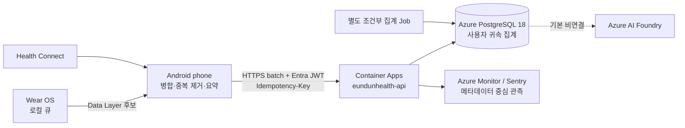

# [PROP-06-A] Wear OS Azure 백엔드 아키텍처 판단

> **상태**: `Exploring — 설계/팩트체크 완료, 구현·프로비저닝 미승인`
> **작성/재검토일**: 2026-11-06 (Asia/Seoul)
> **상위 제안서**: [`PROP-06 Wear OS 통합 아키텍처`](2026-11-06-wear-os-integration-architecture.md)
> **범위**: 비용을 의사결정에서 제외하고도 현재 Azure 구성을 재사용할지, IoT Hub·Event Hubs·Azure Health Data Services·Blob·Foundry를 언제 추가할지 판단한다.

이 문서는 Azure 배포 완료 기록이 아니다. 저장소의 운영 스냅샷과 코드는 확인했지만 Azure 리소스의 현재 상태는 이 작업에서 live 조회하지 않았다.

---

## 1. 결정 요약

### 현재 채택 제안

MVP는 다음 경로를 사용한다.

```text
Wear OS 로컬 수집
  → paired phone 로컬 병합·중복 제거
  → 기존 Entra 사용자 인증 HTTPS batch
  → 기존 Azure Container Apps API
  → 기존 Azure Database for PostgreSQL 18
```

- 새 IoT Hub, Event Hubs, Azure Health Data Services FHIR service, Blob 원시 아카이브는 **현재 도입하지 않는다**.
- 이는 해당 서비스가 잘못된 선택이어서가 아니라, 현재 확인된 요구가 그 서비스의 고유 기능을 필요로 하지 않기 때문이다.
- 워치가 Azure에 직접 접속하는 구조와 스마트폰을 경유하는 구조를 동시에 운영하지 않는다. MVP의 클라우드 주체는 기존 모바일 사용자 세션이다.
- 서버에는 제품 기능에 필요한 최소 집계값만 저장하는 안을 기본으로 한다. 고해상도 원시 심박 시계열의 장기 클라우드 저장은 별도 목적·보존기간·동의 승인 전에는 제외한다.
- 기존 Azure AI Foundry 식단 동의를 Wear 생체 데이터 처리 동의로 재사용하지 않는다. Wear 데이터의 AI 입력은 별도 승인 전까지 제외한다.

### 이 결론의 강도

`현재 요구에 대한 조건부 결정`이다. “IoT/FHIR은 항상 안티패턴”이나 “PostgreSQL이 모든 경우 압도적으로 우수”하다는 일반 명제가 아니다. §6의 재평가 트리거가 발생하면 결정을 다시 연다.

---

## 2. 근거 등급과 현재 상태

| 항목 | 현재 확인된 사실 | 근거 등급 | 검증 한계 |
| :--- | :--- | :---: | :--- |
| API 런타임 | `eundunhealth-api`가 Container Apps 배포 대상으로 구성되어 있다 | 저장소 코드/운영 스냅샷 | 이번 작업에서 Azure live 조회 안 함 |
| 저장소 | DDL과 backend 코드는 PostgreSQL 18 및 `uuidv7()`를 전제로 한다 | 저장소 코드 | 실제 engine/minor·parameter는 live 재확인 필요 |
| 정리 Job | `eundunhealth-reaper`는 탈퇴 후 고아 계정 데이터 정리용이다 | 저장소 코드/운영 스냅샷 | Wear 분석 job이 아님 |
| 인증 | 모바일 API는 기존 Entra 사용자 JWT 경계를 사용한다 | 저장소 문서/코드 | Wear sync endpoint는 아직 없음 |
| AI | 식단 생성용 Foundry 모델 호출과 동의/kill switch가 존재한다 | 저장소 코드/운영 스냅샷 | Wear 생체 데이터 사용 권한을 의미하지 않음 |
| Wear backend | `/v2/biometrics/sync`, biometric 테이블, baseline job은 없다 | 저장소 검색 | 모두 제안 상태 |

현재 운영 사실은 [`docs/ops/operations-snapshot.md`](../ops/operations-snapshot.md), 구현 사실은 `backend/` 코드가 근거다. 둘이 다르면 코드를 우선 조사하고 운영 상태는 Azure live 검증 후 확정한다.

---

## 3. 목표 아키텍처



### 경계

- Data Layer는 워치와 Android 폰 사이 전송 후보다. Wear OS 기기가 iOS에 연결된 경우 등 적용 제한은 별도 제품 범위에서 다룬다.
- 폰은 원본 출처 충돌 해소와 재시도를 담당하고, API는 사용자 권한·스키마·멱등성·보존 정책을 강제한다.
- Entra `oid`는 사용자 식별 근거일 뿐 DB 삭제 정합성을 자동 보장하지 않는다. 외래키, `ON DELETE CASCADE`, 삭제 테스트가 별도 보장이다.
- `eundunhealth-reaper`는 고아 데이터 정리 책임을 유지한다. 개인 baseline/통계 계산을 같은 실행 파일·스케줄에 혼합하지 않는다.

---

## 4. 서비스별 판단

### 4.1 Azure Container Apps — 기존 서비스 재사용

**채택 이유**

- 현재 백엔드가 이미 HTTP API, Entra 인증, PostgreSQL 연결, OpenAPI 동기화, 배포 검증을 보유한다.
- Wear MVP도 폰이 보내는 사용자 단위 HTTPS batch이므로 새 ingress 제품을 요구하지 않는다.
- 동일 계정 삭제·관측·배포 경계를 재사용하면 중복 보안 모델을 줄일 수 있다.

**필요 보완**

- `POST /v2/biometrics/sync`는 아직 제안이다. OpenAPI, 인증, payload 상한, 요청 압축 여부, 멱등키, 오류 계약을 먼저 승인한다.
- 배포 검증은 expected image SHA, latest/latest-ready revision, `/health`, `/health/ready`, reaper image 동기화를 유지한다.
- 새 endpoint의 지연, 4xx/5xx, payload 거부, idempotency conflict를 별도 metric으로 관측한다.

### 4.2 Azure Database for PostgreSQL — MVP 정본 저장소

**채택 이유**

- 사용자·운동·식단·세션 데이터가 이미 관계형 키로 연결되어 있어 사용자 귀속, 삭제, 중복 방지를 같은 트랜잭션 경계에서 처리할 수 있다.
- MVP는 고처리량 스트림보다 제한된 사용자 수의 배치 집계가 중심이다.
- PostgreSQL 18 `uuidv7()` 사용은 현재 코드 기준과 맞지만, 그것만으로 시계열 성능이 보장되지는 않는다.

**초기 데이터 원칙**

- 우선 서버 저장 후보는 일/시간 버킷 요약과 출처·품질·측정 구간·스키마 버전이다.
- 원시 beat-to-beat 또는 고주파 심박 표본은 기본 저장 대상이 아니다.
- `(user_id, bucket_start, source, schema_version)` 등 실제 재전송 의미에 맞는 unique key와 upsert 계약을 먼저 정의한다.
- 보존기간과 탈퇴 삭제를 DDL, 서비스, reaper, 통합 테스트에서 함께 증명한다.

**성능 게이트**

- 실제 샘플 수, batch 크기, 쿼리 패턴으로 `EXPLAIN (ANALYZE, BUFFERS)`와 부하 테스트를 수행한다.
- 테이블 partitioning, 별도 분석 저장소, stream platform은 측정된 병목 후에 검토한다.
- `wal_compression=zstd`와 UUID 순서는 운영 튜닝 요소이지 제품 아키텍처 채택의 단독 근거가 아니다.

### 4.3 Container Apps Jobs — 책임 분리

- 현재 reaper는 계정 정리 전용으로 유지한다.
- 주기 집계가 필요해질 때는 동일 이미지 재사용 여부와 무관하게 별도 command, job 이름, timeout, retry, idempotency, 알림을 갖춘다.
- 데이터가 업로드될 때 계산 가능한 단순 요약은 API 트랜잭션 또는 조회 쿼리를 우선 검토한다.
- 별도 Job 채택 조건: 계산이 요청 지연 예산을 넘거나, 일정 구간 재계산/백필이 필요하고, 중복 실행 안전성이 증명될 때.

Microsoft 공식 문서상 Container Apps Job은 수동·스케줄·이벤트 기반의 run-to-completion 작업에 적합하다. 이 적합성은 기존 reaper에 새 책임을 합쳐도 된다는 뜻이 아니다.

### 4.4 IoT Hub — 현재 보류, 다음 조건에서 재평가

IoT Hub는 단순 MQTT 상시 연결 전용 서비스가 아니다. 기기별 identity registry, device-to-cloud/cloud-to-device messaging, twins, direct methods, message routing이 핵심이다.

현재 보류 이유:

- Azure가 인식하는 주체는 워치 기기 fleet보다 기존 Entra 사용자와 모바일 앱이다.
- 워치→폰 오프라인 큐와 폰→API 재시도로 MVP 전달 요구를 충족할 수 있다.
- device twin, cloud-to-watch 명령, 기기별 인증서 수명주기 요구가 없다.

재평가 트리거:

- 폰 없이 워치가 Azure에 직접 연결해야 한다.
- 기기별 독립 identity/credential rotation, fleet 상태, twin, 원격 명령이 필요하다.
- 다수 제조사 기기를 Azure device fleet으로 운영하고 라우팅/프로비저닝을 표준화해야 한다.

### 4.5 Event Hubs — 현재 보류, 처리량·소비자 기준으로 재평가

Event Hubs는 많은 producer, 독립 consumer group, 순서 있는 고처리량 stream과 replay가 필요한 경우에 맞는다.

현재 보류 이유:

- 확인된 producer는 모바일 API 경로 하나이고 정본 소비자는 백엔드 하나다.
- 일/시간 batch를 PostgreSQL에 쓰는 요구에 별도 distributed log는 일관성·운영 지점을 늘린다.
- 필요한 throughput, retention, consumer 수가 아직 측정되지 않았다.

재평가 트리거:

- API/DB가 감당할 수 없는 지속 수집량이 부하 테스트로 확인된다.
- 실시간 탐지, 분석, 보관 등 둘 이상의 독립 소비자가 같은 event stream을 재생해야 한다.
- producer와 consumer의 장애/배포를 stream retention으로 분리해야 한다.

### 4.6 Azure Health Data Services FHIR — 상호운용성 요구 전까지 보류

FHIR service는 병원 전용이라는 이유로 배제하지 않는다. 서로 다른 건강 시스템의 임상 데이터 교환·저장, SMART on FHIR, 표준 검색/내보내기가 필요할 때 유효하다.

현재 보류 이유:

- 현재 제품은 내부 wellness 데이터 모델과 자체 API가 중심이며 외부 의료기관/FHIR contract 요구가 확인되지 않았다.
- FHIR을 추가해도 기존 제품 관계형 모델과 분석 쿼리가 자동 대체되지는 않는다.
- 표준 매핑, consent/provenance, terminology, 운영 경계가 새로 필요하다.

재평가 트리거:

- 병원·보험자·연구기관과 FHIR R4 교환 계약이 생긴다.
- SMART on FHIR, 환자 접근/데이터 이동성 또는 규제 준수 요구가 생긴다.
- 내부 모델을 표준 resource로 변환·검증할 명확한 책임과 테스트가 승인된다.

### 4.7 Blob/Parquet — 연구·장기 보존 목적 승인 전 보류

- “나중에 AI에 쓸 수 있음”만으로 원시 생체 데이터를 축적하지 않는다.
- 추가 조건: 명시 목적, 별도 opt-in, 최소 필드, 보존/삭제 기간, 암호화/RBAC, 재식별 위험 검토, 계정 삭제 전파, export lineage.
- Archive tier는 장기 최소 보존·rehydration 제약이 있으므로 사용자 삭제 SLA와 충돌하지 않는지 먼저 검토한다.

### 4.8 Azure AI Foundry — 기본 비연결

현재 식단용 `gpt-5.4-mini` deployment와 동의 경계가 있다는 사실은 Wear 데이터를 전송할 권한이 있다는 뜻이 아니다.

- Wear 생체 데이터는 기본적으로 Foundry prompt에 넣지 않는다.
- 향후 비의료 wellness 요약 기능을 검토할 때도 원시 시계열 대신 최소 집계만 후보로 한다.
- 별도 명시 동의, 목적/철회 UX, 데이터 흐름 고지, kill switch, 입력·출력 schema, 안전성 평가, 비의료 문구를 승인 게이트로 둔다.
- 현재 `GlobalStandard`가 유지된다면 prompt/response가 전 세계 Azure geography에서 처리될 수 있음을 고지·정책에 반영한다.
- AI 출력은 진단, 치료, 질환 위험 판정 또는 안전 중요 운동 처방의 근거로 사용하지 않는다.

---

## 5. 보안·개인정보·신뢰성 계약

### 인증과 권한

- 폰→API: 기존 Entra access token과 사용자 scope를 사용한다.
- 서버는 token의 검증된 claim으로 user를 결정하며 payload의 user ID를 신뢰하지 않는다.
- Azure workload는 가능한 경우 managed identity와 Key Vault reference를 사용하고 secret 값을 문서·로그에 출력하지 않는다.

### 멱등성과 순서

- 각 batch는 client-generated immutable ID와 schema version을 갖는다.
- 재시도는 동일 ID/내용이면 같은 결과를 내고, 동일 ID/다른 내용은 conflict로 거부한다.
- 측정 시각과 수신 시각을 분리한다. 늦은 업로드가 현재 시각 데이터로 오인되지 않게 한다.
- client 시계 오류·future timestamp·과도하게 오래된 데이터의 정책을 API contract로 정한다.

### 데이터 최소화와 삭제

- 서버 필드별 목적과 보존기간을 문서화한다.
- 로그·Sentry에는 생체 값과 전체 payload를 기록하지 않는다. request ID, batch ID, count, 오류 코드 중심으로 관측한다.
- `DELETE /account`, DB cascade, reaper 안전망, 백업/아카이브 정책까지 삭제 범위를 검증한다.
- 데이터 export/정정 요구가 제품 범위에 들어오면 API와 운영 절차를 별도 설계한다.

### 장애 모델

- 폰은 bounded queue와 exponential backoff를 사용하며 영구 4xx와 재시도 가능한 5xx/네트워크 오류를 구분한다.
- API는 payload 크기/건수 상한과 rate limit을 둔다.
- DB 장애 시 성공 ACK를 보내지 않는다.
- batch acceptance와 비동기 후처리를 분리한다면 상태 조회/재처리/중복 방지 계약을 추가한다.

---

## 6. 재평가 의사결정 표

| 요구/증거 | 우선 선택 | 재평가 대상 |
| :--- | :--- | :--- |
| 사용자 단위 저빈도 HTTPS batch, 단일 소비자 | Container Apps + PostgreSQL | 현재안 유지 |
| 직접 연결 기기 fleet, twin, cloud command, 기기 identity | Device management 계층 | IoT Hub |
| 고처리량 stream, 다중 독립 consumer, replay | Streaming backbone | Event Hubs |
| 의료기관/보험자와 표준 임상 교환 | Interoperability store/API | AHDS FHIR |
| 장기 원시 데이터 연구와 승인된 retention | Object/data lake | Blob/Parquet |
| 비의료 생성형 요약의 검증된 사용자 가치 | 최소 집계 기반 inference | Foundry 별도 승인 |

서비스 도입 제안은 “있으면 좋음”이 아니라 위 트리거, 측정치, 소유자, 삭제/장애 모델을 함께 제시해야 한다.

---

## 7. 구현 전 승인 게이트

| Gate | 승인 내용 | 필수 증거 |
| :--- | :--- | :--- |
| A0 | 서버 저장 목적과 데이터 최소 단위 | 필드-목적-보존 표 |
| A1 | API contract | OpenAPI diff, 인증, 상한, 201/200/409/4xx 계약 |
| A2 | DB contract | DDL, unique/FK/cascade, PostgreSQL 통합 테스트 |
| A3 | 개인정보/정책 | 동의·철회·삭제·국외 처리·Play Health 검토 |
| A4 | 운영 | 부하/복구/관측/alert/runbook |
| A5 | AI 사용 시에만 | 별도 opt-in, Global 처리 고지, kill switch, eval 결과 |
| A6 | 새 Azure PaaS 사용 시에만 | §6 트리거의 측정 증거와 철회/rollback 계획 |

Azure/Play/실기기/법적 문구 변경이 필요할 때는 사용자에게 구체적으로 요청한다. 본 제안서는 그 권한을 부여하지 않는다.

---

## 8. 수용 기준

- [ ] 현재 운영 사실과 제안 리소스가 문서에서 구분된다.
- [ ] MVP 데이터 흐름에 IoT Hub/Event Hubs/FHIR/Blob/Foundry가 암묵적으로 포함되지 않는다.
- [ ] `/v2/biometrics/sync`가 구현되면 OpenAPI·PostgreSQL·실제 HTTP 멱등성 테스트가 존재한다.
- [ ] reaper와 분석/집계 책임이 분리된다.
- [ ] 생체 payload가 애플리케이션/Sentry 로그에 남지 않는 테스트가 있다.
- [ ] 계정 삭제가 새 테이블과 조건부 archive까지 포함하는지 검증된다.
- [ ] 성능 주장은 실제 batch/쿼리 부하 측정치로 뒷받침된다.
- [ ] Foundry 연결은 A5 승인 없이는 비활성이다.
- [ ] 새 서비스 도입은 §6 트리거와 rollback 기준을 만족한다.

---

## 9. 공식 근거

모든 링크는 2026-11-06에 재검토했다.

1. [Azure IoT Hub concepts](https://learn.microsoft.com/azure/iot-hub/iot-concepts-and-iot-hub) — device identity, D2C/C2D, twins/direct methods와 routing
2. [Azure Event Hubs overview](https://learn.microsoft.com/azure/event-hubs/event-hubs-about) — 고처리량 stream, partition, consumer group, retention
3. [Azure Health Data Services overview](https://learn.microsoft.com/azure/healthcare-apis/healthcare-apis-overview) — FHIR/DICOM/health data 표준화와 교환
4. [FHIR service documentation](https://learn.microsoft.com/azure/healthcare-apis/fhir/) — managed FHIR API, search, import/export와 interoperability
5. [Jobs in Azure Container Apps](https://learn.microsoft.com/azure/container-apps/jobs) — manual/schedule/event run-to-completion workload
6. [Managed identities in Azure Container Apps](https://learn.microsoft.com/azure/container-apps/managed-identity) — credential-free Azure resource access
7. [Manage secrets in Azure Container Apps](https://learn.microsoft.com/azure/container-apps/manage-secrets) — Key Vault reference와 managed identity
8. [Data, privacy, and security for Models sold by Azure](https://learn.microsoft.com/legal/cognitive-services/openai/data-privacy) — prompt 처리·보관·학습·Global deployment 경계
9. [Microsoft Foundry architecture](https://learn.microsoft.com/azure/ai-foundry/concepts/architecture) — Global/Data Zone/Regional 처리 위치
10. [Archive a blob](https://learn.microsoft.com/azure/storage/blobs/archive-blob) — archive lifecycle과 최소 보존/rehydration 고려
