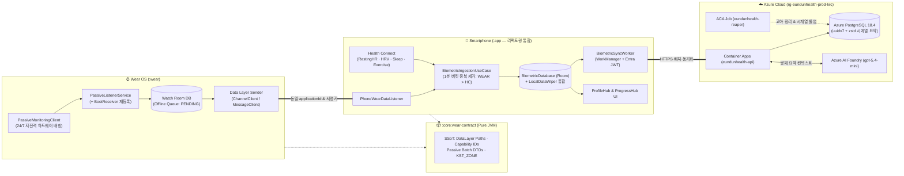
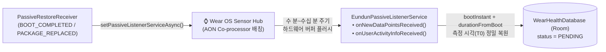
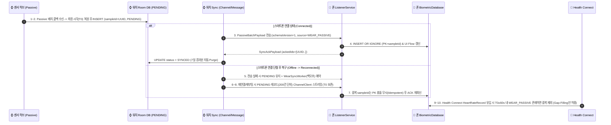
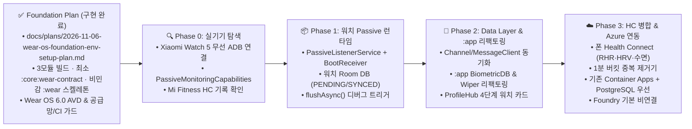

# [PROP-06] 은둔헬스(eundunHealth) Wear OS 통합 기획 · 전사 리팩토링 및 아키텍처 제안서

> **상태**: `Exploring (Foundation Plan 구현·검증 완료 / Phase 0~3 런타임 수집·동기화 대기)` ｜ **작성일**: 2026-11-06 ｜ **목표 버전**: `v0.8.0+`
> **기술 기준선**: **Google Wear OS 공식 표준 아키텍처** (Pixel Watch 레퍼런스 기준 · 1차 실기기 검증 Xiaomi Watch 5)
> **핵심 채택 결정**: ① **3모듈 경량 계약 구조 (`:app` + `:wear` + `:core:wear-contract`)** ｜ ② **`PassiveMonitoringClient` 중심 백그라운드 자동 수집**

> [!NOTE]
> **📌 Plan 분리 및 Foundation 구현 완료 기록 (`2026-11-06`)**
> 환경설정·멀티모듈 빌드·최소 계약 모듈·비민감 `:wear` 스켈레톤·원형 M3 진단 UI·공급망/CI 가드는 공식 구현 계획으로 분리되어 `2026-11-06` 구현 및 실측 검증(`AC-01 ~ AC-10`)까지 완료되었다. 본 제안서는 실기기 페어링 이후 수행할 **Phase 0~3 런타임 수집·동기화·백엔드 연동**을 다룬다.
> - **승격·구현된 Plan 문서**: [`docs/plans/2026-11-06-wear-os-foundation-env-setup-plan.md`](../plans/2026-11-06-wear-os-foundation-env-setup-plan.md)
> - **승격(삭제 후 이관·구현 완료)된 항목 요약**:
>   1. **호스트 SDK & 에뮬레이터 환경**: Wear OS 6.0(`system-images/android-36/android-wear-signed/x86_64`) 설치 및 `Wear_OS_Large_Round_API_36` AVD 생성·콜드 부트 스모크 검증 완료 (`§1.1`, `§8`)
>   2. **Gradle 3모듈 & Version Catalog 환경**: `settings.gradle.kts`, `build.gradle.kts`, 명시적 `wearVersionCode=10001` (`version.properties` SSoT), `libs.versions.toml` 구성 완료 (`§1.1`, `§2.1`)
>   3. **`:core:wear-contract` (Pure JVM) & `KST_ZONE` SSoT 리팩토링**: Foundation에서는 `WearTimeConstants.kt` (`KST_ZONE`) 공유 상수와 순수 단위 테스트만 포함하며 Data Layer 경로·생체 DTO는 런타임 계약 승인까지 보류 (`§1.2 ①`, `§2.1`, `§2.3`)
>   4. **비민감 `:wear` 모듈 스켈레톤 & 패키지/`res/values/wear.xml` + `res/raw/keep_wear_capabilities.xml` 정책**: `minSdk = 36` 확정, 건강·활동·부팅 권한은 Phase 1까지 미선언(0건), Wear Compose M3 (`1.7.1`) 원형 진단 화면(`WearEnvironmentSpec.kt`, `WearEnvironmentStatusScreen.kt`) 구현 완료 (`§2.2`, `§2.3`)
>   5. **빌드·CI·락파일 가드 리팩토링**: [`check-agp10-compat.sh`](../../scripts/check-agp10-compat.sh), [`android-cli-check.sh`](../../scripts/android-cli-check.sh), [`.githooks/pre-commit`](../../.githooks/pre-commit), [`android.yml`](../../.github/workflows/android.yml), [`AgpBuildContractTest.kt`](../../app/src/test/java/com/gunnys/eundunhealth/AgpBuildContractTest.kt), [`ProguardKeepRulesTest.kt`](../../app/src/test/java/com/gunnys/eundunhealth/ProguardKeepRulesTest.kt), 3모듈 `gradle.lockfile` & `verification-metadata.xml` 동기화 완료 (`§1.2 ⑥`, `§8.1 L1`)

---

## 0. Executive Summary (핵심 채택 제안 요약)

프로젝트 전체(`:app` + `:wear` + `:core:wear-contract` + `Azure Backend` + `CI/Build`) 관점의 **9대 채택 제안**이다. Foundation과 Azure 상세안은 각각 연결 문서의 승인 게이트를 따른다.

| 의사결정 영역 | 채택 제안 (Decision Proposal) | 상태 / 관리 문서 | 핵심 선정 근거 (Google Wear OS 표준 & 전사 관점) |
| :--- | :--- | :---: | :--- |
| **1. 모듈 구조 (§2.1)** | **대안 B: 3모듈 경량 계약 구조**<br>(`:app` + `:wear` + `:core:wear-contract` [Pure JVM]) | **Foundation 구현 완료**<br>([Plan](../plans/2026-11-06-wear-os-foundation-env-setup-plan.md)) | • Foundation에서는 `KST_ZONE`만 공유하고 생체 DTO/전송 경로는 런타임 계약 승인까지 보류 |
| **2. 패키지 & 버전 (§2.2)** | • **동일 `applicationId`**: `com.gunnys.eundunhealth`<br>• **워치 `versionCode`**: 명시적 별도 SSoT (`wearVersionCode=10001`) | **Foundation 구현 완료**<br>([Plan](../plans/2026-11-06-wear-os-foundation-env-setup-plan.md)) | • 모든 폼팩터에서 고유한 코드와 Wear 내부 단조성을 별도로 검증하고 휴리스틱을 배제 |
| **3. 생체 수집 API (§4)** | **`PassiveMonitoringClient` 단독 주력 채택**<br>(`PassiveListenerService` + 재부팅 복구 `BroadcastReceiver`) | **본 제안서 관리**<br>(Phase 1 런타임) | • 사용자가 매번 워치 앱을 열지 않아도 **착용만으로 24/7 저전력(보조 프로세서 배칭) 일상 심박·활동량·수면/휴식 상태 자동 수집** |
| **4. 기기 차이 대응 (§3.2)** | **Google Wear OS 표준 단일 구현체 + 런타임 Capability 탐지** | **본 제안서 관리**<br>(Phase 1 런타임) | • Pixel Watch와 Xiaomi Watch 5 모두 동일한 `HealthServicesClient` HAL 사용, `PassiveMonitoringCapabilities`로 동적 분기 |
| **5. 기기 간 통신 (§5)** | • **워치→폰**: `ChannelClient`(배치 주력) + `MessageClient`(제어/ACK)<br>• **보조 이력**: 스마트폰 `Health Connect` | **본 제안서 관리**<br>(Phase 2~3) | • `PassiveMonitoringClient`의 배치 전달 특성에 맞춰 워치 Room DB(`PENDING`) 선저장 후 폰 수신 ACK 확인 시 `SYNCED` 전이 |
| **6. 전사 리팩토링 (§1.2)** | **`:app`·`Build/CI`·`Backend` 6대 영역 구조적 리팩토링** | **부분 완료**<br>(①·⑥ [Plan 완료](../plans/2026-11-06-wear-os-foundation-env-setup-plan.md) / ②~⑤ 본 문서) | • 환경·상수·CI 리팩토링(①·⑥)은 선행 Plan에서 완료했고, 런타임 DB·워커·허브 UI 리팩토링(②~⑤)은 Phase 2~3에서 수행 |
| **7. 권한 및 SDK (§6)** | **`minSdk = 36` 확정 + Phase 1 최소 권한** | **Foundation 완료 / Phase 1 대기**<br>(Manifest [Plan](../plans/2026-11-06-wear-os-foundation-env-setup-plan.md) / 런타임 플로우 본 문서) | • Foundation은 민감 권한 0건으로 구축 완료했으며, Phase 1 진입 시 `G5`(법무/고지) 승인 후 API 36 권한 체계를 추가 |
| **8. Azure 백엔드 (§7)** | **기존 Container Apps + PostgreSQL 우선, 신규 PaaS 조건부 재평가** | **별도 제안서**<br>([PROP-06-A](2026-11-06-wear-os-azure-backend-architecture.md)) | • IoT Hub/Event Hubs/FHIR/Blob/Foundry를 영구 배제하지 않고 고유 기능을 요구하는 측정 가능한 트리거로 판단 |
| **9. 테스트·디버깅 (§8)** | **3모듈 4계층 자동화 테스트 + `flushAsync`/ADB 합성 데이터 디버깅** | **부분 완료**<br>(L1·L3 [Plan 완료](../plans/2026-11-06-wear-os-foundation-env-setup-plan.md) / L2·L4·디버깅 본 문서) | • 빌드/계약 가드(L1) 및 프리뷰/APK/AVD 검증(L3)은 선행 Plan에서 완료했고, 센서/Data Layer/오프라인 디버깅은 본 문서에서 관리 |



---

## 1. 전사 리팩토링 설계 (런타임 도메인·데이터·UI 잔류 항목)

> **승격 기록**: `§1.1 현행 빌드/SDK 환경 지표`와 `§1.2 리팩토링 ①(KST_ZONE SSoT 이관)` 및 `⑥(Gradle 빌드·CI 가드 멀티모듈 리팩토링)`은 지금 즉시 작업 가능한 환경설정 범위로서 [`docs/plans/2026-11-06-wear-os-foundation-env-setup-plan.md`](../plans/2026-11-06-wear-os-foundation-env-setup-plan.md) (`§1`, `§3`, `§6 Task 2~6`)로 승격·삭제되었습니다. 아래에는 실기기 검증 이후 Phase 2~3에서 수행할 **런타임 4대 리팩토링(②~⑤)** 만 남깁니다.

| 리팩토링 대상 | AS-IS 한계점 | TO-BE 전사 리팩토링 설계 (Phase 2~3 구현 대상) | 대상 파일 |
| :--- | :--- | :--- | :--- |
| **② `:app` 건강 데이터 계층 확장 리팩토링** | `HealthRepositoryImpl`이 `ExerciseSessionRecord` 날짜 조회 1개 메서드만 가진 단순 래퍼 구조 | • **역할 분리**: 기존 `SyncHealthDataUseCase`(주간 운동 자동 완료)는 유지하되, 워치 Passive 배치 수신(`PhoneWearDataListenerService`)과 Health Connect 생체 이력을 통합 수집·중복 제거하는 **`BiometricRepository` & `IngestBiometricDataUseCase`** 신설 | [`HealthRepositoryImpl.kt`](../../app/src/main/java/com/gunnys/eundunhealth/data/repository/HealthRepositoryImpl.kt), [`HealthConnectDataSource.kt`](../../app/src/main/java/com/gunnys/eundunhealth/data/healthconnect/HealthConnectDataSource.kt) |
| **③ `:app` Room DB 및 `LocalDataWiper` 리팩토링** | `EundunDatabase`(운동계획)와 `SmileTrainingDatabase`(스마일) 2개만 존재 및 와이퍼 하드코딩 | • `DatabaseModule`에 생체 데이터 전용 **`BiometricDatabase`(`biometric.db`)** 추가 (기존 DB 마이그레이션 오염 방지)<br>• `DefaultLocalDataWiper` 리팩토링: 회원 탈퇴 시 로컬 3개 DB 초기화 + 연결된 워치에 `/eundun/v1/command/wipe_all` 전송을 일괄 처리 | [`DatabaseModule.kt`](../../app/src/main/java/com/gunnys/eundunhealth/di/DatabaseModule.kt), [`LocalDataWiper.kt`](../../app/src/main/java/com/gunnys/eundunhealth/data/local/LocalDataWiper.kt) |
| **④ WorkManager 동기화 엔진 패턴 공통화** | `SmileSyncWorker`에 오프라인 큐(`PENDING`→`SYNCED`) 및 백오프 로직이 개별 구현됨 | • 오프라인 배치 동기화 상태 전이 및 지수 백오프(30s) 규약을 표준화하여 **`BiometricSyncWorker`** 가 일일 생체 요약을 백엔드로 멱등 업로드하도록 구조 통일 | [`SmileSyncWorker.kt`](../../app/src/main/java/com/gunnys/eundunhealth/data/sync/SmileSyncWorker.kt) |
| **⑤ `:app` UI 허브 컴포넌트 리팩토링** | `ProfileHubScreen`의 연동 카드가 Health Connect 단일 상태만 표현 | • `WorkoutAndHealthIntegrationCard`를 **웨어러블(Wear OS 4단계 상태 + 원격 설치 CTA) & Health Connect 통합 카드**로 리팩토링<br>• `ProgressHubScreen` 지표 타일에 워치 Passive 수집 데이터(일일 심박 범위·안정 시 심박·활동량) 연결 | [`ProfileHubScreen.kt`](../../app/src/main/java/com/gunnys/eundunhealth/ui/profile/ProfileHubScreen.kt), [`ProgressHubScreen.kt`](../../app/src/main/java/com/gunnys/eundunhealth/ui/navigation/ProgressHubScreen.kt) |

---

## 2. Wear OS 프로젝트 구성 및 배포 정책 (Plan 분리 기록 및 런타임 연동 UX)

> **Plan 분리 및 Foundation 구현 완료 기록**:
> - `2.1 3모듈 경량 계약(:app + :wear + :core:wear-contract) 빌드 구성`
> - `2.2 패키지명(com.gunnys.eundunhealth), 서명 키 공유, 명시적 wearVersionCode=10001 SSoT, res/values/wear.xml 정적 선언 및 res/raw/keep_wear_capabilities.xml R8 리소스 보호`
> - `2.3 3모듈 초기 스켈레톤 디렉터리 구조`
> 위 항목들은 [`docs/plans/2026-11-06-wear-os-foundation-env-setup-plan.md`](../plans/2026-11-06-wear-os-foundation-env-setup-plan.md)로 분리되어 `2026-11-06` 구현 및 실측 검증(`AC-01 ~ AC-10`)이 완료되었다.

### 2.1 Phase 2 런타임 Capability 탐색 및 원격 설치 UX (`RemoteActivityHelper`)
- Foundation Plan에서 구현 완료된 양쪽 모듈 `res/values/wear.xml`(`eundun_phone_companion` / `eundun_wear_companion`) 및 `res/raw/keep_wear_capabilities.xml`을 기반으로, Phase 2에서 모바일 [`ProfileHubScreen.kt`](../../app/src/main/java/com/gunnys/eundunhealth/ui/profile/ProfileHubScreen.kt)는 `NodeClient` + `CapabilityClient`를 결합해 **4단계 런타임 상태(`워치 미연결` → `워치 연결·앱 미설치` → `앱 설치·오프라인` → `Passive 수집 정상`)** 를 실시간 표시합니다.
- 워치는 연결되어 있으나 `:wear` 앱이 미설치된 경우(`NodeClient`는 존재하나 `CapabilityClient`는 비어 있음), `androidx.wear:wear-remote-interactions`의 `RemoteActivityHelper.startRemoteActivity()`로 워치의 Google Play 스토어(`market://details?id=com.gunnys.eundunhealth`)를 원격 실행하는 CTA 버튼을 제공합니다.

---

## 3. 런타임 핵심 기술 및 기기별 호환성 설계 (Google Wear OS 기준)

### 3.1 런타임 수집·동기화 기술 스택 (실측 안정판 버전 기준)

| 기술 스택 | 판정 | 적용 시기 | 선정 이유 (Google Wear OS 표준 호환성) | 대안 및 단점 |
| :--- | :---: | :---: | :--- | :--- |
| **AndroidX Health Services (`PassiveMonitoringClient`)** (`1.1.0`) | ✅ **핵심 채택** | Phase 1 (런타임) | • Wear OS 6+(API 36+) 보조 프로세서 하드웨어 배칭을 활용하는 **Google 공식 저전력 백그라운드 수집 표준**<br>• 앱이 종료된 상태에서도 OS가 `PassiveListenerService`를 깨워 배치 데이터를 전달함 | • *기각 대안*: `MeasureClient` / `ExerciseClient` / `SensorManager`<br>• *기각 사유*: 사용자 수동 실행 강제 또는 상시 FGS/WakeLock으로 인한 심각한 배터리 소모 |
| **Compose for Wear OS (Material 3)** (`1.7.1`) | ✅ **구현 완료 (진단 UI)** | Foundation 완료 / Phase 1 데이터 바인딩 | • 초기 진단 UI(`TransformingLazyColumn` + `SurfaceTransformation`)는 [Foundation Plan](../plans/2026-11-06-wear-os-foundation-env-setup-plan.md)에서 구현·검증 완료했으며, Phase 1에서 실제 Passive 수집 상태·최근 심박·미전송 큐 건수를 연결 | • *대안*: 모바일 M3 재사용은 원형 화면 기본값과 입력 모델이 맞지 않음 |
| **Play Services Wearable Data Layer** (`20.0.1`) | ✅ **채택** | Phase 2 | • 블루투스/Wi-Fi 라우팅을 OS가 자동 중계하여 워치 내 인증·네트워크 스택 제거 | • *대안*: 워치 직접 HTTPS 호출 (MSAL 토큰 관리 및 배터리 소모 과다) |
| **Room** (`2.8.5`) & **WorkManager** (`2.12.0`) | ✅ **채택** | Phase 1~2 | • 워치 오프라인 스풀러(`WearHealthDatabase`) 및 폰 백엔드 업로더(`BiometricSyncWorker`) 구현 | • *대안*: DataStore (시계열 배치 상태 전이 및 인덱스 쿼리 부적합) |
| **Health Connect** (`1.1.0`) | ✅ **채택** | Phase 3 (`:app`) | • 워치 표준 Health Services가 제공하지 않는 **HRV(`RMSSD`), 안정 시 심박수, 상세 수면 단계**를 제조사 앱(Fitbit / Mi Fitness) 경유로 보완 수집 | • *주의*: 스마트폰 로컬 API이므로 `:app`에서만 호출 |

### 3.2 기기별 기능 차이 대응 (`PassiveMonitoringCapabilities` 기반 단일 구현)

- **원칙**: 제조사별 Adapter/Factory를 두지 않고, Google Wear OS 표준 `PassiveMonitoringClient.getCapabilitiesAsync().await()`가 반환하는 `PassiveMonitoringCapabilities`로 런타임 분기합니다.
  1. `capabilities.supportedDataTypesPassiveMonitoring`에 `DataType.HEART_RATE_BPM`, `DataType.STEPS_DAILY`, `DataType.CALORIES_DAILY` 포함 여부를 확인하여 **지원되는 `DataType`만 `PassiveListenerConfig`에 동적 등록**합니다.
  2. 미지원 항목은 워치 상태 화면에 `"기기 미지원"`으로 표시하고, 스마트폰 `:app`의 `Health Connect` 보조 파이프라인에서 폴백 조회합니다.

---

## 4. 생체 데이터 API 기술 조사 및 지원 매트릭스 (`PassiveMonitoringClient` 채택)

### 4.1 `PassiveMonitoringClient` 아키텍처 및 동작 명세 (최종 채택)

| 설계 항목 | `PassiveMonitoringClient` (`androidx.health:health-services-client:1.1.0`) 명세 |
| :--- | :--- |
| **채택 이유 (Why Passive-First?)** | 은둔헬스의 장기 방향(일상 심박 변화, 수면·회복 추이, 스트레스·불안 변화 감지 기반)은 **사용자의 인위적 개입 없이 일상 기저 상태(Baseline)를 24/7 연속 관찰**해야 하므로, 저전력 백그라운드 수집 전용인 `PassiveMonitoringClient`가 유일한 적합 기술임. |
| **수집 데이터 (`PassiveListenerConfig`)** | • **`DataType.HEART_RATE_BPM`**: 일상 백그라운드 심박수 시계열 샘플 (`SampleDataPoint<Double>`)<br>• **`DataType.STEPS_DAILY` / `CALORIES_DAILY`**: 일일 누적 걸음 수 및 소모 칼로리 (`IntervalDataPoint`)<br>• **`shouldUserActivityInfoBeRequested = true`**: 사용자의 **수면(`USER_ACTIVITY_ASLEEP`) · 휴식(`USER_ACTIVITY_PASSIVE`) · 운동(`USER_ACTIVITY_EXERCISE`)** 상태 전환 타임스탬프 자동 수신 |
| **백그라운드 수신 메커니즘** | `PassiveListenerService`를 상속한 **`EundunPassiveListenerService`** 등록. 앱 프로세스가 내려가 있어도 하드웨어 센서 허브 버퍼가 차면 OS가 서비스를 바인딩해 `onNewDataPointsReceived(DataPointContainer)` 및 `onUserActivityInfoReceived(UserActivityInfo)`를 호출함. |
| **갱신 주기 및 설계상 주의점** | • **배치 전달(Batching) 특성**: 배터리 절약을 위해 하드웨어 버퍼링 후 **수 분~수십 분 간격으로 일괄 전달**됨 (고정 1분 간격 실시간 스트리밍을 가정하지 않고 각 `DataPoint`의 실제 측정 타임스탬프를 복원해 시계열 구성). |
| **재부팅 / 업데이트 자동 복구** | 기기 재부팅(`ACTION_BOOT_COMPLETED`) 또는 앱 업데이트(`ACTION_MY_PACKAGE_REPLACED`) 시 Passive 등록이 초기화되므로, **`PassiveRestoreBroadcastReceiver`에서 WorkManager/코루틴을 통해 `setPassiveListenerServiceAsync()`를 자동 재등록**함. |
| **보조 API (`Measure` / `Exercise`) 처리** | 초기 범위에서 제외(보류). 단, 워치 앱 진입 시 센서 정상 동작 확인용 1회성 진단이나 향후 실시간 운동 가이드 미러링이 필요할 때만 선택 확장. |



### 4.2 스마트폰 Health Connect 및 제조사 데이터 보완 구조

- **역할 분담**: Wear OS의 `PassiveMonitoringClient`는 표준 `HEART_RATE_BPM`, 일일 걸음/칼로리, 수면/활동 상태 전환(`UserActivityInfo`)을 직접 수집하고, Health Services 표준 `DataType`에 없는 **HRV(`HeartRateVariabilityRmssdRecord`), 일일 안정 시 심박수(`RestingHeartRateRecord`), 세부 수면 단계(`SleepSessionRecord`)** 는 스마트폰 `:app`이 **Health Connect**에서 읽어 결합합니다.
- **제조사 독점 지표(`스트레스 점수`, `PPG/EMG 원시 신호`)**: Google Wear OS 표준 API에 존재하지 않으므로 `접근 가능성 미확인 (비표준)`으로 분류하고 표준 생체 지표(BPM, RMSSD, 수면/활동 상태) 기반으로 파이프라인을 구축합니다.

### 4.3 생체 데이터 지원 매트릭스 (Google Wear OS 기준)

*(표기 기준: `공식 문서 확인` / `기기 테스트 확인` / `조건부 지원` / `검증 필요` / `미지원 확인`)*

| 데이터 유형 | 수집 API (계층) | Pixel Watch *(Google 표준 기준)* | Xiaomi Watch 5 *(1차 검증 기기)* | 검증 방법 | 우선순위 |
| :--- | :--- | :---: | :---: | :--- | :---: |
| **백그라운드 일상 심박수 (배치 BPM)** | 워치 `PassiveMonitoringClient` (`HEART_RATE_BPM`) | **공식 문서 확인** | **검증 필요** *(Phase 0 실측)* | `PassiveMonitoringCapabilities` 조회 및 `PassiveListenerService` 배치 수신 로깅 | **P0 (Phase 1 핵심)** |
| **일일 걸음 수 & 일일 칼로리** | 워치 `PassiveMonitoringClient` (`STEPS_DAILY`, `CALORIES_DAILY`) | **공식 문서 확인** | **검증 필요** | `onNewDataPointsReceived` 내 `IntervalDataPoint` 수신 확인 | **P0 (Phase 1 핵심)** |
| **수면 / 휴식 / 운동 상태 전환** | 워치 `PassiveMonitoringClient` (`UserActivityInfo`) | **공식 문서 확인** | **검증 필요** | `onUserActivityInfoReceived`의 `ASLEEP`/`PASSIVE`/`EXERCISE` 전이 확인 | **P0 (Phase 1 핵심)** |
| **주간 운동 세션 완료 이력** | 폰 `Health Connect` (`ExerciseSessionRecord`) | **공식 문서 확인** | **조건부 지원** *(Mi Fitness 연동 시)* | 현행 `:app` [`HealthConnectDataSource`](../../app/src/main/java/com/gunnys/eundunhealth/data/healthconnect/HealthConnectDataSource.kt) 조회 (기구현) | **P0 (기구현)** |
| **안정 시 심박수 & 심박 이력 보완** | 폰 `Health Connect` (`RestingHeartRateRecord`, `HeartRateRecord`) | **공식 문서 확인** *(Fitbit 동기화)* | **검증 필요** *(Mi Fitness 기록 주기)* | `HealthConnectClient.readRecords()` 조회 결과 확인 | **P1 (Phase 3)** |
| **심박 변이도 (HRV — RMSSD)** | 폰 `Health Connect` (`HeartRateVariabilityRmssdRecord`) | **공식 문서 확인** *(Fitbit 수면 중 기록)* | **검증 필요** *(Mi Fitness 기록 여부)* | 수면 착용 후 익일 `readRecords(HRV)` 레코드 유무 실측 | **P1 (Phase 3)** |
| **수면 세션 및 상세 수면 단계** | 폰 `Health Connect` (`SleepSessionRecord`) | **공식 문서 확인** | **조건부 지원** *(Mi Fitness 연동 시)* | `readRecords(SleepSessionRecord::class)` 단계 배열 확인 | **P1 (Phase 3)** |
| **능동 단발 심박 / 실시간 운동 세션** | 워치 `MeasureClient` / `ExerciseClient` | **공식 문서 확인** | **검증 필요** | 초기 범위 제외 (Passive 수집으로 일원화, 추후 필요 시만 확장) | **보류 (P3)** |
| **제조사 독점 스트레스 점수 / EMG·PPG 원시** | 비표준 (공개 API 미확인) | **미지원 확인** *(EMG 미탑재)* | **검증 필요** *(접근 가능성 미확인)* | Phase 0 `dumpsys sensorservice` 탐색만 수행, 설계 의존성 배제 | **제외** |

---

## 5. 스마트워치 ↔ 모바일 데이터 통신 및 Offline-first 설계

### 5.1 Wearable Data Layer 채널 전략 (`PassiveMonitoring` 최적화)

- **`ChannelClient` (주력 배치 파이프)**: `PassiveMonitoringClient`가 모은 수십~수백 건의 시계열 샘플 배치를 GZIP JSON 스트림으로 스마트폰에 전송.
- **`MessageClient` (경량 제어 및 ACK)**: 스마트폰 수신 완료 응답(`SyncAckPayload`), 원격 데이터 초기화 명령(`/eundun/v1/command/wipe_all`), 연결 상태 핑 교환.
- **`DataClient` (시계열 사용 금지)**: 중간 이력 덮어쓰기 특성이 있으므로 생체 시계열 전송에는 사용하지 않음.

### 5.2 Offline-first 동기화 흐름 및 1분 버킷 이중 집계 방지



- **측정 시간 보존**: `SampleDataPoint.timeDurationFromBoot`를 부팅 시각 기준 UTC Epoch Millis(`measuredAtEpochMs`)로 변환 저장하여, 수 시간 뒤 지연 동기화되어도 KST 기준 원래 측정 시각에 정확히 매핑합니다.
- **스마트워치 교체 연속성 (Xiaomi Watch 5 → Pixel Watch)**: 모든 데이터는 스마트폰 DB와 백엔드에 계정(`userId = Entra oid`) 기준으로 귀속되며, `deviceModel` 및 `wearInstallId` 메타데이터만 갱신되어 시계열이 끊김 없이 이어집니다.

---

## 6. 런타임 권한 요청 및 백그라운드 동작 제안 (API 36+ 후보)

> **Foundation 경계**: [`Foundation Plan`](../plans/2026-11-06-wear-os-foundation-env-setup-plan.md)은 건강·활동·부팅 권한을 선언하지 않는다. `minSdk = 36` 지원 범위가 승인되고 Phase 1 기능·고지·권한 UX가 함께 승인될 때 이 절을 구현한다.

### 6.1 Phase 1 & Phase 3 런타임 2단계 순차 권한 요청 UX 플로우

공식 문서는 API 36+에서 심박에 `READ_HEART_RATE`, background passive body sensor 접근에 `READ_HEALTH_DATA_IN_BACKGROUND`, 활동 데이터 타입에 `ACTIVITY_RECOGNITION`을 요구한다. 다만 두 건강 권한을 한 요청에 넣을 때의 모든 OEM 동작을 보장하지 않으므로 아래 순서는 최소 권한과 맥락 설명을 위한 **구현 후보**이며 API 36 AVD와 Xiaomi Watch 5에서 검증 후 확정한다.

1. **Step 1 (사용 기능 권한 요청)**: 워치 상태 화면에서 `READ_HEART_RATE`를 요청한다. Steps/Calories/UserActivity를 실제 제공할 때만 `ACTIVITY_RECOGNITION`을 함께 요청한다.
2. **Step 2 (background 기능 활성화 시점)**: foreground 심박 권한 승인과 별도 설명 후 `READ_HEALTH_DATA_IN_BACKGROUND`를 요청한다. 승인된 데이터 타입만 `PassiveMonitoringClient`에 등록한다.
3. **권한 철회 감지 및 복구**: 사용자가 시스템 설정에서 백그라운드 권한을 해제하면 `EundunPassiveListenerService.onPermissionLost()`가 호출되므로, 워치 Room DB에 상태를 기록하고 다음 워치 앱 진입 또는 스마트폰 `ProfileHubScreen` 진입 시 권한 재요청 배너를 노출합니다.

---

## 7. Azure 클라우드 백엔드 아키텍처 판단 — 별도 문서로 분리

비용을 제외한 Azure 서비스 선택, 현재 운영 사실, IoT Hub/Event Hubs/FHIR/Blob/Foundry의 채택·재평가 조건은 다음 문서에서 독립적으로 관리한다.

- **상세 제안서**: [`PROP-06-A Wear OS Azure 백엔드 아키텍처 판단`](2026-11-06-wear-os-azure-backend-architecture.md)
- **현재 요약**: MVP는 스마트폰 gateway → 기존 Container Apps API → PostgreSQL batch 경로를 우선한다. 새 Azure PaaS는 “안티패턴”이라서 영구 배제하는 것이 아니라, 기기 fleet 관리·고처리량 다중 consumer·FHIR 상호운용성 등 문서화된 트리거가 생길 때 재평가한다.
- **보호 경계**: 기존 식단용 Foundry 동의는 Wear 생체 데이터 처리를 허가하지 않는다. Wear 데이터의 AI 사용은 별도 명시 동의·처리 위치 고지·평가·kill switch 승인 전까지 제외한다.

---

## 8. 런타임 테스트 및 디버깅 전략 기획 (Runtime Testing & Debugging Playbook)

> **승격 기록**: `L1 계약 & 빌드 불변식 가드`(`:core:wear-contract:test`, [`AgpBuildContractTest.kt`](../../app/src/test/java/com/gunnys/eundunhealth/AgpBuildContractTest.kt), [`ProguardKeepRulesTest.kt`](../../app/src/test/java/com/gunnys/eundunhealth/ProguardKeepRulesTest.kt)) 및 `L3 Android CLI 초기 프리뷰/APK 검증`은 [`docs/plans/2026-11-06-wear-os-foundation-env-setup-plan.md`](../plans/2026-11-06-wear-os-foundation-env-setup-plan.md) (`§5`, `§6 Task 5 & 7`)로 승격되었습니다. 본 절에서는 Phase 1~3 런타임 구현 시 적용할 **L2·L4 테스트**와 **실기기/에뮬레이터 4대 병목 디버깅 플레이북**을 정의합니다.

### 8.1 Phase 1 ~ Phase 3 런타임 단위·통합 테스트 명세 (L2 & L4)

| 계층 | 실행 명령 / 대상 | 핵심 검증 시나리오 (Test Cases) | 재발 방지 목적 (Guardrail) |
| :--- | :--- | :--- | :--- |
| **L2. `:wear` 런타임 단위 테스트 (Phase 1~2)** | `./gradlew :wear:testDebugUnitTest` | • **`FakePassiveMonitoringClient`**: 기기가 `HEART_RATE_BPM`만 지원하고 `CALORIES_DAILY`를 미지원할 때 지원 항목만 `PassiveListenerConfig`에 등록되는지 검증<br>• **`EundunPassiveListenerService` 단위 검증**: 합성 `DataPointContainer` 주입 시 `WearHealthDatabase`에 `status = PENDING`으로 저장되고, `SyncAckPayload` 수신 시에만 `SYNCED`로 전이되는지 검증 | • 기기별 센서 차이로 인한 `HealthServicesException` 크래시 방지<br>• 블루투스 전송 실패 시 데이터 유실 차단 |
| **L2. `:app` 런타임 단위 테스트 (Phase 2~3)** | `./gradlew :app:testDebugUnitTest` | • **`IngestBiometricDataUseCaseTest`**: 동일 `sampleId`(UUID) 재수신 시 멱등 무시 검증 + 동일 1분 버킷($T_0 \pm 60\text{s}$) 내 `WEAR_PASSIVE`(워치 직접 수집)와 `HEALTH_CONNECT`(Mi Fitness/Fitbit) 충돌 시 **`WEAR_PASSIVE` 우선 보존** 검증<br>• **`DefaultLocalDataWiperTest`**: 회원 탈퇴 시 `EundunDB` + `SmileDB` + `BiometricDB` 3종 삭제 및 워치 `/eundun/v1/command/wipe_all` 메시지 발송 검증 | • 워치 직접 수집과 Health Connect 간 이중 집계(Double Counting) 방지<br>• Play 스토어 계정 삭제 정책 위반 방지 |
| **L4. 백엔드 통합 테스트 (Phase 3)** | `pytest backend/tests/` | • `POST /v2/biometrics/sync` 동일 날짜·유저 중복 배치 전송 시 PostgreSQL 18 `ON CONFLICT DO UPDATE` 멱등성 검증<br>• `DELETE /account` 호출 및 `reap_orphaned_accounts.py` 실행 시 `biometric_daily_summaries` 연쇄 삭제 검증 | • 모바일 재시도(WorkManager) 시 서버 데이터 중복 적재 차단 |

### 8.2 Wear OS 4대 핵심 병목 구간 실전 디버깅 플레이북 (Debugging Playbook)

| 병목 시나리오 (증상) | 근본 원인 (Root Cause) | 실전 디버깅 및 즉시 강제 트리거 방법 (Debug Action & Command) |
| :--- | :--- | :--- |
| **① `PassiveMonitoringClient` 콜백이 안 옴**<br>*(워치 착용 후 10분 이상 로그가 전혀 안 찍힘)* | 하드웨어 센서 허브는 배터리 절약을 위해 버퍼가 찰 때까지(수 분~수십 분) 콜백을 지연 배칭함 | • **Debug 빌드 전용 `Force Flush` 버튼/Broadcast 추가**: 워치 디버그 화면 또는 ADB 브로드캐스트 수신 시 **`passiveMonitoringClient.flushAsync().await()`** 를 호출하여 하드웨어 버퍼를 **1초 내 즉시 강제 배출**<br>• **에뮬레이터 합성 센서 주입**: `adb -s <WATCH> emu sensor set heart-rate 84`<br>• **Health Services 상태 덤프**: `adb -s <WATCH> shell dumpsys activity service com.google.android.wearable.healthservices` |
| **② Data Layer 전송이 아무 에러 없이 증발함**<br>*(워치에서 `sendMessage` 성공했는데 폰 `ListenerService`가 안 깨어남)* | 90% 이상이 **① 폰·워치 서명 인증서(SHA-256) 불일치**, **② `applicationId` 불일치**, **③ R8 리소스 축소기가 `array/android_wear_capabilities`를 제거함** (`res/values/wear.xml` 단독 `tools:keep`은 `aapt2` 컴파일 시 소실되므로 `res/raw/keep_wear_capabilities.xml` 필수) | • **1단계 (서명키 지문 대조)**: `apksigner verify --print-certs app-debug.apk` 와 `wear-debug.apk`의 SHA-256 지문 일치 확인<br>• **2단계 (Release APK Capability 보존 확인)**: `aapt2 dump resources wear-release.apk \| grep -A3 android_wear_capabilities`<br>• **3단계 (WearableService 노드·Capability 덤프)**:<br>`adb -s <PHONE> shell dumpsys activity service WearableService \| grep -E "Node\|Capability\|eundun"` |
| **③ 백그라운드 킬 / 재부팅 후 수집 중단**<br>*(워치 재부팅 또는 프로세스 종료 후 Passive 수집이 멈춤)* | `BOOT_COMPLETED` 리시버 누락 또는 백그라운드 건강 권한(`READ_HEALTH_DATA_IN_BACKGROUND`) 미승인 | • **프로세스 강제 종료 후 재부팅 시뮬레이션**:<br>`adb -s <WATCH> shell am force-stop com.gunnys.eundunhealth`<br>`adb -s <WATCH> shell am broadcast -a android.intent.action.BOOT_COMPLETED -p com.gunnys.eundunhealth`<br>• 로그캣 필터: `adb -s <WATCH> logcat -v time -s EundunPassiveSvc:D PassiveRestoreRcvr:D WearSyncWorker:D` |
| **④ 블루투스 단절(Offline) → 재연결 동기화 검증**<br>*(실제 외출하지 않고 오프라인 큐잉 및 재연결 복구를 테스트하고 싶음)* | 워치 ADB를 블루투스 디버깅으로 연결하면 BT 해제 시 ADB까지 끊김 | • **워치는 Wi-Fi 무선 디버깅(`adb connect <WATCH_IP>:<PORT>`)으로 연결 유지**한 상태에서 **스마트폰의 블루투스만 ADB로 비활성화/재활성화**:<br>1. 단절: `adb -s <PHONE> shell cmd bluetooth_manager disable`<br>2. 워치에서 `flushAsync()` 호출 → 워치 Room DB에 `PENDING` 적재 확인<br>3. 복구: `adb -s <PHONE> shell cmd bluetooth_manager enable` → `ChannelClient` 배치 전송 및 `SYNCED` 전이 확인 |

---

## 9. 단계별 실행 로드맵 (Foundation Plan 분리 반영)



### Phase 0: Xiaomi Watch 5 실기기 검증 명령 (사용자 무선 ADB 연결 후 1순위 수행)
```bash
# 1. 워치 OS / API 레벨(>=36 확인) / Health Services 버전 확인
adb -s <WATCH> shell getprop ro.build.version.sdk && adb -s <WATCH> shell getprop ro.cw_build.platform
adb -s <WATCH> shell dumpsys package com.google.android.wearable.healthservices | grep versionName
# 2. 워치 하드웨어 센서 목록 및 스마트폰 Health Connect 상태 확인
adb -s <WATCH> shell dumpsys sensorservice > scratch/xiaomi_watch5_sensors.txt
adb -s <PHONE> shell dumpsys activity provider com.google.android.healthconnect.controller
```

### 단계별 과업 현황 (승격 기록 및 잔류 단계)

| 단계 | 상태 / 관리 문서 | 핵심 구현 및 리팩토링 과업 (Deliverables) | 완료 검증 기준 (Exit Criteria) |
| :--- | :---: | :--- | :--- |
| **Foundation**<br>*(환경설정 & 3모듈 기반)* | **구현 완료 (`2026-11-06`)**<br>([`2026-11-06-wear-os-foundation-env-setup-plan.md`](../plans/2026-11-06-wear-os-foundation-env-setup-plan.md)) | • 비민감 스켈레톤, KST 공유, 명시적 `wearVersionCode=10001`, `Wear_OS_Large_Round_API_36` AVD·CI·공급망 가드 | • `AC-01 ~ AC-10` 전수 통과 완료 |
| **Phase 1**<br>*(워치 Passive 수집 런타임)* | **대기**<br>(Phase 0 실측 후 승격) | • `:wear`: `EundunPassiveListenerService`(`HEART_RATE_BPM`, `STEPS_DAILY`, `CALORIES_DAILY`, `UserActivityInfo`) + `PassiveRestoreBroadcastReceiver` + `WearHealthDatabase` + 디버그 `flushAsync()` 트리거 구현 | • 워치/에뮬레이터에서 `flushAsync()` 및 `BOOT_COMPLETED` 브로드캐스트 시 워치 Room DB `PENDING` 저장 확인 |
| **Phase 2**<br>*(Data Layer & `:app` 리팩토링)* | **대기** | • `:wear` → `:app` `ChannelClient`/`MessageClient` 배치 전송 및 `SyncAckPayload` 상태 전이 구현<br>• `:app` 리팩토링: `BiometricDatabase` 신설, `DefaultLocalDataWiper` 워치 연동 확장, `ProfileHubScreen` 4단계 워치 연동 카드 + `RemoteActivityHelper` 원격 설치 버튼 구현 | • 블루투스 강제 단절(`cmd bluetooth_manager disable`) 후 재연결 시 유실·중복 0건으로 스마트폰 DB에 Passive 시계열 동기화 확인 |
| **Phase 3**<br>*(HC 병합 & Azure 통합)* | **대기** | • `:app` `HealthConnectDataSource`에 `RestingHeartRate`, `HRV(RMSSD)`, `SleepSession` 읽기 확장 및 `IngestBiometricDataUseCase`(1분 버킷 중복 제거) 구현<br>• `ProgressHubScreen` 대시보드 타일 연동 + 백엔드 [`02_schema_create_all.sql`](../../backend/sql/02_schema_create_all.sql) `biometric_daily_summaries` 테이블 및 `/v2/biometrics/sync` 추가 | • 워치 Passive 데이터 + Health Connect 데이터 병합 단위 테스트 통과 및 Azure PostgreSQL 18 멱등 동기화 E2E(`pytest`) 통과 |
| **향후 공개 출시 Backlog**<br>*(현 단계 비대상)* | **보류** | • [`docs/store/privacy-policy.md`](../store/privacy-policy.md) 백그라운드 생체 수집 명시(`sync-legal-docs.sh`), Play Health 선언 양식 제출, Pixel Watch 실기기 교차 검증 | • Play `wear:production` 트랙 정식 출시 시점 |

---

## 10. 참고 공식 문서 (References)

1. **AndroidX Health Services — Passive Data Monitoring**: <https://developer.android.com/health-and-fitness/guides/health-services/passive-data>
2. **Android 16 (API 36) Granular Health Permissions (`android.permission.health.*`)**: <https://developer.android.com/about/versions/16/behavior-changes-16#health-fitness-permissions>
3. **Jetpack Compose for Wear OS (Material 3)**: <https://developer.android.com/training/wearables/compose>
4. **Wearable Data Layer & Capability Detection**: <https://developer.android.com/training/wearables/data/overview>
5. **Package and Distribute Wear OS Apps (Multi-APK / Version Codes)**: <https://developer.android.com/training/wearables/packaging>
6. **Health Connect Data Types (`HeartRate`, `RestingHeartRate`, `HRV RMSSD`)**: <https://developer.android.com/health-and-fitness/guides/health-connect/plan/data-types>
7. **eundunHealth Operations & Azure Infrastructure Snapshot**: [`docs/ops/operations-snapshot.md`](../ops/operations-snapshot.md)
