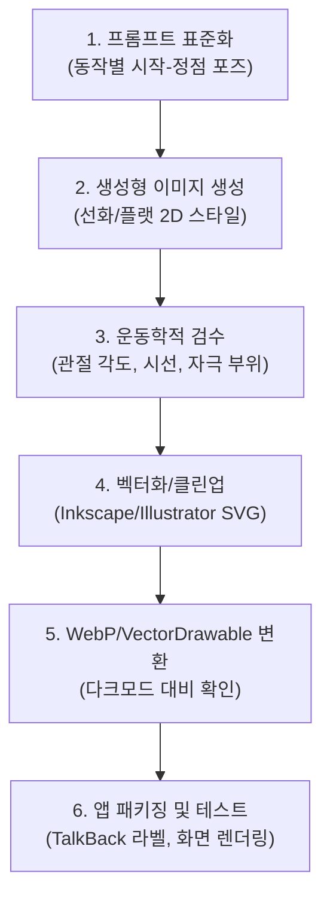

# [PROP-05-HOLD] 홈트레이닝 18종 일러스트 제작 방식 및 에셋 파이프라인

> **상태 (Status)**: `Holding` (별도 검토 및 보류)
> **제안일자 (Date)**: 2026-10-28
> **제안자 (Author)**: Antigravity IDE (Gemini) & User
> **목표 마일스톤 (Target Milestone)**: `v0.7.0` (운동 가이드 모드 도입 시점)
> **관련 문서**: [PROP-05 UI/UX 개선 통합 구현 설계서](../../plans/2026-10-28-ux-improvement-design.md)

---

## 1. 개요 및 목적 (Overview)

### 배경
eundunHealth는 v0.6.0에서 헬스장 장비 없이 집에서 수행할 수 있는 **홈트레이닝 18종 내장 카탈로그**(`HomeExerciseCatalog.kt`)를 도입했습니다.

그러나 현재 홈트레이닝 종목은 다음과 같은 UX 문제가 확인되었습니다:
1. **동작 그림 부재**: 홈트 18종은 시각 자료(`gifUrl = ""`)가 없어 동작 그림이나 시각적 가이드 없이 텍스트 안내만 제공되고 있습니다.
2. **장비 표기 어색함**: 홈트레이닝 장비 메타데이터가 `"없음"`으로 되어 있어, 운동 상세 및 목록 화면에서 `가슴 | 없음`, `등 | 없음`처럼 부위와 장비가 어색하게 결합되어 표시됩니다.

현재 이 작업은 UI/UX 개선 로드맵 상에서 우선순위가 조정되어 본 기획(PROP-05)에서 분리하고 본 `holding` 문서에서 별도로 관리 및 보류합니다. 향후 운동 가이드 모드 고도화 시점에 시각 자료 제작 및 메타데이터 표기 개선(`장비: 맨몸` 또는 장비 칩 생략)을 함께 진행합니다.

### 목표
- **오프라인 완결성**: 네트워크 연결 없이도 즉시 표시되는 앱 번들(Asset/Drawable) 내장.
- **용량 최적화**: 18종 추가로 인한 APK 용량 증가 최소화 (500KB 이하 목표).
- **시각적 일관성**: 성별 중립적이고 간결한 2D 플랫/라인 아트 스타일 통일.
- **메타데이터 UI 정제**: 홈트레이닝의 경우 "가슴 | 없음" 대신 "가슴 | 맨몸" 또는 장비 라벨 생략.

---

## 2. 홈트레이닝 18종 대상 목록

`HomeExerciseCatalog.kt`에 정의된 18종 확정 목록:

| 부위/카테고리 | 슬러그 (`slug`) | 한글 종목명 | 핵심 가이드 포인트 |
|---|---|---|---|
| **Push** (상체 밀기) | `standard-pushup` | 정석 푸시업 | 몸 일직선 유지, 팔꿈치 45도 |
| | `knee-pushup` | 니 푸시업 | 무릎 지지, 허리 꺾임 방지 |
| | `pike-pushup` | 파이크 푸시업 | 엉덩이 V자, 정수리 지면 방향 |
| | `chair-dips` | 체어 딥스 | 소파/의자 지지, 팔꿈치 90도 수직 하강 |
| **Pull** (상체 당기기) | `superman-hold` | 슈퍼맨 홀드 | 상하체 동시 거상, 기립근/둔근 수축 |
| | `ytw-raise` | Y-T-W 레이즈 | Y/T/W 3단계 팔 각도 및 견갑골 모음 |
| | `bird-dog` | 버드독 | 네발기기 교차 신전, 골반 중립 |
| | `reverse-snow-angel` | 리버스 스노우 엔젤 | 엎드려 큰 원 회전, 승모/광배 긴장 |
| **Legs** (하체) | `bodyweight-squat` | 에어 스쿼트 | 대퇴 수평, 무릎-발끝 정렬 |
| | `walking-lunge` | 제자리 런지 | 앞뒤 무릎 90도, 상체 수직 |
| | `glute-bridge` | 글루트 브릿지 | 골반 거상, 둔근 수축, 일직선 정렬 |
| | `standing-calf-raise` | 스탠딩 카프 레이즈 | 뒤꿈치 최대 거상, 비복근 수축 |
| **Core** (복부/코어) | `forearm-plank` | 엘보우 플랭크 | 전완 지탱, 척추 일직선 유지 |
| | `deadbug` | 데드버그 | 허리 지면 밀착, 대각선 팔다리 교차 |
| | `lying-leg-raise` | 레그 레이즈 | 하복부 수축, 허리 뜨지 않게 통제 |
| **Cardio** (유산소/전신) | `mountain-climber` | 마운틴 클라이머 | 푸시업 플랭크 + 빠른 무릎 교차 |
| | `jumping-jacks` | 점핑잭 | 가벼운 도약 + 팔벌려 뛰기 |
| | `skater-hops` | 스케이터 홉스 | 좌우 탄력 도약 + 반대발 후방 지지 |

---

## 3. 제작 방식 비교 및 권장 파이프라인

### 3가지 제작 방식 비교

| 구분 | 방식 1. 순수 수작업 일러스트 외주/제작 | 방식 2. 생성형 AI 초안 + 디자이너 검수/리터칭 (권장) | 방식 3. 오픈소스/상용 스톡 벡터 라이브러리 구매 |
|---|---|---|---|
| **장점** | 스타일 일관성 완벽, 정밀한 운동학적 해부도 보장 | **비용·시간 80% 절감**, 신속한 프로토타이핑 | 즉시 확보 가능, 검증된 품질 |
| **단점** | 제작 비용 높음, 수정 및 추가 시 일정 지연 | AI 해부학적 오류(손가락/관절 왜곡) 수정 필요 | 18종 일치하는 동작 세트 찾기 어려움, 스타일 불일치 |
| **소요 시간** | 3~4주 | **1주 이내** | 1~2일 |
| **적합성** | 리소스 여유 있을 때 | **스타트업/개인 인디 프로젝트에 최적** | 동작 매핑 한계 |

### 권장 파이프라인 (방식 2: AI 생성 초안 + 휴먼 정밀 검수)

1. **프롬프트 템플릿 표준화**:
   - `Minimalist 2D vector flat illustration of an athletic gender-neutral person performing [EXERCISE_NAME], side angle view, clear form, solid outline, primary green accent #006D3C on working muscles, clean transparent background, white background, no clutter.`
2. **2단계 동작 프레임 (Start / Peak)**:
   - 각 종목당 **시작 자세(A)**와 **수축/정점 자세(B)** 2컷을 1장의 가로 분할 카드 또는 2단 일러스트로 구성.
3. **디자이너/인간 검수 필수 체크리스트**:
   - [ ] 허리 꺾임이나 무릎 과신전 등 부상 유발 자세가 없는가?
   - [ ] 특정 성별이나 체형에 치우치지 않고 중립적인가?
   - [ ] 주 자극 부위(주동근)가 은둔헬스 시드 그린(`#006D3C`)으로 명확히 하이라이트되어 있는가?

---

## 4. 기술 사양 및 포맷 규칙

1. **포맷**:
   - 1순위: **Android Vector Drawable (`.xml`)** — 무한 해상도, 파일당 5~15KB, 다크/라이트 색상 테마 동적 바인딩 용이.
   - 2순위 (복잡한 일러스트 시): **Lossless WebP (`.webp`)** — 800×600px 기준 종목당 15~25KB 내외.
2. **용량 상한**:
   - 18종 총합 500KB 이하로 유지 (APK 전체 크기 영향 최소화).
3. **접근성 (A11y)**:
   - 각 일러스트마다 TalkBack을 위한 `contentDescription` 매핑 (예: `"에어 스쿼트 시작 자세: 발을 어깨너비로 벌리고 선 모습, 수축 자세: 허벅지가 지면과 수평이 되도록 앉은 모습"`).

---

## 5. 검토 및 보류 사유 (Holding Rationale)

- 현재 단계는 **기획 단계(Exploring)**이며, v0.6.2(브랜드 기반 확립) 이후 v0.7.0 스프린트 착수 시점에 실제 제작 파이프라인을 가동하는 것이 효율적입니다.
- 일러스트 스타일 가이드(선 굵기, 색상 팔레트)는 v0.6.2에서 확정될 브랜드 토큰(M3 색상 체계)에 종속되므로, v0.6.2 완료 후 제작에 착수합니다.
