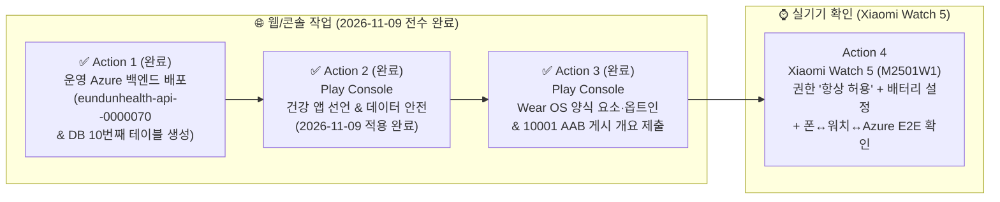

# Wear OS 6 상시 생체·마음 상태 런타임 & 운영 Azure 배포 — 사용자 필수 실행 가이드 (Action Items Runbook)

> **작성일**: 2026-11-09 (KST)
> **대상 기기**: Xiaomi Watch 5 (`모델: M2501W1` / `펌웨어: OS3.0.3.70.WO61WMIXM` / Wear OS 6.0 API 36) + Android 스마트폰 + 운영 Azure (`rg-eundunhealth-prod-krc`)
> **연관 설계 원장**: [`docs/plans/logs/android.md`](../plans/logs/android.md) · [`docs/plans/logs/backend.md`](../plans/logs/backend.md)
> **목적**: 에이전트가 임의로 우회할 수 없는 **개발자(사용자) 고유 권한 작업(GitHub 운영 승인 게이트, Google Play Console 정책 선언/양식 요소 추가, Xiaomi Watch 5 실기기 설정 및 권한 허용)** 을 외부 이동 중/귀가 후 상황에 맞춰 가장 빠르고 정확하게 실행할 수 있도록 단계별 화면 경로와 복사·붙여넣기(Copy-Paste) 템플릿으로 정리한 실행 매뉴얼입니다.

---

## 0. 한눈에 보는 실행 순서 & 현재 위치(외부 vs 귀가 후) 매트릭스

**Action 1 ~ Action 3(GitHub Actions 운영 Azure 배포 승인 및 Google Play Console 게시 개요 제출)은 2026-11-09 전수 완료**되었으며, **Action 4(워치 실기기 확인)는 워치 Play 스토어(내부 테스트) 또는 귀가 후 무선 ADB로 확인**하실 수 있습니다.



| 순서 | 작업 항목 | 수행 장소 / 도구 | 소요 시간 | 진행 상태 / 외부 가능 여부 | 필수 시점 |
| :---: | :--- | :--- | :---: | :---: | :--- |
| **Action 1** | **운영 Azure 백엔드(`/v2/biometrics/*`) 배포 및 `biometric_daily_summaries` 테이블 부트스트랩** | Git Push + GitHub 웹/앱 (`backend-production` 승인) | 완료 | ✅ **완료 (`run 42596583922` → `eundunhealth-api--0000070`, `8968394`)** | 모바일/워치 클라우드 동기화 전 |
| **Action 2** | **Google Play Console `건강 앱` 및 `데이터 안전` 섹션 갱신** | [Google Play Console](https://play.google.com/console) 웹 | 완료 | ✅ **완료 (2026-11-09 적용 및 심사 제출 완료)** | Play 스토어 신규 버전 제출 전 |
| **Action 3** | **Google Play Console `Wear OS` 양식 요소(Form Factor) 추가·옵트인 및 AAB(`10001`) 등록** | [Google Play Console](https://play.google.com/console) 웹 | 완료 | ✅ **완료 (2026-11-09 5개 항목 게시 개요 제출 완료)** | Play 스토어로 워치 앱 배포 시 |
| **Action 4** | **Xiaomi Watch 5 (`M2501W1`) 실기기 설정·권한 허용 및 E2E 동기화 확인** | Xiaomi Watch 5 + 스마트폰 | 약 3분 | ⏳ **운영 배포 완료 — 외부/귀가 후 언제든 가능** | 최종 실기기 검증 시 |

---

## Action 1. ✅ [완료 — 2026-11-09 배포] 운영 Azure (`rg-eundunhealth-prod-krc`) 백엔드 배포 및 DB 스키마 적용 방법 (기록 보존)

> [!TIP]
> **2026-11-09 운영 배포 완료 (`Backend CI/CD` run [`42596583922`](https://github.com/gunnysis/eundunHealth/actions/runs/42596583922))**:
> - **활성 리비전**: `eundunhealth-api--0000070` (트래픽 100%, 이미지 `eundunhealthacr.azurecr.io/eundunhealth-api:8968394`, digest `sha256:3acf47cf54e152a528e3fc0beeebeaeb6bd3f7e4fa1f2d697c562054138bb7e7`)
> - **Reaper Job**: `eundunhealth-reaper` 동일 다이제스트 동기화 완료
> - **DB 부트스트랩 & 사후 검증**: PostgreSQL 18.4(`healthapp`)에 10번째 정규 테이블 `public.biometric_daily_summaries` 자동 생성, `MINIMUM_SUPPORTED_ANDROID_VERSION_CODE=45` 및 `GET /v2/biometrics/daily` 보호 라우트(`401`/`403` `probe-auth-guard-ok`) 검증 통과.

### 1-1. 실행 절차 (Step-by-Step)

1. **변경사항 푸시 (또는 워크플로 수동 실행)**:
   ```powershell
   # 로컬 터미널에서 main 브랜치로 푸시하면 backend/** 변경을 감지해 자동 시작됩니다.
   git push origin main
   ```
   *(또는 수동으로 즉시 배포 워크플로를 트리거하려면 아래 명령을 실행합니다)*:
   ```powershell
   gh workflow run backend.yml --ref main -f deploy=true
   ```

2. **GitHub Actions `backend-production` 환경 승인 게이트 통과 (사용자 필수 클릭)**:
   - **경로**: GitHub 저장소(`gunnysis/eundunHealth`) → 상단 **[Actions]** 탭 → 실행 중인 **`Backend CI/CD`** 워크플로 클릭
   - `build-and-test` 및 `runtime-smoke` Job이 통과하면 `deploy` Job이 **`Waiting for review (backend-production)`** 상태로 대기합니다.
   - 우측 상단 노란색 배너의 **[Review deployments]** 버튼 클릭 → **`backend-production`** 체크 → **[Approve and deploy]** 클릭.

3. **자동 검증 결과 확인 (`verify_containerapp_deployment.py`)**:
   - 승인 후 약 2~3분 뒤 `deploy` Job의 마지막 단계인 **`Verify Container App deployment invariants`** 가 자동으로 다음 항목을 검증하고 초록불(PASS)로 종료되는지 확인합니다:
     - `eundunhealth-api` 리비전 교체 및 `eundunhealth-reaper` Job 이미지 태그 일치
     - `/health` (`200`), `/health/ready` (`200`), `/app-compatibility` (`minimumSupportedVersionCode == 45`)
     - **신규 검증**: `GET /v2/biometrics/daily` 호출 시 `404`가 아닌 **`401`/`403`(라우터 정상 마운트 및 Entra JWT 보호 작동)** 반환 확인

4. **(선택) 운영 DB 10개 정규 테이블 Clean-Slate 하드 리셋 명령**:
   - 운영 DB를 10개 정규 테이블 초기 상태(`01_cleanup_drop_all.sql` → `02_schema_create_all.sql`)로 완전히 새로 밀고 시작하고 싶으실 때는 언제든 아래 1줄 명령을 실행하시면 됩니다:
     ```powershell
     az containerapp exec --name eundunhealth-api --resource-group rg-eundunhealth-prod-krc --command "python scripts/hard_reset_db.py --confirmation DROP_AND_RECREATE_ALL_SCHEMAS --reset-id hard-reset-2026-11-09-wear --image-sha manual --execution-id prod-manual --verify-constraints"
     ```

---

## Action 2. ✅ [완료 — 2026-11-09 적용] Google Play Console — `건강 앱` 및 `데이터 안전` 선언 가이드 (기록 보존)

> [!TIP]
> **2026-11-09 사용자 적용 완료**: Google Play Console `[앱 콘텐츠 > 건강 앱]` 및 `[앱 콘텐츠 > 데이터 안전]` 선언이 아래 기준에 맞춰 적용 완료되었습니다. 향후 재검토·감사 증적을 위해 설정 기준과 원문을 보존합니다.
>
> 모바일 `:app`에는 신규 Health Connect 권한을 추가하지 않았으나(`READ_EXERCISE` 단독 유지), 워치 `:wear` 매니페스트([`wear/src/main/AndroidManifest.xml`](../../wear/src/main/AndroidManifest.xml))에 Wear OS 6 생체 센서 권한(`READ_HEART_RATE`, `READ_HEALTH_DATA_IN_BACKGROUND`, `BODY_SENSORS`, `ACTIVITY_RECOGNITION`)이 포함되고 `/v2/biometrics/*`로 일일 요약이 동기화되므로 Play Console 선언을 함께 갱신해야 심사 거절을 예방할 수 있습니다.

### 2-1. [앱 콘텐츠 > 건강 앱(Health apps)] 설정 방법

1. [Google Play Console](https://play.google.com/console) 접속 → **은둔헬스** 선택 → 좌측 메뉴 하단 **[정책 및 프로그램] > [앱 콘텐츠]** 이동
2. **[건강 앱]** 항목에서 **[관리]** (또는 **[새로 제출]**) 클릭
3. **체크할 카테고리 (O)**:
   - ✅ **활동 및 피트니스 (Activity and fitness)**
   - ✅ **스트레스 관리, 이완, 정신적 민첩성 (Stress management, relaxation, mental acuity)** *(또는 웰니스/자기관리 항목)*
4. **절대 체크하면 안 되는 카테고리 (X — 의료기기 심사 대상 방지)**:
   - ❌ 질병 또는 상태 관리 / 의학적 참고 및 교육 / 의료기기 연결 앱은 **체크하지 마십시오.** (은둔헬스는 비의료 웰니스 앱입니다.)
5. **개별 권한 사용 방법 서술란 복붙용 문구 (필수 입력 항목)**:
   - **① '생체 신호 센서' — `android.permission.BODY_SENSORS` 권한을 사용하는 방법 설명**:
     ```text
     [한국어]
     Wear OS 워치 컴패니언 앱(:wear)에서 사용자의 명시적 동의 하에 AndroidX Health Services(PassiveMonitoringClient 및 MeasureClient)를 통해 워치 착용 중 온디바이스 생체 신호 센서(광학 심박 센서 및 착용 감지 상태)에 접근하는 데 사용합니다. 수집된 센서 신호는 워치 내부에서 안정시 심박수, 심박 구간(4-Zone) 분포, 일상 활동 및 비의료 웰니스 자기관리 참고용 회복 추세 지표를 산출하는 데에만 사용되며, 의학적 진단 용도로 사용되지 않습니다. 원시 분 단위 센서 버킷은 워치 외부로 전송되지 않으며, 사용자는 앱 내 '진행' 및 '프로필' 탭에서 언제든 동기화된 요약 데이터를 단독 삭제하거나 권한을 철회할 수 있습니다.

     [English]
     Used in our Wear OS companion app (:wear) with explicit user consent to access on-device body sensors (optical heart rate sensor and off-body detection state) via AndroidX Health Services (PassiveMonitoringClient and MeasureClient). Sensor signals are processed on-device solely to calculate resting heart rate, 4-zone time distribution, and daily wellness/self-care recovery trend summaries in the app's Progress tab, and are never used for medical diagnosis. Raw minute-level buckets never leave the watch, and users can independently delete synced summaries at any time inside the app.
     ```
     *(글자 수 제한이 500자 이하로 짧을 때 — 한국어 단독 요약본)*:
     ```text
     Wear OS 워치 컴패니언 앱(:wear)에서 사용자의 명시적 동의 하에 AndroidX Health Services(PassiveMonitoringClient 및 MeasureClient)로 워치 착용 여부 및 온디바이스 광학 심박 센서에 접근하기 위해 사용합니다. 측정된 신호는 앱 내 '진행' 탭에서 비의료 웰니스 및 자기관리 참고용 일일 심박 구간 분포와 회복 추세 요약을 제공하는 데만 사용되며, 의학적 진단에 사용되지 않습니다. 원시 분 단위 데이터는 워치 외부로 나가지 않으며 사용자는 앱 내에서 언제든 요약 기록을 즉시 삭제할 수 있습니다.
     ```

   - **② '심박수' — `android.permission.health.READ_HEART_RATE` 권한을 사용하는 방법 설명**:
     ```text
     [한국어]
     Wear OS 6(API 36+)의 세분화된 건강 권한 체계에 따라, 워치 컴패니언 앱(:wear)에서 AndroidX Health Services(DataType.HEART_RATE_BPM)를 통해 실시간 심박수(MeasureClient) 및 착용 중 백그라운드 심박수 추세(PassiveMonitoringClient)를 읽어오기 위해 사용합니다. 읽어들인 심박수(BPM)는 워치 대시보드와 스마트폰 앱의 '진행' 탭에서 사용자의 일일 안정시 심박수(P20), 4단계 심박 구간 시간 분포, 급격한 심박 변화 횟수, 활동 후 심박 회복(HRR) 등 비의료 피트니스·마음 긴장 관리 지표를 시각화하는 데 사용됩니다. 제3자와 공유하거나 광고 목적으로 사용하지 않으며, 사용자는 앱 내에서 언제든 워치 생체 요약 기록을 단독 삭제(DELETE /v2/biometrics/daily)할 수 있습니다.

     [English]
     Required on Wear OS 6 (API 36+) granular health permissions to read real-time heart rate (MeasureClient) and continuous heart rate trends (PassiveMonitoringClient, DataType.HEART_RATE_BPM) on our Wear OS companion app (:wear). Heart rate BPM data is used exclusively to display non-medical fitness and stress/tension self-care metrics—such as resting BPM, 4-zone heart rate distribution, rapid delta spikes, and post-activity heart rate recovery (HRR)—on the watch dashboard and the phone app's Progress tab. Data is never shared with third parties or used for advertising, and users can delete all synced summaries at any time in the app.
     ```
     *(글자 수 제한이 500자 이하로 짧을 때 — 한국어 단독 요약본)*:
     ```text
     Wear OS 6(API 36+)의 세분화된 건강 권한 정책에 따라 워치 컴패니언 앱(:wear)에서 AndroidX Health Services(DataType.HEART_RATE_BPM)로 실시간 심박수 및 착용 중 심박 추세를 읽기 위해 사용합니다. 측정된 심박수(BPM)는 워치 화면과 스마트폰 앱 '진행' 탭에서 안정시 심박수, 4단계 심박 구간 시간 분포, 활동 후 심박 회복(HRR), 일일 마음 긴장·회복 점수 등 비의료 피트니스 및 웰니스 자기관리를 시각화하는 데만 사용되며, 앱 내에서 언제든 기록을 삭제할 수 있습니다.
     ```

   - **③ '백그라운드의 건강 데이터' — `android.permission.health.READ_HEALTH_DATA_IN_BACKGROUND` 권한을 사용하는 방법 설명**:
     ```text
     [한국어]
     사용자가 워치 화면을 켜두지 않은 일상·휴식·수면 착용 중에도 AndroidX Health Services의 PassiveMonitoringClient(EundunPassiveListenerService)를 통해 백그라운드에서 심박수 및 걸음·칼로리 변화 배치를 끊김 없이 수신하기 위해 사용합니다. 포그라운드 측정만으로는 하루 전체의 적응형 안정시 심박수(P20), 전 구간 4단계 심박 분포(이완·일상·긴장 주의·고부하), 활동 후 심박 회복(HRR), 수면 중 심박 안정도 및 일일 자율신경 회복 점수(0~100점)를 산출할 수 없으므로 백그라운드 건강 데이터 읽기가 필수적입니다. 모든 원시 분 단위 버킷은 워치 내부에서만 집계되며, 사용자는 언제든 권한을 변경하거나 앱 내에서 동기화된 일일 요약 데이터를 즉시 삭제할 수 있습니다.

     [English]
     Used in our Wear OS companion app (:wear) to continuously receive batched heart rate, step, and calorie updates in the background via AndroidX Health Services PassiveMonitoringClient (EundunPassiveListenerService) while the user wears the watch during daily routines, rest, and sleep with the screen off. Foreground-only reading cannot compute full-day adaptive resting heart rate (P20), 4-zone heart rate time distribution, post-activity heart rate recovery (HRR), sleep heart rate stability, or the daily recovery score (0-100) shown in the Progress tab. Raw minute-level buckets remain on the watch, and users can revoke this permission or delete synced summaries at any time inside the app.
     ```
     *(글자 수 제한이 500자 이하로 짧을 때 — 한국어 단독 요약본)*:
     ```text
     사용자가 워치 화면을 켜두지 않은 일상·휴식·수면 착용 중에도 AndroidX Health Services(PassiveMonitoringClient / EundunPassiveListenerService)로 백그라운드 심박·활동 배치를 수신하기 위해 사용합니다. 포그라운드 측정만으로는 하루 전체의 안정시 심박수(P20), 4단계 심박 구간 시간 분포, 활동 후 심박 회복(HRR), 일일 회복 점수(0~100점) 리포트를 산출할 수 없어 백그라운드 읽기가 필수적이며, 사용자는 앱 내에서 언제든 요약 기록을 삭제할 수 있습니다.
     ```

   - **④ '활동 감지' — `android.permission.ACTIVITY_RECOGNITION` 권한을 사용하는 방법 설명**:
     ```text
     [한국어]
     Wear OS 워치 컴패니언 앱(:wear)에서 사용자의 명시적 동의 하에 AndroidX Health Services(PassiveMonitoringClient)로부터 일일 걸음 수(DataType.STEPS_DAILY), 활동 칼로리(DataType.CALORIES_DAILY) 및 착용 중 활동 맥락(UserActivityState: 휴식·일상 이동·운동·수면 상태)을 감지하기 위해 사용합니다. 활동 맥락을 함께 인식해야 운동 중 자연스러운 심박 상승을 마음 긴장(스트레스) 에피소드로 오탐하지 않고, 활동 종료 후 심박 회복 속도(HRR)와 일일 활동량 요약을 정확하게 산출할 수 있습니다. 사용자는 언제든 권한을 철회하거나 앱 내에서 동기화된 요약 기록을 즉시 삭제할 수 있습니다.

     [English]
     Used in our Wear OS companion app (:wear) with explicit user consent to detect daily steps (DataType.STEPS_DAILY), active calories (DataType.CALORIES_DAILY), and user activity states (UserActivityState: rest, passive movement, exercise, and sleep) via AndroidX Health Services PassiveMonitoringClient. Recognizing activity context prevents natural exercise-induced heart rate elevation from being misclassified as stress/tension episodes and enables accurate calculation of post-activity heart rate recovery (HRR) and daily activity summaries. Users can revoke this permission or delete synced summaries at any time inside the app.
     ```
     *(글자 수 제한이 500자 이하로 짧을 때 — 한국어 단독 요약본)*:
     ```text
     워치 컴패니언 앱(:wear)에서 AndroidX Health Services로 일일 걸음 수(STEPS_DAILY)와 착용 중 활동 맥락(휴식·이동·운동·수면 상태)을 감지하기 위해 사용합니다. 이를 통해 운동 중 자연스러운 심박 상승을 스트레스/긴장 상태로 오탐하지 않고 활동 후 심박 회복(HRR)과 일일 활동 요약을 정확히 산출하며, 사용자는 앱 내에서 언제든 요약 기록을 삭제할 수 있습니다.
     ```

   - **⑤ '운동' — `android.permission.health.READ_EXERCISE` 권한을 사용하는 방법 설명**:
     ```text
     [한국어]
     스마트폰 앱(:app)에서 사용자의 명시적 동의 하에 Android Health Connect에 기록된 운동 세션(ExerciseSessionRecord) 이력을 읽어오기 위해 사용합니다. 읽어온 운동 세션 기록은 앱 내 '홈', '진행(기록·통계)' 화면에서 사용자의 일일 홈트레이닝 루틴 달성 여부, 주간 운동 시간·칼로리 통계 및 연속 달성 배지 현황을 통합 표시하는 데에만 사용됩니다. 데이터는 제3자에게 공유되거나 광고 목적으로 사용되지 않으며, 사용자는 언제든 Health Connect 연동을 해제하거나 앱 내 기록을 삭제할 수 있습니다.

     [English]
     Used in the mobile app (:app) with explicit user consent to read exercise session records (ExerciseSessionRecord) from Android Health Connect. Exercise history is used solely to display daily home-workout routine completion, weekly workout duration/calorie statistics, and streak badge progress on the Home and Progress (History/Statistics) screens. Data is never shared with third parties or used for advertising, and users can disconnect Health Connect or delete their records at any time.
     ```
     *(글자 수 제한이 500자 이하로 짧을 때 — 한국어 단독 요약본)*:
     ```text
     스마트폰 앱(:app)에서 사용자의 명시적 동의 하에 Android Health Connect의 운동 세션(ExerciseSessionRecord) 이력을 읽어와 앱 내 홈·기록·통계 화면에서 일일 홈트레이닝 달성 여부와 주간 운동 통계를 통합 표시하기 위해 사용합니다. 제3자 공유나 광고에 사용되지 않으며 언제든 연동을 해제하거나 삭제할 수 있습니다.
     ```

   - **⑥ '단계(걸음 수)' — `android.permission.health.READ_STEPS` 권한을 사용하는 방법 설명**:
     > 💡 *(참고: 과거 Play Console 버전 이력 또는 Health Connect/Wear 건강 권한 설문 항목으로 인해 `READ_STEPS` 설명란이 함께 표시되는 경우 아래 문구를 그대로 입력하시면 됩니다.)*
     ```text
     [한국어]
     사용자의 명시적 동의 하에 일일 걸음 수(Steps) 데이터를 읽어와 앱 내 '진행' 및 일일 활동 요약 카드에서 사용자의 하루 신체 활동량(총 걸음 수)과 심박·활동 회복 추세를 함께 표시하기 위해 사용합니다. 걸음 수 데이터는 비의료 피트니스 및 일상 활동량 확인 목적으로만 사용되며, 제3자에게 공유하거나 광고에 사용하지 않고 사용자가 앱 내에서 언제든 동기화된 요약 기록을 단독 삭제할 수 있습니다.

     [English]
     Used with explicit user consent to read daily step count data so the app can display daily physical activity volume (total steps) alongside heart rate and recovery trend summaries in the Progress tab. Step data is used strictly for non-medical fitness and daily activity tracking, is never shared with third parties or used for advertising, and can be deleted by the user at any time inside the app.
     ```
     *(글자 수 제한이 500자 이하로 짧을 때 — 한국어 단독 요약본)*:
     ```text
     사용자의 명시적 동의 하에 일일 걸음 수 데이터를 읽어와 앱 내 '진행' 탭의 일일 활동 요약 카드에서 하루 총 걸음 수와 신체 활동 추세를 표시하기 위해 사용합니다. 비의료 피트니스 확인 목적으로만 사용되며 사용자가 앱 내에서 언제든 기록을 삭제할 수 있습니다.
     ```

### 2-2. [앱 콘텐츠 > 데이터 안전(Data safety)] 설정 방법

1. 좌측 메뉴 **[정책 및 프로그램] > [앱 콘텐츠] > [데이터 안전]** → **[관리]** 클릭
2. **[데이터 수집 및 보안]** 질문:
   - 모든 사용자 데이터를 암호화하여 전송하나요? → **예** (HTTPS TLS 1.2+ 및 Wearable Data Layer 암호화 채널)
   - 사용자가 데이터 삭제를 요청할 수 있는 방법을 제공하나요? → **예**
     - **삭제 안내 URL**: `https://eundunhealth-api.livelyriver-782a792f.koreacentral.azurecontainerapps.io/account-deletion` (이미 [`docs/store/account-deletion.md`](../store/account-deletion.md)에 생체 요약 단독 삭제 `DELETE /v2/biometrics/daily` 및 계정 탈퇴 시 영구 파기가 반영되어 있습니다.)
3. **[데이터 유형] > [건강 및 피트니스]** 섹션에서:
   - ✅ **건강 정보 (Health info)** 및 ✅ **피트니스 정보 (Fitness info)** 체크
4. **세부 질문 응답 표 (그대로 선택)**:

| 질문 항목 | 선택할 답변 | 근거 |
| :--- | :--- | :--- |
| 이 데이터를 **수집(Collected)** 하나요, **공유(Shared)** 하나요? | **수집함(Collected)** 체크 / **공유함(Shared)** 체크 해제 | 제3자에게 판매·공유하지 않고 사용자 본인의 멀티디바이스 복원 용도로만 운영 Azure DB에 암호화 저장 |
| 이 데이터가 **일시적으로(Ephemerally)** 처리되나요? | **아니요** | 사용자가 삭제하기 전까지 일일 요약 테이블(`biometric_daily_summaries`)에 보관됨 |
| 데이터 수집이 **필수(Required)** 인가요, **선택(Optional)** 인가요? | **선택(사용자가 제어 가능)** | 워치 권한을 거부하거나 앱 내 `워치 기록 삭제` 버튼으로 언제든 단독 파기 가능 |
| 왜 이 데이터를 수집하나요? (용도) | **앱 기능(App functionality)** 단독 체크 | 광고/마케팅/개인화 추천에 사용하지 않음 |

5. **심사관 참고 메모( 또는 설명란) 복붙용 문구**:
   ```text
   [한국어]
   본 앱의 Wear OS 워치 컴패니언 앱(:wear)은 사용자의 명시적 권한 동의 하에 착용 중 심박수(READ_HEART_RATE / BODY_SENSORS) 및 신체 활동(ACTIVITY_RECOGNITION)을 측정하여 일일 활동·마음 긴장·자율신경 회복 추세 요약 지표를 제공합니다. 모든 지표는 비의료 웰니스 및 자기관리 참고 목적이며 의학적 진단에 사용되지 않습니다. 원시 분 단위 버킷은 워치 외부로 전송되지 않으며, 사용자는 앱 내 프로필/진행 탭에서 언제든 생체 요약 데이터만 단독으로 즉시 삭제(DELETE /v2/biometrics/daily)하거나 계정 탈퇴(DELETE /account)를 통해 전체 데이터를 영구 파기할 수 있습니다.

   [English]
   Our Wear OS companion app (:wear) measures heart rate (READ_HEART_RATE / BODY_SENSORS) and physical activity (ACTIVITY_RECOGNITION) with explicit user consent to provide daily wellness, mind-tension, and recovery trend summaries. All metrics are strictly for non-medical wellness and self-care reference, not for medical diagnosis. Raw minute-level buckets never leave the watch, and users can independently delete all synced biometric summaries at any time inside the app (DELETE /v2/biometrics/daily) or permanently purge all data via account deletion (DELETE /account).
   ```

---

## Action 3. ✅ [완료 — 2026-11-09 적용] Google Play Console — `Wear OS` 양식 요소(Form Factor) 추가·옵트인 및 AAB(`10001`) 배포

> [!TIP]
> **2026-11-09 Play Console `[게시 개요]` 5대 항목 등록 및 심사 제출 완료**:
> 1. `기본 스토어 등록정보 — Wear OS 스크린샷 변경` ✅
> 2. `앱 콘텐츠 > 데이터 보안 — 데이터 보안 설문지 작성` ✅
> 3. `앱 콘텐츠 > 건강 앱 — 건강 앱 선언 완료` ✅
> 4. `고급 설정 > 폼 팩터 — 고급 설정에서 Wear OS by Google 폼 팩터가 선택으로 설정되었습니다.` ✅
> 5. `고급 설정 > 폼 팩터 — Wear OS의 전용 출시 트랙 사용 시작` (`wearVersionCode = 10001`) ✅
>
> 위 5개 항목이 `[게시 개요]`를 통해 최종 제출 완료되었습니다. 향후 재검토 및 감사 증적을 위해 절차와 설정 원문을 보존합니다.

### 3-1. Play Console에서 Wear OS 양식 요소 활성화 (최초 1회 — 최신 Play Console UI 기준)

1. [Google Play Console](https://play.google.com/console) → **은둔헬스** → 좌측 메뉴 **[테스트 및 출시] > [설정] > [고급 설정]** 이동
2. 상단 탭 중 **[양식 요소 (Form factors)]** 클릭 → 우측 **[+ 양식 요소 추가]** 버튼 클릭 → **[Wear OS]** 선택
3. **스토어 등록정보에 Wear OS 스크린샷 추가 & `AI 애셋 선언` 선택 방법**:
   - Wear OS 체크리스트에서 **[스토어 등록정보에 Wear OS 스크린샷 추가]** 를 누르면 **[기본 스토어 등록정보]** 화면으로 이동합니다.
   - **Wear OS 스크린샷 요건**: 최소 1장 이상, `1:1` 정사각형 비율(최소 `384×384px`), 투명 배경이나 시계 테두리 프레임이 없는 순수 화면 캡처(`wear/build/reports/emulator-smoke-scrolled.png` 등).
   - **⚠️ 화면 하단 `AI 애셋 선언` 항목이 나올 때 선택할 값**:
     - 반드시 첫 번째 항목인 **`🔘 애셋 라벨 지정 안함`** 을 선택합니다.
     - *(이유: 업로드하는 Wear OS 스크린샷은 AI 이미지 생성기로 만든 가짜 그림이 아니라 실제 Wear Compose 앱 UI를 캡처한 화면이므로 라벨 지정 대상이 아닙니다.)*
   - 우측 하단 **[저장]** 버튼을 눌러 스토어 등록정보를 저장합니다.
4. **なぜ(왜) '옵트인' 항목이 안 보였는가 & 확인 위치**:
   - `AI 애셋 선언`이 보이는 화면은 **[기본 스토어 등록정보]** 페이지이기 때문에 여기에는 옵트인 버튼이 없습니다.
   - 우측 하단 **[저장]** 을 누른 뒤, 다시 좌측 메뉴 **[테스트 및 출시] > [설정] > [고급 설정] > 상단 [양식 요소 (Form factors)] 탭**으로 돌아갑니다.
   - `Wear OS` 항목의 체크리스트 상태를 확인합니다:
     - 최신 Play Console UI에서는 ① Wear OS 스크린샷 등록과 ② Wear OS 트랙에 첫 AAB 업로드(아래 3-2)까지 마쳐야 최종 활성화/옵트인 버튼이 열리거나, 이미 `+ 양식 요소 추가 > Wear OS` 단계에서 자동 편입되어 별도 옵트인 체크박스 없이 바로 트랙 생성이 가능합니다.

### 3-2. `내부 테스트`(또는 `프로덕션`)에 Wear OS 새 버전 만들기 → 양식 요소 `옵트인` 활성화 순서 (★핵심)

> [!IMPORTANT]
> **왜 지금 `내부 테스트 > 새 버전 만들기`를 먼저 해야 하나요?**
> Google Play Console의 `[고급 설정 > 양식 요소 > Wear OS]`에서 마지막 단계인 **'Wear OS 배포 옵트인(약관 동의)' 버튼은 Wear OS 트랙(`내부 테스트` 또는 `프로덕션`)에 첫 `wear-release.aab`가 업로드되어 버전이 생성되어야만 활성화(잠금 해제)** 됩니다.
> 또한 첫 Wear OS 프로덕션 출시는 Google의 Wear OS 앱 품질 심사에 1~3일이 걸릴 수 있으므로, **`내부 테스트`의 `Wear OS 전용` 트랙에 먼저 새 버전을 만들면 ① 즉시 양식 요소 옵트인이 열리고, ② 심사 대기 없이 몇 분 만에 본인 Xiaomi Watch 5에서 바로 스토어 설치가 가능**합니다.

1. **서명된 최신 워치 Release AAB 파일 경로 (`wearVersionCode = 10001`)**:
   - 이미 업로드 키(`.key/eundunhealth_upload_key`)로 서명된 최신 번들이 아래 경로에 빌드되어 준비되어 있습니다:
     ```text
     C:\programming\apps\eundunHealth\wear\build\outputs\bundle\release\wear-release.aab
     ```
2. **Step A — `[내부 테스트]`의 `Wear OS 전용` 트랙에 새 버전 만들기**:
   - Play Console 좌측 메뉴 **[테스트 및 출시] > [테스트] > [내부 테스트]** 클릭
   - 화면 우측 상단(또는 트랙 제목 옆)의 **기기 유형(양식 요소) 드롭다운**(`휴대전화, 태블릿, ChromeOS`로 되어 있는 곳)을 클릭하여 **`⌚ Wear OS 전용 (Wear OS only)`** 으로 변경합니다.
   - **[트랙 만들기]** (이미 트랙이 있으면 **[새 버전 만들기]**) 버튼 클릭
   - **Play 앱 서명**: 안내가 뜨면 기존 앱과 동일한 키를 사용하므로 기본값 그대로 진행
   - **App Bundle 업로드**: 위 경로의 **`wear-release.aab`** (`버전 코드 10001 (0.7.3)`) 파일을 드래그 앤 드롭으로 업로드합니다.
   - **💡 `'네이티브 코드를 포함하며 아직 디버그 기호가 업로드되지 않았습니다'` 노란색 경고 메시지가 뜰 때 → 그대로 무시하고 진행 (정상)**:
     - **원인**: 우리 `:wear` 앱은 C/C++(NDK)를 직접 쓰지 않지만, Google 공식 Compose 라이브러리(`androidx.graphics:graphics-path`) 내부에 프리빌트 `libandroidx.graphics.path.so` 파일 1개가 포함되어 있습니다. Google Maven에서 배포될 때부터 심볼이 제거(strip)된 라이브러리라 Play Console이 자동 안내 경고를 띄우는 것입니다.
     - **안심하고 진행 가능한 이유**: 우리 Kotlin/Compose 코드의 R8 난독화 기호(`proguard.map` / `mapping.txt`)는 `wear-release.aab` 내부(`BUNDLE-METADATA`)에 이미 자동 포함되어 업로드되었으므로 크래시 분석에 아무런 지장이 없으며, 출시 차단 사유도 아닙니다.
   - **출시명 / 출시 노트**: 기본값(`10001 (0.7.3)`) 유지 → 우측 하단 **[다음]** → **[저장]** (또는 **[내부 테스트 트랙 출시]**) 클릭
   - *(참고: `[테스터]` 탭에서 본인 구글 계정이 체크된 테스터 목록이 선택되어 있는지 확인합니다.)*
3. **Step B — 다시 `[고급 설정 > 양식 요소]`로 돌아가 `Wear OS 옵트인` 완료**:
   - 좌측 메뉴 **[테스트 및 출시] > [설정] > [고급 설정]** → 상단 **[양식 요소 (Form factors)]** 탭 클릭
   - **`Wear OS`** 섹션을 펼치면 이제 모든 선행 조건(① 스크린샷 저장 완료 + ② Wear OS App Bundle 업로드 완료)이 충족되어 **마지막 `Wear OS 배포 옵트인(Opt-in)` 동의 버튼이 활성화**되어 있습니다.
   - 약관 동의 체크 후 **[저장]** 클릭!
4. **Step C — (선택) `[게시 개요]` 확인**:
   - Action 2(`건강 앱`·`데이터 안전`)와 Action 3(`스토어 등록정보 스크린샷`·`양식 요소`) 변경사항이 좌측 메뉴 상단 **[게시 개요 (Publishing overview)]** 에 모여 있다면 **[검토를 위해 변경사항 전송]** (또는 자동 게시)을 눌러 반영을 확정합니다.

---

## Action 4. Xiaomi Watch 5 (`M2501W1`, `OS3.0.3.70.WO61WMIXM`) 실기기 설정 및 검증 매뉴얼

> [!TIP]
> **외부에 계실 때**: Action 1 ~ 3을 통해 Play 스토어(내부 테스트 또는 프로덕션)에 배포하시면 케이블/PC 없이 **워치의 Google Play 스토어에서 바로 설치**하여 아래 4-2 ~ 4-4를 확인하실 수 있습니다.
> **귀가 후 PC 앞에서 확인하실 때**: 4-1의 무선 ADB 명령으로 30초 만에 설치 가능합니다.

### 4-1. (귀가 후 로컬 테스트 시) Xiaomi Watch 5 무선 ADB 설치 방법

1. **워치 개발자 옵션 및 무선 디버깅 켜기**:
   - 워치 `설정(⚙️) > 시스템 > 정보 > 버전` → **빌드 번호(`OS3.0.3.70.WO61WMIXM`)를 연속 7회 터치**하여 개발자 옵션 활성화
   - 워치 `설정(⚙️) > 개발자 옵션` 진입 → **`ADB 디버깅`** 켜기 → **`무선 디버깅`** 켜기 (같은 Wi-Fi 연결 필수)
2. **PC 터미널(`pwsh`)에서 페어링 및 설치**:
   ```powershell
   # 1) 워치 '무선 디버깅 > 새 기기 페어링' 화면에 뜬 IP:포트와 6자리 코드로 페어링 (최초 1회)
   adb pair <워치_IP>:<페어링_포트> <6자리_페어링_코드>

   # 2) 워치 '무선 디버깅' 메인 화면에 표시된 IP:포트로 연결
   adb connect <워치_IP>:<연결_포트>

   # 3) 워치 및 모바일 최신 디버그 APK 설치
   .\gradlew.bat :wear:assembleDebug :app:assembleDebug
   adb -s <워치_IP>:<연결_포트> install -r wear/build/outputs/apk/debug/wear-debug.apk
   ```

### 4-2. Xiaomi Watch 5 필수 권한 & 하이브리드 칩셋(`W5 Gen 1 + BES2800BP`) 배터리 설정 (★가장 중요)

Xiaomi Watch 5는 고성능 `Snapdragon W5 Gen 1`(Wear OS 6 구동)과 초저전력 `BES2800BP`(RTOS 코프로세서) 듀얼 아키텍처를 사용합니다. **착용 중 모든 상태(`PASSIVE` + `EXERCISE` + `ASLEEP` + `UNKNOWN`)에서 끊김 없이 24/7 측정**되려면 아래 3가지를 워치에서 반드시 설정해 주세요.

| 단계 | 워치 내 설정 경로 | 권장 설정값 | 미설정 시 증상 및 기술적 이유 |
| :---: | :--- | :--- | :--- |
| **①** | 워치에서 **은둔헬스** 앱 최초 실행 시 권한 팝업<br>*(또는 `설정 > 앱 > 앱 정보 > 은둔헬스 > 권한`)* | • **센서 / 심박수**: **`항상 허용 (Allow all the time)`**<br>• **신체 활동**: **`허용 (Allow)`** | `'앱 사용 중에만 허용'`을 선택하면 화면이 꺼졌을 때 `EundunPassiveListenerService` 백그라운드 콜백과 `PassiveGoal`(100 BPM 급등 웨이크업)이 차단됩니다. |
| **②** | 워치 `설정(⚙️) > 앱 > 앱 정보 > 은둔헬스 > 배터리(또는 백그라운드 활동)` | **`제한 없음 (Unrestricted)`** / 백그라운드 활동 허용 | 샤오미 펌웨어(`WO61WMIXM`)가 절전을 위해 백그라운드 바인딩을 동결하는 것을 방지합니다. |
| **③** | 워치 `설정(⚙️) > 배터리` 및 **샤오미 기본 심박수 앱 설정** | • 워치 **초절전 모드(배터리 절약 모드) 해제**<br>• 기본 심박 앱 **상시 심박 측정(Continuous HR) ON** | 초절전 모드 진입 시 Wear OS 6 프로세서(`W5 Gen 1`)가 꺼지고 RTOS만 남으므로 서드파티 서비스가 중지됩니다. 또한 기본 상시 심박을 켜두면 하드웨어 PPG 센서가 1분 주기로 활성화되어 은둔헬스 `PassiveMonitoringClient` 버킷 밀도가 극대화됩니다. |

### 4-3. 3분 만에 끝내는 실기기 End-to-End 검증 체크리스트

위 설정을 마친 뒤 아래 4단계를 순서대로 눌러보시면 **워치 센서 → 워치 5차원 분석기 → Data Layer(GZIP+SHA-256) → 모바일 Room v4 → 운영 Azure PostgreSQL 18(`biometric_daily_summaries`)** 전 구간을 즉시 검증하실 수 있습니다.

- [ ] **Step 1 (워치 실시간 측정 & 착용 맥락 확인)**:
  - 워치에서 은둔헬스 앱을 열면 상단 **상시 마음·생체 분석** 카드에 `실시간 심박 (MeasureClient)` BPM 숫자와 현재 착용 맥락 배지(`휴식·안정 구간` / `일상·이동 구간` / `운동·고부하 구간` / `수면 구간`) 및 오늘의 **자율신경 회복 점수(`0~100점`)** 가 표시되는지 확인합니다.
- [ ] **Step 2 (워치 → 스마트폰 즉시 전송 확인)**:
  - 워치 화면을 아래로 스크롤하여 **`지금 폰으로 동기화`** 버튼을 탭합니다.
  - 코프로세서 버퍼 강제 플러시(`flushAsync()`) 후 **`폰으로 전송 완료 (1건)`** 안내 문구와 함께 `폰 동기화 완료` 상태로 바뀌는지 확인합니다.
- [ ] **Step 3 (스마트폰 `진행` 탭 5차원 리포트 카드 확인)**:
  - 스마트폰 은둔헬스 앱의 하단 탭 중 **`진행`** 탭으로 이동합니다.
  - 상단에 **`워치 상시 생체 · 마음 상태 분석`** 카드가 나타나며, **회복 점수 배지 · 전 구간 4-Zone 시간 분포 컬러 바(`이완`/`일상`/`긴장 주의`/`고부하`) · 급상승 스파이크 횟수 · 지속 긴장 시간 · 운동 후 회복(HRR) · 수면 각성** 지표가 워치와 일치하는지 확인합니다.
- [ ] **Step 4 (스마트폰 `프로필` 탭 원격 동기화 & 단독 삭제 제어 확인)**:
  - 스마트폰 **`프로필`** 탭(또는 `진행` 탭 카드 하단)에서 **`워치 지금 동기화`** 버튼을 탭했을 때 연결된 워치 노드를 깨워 최신 데이터를 가져오고 운영 Azure(`/v2/biometrics/sync`)로 업로드하는지 확인합니다.
  - (선택) `워치 기록 삭제` 버튼을 눌러 확인 다이얼로그에서 삭제 시 모바일 로컬 DB와 운영 Azure `biometric_daily_summaries` 테이블에서 즉시 삭제(`DELETE /v2/biometrics/daily`)되는지 확인합니다.
